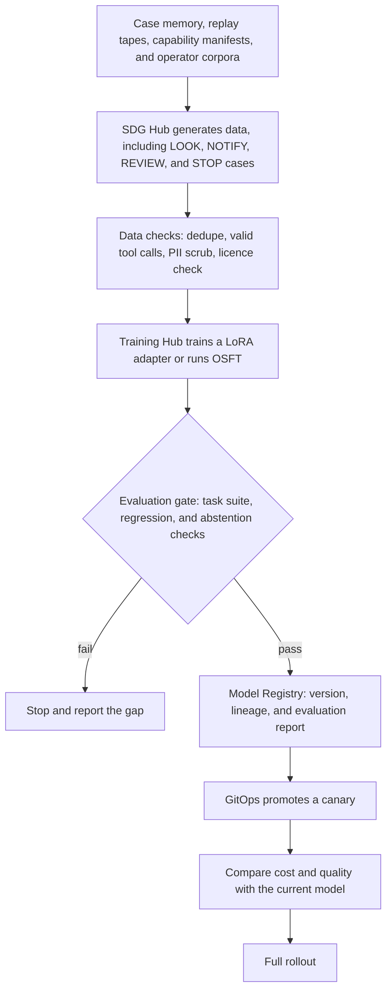
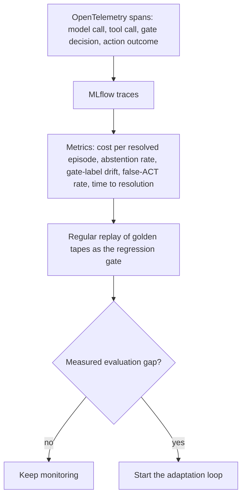

# Adaptation ladder

## At a glance

| Field | Value |
|---|---|
| Question answered | How far should an operator customise an OTel model, and when should they go further? |
| Answer | Start with retrieval, then skills and capability manifests, then LoRA, then OSFT, and climb only when evaluation shows the current rung falls short |
| Audience | Architects, platform engineers, and model owners |
| OTel slots | LLM, Decision, Classification, Embedding, Reranker |
| Platform blueprints | PB-02, PB-03, PB-09 |

## The question

How far should an operator customise an OTel model for its own network, and when is the next step worth its cost?
Without a rule, teams fine-tune first, then retrain every adapter each time a new OTel base model ships.

## The principle

Start at retrieval. Climb one rung only when a measured evaluation gap on the operator's task suite shows the current rung is not enough.
Each rung up costs more to build and more to redo when the base model changes, so the evaluation result, not a preference, decides the climb.

## The design

| Component role | Red Hat product used |
|---|---|
| Knowledge service: holds operator corpora for retrieval | Vector store with the OTel Embedding and Reranker slots on Red Hat AI Inference (vLLM) |
| Data generation: turns tools, tapes, and documents into training data | SDG Hub |
| Training: trains LoRA adapters and runs OSFT | Training Hub |
| Evaluation gate: blocks any promotion that fails the task suite | EvalHub in Red Hat OpenShift AI |
| Versioning: binds each adapter to its base revision and evaluation report | Model Registry in Red Hat OpenShift AI |
| Tracing: records each step, its cost, and the gate labels | OpenTelemetry and MLflow |

Any component can be replaced. The Red Hat products named here show one way to build this design.

### Rungs

| Rung | What changes | Climb when | Cost when the base model changes |
|---|---|---|---|
| Retrieval | Operator corpora sit behind the knowledge service; no weights change | Start here | Re-index only if the embedding model changes |
| Skills and capability manifests | One SKILL.md procedure per role and one manifest per MCP capability | Retrieval holds the facts, but the agent picks the wrong procedure or tool | Rerun the task suite; skills and manifests carry over |
| LoRA | An adapter trained with Training Hub on SDG Hub data, bound to one exact base revision | Skills and manifests are in place, and the suite still shows gaps in vocabulary, tool calls, or output format | Retrain and re-evaluate every adapter for each new base revision |
| OSFT | A full fine-tune that absorbs a large proprietary corpus, served from a dedicated pool | A LoRA adapter cannot close the gap, and the operator has a large corpus and the budget for its own pool | Retrain and re-evaluate the full model for each new base revision |

### Capability manifests

Manifests follow the 401 skills and capabilities course in the [agent-school roadmap](https://github.com/open-experiments/agent-school/blob/main/docs/RoadMap.md). Each MCP capability gets one manifest with six fields: backend pattern, I/O schema, risk class, allowed identities, rate class, and data class. The risk class sets the ceiling the [decision gate](decision-gate.md) applies, and the same manifest drives the tool gateway's access and rate policies.

### Flow: adaptation loop

### Flow: continuous evaluation

## Trade-offs and limits

| Trade-off | What to do |
|---|---|
| A LoRA adapter does not carry across base versions: it may load on a new base, but its behavior changes without warning | Pin each adapter to its base revision in the Model Registry, and retrain and re-evaluate it for every new base |
| An embedding model change forces a full re-index of every vector store built with it | Version each index with its embedding model, and re-index before you switch |
| OSFT gives each operator its own full model, with no base sharing | Use it only when a LoRA adapter cannot close a measured gap |
| Training data that always ends in a change teaches the model to act | Generate LOOK, NOTIFY, REVIEW, and STOP cases as well as ACT cases |

## Used by

- PB-02, PB-03, PB-09: evaluation, adaptation, and lifecycle build on this ladder
- [Decision gate](decision-gate.md): the risk class from each manifest sets its ceiling
- [Architecture overview](index.md): layers L9a to L9c, where these flows run
