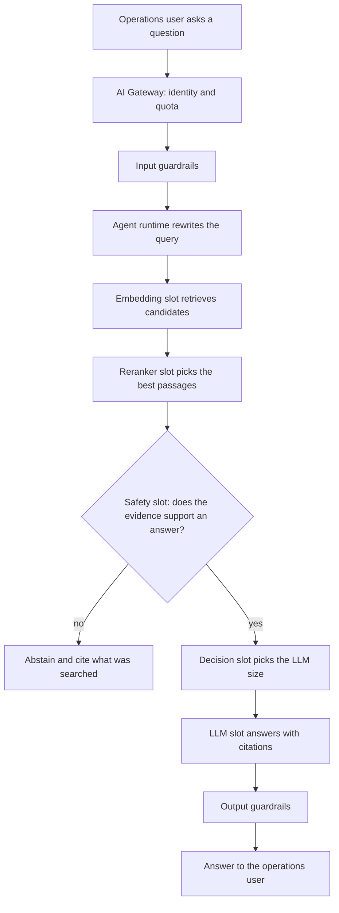
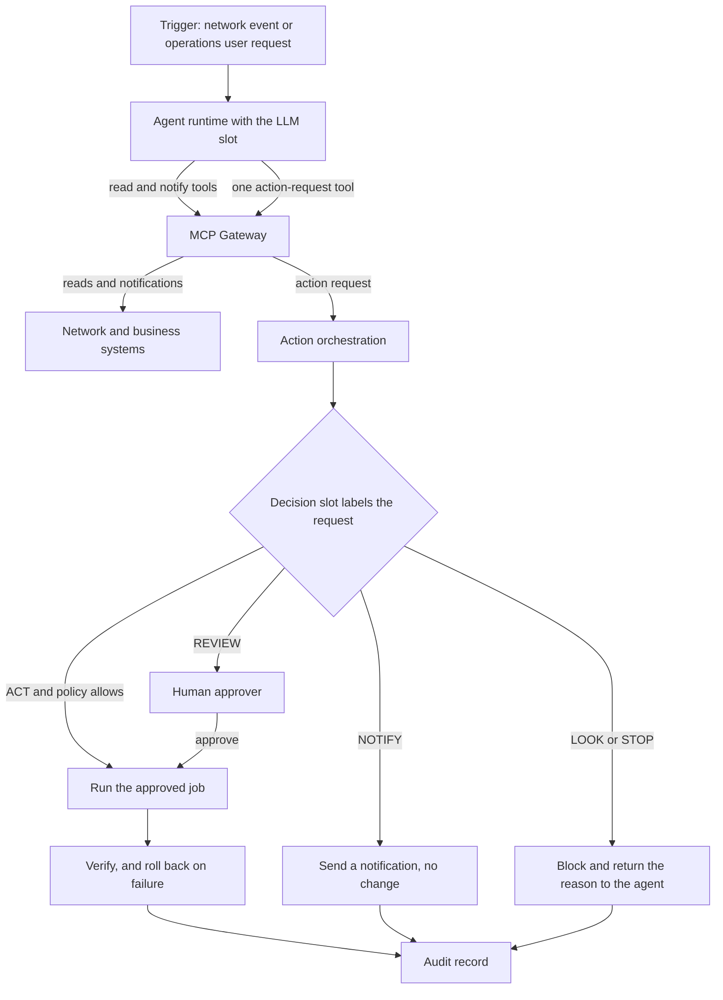

# Architecture overview

## At a glance

| Field | Value |
|---|---|
| Question answered | How do the six OTel model slots map onto Red Hat products, and how do requests flow? |
| Answer | Every slot runs on Red Hat AI Inference (vLLM) behind gateways, and guardrails plus a Decision-model gate sit between the agent and any change to the network |
| Audience | Architects and platform engineers |
| OTel slots | All six: LLM, Embedding, Reranker, Safety, Decision, Classification |
| Platform blueprints | PB-04, PB-05, PB-06, PB-07 |

## The question

How do the six OTel model slots map onto Red Hat products, and how do requests flow between them?
Without one map, each use case wires models, gateways, and actions its own way, and safety controls end up in different places.

## The principle

The model is a stateless service behind a gateway, so you can swap it without the agent noticing ([Red Hat Developer](https://developers.redhat.com/articles/2026/07/20/architect-open-blueprint-cloud-native-ai-agents)).
The agent recommends and the orchestrator decides: agents read and notify, and only the action layer changes network state.
The design names model slots, not checkpoints, because OTel checkpoints keep changing.

## The design

### Slots, roles, and products

| Slot | Role in this design | Red Hat product used |
|---|---|---|
| LLM | Answers with citations; a tool-calling checkpoint also runs the agent loop | Red Hat AI Inference (vLLM); Distributed Inference with llm-d in the core, KServe at the edge |
| Embedding | Turns documents and queries into vectors for retrieval | Red Hat AI Inference (vLLM) in pooling mode on KServe |
| Reranker | Reorders retrieved passages so the best evidence comes first | Red Hat AI Inference (vLLM) in pooling mode on KServe |
| Safety | Checks whether the evidence supports an answer, and abstains when it does not | Red Hat AI Inference (vLLM) on KServe |
| Decision | Labels each request or proposed step as LOOK, NOTIFY, REVIEW, ACT, or STOP with label probabilities, and picks the model size for content routing | Red Hat AI Inference (vLLM) on KServe, with log probabilities turned on |
| Classification | Assigns fixed root-cause labels, offered to the agent as a governed tool | Red Hat AI Inference (vLLM) in pooling mode on KServe |

### Layers

The layers extend the components of Table 1 in the [Red Hat Developer blueprint article](https://developers.redhat.com/articles/2026/07/20/architect-open-blueprint-cloud-native-ai-agents). The data and execution plane runs from data and knowledge to action, placement puts that plane on sites, the lifecycle plane evaluates, adapts, and observes, and the control plane deploys everything.

| Layer | Plane | Role | Red Hat product used |
|---|---|---|---|
| Data and knowledge | Data and execution | Load, embed, store, and rerank operator knowledge | Vector store; OTel Embedding and Reranker on Red Hat AI Inference (vLLM) with KServe; Data Science Pipelines for loading |
| Model endpoint inferencing | Data and execution | Run every OTel slot behind an OpenAI-compatible API | Red Hat AI Inference (vLLM) on KServe; Distributed Inference with llm-d for generative slots in the core |
| Network capabilities | Data and execution | Offer read, notify, and action-request tools for network and business systems | Standards-based MCP servers (TM Forum, CAMARA, device command line); classifier-as-tool |
| AI Gateway | Data and execution | Decide who may call which model, which slot handles a request, and which replica serves it | Models-as-a-Service front door; OTel Decision model for content routing; llm-d scheduler for replica choice |
| MCP Gateway | Data and execution | Authorize every tool call by token claims, and apply rate limits and audit | MCP gateway in Red Hat Connectivity Link with Kuadrant policies and Keycloak |
| Agent runtime | Data and execution | Own the loop, context, and tool calls inside a sandbox | Harness (LangGraph or custom) in a sandbox on Red Hat OpenShift |
| Safety and governance | Data and execution | Screen inputs and outputs, abstain without evidence, and gate each step | NeMo Guardrails; OTel Safety slot for abstention; OTel Decision slot as the gate |
| Action | Data and execution | Be the only path to a state change, with gate, approval, execution, verification, and audit | Red Hat Ansible Automation Platform with Automation Orchestrator and Event-Driven Ansible |
| Placement | Placement | Run each slot on the site that fits its latency and data rules | Red Hat OpenShift (core); single-node OpenShift with Red Hat OpenShift AI (regional); RHEL with Podman or Red Hat Device Edge (far edge) |
| Evaluation | Lifecycle | Gate every promotion on measured results | EvalHub in Red Hat OpenShift AI |
| Adaptation | Lifecycle | Generate data, train adapters, and version models | SDG Hub, Training Hub, and Model Registry |
| Observability | Lifecycle | Trace each step, its cost, and drift | OpenTelemetry, MLflow, Prometheus, and Perses |
| Control | Control | Declare and deploy everything, and give each workload an identity | OpenShift GitOps (Argo CD), Red Hat Advanced Cluster Management, and workload identity with SPIFFE/SPIRE and Keycloak |

Any component can be replaced. The Red Hat products named here show one way to build this design.

Placement uses three tiers: the far edge runs one small model per site, the regional tier runs a closed loop with several slots, and the core runs the large LLM, adaptation, and evaluation. The placement page lists what runs where.

### Flow: grounded answer

This flow is read-only and needs no tool calling. Each step writes to the trace: retrieval ids, rerank scores, the abstain decision, model size, tokens, and latency.

### Flow: investigate then act

The agent reads and notifies through the MCP Gateway, and asks for a change through one action-request tool. The orchestrator runs the gate itself, so a prompt-injected agent cannot skip it, and only the automation platform holds write credentials. The decision gate page gives the label policy.

## Trade-offs and limits

| Trade-off | What to do |
|---|---|
| Generative steps take seconds | Put the Decision or Classification slot in fast closed loops, and use the LLM for explanations and human review |
| Three routing layers can blur | Keep them apart: the front door decides who may call which model, the Decision model picks the slot, and llm-d picks the replica |
| The replica scheduler does not choose the tier | Choose far edge, regional, or core in the caller or with multi-cluster DNS policy |
| A new OTel revision changes behavior behind the same slot | Pin each revision, and rerun evaluation before you promote it |
| More services mean more moving parts than one large model | Start with the grounded-answer flow, and add the action layer when the readiness questions for autonomy are answered |

## Used by

- PB-04, PB-05, PB-06, PB-07: serving, integration, gating, and the action layer build on this map
- [Readiness questions](../framework/index.md): what each part of this design must show before production
- The decision gate, adaptation ladder, placement, and crosswalk pages in this section
