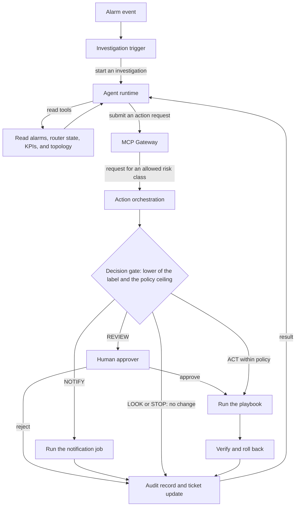

<!-- Writing rules: framework/style-guide.md. Name each component by its role and the Red Hat product used. Write no product support status. -->

# Governed closed-loop incident handling

## At a glance

| Field | Value |
|---|---|
| One-liner | Handles router incidents from alarm to ticket with read-only tools, and sends every write through the Decision gate. Acts within policy only for low-risk classes, once that stage is earned. Depends on the Decision gate and the automation workflow. |
| Problem | Engineers triage router alarms and open tickets by hand; the KPI is mean time to identify |
| Audience | Operations engineers, approvers, and risk owners who run incident handling |
| OTel slots | `llm`: the agent; `decision`: the gate label; `safety`: checks the evidence behind a finding; `classification`: labels the likely cause |
| Autonomy ceiling | Act within policy, for low-risk classes only |
| Placement tier | Regional and core |
| Agent-school courses | 101, 301, 302, and 403 in the [agent-school roadmap](https://github.com/open-experiments/agent-school/blob/main/docs/RoadMap.md) |

## Problem and value

Engineers triage router alarms and open tickets by hand, and under load they open duplicates and skip checks.
This recipe investigates with read-only tools and sends every write through the Decision gate and the automation workflow, so every change leaves an approval, a verification, and an audit record.
The KPIs are mean time to identify, the share of incidents handled without rework, and duplicate tickets avoided; any ROI is a target, measured against the shadow-stage baseline with the [PB-10](../../../platform/compliance-operating-model/README.md#staged-rollout-and-roi) measures.

## How it works



1. The event trigger receives a TMF642 `alarmCreateEvent` through its `/hub` subscription and starts an investigation, never a fix.
2. Through the MCP Gateway, the agent reads TMF642 `/alarm`, router state through read-only device tools, TMF628 KPIs, and TMF639 topology. The Classification slot labels the likely cause, and the Safety slot checks that the evidence supports the finding.
3. The agent searches TMF621 `/troubleTicket` for an open ticket on the same fault.
4. To change anything, ticket creation included, the agent sends an action request with `submit_action_request`. It holds no write credentials, and the gateway checks that it may submit requests for the risk class.
5. Action orchestration checks the request against the decision gate schema. A REST API step asks the Decision slot a fixed label question on `/v1/chat/completions` with log probabilities; the agent's own label is advisory.
6. A switch step takes the lower of the model label and the policy ceiling. A label mass below the Label-mass floor fails closed to STOP, and STOP ends the step with no change.
7. REVIEW waits for the `approver` role. ACT runs only an approved playbook within policy. NOTIFY runs a notification job that posts to the ticket or the operations channel, with no network change.
8. A job template runs the playbook, a verification job reads the same object, and a rollback job runs if verification fails. The workflow writes the audit record, updates the TMF621 ticket, and, once verification passes, clears the TMF642 alarm through `/clearAlarm`.

The outcome is the lower of the model label and the policy ceiling for the capability and risk class, so it never exceeds either. A STOP label forces STOP at every stage. A confirmed false ACT drops the use case and its action class back one stage, as [PB-06](../../../platform/safety-autonomy-gating/README.md#staged-autonomy) sets out. A blocked prompt injection in alarm, ticket, or device text opens a SOC case and does not drop a stage.

NOTIFY works two ways. From the assist stage up, an agent may hold direct notify tools, such as an operations-channel message or a ticket comment, through the MCP Gateway; the shadow stage gets no notify role. An action request that the gate labels NOTIFY becomes a notification job that the [action layer](../../../platform/action-layer/README.md) runs. For direct notify tools, the gateway's tool-role mapping enforces the stage, not the gate.

### Tools and risk classes

| Tool | Risk class | Who may call it |
|---|---|---|
| List and get alarms, TMF642 `/alarm` | `read` | The agent, from the shadow stage up |
| Run `show` commands on the router, through a read-only device MCP server | `read` | The agent, from the shadow stage up |
| Read KPIs and measurement jobs, TMF628 | `read` | The agent, from the shadow stage up |
| Read topology from resource inventory, TMF639 | `read` | The agent, from the shadow stage up |
| Search trouble tickets, TMF621 `/troubleTicket` | `read` | The agent, from the shadow stage up |
| Classify the likely cause, Classification slot served as a tool | `read` | The agent, from the shadow stage up |
| Read job status and output, through the automation MCP server in read-only mode | `read` | The agent; it can never launch a job |
| `submit_action_request` | The class of the requested action: `notify`, `write_low`, or `write_high` | The agent; its only write path |

Risk classes follow the [decision gate schema](https://github.com/ravisharma5/otel-telco-blueprints/blob/main/schemas/decision-gate.schema.json). The gateway denies any call that no role allows, the deny-unless-allowed rule in [PB-05](../../../platform/integration/README.md#per-tool-authorization).

### Slots and checkpoints

| Slot | Checkpoint | Role | Placement |
|---|---|---|---|
| `llm` | OTel-2.0-LLM-31B-IT, pinned by revision; OTel 2.5 replaces it only through the swap in Deploy and verify | The agent: reads, reasons, and writes action requests | Core |
| `decision` | OTel-2.0-Decision-26B-A4B-4bit, pinned by revision | Gives the gate label in action orchestration | Regional |
| `safety` | OTel-LLM-12B-Safety or OTel-LLM-8.3B-Safety, pinned by revision | Checks that the evidence supports a finding before the agent proposes a change | Regional |
| `classification` | OTel-LLM-8.3B-Classification with its head retrained on your alarm taxonomy, pinned by revision | Labels the likely cause, served as a read tool | Regional |

### Worked example: a BGP session flap on pe7

A BGP session from PE router `pe7` flaps after a CPU spike, and the TMF642 alarm opens incident `inc-3107`. `noc-loop-agent` reads the alarm, the BGP neighbour state and CPU history on `pe7`, the KPIs, and the topology, and finds no open TMF621 ticket.

Request `req-3107-1` to create the ticket is `notify` class at the assist stage, so `dec-3107-1` records NOTIFY and the notification job opens the ticket, per the gate [policy table](../../../architecture/decision-gate.md#policy-table).

Next the agent proposes a BGP soft reset in `req-3107-2`, a `write_low` request. The stage register holds this class at the recommend stage, so `dec-3107-2` records REVIEW even though the label reads ACT. After the `approver` role signs off, the playbook runs, the verification job reads the session state, and the workflow clears the alarm and updates the ticket. The soft reset runs as ACT only once its class earns the act stage. A traffic drain on `pe7` is `write_high` and always needs approval.

## What you need

- [ ] Models: the four slots in the slots table, chosen from the family in [PB-01](../../../platform/intake-model-selection/README.md), each pinned by revision with its licence chain recorded
- [ ] Platform blueprints: the pages for [PB-02](../../../platform/evaluation-acceptance/README.md), [PB-04](../../../platform/serving-routing-placement/README.md), [PB-05](../../../platform/integration/README.md), [PB-06](../../../platform/safety-autonomy-gating/README.md), [PB-07](../../../platform/action-layer/README.md), [PB-08](../../../platform/security-identity-sandbox/README.md), [PB-09](../../../platform/quality-operations/README.md), and [PB-10](../../../platform/compliance-operating-model/README.md)
- [ ] Components: one product for each role in the components table
- [ ] Integrations: the TMF642, TMF621, TMF628, and TMF639 APIs and read-only device tools, each behind the MCP Gateway
- [ ] Write path: `submit_action_request` is the agent's only write tool, and only the job templates hold write credentials
- [ ] Gate endpoint: let REST API steps reach the in-cluster gate endpoint, and require a token there, because the Decision model card's recipe starts a server with no authentication
- [ ] Decision engine: vLLM 0.26 or later on CUDA, or 0.30 or later on ROCm, as the [Decision model card](https://huggingface.co/farbodtavakkoli/OTel-2.0-Decision-26B-A4B-4bit) states
- [ ] Playbooks: each with a verification job and a rollback job, tested on a stateful mock
- [ ] Agent identity: a workload identity bound to the agent's tool roles, as PB-08 sets out
- [ ] Data: replayed incidents on stateful mocks, and a gate set weighted toward non-ACT cases
- [ ] Stage register: every action class starts at the shadow stage
- [ ] Traces: tool calls, gate decisions, approvals, and job results, as PB-09 sets out

| Component role | Red Hat product used |
|---|---|
| Event trigger that starts investigations, never fixes | Event-Driven Ansible in Red Hat Ansible Automation Platform |
| Action orchestration for the gate, approval, job, verification, rollback, and audit | Automation Orchestrator for Red Hat Ansible Automation Platform |
| Execution with the only write credentials | Job templates in Red Hat Ansible Automation Platform |
| Agent read access to job status and output | MCP Server for Red Hat Ansible Automation Platform, in read-only mode |
| Tool gateway for per-tool authorization | MCP gateway in Red Hat Connectivity Link |
| Inference engine for every slot | Red Hat AI Inference (vLLM) |
| Input and tool-response guardrails | NeMo Guardrails in Red Hat OpenShift AI |
| Version record for each checkpoint and its pass | Model Registry in Red Hat OpenShift AI |

Key flags for each slot, copied from [PB-04](../../../platform/serving-routing-placement/README.md#key-flags-per-slot). Start the Safety slot with its own pinned revision and no tool-calling flags.

```text
# LLM 31B (pin the revision; text-only; tool calling)
--revision <sha> --enable-auto-tool-choice --tool-call-parser gemma4 \
--limit-mm-per-prompt '{"image": 0, "audio": 0}'
# Decision (card recipe)
--revision <sha> --max-logprobs 64 --enable-prefix-caching --max-model-len 16384
# Classification (Gemma3TextForSequenceClassification) and Reranker (num_labels=1)
--runner pooling --convert classify        # endpoints /classify, /v1/score, /rerank
```

Any component can be replaced. The Red Hat products named here show one way to build this design.

## Governance

Each action request passes the [decision gate](../../../architecture/decision-gate.md), and the outcome never exceeds the policy ceiling for its class.

| Action | Gate outcome (LOOK/NOTIFY/REVIEW/ACT/STOP) | Approval | AI Act class |
|---|---|---|---|
| Create or update the TMF621 ticket, `notify` | NOTIFY, from the assist stage up | None | [Recorded by your legal team in the classification record](../../../platform/compliance-operating-model/README.md) |
| Comment on or acknowledge the TMF642 alarm, `notify` | NOTIFY, from the assist stage up | None | [Recorded by your legal team in the classification record](../../../platform/compliance-operating-model/README.md) |
| BGP soft reset, `write_low` | REVIEW from the recommend stage up, then ACT within policy once the act stage is earned | The `approver` role while the outcome is REVIEW | [Recorded by your legal team in the classification record](../../../platform/compliance-operating-model/README.md) |
| Drain traffic, `write_high` | REVIEW, from the recommend stage up | The `approver` role | [Recorded by your legal team in the classification record](../../../platform/compliance-operating-model/README.md) |
| Clear the TMF642 alarm, a step of the approved playbook run | The playbook's outcome; runs only after verification passes | The playbook's approval | [Recorded by your legal team in the classification record](../../../platform/compliance-operating-model/README.md) |
| Any action the label marks STOP | STOP | None | [Recorded by your legal team in the classification record](../../../platform/compliance-operating-model/README.md) |

| Parameter | What it controls | Who sets it | How to calibrate |
|---|---|---|---|
| Decision false-ACT budget | The highest false-ACT rate accepted on state-changing proposals | Risk owner | [Evaluation and acceptance](../../../platform/evaluation-acceptance/README.md#false-act-method): use the false-ACT method, with a gate set large enough for the rule of three |
| Decision minimum ACT probability | The lowest ACT probability at which the orchestrator may act alone | Risk owner, with subject-matter expert (SME) review | Fit on the SME-labelled gate set and check the calibration error |
| Decision REVIEW band | The probability range that sends a request to a human | Risk owner, with SME review | Set from the calibration curve and the human review load |
| Decision calibration error ceiling | The largest difference between stated and observed label probabilities | Platform team, with SME review | Bin the gate set by stated probability and compare with observed outcomes |
| Minimum share of no-write scenarios | The lowest share of trajectory scenarios whose correct answer changes nothing | SME | Sample real incidents and count those where people only looked, notified, or escalated |
| Non-inferiority margin | The largest drop against the incumbent that still counts as no worse | Risk owner | Run candidate and incumbent on identical items and set the margin from the run-to-run noise |
| Shadow agreement floor | How often shadow outcomes must match what people did before a use case moves to assist | Risk owner, with SME review | [Evaluation and acceptance method](../../../platform/evaluation-acceptance/README.md): compare shadow outcomes with logged human actions over a window the risk owner sets |
| Canary window | How long, and over how many requests, a raised ceiling runs on a small share of traffic | Risk owner | [Evaluation and acceptance method](../../../platform/evaluation-acceptance/README.md): size the window to hold enough state-changing requests to bound the false-ACT rate |
| Override rate ceiling | The share of human overrides that sends a use case back one stage | Business owner | [Evaluation and acceptance method](../../../platform/evaluation-acceptance/README.md): count overrides per use case and action class in the trace |
| Ceiling for read requests | The highest outcome for requests that only read | Risk owner, with SME review | [Evaluation and acceptance method](../../../platform/evaluation-acceptance/README.md): review the gate set for read requests and the human review load |
| Ceiling for notify requests | The highest outcome for notifications and ticket notes | Risk owner, with SME review | [Evaluation and acceptance method](../../../platform/evaluation-acceptance/README.md): review notify cases for duplicates and noise |
| Ceiling for low-risk writes | The highest outcome for reversible changes such as an interface restart | Risk owner | [Evaluation and acceptance method](../../../platform/evaluation-acceptance/README.md): raise it only after a canary window with no false ACT label |
| Ceiling for high-risk writes | The highest outcome for changes that are hard to reverse or affect many customers | Risk owner | [Evaluation and acceptance method](../../../platform/evaluation-acceptance/README.md): keep it at REVIEW until the risk owner signs off on canary evidence |
| Required approver role per action class | Which role approves REVIEW for each action class | Risk owner | [Evaluation and acceptance method](../../../platform/evaluation-acceptance/README.md): check approval times and overrides per class in the trace |
| Label-mass floor | The lowest label mass at which the gate trusts the readout | Platform team, with SME review | [Evaluation and acceptance method](../../../platform/evaluation-acceptance/README.md): measure label mass on the operator gate set and set the floor below normal readouts |

This page gives no default values. Each owner sets the value with SME review and versions it with the policy that `policy_version` names.

Three zero-tolerance rules fail any run, whatever the scores: any write outside the allowed set, any duplicate ticket, and any secret in model context or output. No operator setting relaxes them, as [PB-02](../../../platform/evaluation-acceptance/README.md#zero-tolerance-rules) sets out.

| Activity | Responsible | Accountable | Consulted | Informed |
|---|---|---|---|---|
| Approve a REVIEW request | Approver | Business owner | SME | Operations engineer |
| Change a policy ceiling | Operations engineer | Risk owner | Change board and SME | Business owner |
| Promote a use case to the next stage | Approver | Risk owner | SME | Platform team |
| Approve a canary | Approver | Risk owner | Model owner | Security |

## Sources

Each key claim links its source, as set out in [the Sources table](../../../framework/definitions.md#sources-table).

| # | Claim | Basis | Source |
|---|---|---|---|
| 1 | TMF642 v5.0.1 defines `/alarm`, `/ackAlarm`, `/clearAlarm`, and `/commentAlarm`, and a `/hub` for event subscriptions such as `alarmCreateEvent` | project documentation | [TMF642 Alarm Management v5.0.1 OpenAPI](https://github.com/tmforum-apis/TMF642_AlarmManagement/blob/main/TMF642_Alarm_v5.0.1.oas.yaml) |
| 2 | TMF621 v5.0.1 defines `/troubleTicket` to create, search, and update tickets, and a `/hub` for ticket events | project documentation | [TMF621 Trouble Ticket v5.0.1 OpenAPI](https://github.com/tmforum-apis/TMF621_TroubleTicket/blob/main/TMF621-Trouble_Ticket-v5.0.1.oas.yaml) |
| 3 | The 31B training mixture holds general tool-calling examples but no telecom-specific MCP or tool-calling examples | model card | [OTel-2.0-LLM-31B-IT model card](https://huggingface.co/farbodtavakkoli/OTel-2.0-LLM-31B-IT) |
| 4 | The 31B has not been evaluated for closed-loop completion of operational telecom tasks, and needs task-specific evaluation with outcome-based scoring before any non-supervised use | model card | [OTel-2.0-LLM-31B-IT model card](https://huggingface.co/farbodtavakkoli/OTel-2.0-LLM-31B-IT) |
| 5 | The 31B has not been benchmarked on methods of procedure run against live or emulated network devices | model card | [OTel-2.0-LLM-31B-IT model card](https://huggingface.co/farbodtavakkoli/OTel-2.0-LLM-31B-IT) |
| 6 | The Decision model returns label probabilities through `/v1/chat/completions` with log probabilities, on vLLM 0.26 or 0.30; its recipe starts a server with no authentication, and its probabilities need calibration on your own labelled data | model card | [OTel-2.0-Decision-26B-A4B-4bit model card](https://huggingface.co/farbodtavakkoli/OTel-2.0-Decision-26B-A4B-4bit) |
| 7 | The Classification model predicts eight root-cause classes from the synthetic TeleLogs drive-test dataset | model card | [OTel-LLM-8.3B-Classification model card](https://huggingface.co/farbodtavakkoli/OTel-LLM-8.3B-Classification) |
| 8 | A REST API step calls a REST service from a workflow, and blocks URLs that target private network addresses by default | Red Hat guidance | [Automation Orchestrator REST API step](https://docs.redhat.com/en/documentation/automation_orchestrator/2026.8/develop-add_a_rest_api_step_to_a_workflow) |
| 9 | An Event-Driven Ansible rulebook defines the event source and the action to take when the event occurs | Red Hat guidance | [Event-Driven Ansible overview](https://www.redhat.com/en/technologies/management/ansible/event-driven-ansible) |
| 10 | Telecom agents can produce good summaries while missing the diagnostic sequence, so outcome-only scoring overstates readiness | research | [TelcoAgent-Bench](https://arxiv.org/html/2604.06209v1) |
| 11 | Agent tasks can be scored by checking the end state of stateful mocked systems | research | [tau2-bench](https://github.com/sierra-research/tau2-bench) |
| 12 | Zero events in n trials bounds the event rate below about 3/n at 95% confidence | research | [If nothing goes wrong, is everything all right? JAMA](https://pubmed.ncbi.nlm.nih.gov/6827763/) |
| 13 | At Level 3 the system also shares analysis and decision, and levels apply to selected scenarios | project documentation | [TM Forum Autonomous Networks whitepaper](https://www.tmforum.org/wp-content/uploads/2019/05/22553-Autonomous-Networks-whitepaper.pdf) |

## Deploy and verify

Apply these settings in order. No class rises past its stage until the gates pass.

1. Pin the 2.0 checkpoint for each slot through intake ([PB-01](../../../platform/intake-model-selection/README.md)), and record each revision and its licence chain in the model registry.
2. Deploy the slots with the flags from What you need, and expose the gate endpoint inside the cluster behind a token.
3. Have each owner load the policy ceilings, the approver role per action class, and the Label-mass floor, with every class at the shadow stage in the stage register ([PB-06](../../../platform/safety-autonomy-gating/README.md)).
4. Baseline: run the PB-02 ladder on the pinned 2.0 checkpoints: intake and smoke, public sanity, operator offline acceptance on replayed incidents with stateful mocks and trajectory checks, and safety and red team. Record the pass or fail on each registry version.
5. Swap: when OTel 2.5 ships, take it through intake. The regression trigger for a new checkpoint version or base family re-runs the full ladder in paired runs on identical items against the Non-inferiority margin, and you retrain any adapter on the new base.
6. Promote or roll back: run the passing version in shadow beside people, then as a weighted canary, capped at REVIEW, for the Canary window. Any zero-tolerance event or missed gate rolls back to the pinned 2.0 revision, and a ceiling rises only through the stage register.

| Check | PB-02 gate or parameter | Owner |
|---|---|---|
| ACT labels on state-changing proposals whose ground truth is not ACT stay within budget | Decision false-ACT budget | Risk owner |
| Stated label probabilities match observed outcomes | Decision calibration error ceiling | Platform team |
| The scenario set holds enough incidents where the right answer changes nothing | Minimum share of no-write scenarios | SME |
| Each replayed incident passes the trajectory checks, such as no unnecessary writes, ticket ID reuse, and verification after a fix | [Trajectory checks](../../../platform/evaluation-acceptance/README.md#trajectory-checks) | Model owner |
| Gate label mass stays over the floor, and a request under it ends as STOP | Label-mass floor | Platform team |
| Shadow outcomes match what people did | Shadow agreement floor | Risk owner |
| Human overrides stay below the ceiling during the canary | Override rate ceiling | Business owner |
| OTel 2.5 is no worse than the 2.0 baseline on identical items | Non-inferiority margin | Risk owner |

- Agent-school: 101 builds the NOC assistant loop, 301 adds an approval gate to a closed loop, 302 puts policies in front of the MCP gateway and adds a judge suite, and 403 measures OTel 2.0 on the course tapes, in the [agent-school roadmap](https://github.com/open-experiments/agent-school/blob/main/docs/RoadMap.md)
- Architecture: the [decision gate](../../../architecture/decision-gate.md) page for the policy table and the message examples
- TM Forum: the [TMF642](https://github.com/tmforum-apis/TMF642_AlarmManagement) and [TMF621](https://github.com/tmforum-apis/TMF621_TroubleTicket) API repositories for the contracts each MCP server fronts

## Limitations

- It never acts on a high-risk class without approval; every `write_high` change goes to REVIEW.
- It handles one router fault at a time; people correlate faults across domains.
- The 2.0 baseline result is yours to record. This page claims none, and the 31B card says closed-loop work hasn't been evaluated.
- It assumes no OTel 2.5 results: 2.5 replaces 2.0 only after passing the same gates.
- The Classification slot's shipped classes come from drive-test data, so retrain its head on your alarm taxonomy first.
- The AI Act class is your legal team's call, recorded in the [classification record](../../../platform/compliance-operating-model/README.md).
