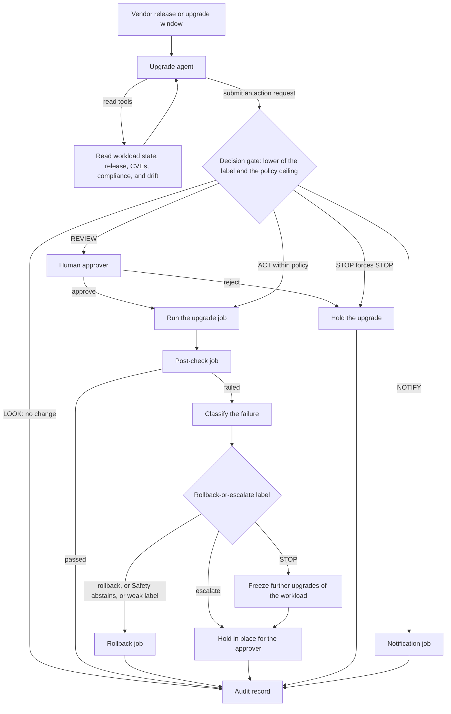

<!-- Writing rules: framework/style-guide.md. Name each component by its role and the Red Hat product used. Write no product support status. -->

# CNF upgrade pre- and post-checks

## At a glance

| Field | Value |
|---|---|
| One-liner | Checks live workload state before and after a CNF upgrade, and sends every upgrade through the Decision gate. Acts within policy only on low-risk change classes, once that stage is earned; minor and major upgrades always need approval. Depends on the Decision gate and automation-platform jobs. |
| Problem | Vendor CNF upgrades fail on live state nobody checked; the KPIs are delivery-to-production time and the first-time post-check pass rate |
| Audience | Change managers, approvers, and risk owners for CNF upgrades |
| OTel slots | `llm`: the agent; `decision`: the gate label and the rollback-or-escalate label; `safety`: abstains on weak evidence; `classification`: labels failures; `embedding` and `reranker`: retrieval |
| Autonomy ceiling | Act within policy, for low-risk change classes only |
| Placement tier | Regional for the gate, checks, and retrieval; core for the agent; nothing at the far edge |
| Agent-school courses | 301 and 401 in the [agent-school roadmap](https://github.com/open-experiments/agent-school/blob/main/docs/RoadMap.md) |

## Problem and value

Vendor CNF upgrades fail on live state that nobody checked, such as an expiring certificate, a quota, a drifted configuration, or a missing dependency.
This recipe checks workload state before and after each upgrade and sends every upgrade through the Decision gate and automation-platform jobs, so every hold, run, or rollback leaves an audit record.
The KPIs are the time from vendor delivery to production and the first-time post-check pass rate.
The ROI measure is failed upgrades avoided or rolled back early times your cost of an incident or outage, plus approver time saved per change; measure both in shadow with the [PB-10](../../../platform/compliance-operating-model/README.md#staged-rollout-and-roi) measures, from inputs you supply.

## How it works



1. A vendor release in the software gateway, or an open upgrade window, triggers the agent, which runs checks and never runs a change itself.
2. The agent plans the checks from the workload's capability manifest and reads state through read-only MCP tools behind the MCP gateway, which denies each call unless a role allows it, the deny-unless-allowed rule in [PB-05](../../../platform/integration/README.md#per-tool-authorization).
3. It retrieves the release notes, upgrade guide, MOP, and past outcomes with the Embedding and Reranker slots, and writes a change summary; the Safety slot abstains when the evidence for GO is weak.
4. It sends the upgrade as an action request with `submit_action_request`, and the Decision slot gives the pre-upgrade label at the [decision gate](../../../architecture/decision-gate.md).
5. The gate takes the lower of the label and the ceiling for the change class; ACT runs the upgrade job, REVIEW goes to the approver, and STOP holds it.
6. A post-check job reads the same workload; on a failure, the Classification slot labels the failure, and then the Decision slot gives the rollback-or-escalate label.
7. Every path ends in the audit record and a ticket update.

The outcome is the lower of the model label and the policy ceiling for the capability and risk class, so it never exceeds either. A STOP label forces STOP at every stage. Every change class starts at the shadow stage, and a confirmed false ACT drops the class back one stage, as [PB-06](../../../platform/safety-autonomy-gating/README.md#staged-autonomy) sets out.

Only low-risk change classes can earn ACT, and that stage targets Level 3 for low-risk change classes only. Major upgrades are always REVIEW. An operator aiming for Level 4 can set it as a per-class target; the stage register earns each class up to the act stage (Level 3), and PB-06 treats Level 4 as a later target beyond these blueprints. This recipe claims no level.

### Tools and risk classes

| Tool | Risk class | Who may call it |
|---|---|---|
| Read releases, images, signatures, and delivery metrics from the software gateway or OCI registry | `read` | The agent, from the shadow stage up |
| Read packages, images, and CVEs across deployed applications from the inventory | `read` | The agent, from the shadow stage up |
| Run or read compliance-rule checks on Helm charts and deployment artifacts | `read` | The agent, from the shadow stage up |
| Read scan results, the CVE delta between versions, and the security-officer check status | `read` | The agent, from the shadow stage up |
| Read the rendered configuration and validate it against its YANG modules | `read` | The agent, from the shadow stage up |
| Read pods, events, operators, quotas, certificates, and endpoints from the cluster | `read` | The agent, from the shadow stage up |
| Read GitOps reconciliation status, drift, and health | `read` | The agent, from the shadow stage up |
| Read job status and output, through the MCP Server for AAP in read-only mode | `read` | The agent; it can never launch a job |
| Read and comment on tickets and alerts | `read`, and `notify` from the assist stage up | The agent |
| `submit_action_request` to propose a configuration or compliance fix as a pull request | `write_low` | The agent; REVIEW from the recommend stage up; an action-layer job opens the pull request, and the reviewer's merge is the approval |
| `submit_action_request` to run a patch, certificate rotation, or configuration change | `write_low` | The agent; its only write path |
| `submit_action_request` to run a minor or major upgrade | `write_high`, always REVIEW | The agent; its only write path |

Risk classes follow the [decision gate schema](https://github.com/ravisharma5/otel-telco-blueprints/blob/main/schemas/decision-gate.schema.json).

### Gate policy per change class

| Change class | Risk class | Highest outcome | Approver | TM Forum target |
|---|---|---|---|---|
| Patch | `write_low` | ACT once the class earns the act stage | `approver` | Level 3 once the class earns the act stage |
| Certificate rotation | `write_low` | ACT once the class earns the act stage | `approver` | Level 3 once the class earns the act stage |
| Configuration change listed in Change types eligible for ACT | `write_low` | ACT once the class earns the act stage | `approver` | Level 3 once the class earns the act stage |
| Other configuration change | `write_low` | REVIEW | `approver` | Level 2 |
| Minor upgrade | `write_high` | REVIEW | `approver` | Level 2 |
| Major upgrade | `write_high` | Always REVIEW | `approver` and the change board | Level 2 |

### On a failed post-check

The Classification slot labels the failure first, and the Decision slot then gives the rollback-or-escalate label.

| Label or signal | What runs | Approval |
|---|---|---|
| Rollback | The paired rollback job | None: covered by the upgrade's gate outcome |
| Escalate, when rollback is unsafe or won't fix the cause (certificate, quota, dependency) | Hold the workload in place | The `approver` role, as REVIEW |
| Safety abstains, or label mass below the Label-mass floor | The paired rollback job, PB-07's default | None: covered by the upgrade's gate outcome |
| STOP | Freeze further upgrades of the workload and hold it in place for the `approver` (REVIEW); a STOP never cancels a rollback job already running | A person clears the freeze |

This narrows the [PB-07](../../../platform/action-layer/README.md) default of always rolling back, for workloads whose rollback is unsafe.

### Harness

Configure first, and train only on a measured gap, as [PB-03](../../../platform/adaptation/README.md) sets out.

| Mechanism | What you configure |
|---|---|
| Skills | Pre-upgrade check, post-upgrade verification, rollback decision, compliance explain-and-fix proposed as a pull request, YANG change review, and change summary |
| Capability manifest | One per vendor workload: its checks, thresholds, and order |
| Corpora | Vendor release notes and upgrade guides, the MOP library, past upgrade outcomes, the compliance-rule catalog, YANG modules, and CVE advisories |
| Gate policy | The change classes in the gate policy table |
| Classification head | Retrained on labelled past failures in six classes: crash loop, certificate expiry, configuration mismatch, quota, dependency, and licence |
| LoRA | Only if a gap remains after skills, measured by evaluation: vendor configuration reasoning, or tool calling over your tool catalog with LoRA plus GRPO on replayed upgrades |

### Slots and checkpoints

| Slot | Checkpoint | Role | Placement |
|---|---|---|---|
| `llm` | OTel-2.0-LLM-31B-IT, pinned by revision | The agent: plans checks, reads diffs and release notes, and writes the change summary | Core |
| `decision` | OTel-2.0-Decision-26B-A4B-4bit, pinned by revision | Gives the pre-upgrade gate label and the rollback-or-escalate label, with label probabilities | Regional |
| `safety` | OTel-LLM-12B-Safety or OTel-LLM-8.3B-Safety, pinned by revision | Abstains when the evidence for GO is weak | Regional |
| `classification` | OTel-LLM-8.3B-Classification with its head retrained on your failure taxonomy, pinned by revision | Labels post-check and downtime failures | Regional |
| `embedding` | OTel-Embedding-600M or OTel-Embedding-8B, pinned by revision | Turns release notes, MOPs, and advisories into vectors | Regional |
| `reranker` | OTel-Reranker-0.6B or OTel-Reranker-4B, pinned by revision | Puts the best passages first | Regional |

Tool calling over your tool catalog is the reason to take OTel 2.5 through intake and the PB-02 ladder once its model cards are published; until then the slots stay on the pinned 2.0 checkpoints, and this page states no 2.5 result.

### Worked example: a certificate that expires inside the upgrade window

Minor upgrade `chg-4417` is planned for the IMS core CNF `ims-core-0212` in namespace `ims-core`. `upgrade-check-agent` reads the cluster state before the window opens. It finds that a TLS certificate on the signalling endpoint expires inside the upgrade window.

The Decision slot labels the request REVIEW, a hold. Minor upgrades are `write_high`, so the outcome is REVIEW either way, per the [policy table](../../../architecture/decision-gate.md#policy-table). The approver schedules certificate rotation `chg-4418` first, then has the agent re-run the pre-check.

## What you need

- [ ] Models: the six slots in the slots table, chosen from the family in [PB-01](../../../platform/intake-model-selection/README.md), each pinned by revision with its licence chain recorded
- [ ] Platform blueprints: the pages for [PB-02](../../../platform/evaluation-acceptance/README.md), [PB-04](../../../platform/serving-routing-placement/README.md), [PB-05](../../../platform/integration/README.md), [PB-06](../../../platform/safety-autonomy-gating/README.md), [PB-07](../../../platform/action-layer/README.md), [PB-08](../../../platform/security-identity-sandbox/README.md), [PB-09](../../../platform/quality-operations/README.md), and [PB-10](../../../platform/compliance-operating-model/README.md)
- [ ] Components: one product for each role in the components table
- [ ] Integrations: the read tool contracts in the tools table, each behind the MCP gateway
- [ ] Write path: `submit_action_request` is the agent's only write tool, and only job templates hold write credentials, including the job that opens pull requests
- [ ] Gate endpoint: let REST API steps reach the in-cluster gate endpoint, and require a token there, because the Decision model card's recipe starts a server with no authentication
- [ ] Decision engine: vLLM 0.26 or 0.30 on CUDA or ROCm, as the [Decision model card](https://huggingface.co/farbodtavakkoli/OTel-2.0-Decision-26B-A4B-4bit) states
- [ ] Playbooks: each upgrade job paired with a post-check job and a rollback job, tested on a stateful mock
- [ ] Agent identity: a workload identity bound to the read roles and `submit_action_request` only, as PB-08 sets out
- [ ] Data: recorded past upgrades with their outcomes, and a gate set weighted toward non-ACT cases
- [ ] Traces: tool calls, gate decisions, approvals, post-check results, and rollbacks, as PB-09 sets out

| Component role | Red Hat product used |
|---|---|
| Event trigger that starts checks, never changes | Event-Driven Ansible in Red Hat Ansible Automation Platform |
| Action orchestration for the gate, approval, upgrade, post-check, rollback, and audit | Automation Orchestrator for Red Hat Ansible Automation Platform |
| Execution with the only write credentials | Job templates in Red Hat Ansible Automation Platform |
| Agent read access to job status and output | MCP Server for Red Hat Ansible Automation Platform, in read-only mode |
| Tool gateway for per-tool authorization | MCP gateway in Red Hat Connectivity Link |
| Inference engine for every slot | Red Hat AI Inference (vLLM) |
| Input and tool-response guardrails | NeMo Guardrails in Red Hat OpenShift AI |
| Version record for each checkpoint and its pass | Model Registry in Red Hat OpenShift AI |
| Workload platform | Red Hat OpenShift |
| Configuration delivery and drift | Red Hat OpenShift GitOps |
| Software gateway, inventory, and CVE scanning | Your choice; this design names no product |

Key flags for each slot, copied from [PB-04](../../../platform/serving-routing-placement/README.md#key-flags-per-slot). Start the Safety slot with its own pinned revision and no tool-calling flags.

```text
# LLM 31B (pin the revision; text-only; tool calling)
--revision <sha> --enable-auto-tool-choice --tool-call-parser gemma4 \
--limit-mm-per-prompt '{"image": 0, "audio": 0}'
# Decision (card recipe)
--revision <sha> --max-logprobs 64 --enable-prefix-caching --max-model-len 16384
# Classification (Gemma3TextForSequenceClassification) and Reranker (num_labels=1)
--runner pooling --convert classify        # endpoints /classify, /v1/score, /rerank
# Embedding
--runner pooling --convert embed           # endpoint /v1/embeddings
```

Any component can be replaced. The Red Hat products named here show one way to build this design.

### What you bring

<!-- generated:what-you-bring start -->

| Model change | Your expertise | How far to climb |
|---|---|---|
| Retrain the Classification head on your taxonomy; train a LoRA adapter only if a measured gap remains after retrieval and skills | Your fault or alert taxonomy; a golden set your experts label; gate labels from your approvers; a contract for each tool; your domain corpus | Configure first, and train only on a measured gap, as [PB-03 Adaptation](../../../platform/adaptation/README.md) sets out |

| Item | Network component | Mechanism | Owner | Matrix row |
|---|---|---|---|---|
| Failure taxonomy and labelled past upgrade failures | 5G core CNFs | Classification labels | SME | [5G core CNFs](../../../platform/bring-your-own-data/README.md#domain-5g-core-cnfs) |
| Read-only registry, cluster, CVE, and GitOps tool contracts | 5G core CNFs | MCP tool contract | Platform team | [5G core CNFs](../../../platform/bring-your-own-data/README.md#domain-5g-core-cnfs) |
| Upgrade check skills and capability manifests per workload | 5G core CNFs | Skill or capability manifest | SME | [5G core CNFs](../../../platform/bring-your-own-data/README.md#domain-5g-core-cnfs) |
| Release notes, upgrade guides, and the MOP library | 5G core CNFs | RAG corpus | Platform team | [5G core CNFs](../../../platform/bring-your-own-data/README.md#domain-5g-core-cnfs) |
| Compliance rules, YANG modules, and CVE advisories | 5G core CNFs | RAG corpus | Platform team | [5G core CNFs](../../../platform/bring-your-own-data/README.md#domain-5g-core-cnfs) |
| Change classes with ceilings and approver roles | 5G core CNFs | Gate and action-layer policy | Risk owner | [5G core CNFs](../../../platform/bring-your-own-data/README.md#domain-5g-core-cnfs) |
| Gate labels on recorded past upgrades | 5G core CNFs | Gate and action-layer policy | Risk owner | [5G core CNFs](../../../platform/bring-your-own-data/README.md#domain-5g-core-cnfs) |
| Replayed upgrades for LoRA and GRPO, only after a gap | 5G core CNFs | LoRA training data | Model owner, with data protection officer review | [5G core CNFs](../../../platform/bring-your-own-data/README.md#domain-5g-core-cnfs) |

<!-- generated:what-you-bring end -->

### Sandbox

<!-- generated:sandbox start -->

| Sandbox fit | Trigger on this page | Where to read |
|---|---|---|
| Sandbox the whole agent: run it under OpenShell policy inside a micro-VM | Can act within policy on low-risk change classes once earned | [PB-08: when a use case needs a sandbox](../../../platform/security-identity-sandbox/README.md#when-a-use-case-needs-a-sandbox) |

<!-- generated:sandbox end -->

### What you must add

| Gap | What you add | Source |
|---|---|---|
| Taxonomy | Labelled past upgrade failures in your six failure classes, to retrain the Classification head, because its shipped classes come from synthetic drive-test data | [OTel-LLM-8.3B-Classification model card](https://huggingface.co/farbodtavakkoli/OTel-LLM-8.3B-Classification) |
| Golden set | Recorded past upgrades with outcomes your SMEs confirmed, replayed on stateful mocks and scored with the PB-02 false-ACT method, because the card asks you to validate on your own human-labelled data | [OTel-2.0-Decision-26B-A4B-4bit model card](https://huggingface.co/farbodtavakkoli/OTel-2.0-Decision-26B-A4B-4bit#limitations-and-responsible-use) |
| Gate labels | A gate set of past upgrades your approvers labelled, weighted toward non-ACT cases, because the Decision slot turns label probabilities into decisions through thresholds you set | [OTel-2.0-Decision-26B-A4B-4bit model card](https://huggingface.co/farbodtavakkoli/OTel-2.0-Decision-26B-A4B-4bit) |
| Tool contracts | A pinned contract for each read tool, with job access through the MCP Server for AAP in read-only mode, GitOps drift from the reconciliation status, and configuration checks against YANG modules | [MCP Server for AAP overview](https://docs.redhat.com/en/documentation/red_hat_ansible_automation_platform/2.6/extend-con_about_ansible_mcp_server); [About Red Hat OpenShift GitOps](https://docs.redhat.com/en/documentation/red_hat_openshift_gitops/1.19/html/understanding_openshift_gitops/about-redhat-openshift-gitops); [RFC 7950](https://www.rfc-editor.org/rfc/rfc7950) |
| Corpus | Vendor release notes, upgrade guides, MOPs, and past upgrade outcomes in retrieval, each with a usage-rights entry, because the card's training leaves out vendor and operator configuration documents | [OTel-2.0-LLM-31B-IT model card](https://huggingface.co/farbodtavakkoli/OTel-2.0-LLM-31B-IT#telecommunications-data-not-included-in-training) |
| Language scope | Tests in every language your release notes and change records use, because the card's quality claims cover English text only | [OTel-2.0-LLM-31B-IT model card](https://huggingface.co/farbodtavakkoli/OTel-2.0-LLM-31B-IT#supported-language-and-modality) |

## Governance

Each action request passes the [decision gate](../../../architecture/decision-gate.md), and the outcome never exceeds the policy ceiling for its class. The outcome is the lower of the model label and the policy ceiling for the capability and risk class, so it never exceeds either. A STOP label forces STOP at every stage.

| Action | Gate outcome (LOOK/NOTIFY/REVIEW/ACT/STOP) | Approval | AI Act class |
|---|---|---|---|
| Read tools, `read` | LOOK | None | [Recorded by your legal team in the classification record](../../../platform/compliance-operating-model/README.md) |
| Ticket or alert note, `notify` | NOTIFY, from the assist stage up | None | [Recorded by your legal team in the classification record](../../../platform/compliance-operating-model/README.md) |
| Propose a fix as a pull request, `write_low` | REVIEW from the recommend stage up | The reviewer's merge is the approval, written to the audit record | [Recorded by your legal team in the classification record](../../../platform/compliance-operating-model/README.md) |
| Run a patch, certificate rotation, or listed configuration change, `write_low` | REVIEW from the recommend stage up, then ACT at the act stage within the Ceiling for low-risk writes, after the Canary window | The `approver` role while the outcome is REVIEW | [Recorded by your legal team in the classification record](../../../platform/compliance-operating-model/README.md) |
| Run a minor or major upgrade, `write_high` | REVIEW only, from the recommend stage up | The `approver` role | [Recorded by your legal team in the classification record](../../../platform/compliance-operating-model/README.md) |
| Run the paired rollback job after a failed post-check (rollback label, Safety abstain, or weak label) | Covered by the upgrade's gate outcome; no new gate call | None beyond the upgrade's approval | [Recorded by your legal team in the classification record](../../../platform/compliance-operating-model/README.md) |
| Hold a failed workload in place (escalate) | REVIEW from the recommend stage up | The `approver` role | [Recorded by your legal team in the classification record](../../../platform/compliance-operating-model/README.md) |
| Freeze further upgrades of a workload and hold it in place for the `approver` | STOP; a STOP that arrives while a rollback job is already running never cancels it | A person clears the freeze | [Recorded by your legal team in the classification record](../../../platform/compliance-operating-model/README.md) |
| Hold an upgrade | STOP or LOOK | None | [Recorded by your legal team in the classification record](../../../platform/compliance-operating-model/README.md) |

| Parameter | What it controls | Who sets it | How to calibrate |
|---|---|---|---|
| Change types eligible for ACT | Which low-risk change classes may ever reach the act stage; minor and major upgrades never do | Risk owner | Review failed upgrades per change class with SMEs and list only reversible classes with a tested rollback job |
| Shadow agreement floor | How often shadow outcomes must match what people did before a use case moves to assist | Risk owner, with SME review | [Evaluation and acceptance method](../../../platform/evaluation-acceptance/README.md): compare shadow outcomes with logged human actions over a window the risk owner sets |
| Canary window | How long, and over how many requests, a raised ceiling runs on a small share of traffic | Risk owner | [Evaluation and acceptance method](../../../platform/evaluation-acceptance/README.md): size the window to hold enough state-changing requests to bound the false-ACT rate |
| Minimum ACT probability for the act stage | The lowest calibrated ACT probability at which the act stage may run a playbook alone | Risk owner, with SME review | Evaluation and acceptance calibration: fit on an operator gate set labelled by SMEs, and check calibration error |
| Override rate ceiling | The share of human overrides that sends a use case back one stage | Business owner | [Evaluation and acceptance method](../../../platform/evaluation-acceptance/README.md): count overrides per use case and action class in the trace |
| Decision false-ACT budget | The highest false-ACT rate accepted on state-changing proposals | Risk owner | [Evaluation and acceptance](../../../platform/evaluation-acceptance/README.md#false-act-method): use the false-ACT method, with a gate set large enough for the rule of three |
| Ceiling for low-risk writes | The highest outcome for reversible changes such as an interface restart | Risk owner | [Evaluation and acceptance method](../../../platform/evaluation-acceptance/README.md): raise it only after a canary window with no false ACT label |
| Ceiling for high-risk writes | The highest outcome for changes that are hard to reverse or affect many customers | Risk owner | [Evaluation and acceptance method](../../../platform/evaluation-acceptance/README.md): keep it at REVIEW until the risk owner signs off on canary evidence |
| Required approver role per action class | Which role approves REVIEW for each action class | Risk owner | [Evaluation and acceptance method](../../../platform/evaluation-acceptance/README.md): check approval times and overrides per class in the trace |
| Label-mass floor | The lowest label mass at which the gate trusts the readout | Platform team, with SME review | [Evaluation and acceptance method](../../../platform/evaluation-acceptance/README.md): measure label mass on the operator gate set and set the floor below normal readouts |
| Non-inferiority margin | The largest drop against the incumbent that still counts as no worse | Risk owner | Run candidate and incumbent on identical items and set the margin from the run-to-run noise |

This page gives no default values. Each owner sets the value with SME review and versions it with the policy that `policy_version` names.

| Activity | Responsible | Accountable | Consulted | Informed |
|---|---|---|---|---|
| Approve a REVIEW request | Approver | Business owner | SME | Operations engineer |
| Change a policy ceiling | Operations engineer | Risk owner | Change board and SME | Business owner |
| Promote a use case to the next stage | Approver | Risk owner | SME | Platform team |
| Drop a use case back a stage | Approver | Risk owner | Platform team | Security |
| Approve a canary | Approver | Risk owner | Model owner | Security |

## Sources

Each key claim links its source, as set out in [the Sources table](../../../framework/definitions.md#sources-table).

| # | Claim | Basis | Source |
|---|---|---|---|
| 1 | At Level 3 the system also shares analysis and decision, and levels apply to selected scenarios | project documentation | [TM Forum Autonomous Networks whitepaper](https://www.tmforum.org/wp-content/uploads/2019/05/22553-Autonomous-Networks-whitepaper.pdf) |
| 2 | The 31B training mixture holds general tool-calling examples but no telecom-specific MCP or tool-calling examples | model card | [OTel-2.0-LLM-31B-IT model card](https://huggingface.co/farbodtavakkoli/OTel-2.0-LLM-31B-IT) |
| 3 | The 31B has not been evaluated for closed-loop completion of operational telecom tasks, and needs task-specific evaluation with outcome-based scoring before any non-supervised use | model card | [OTel-2.0-LLM-31B-IT model card](https://huggingface.co/farbodtavakkoli/OTel-2.0-LLM-31B-IT) |
| 4 | The 31B training leaves out vendor command and configuration guides, operator configuration records, and change-approval tooling | model card | [OTel-2.0-LLM-31B-IT model card](https://huggingface.co/farbodtavakkoli/OTel-2.0-LLM-31B-IT#telecommunications-data-not-included-in-training) |
| 5 | OTel 2.0 targets English, and all quality claims in the 31B card are text-only | model card | [OTel-2.0-LLM-31B-IT model card](https://huggingface.co/farbodtavakkoli/OTel-2.0-LLM-31B-IT#supported-language-and-modality) |
| 6 | The Decision model reads decisions from label probabilities and uses them for confidence thresholds and routing, on vLLM 0.26 or 0.30 on ROCm or CUDA; its recipe starts a server with no authentication | model card | [OTel-2.0-Decision-26B-A4B-4bit model card](https://huggingface.co/farbodtavakkoli/OTel-2.0-Decision-26B-A4B-4bit) |
| 7 | The Decision evaluation covers English text only; validate on your own human-labelled data, don't assume calibrated probabilities, and keep human review for consequential decisions | model card | [OTel-2.0-Decision-26B-A4B-4bit model card](https://huggingface.co/farbodtavakkoli/OTel-2.0-Decision-26B-A4B-4bit#limitations-and-responsible-use) |
| 8 | The Classification model has a classification head over eight root-cause classes from the synthetic TeleLogs drive-test dataset | model card | [OTel-LLM-8.3B-Classification model card](https://huggingface.co/farbodtavakkoli/OTel-LLM-8.3B-Classification) |
| 9 | In the default read-only access level, the MCP Server for AAP lets the agent retrieve data such as logs and inventory, but not launch jobs or modify configurations | Red Hat guidance | [MCP Server for AAP overview](https://docs.redhat.com/en/documentation/red_hat_ansible_automation_platform/2.6/extend-con_about_ansible_mcp_server) |
| 10 | OpenShift GitOps compares the specified state of configurations in Git with their live state on the cluster, and reports configurations that deviate | Red Hat guidance | [About Red Hat OpenShift GitOps](https://docs.redhat.com/en/documentation/red_hat_openshift_gitops/1.19/html/understanding_openshift_gitops/about-redhat-openshift-gitops) |
| 11 | YANG models configuration data, state data, remote procedure calls, and notifications for network management protocols | project documentation | [RFC 7950](https://www.rfc-editor.org/rfc/rfc7950) |
| 12 | The Red Hat Best Practices Test Suite for Kubernetes runs test cases that check whether CNFs follow best practices for deployment on Red Hat OpenShift | project documentation | [Red Hat Best Practices Test Suite for Kubernetes](https://github.com/redhat-best-practices-for-k8s/certsuite) |
| 13 | The closed-loop offline replay runs the gate pattern on recorded incidents with recorded Decision labels and no model, including approval, run, verify, rollback, and audit jobs | project documentation | [Closed-loop incident handling folder](https://github.com/ravisharma5/otel-telco-blueprints-impl/tree/main/closed-loop-incident-handling) |

## Deploy and verify

Apply these settings in order. Every change class starts at the shadow stage, and minor and major upgrades never get an outcome higher than REVIEW.

1. Pin the current checkpoint for each slot (2.0 for the LLM and Decision slots) through intake ([PB-01](../../../platform/intake-model-selection/README.md)), and record each revision and licence chain in the model registry.
2. Deploy the slots with the flags from What you need, connect the read tools behind the gateway, and mark every minor and major upgrade as `write_high`.
3. Have each owner load the parameters from Governance, with every change class at the shadow stage in the stage register.
4. Run PB-02 operator offline acceptance on replayed past upgrades with stateful mocks, trajectory checks, and the false-ACT method, then promote through the PB-06 stage register.
5. Swap: take OTel 2.5 through intake when its model cards are published, and re-run the ladder in paired runs on identical items against the Non-inferiority margin.

| Check | PB-02 gate or parameter | Owner |
|---|---|---|
| ACT labels on upgrades whose ground truth is not ACT stay within budget | Decision false-ACT budget | Risk owner |
| Shadow outcomes match what people did on past upgrades | Shadow agreement floor | Risk owner |
| Only listed change classes ever reach ACT | Change types eligible for ACT | Risk owner |
| Gate label mass stays over the floor, and a weak post-check label falls back to rollback | Label-mass floor | Platform team |
| Each replayed upgrade passes the trajectory checks, such as no unnecessary writes and a post-check after every upgrade | [Trajectory checks](../../../platform/evaluation-acceptance/README.md#trajectory-checks) | Model owner |
| A candidate checkpoint is no worse than the pinned baseline on identical items | Non-inferiority margin | Risk owner |

- Agent-school: 301 adds an approval gate to a closed loop, and 401 governs skills and capability manifests, in the [agent-school roadmap](https://github.com/open-experiments/agent-school/blob/main/docs/RoadMap.md)
- Reference implementation: the gate pattern this recipe reuses runs end to end in the [closed-loop offline quickstart](https://github.com/ravisharma5/otel-telco-blueprints-impl/tree/main/closed-loop-incident-handling), which replays incidents, not upgrades
- Architecture: the [decision gate](../../../architecture/decision-gate.md) for labels and policy ceilings
- Starting point: the [Red Hat Best Practices Test Suite for Kubernetes](https://github.com/redhat-best-practices-for-k8s/certsuite) checks CNF deployments on OpenShift, a source of checks for your capability manifests
- Related: the [network automation review](../../network-software/network-automation-review/README.md) entry reviews automation changes before rollout

## Limitations

- It never runs a minor or major upgrade without approval; every `write_high` request goes to REVIEW.
- It acts alone only on low-risk change classes, and only after the class earns the act stage.
- Escalate holds a failed workload in place when the label says rollback is unsafe or won't fix the cause.
- It assumes no OTel 2.5 results, and the 2.0 baseline is yours to record; the 31B card says closed-loop work hasn't been evaluated.
- The Classification slot's shipped classes come from drive-test data, so retrain its head on your failure taxonomy first.
- The AI Act class is your legal team's call, recorded in the [classification record](../../../platform/compliance-operating-model/README.md).
