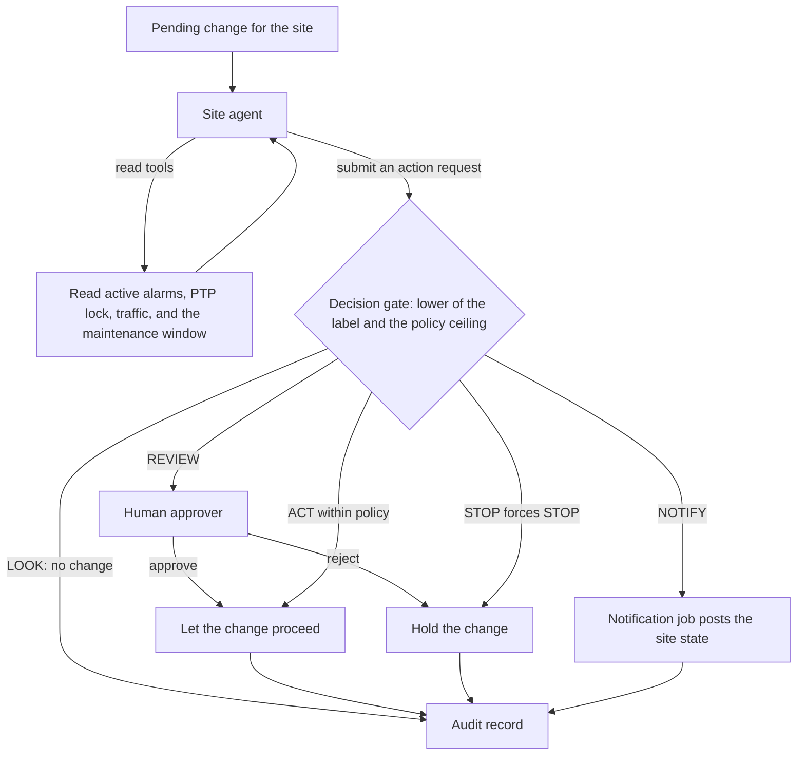

<!-- Writing rules: framework/style-guide.md. Name each component by its role and the Red Hat product used. Write no product support status. -->

# Site change-risk gate

## At a glance

| Field | Value |
|---|---|
| One-liner | Checks live site state before a change lands on a cell site and holds risky changes. Acts within policy only on low-risk change types, once that stage is earned; OS and firmware upgrades always need approval. Depends on the Decision slot on CPU at the site and the Decision gate. |
| Problem | Changes land on busy or degraded cell sites and fail; the KPI is the failed-change rate |
| Audience | Change managers, approvers, and risk owners for cell-site changes |
| OTel slots | `decision`: the gate label for each pending change |
| Autonomy ceiling | Act within policy, for low-risk change types only |
| Placement tier | Far edge: the Decision slot on CPU on the cell-site single-node OpenShift server; no model at the regional site or core |
| Agent-school courses | 301 in the [agent-school roadmap](https://github.com/open-experiments/agent-school/blob/main/docs/RoadMap.md) |

## Problem and value

Changes cause outages and truck rolls when they land on a busy or degraded cell site, whether an SMO or EMS operation, a ZTP or TALM policy, or an OS or firmware upgrade.
This recipe checks live site state at the site before each change and sends the change through the Decision gate, so every hold or release leaves evidence and an audit record.
The KPIs are the failed-change rate and truck rolls after changes.
The ROI measure is changes deferred that would have failed times the cost of an outage or truck roll, plus the failed-change rate before and after; measure both in shadow with the [PB-10](../../../platform/compliance-operating-model/README.md#staged-rollout-and-roi) measures, from inputs you supply.

## How it works



1. A change scheduled for the site, from an SMO or EMS, or a ZTP or TALM policy, triggers the site agent, a fixed workflow with no LLM.
2. The agent reads site state through read-only tools behind the MCP Gateway, which denies each call unless a role allows it, the deny-unless-allowed rule in [PB-05](../../../platform/integration/README.md#per-tool-authorization).
3. It builds a fixed site-state summary: active alarms, PTP lock state, traffic against the usual level, and whether the maintenance window is open.
4. The agent sends the change as an action request, and the Decision slot answers a fixed label question on CPU at the site, at the [decision gate](../../../architecture/decision-gate.md).
5. The gate takes the lower of the label and the policy ceiling for the change class.
6. ACT lets a low-risk change proceed through the [action layer](../../../platform/action-layer/README.md), REVIEW sends it to an approver, and STOP holds it.
7. The outcome and its evidence go to the audit record.

The outcome is the lower of the model label and the policy ceiling for the capability and risk class, so it never exceeds either. A STOP label forces STOP at every stage. Every change class starts at the shadow stage, and a confirmed false ACT drops the class back one stage, as [PB-06](../../../platform/safety-autonomy-gating/README.md#staged-autonomy) sets out.

Only low-risk change types can earn ACT, within the Ceiling for low-risk writes and after the Canary window; that stage targets Level 3 for low-risk change types only. OS and firmware upgrades are always REVIEW. The gate result for the operator's NOC is NOTIFY from the assist stage up.

### Tools and risk classes

| Tool | Risk class | Who may call it |
|---|---|---|
| Read active alarms on the site | `read` | The agent, from the shadow stage up |
| Read PTP lock state | `read` | The agent, from the shadow stage up |
| Read traffic counters | `read` | The agent, from the shadow stage up |
| Read the maintenance window | `read` | The agent, from the shadow stage up |
| `submit_action_request` to let a low-risk change proceed | `write_low` | The agent; its only write path |
| `submit_action_request` to release an OS or firmware upgrade | `write_high`, always REVIEW | The agent; its only write path |
| Hold a change | The safe default; no write | The action layer, on STOP, LOOK, or a rejected REVIEW |

### Slots and checkpoints

| Slot | Checkpoint | Role | Placement |
|---|---|---|---|
| `decision` | OTel-2.0-Decision-26B-A4B-4bit, pinned by revision | Gives the gate label on CPU at the site | Far edge |

No 31B or other LLM runs at the site.

### Worked example: a firmware upgrade on a site that lost PTP lock

A firmware upgrade, change `chg-7781`, is scheduled for cell site `cs-north-0417` inside its maintenance window. `site-gate-agent` reads the site state and finds that PTP lock was lost 10 minutes earlier and a critical alarm is active. The Decision slot labels the request STOP, and STOP forces STOP whatever the ceiling.

The action layer holds the change and writes the audit record with the site state, per the [decision gate](../../../architecture/decision-gate.md#policy-table) policy table. The approver reschedules the upgrade for the next window, after the timing fault is cleared.

## What you need

- [ ] Models: the Decision slot from the family in [PB-01](../../../platform/intake-model-selection/README.md), pinned by revision with its licence chain recorded
- [ ] Platform blueprints: the pages for [PB-02](../../../platform/evaluation-acceptance/README.md), [PB-04](../../../platform/serving-routing-placement/README.md), [PB-05](../../../platform/integration/README.md), [PB-06](../../../platform/safety-autonomy-gating/README.md), [PB-07](../../../platform/action-layer/README.md), [PB-08](../../../platform/security-identity-sandbox/README.md), [PB-09](../../../platform/quality-operations/README.md), and [PB-10](../../../platform/compliance-operating-model/README.md)
- [ ] Components: one product for each role in the components table
- [ ] Integrations: read-only site state tools; the change system (SMO or EMS, ZTP or TALM policy) receives hold or proceed as action requests through the action layer
- [ ] Write path: `submit_action_request` is the agent's only write tool, and only the job templates that release or hold a change hold write credentials
- [ ] Prerequisites: a cell-site single-node OpenShift server with spare non-real-time cores, as [Servers shared with a vDU](../../../architecture/placement.md#servers-shared-with-a-vdu) sets out, and the CPU image of Red Hat AI Inference, `vllm-cpu-rhel9`
- [ ] Decision engine: vLLM 0.26 or 0.30 on CUDA or ROCm, as the [Decision model card](https://huggingface.co/farbodtavakkoli/OTel-2.0-Decision-26B-A4B-4bit) states; this recipe runs it on the CPU image instead, which the card doesn't name, so pass the Decision CPU check before it serves traffic
- [ ] Decision CPU check: check the shipped W4A16 build on the CPU image, or make a W8A8 or an AWQ or GPTQ W4A16 build with LLM Compressor, and evaluate it on the same gates
- [ ] Agent identity: a workload identity bound to the read roles and `submit_action_request` only, as PB-08 sets out
- [ ] Data: recorded past changes with their outcomes, and a gate set weighted toward non-ACT cases
- [ ] Traces: site-state summaries, gate decisions, approvals, and holds, as PB-09 sets out

CPU serving settings: run the Decision slot only on the spare non-real-time cores for AI, never on the isolated cores the vDU pins. Set `VLLM_CPU_OMP_THREADS_BIND` to that core list, and cap the KV cache with `--kv-cache-memory-bytes` so weights and KV cache stay inside the system memory set aside for AI, as [PB-04 Key settings per setup](../../../platform/serving-routing-placement/README.md#key-settings-per-setup) sets out.

| Component role | Red Hat product used |
|---|---|
| Site server platform | Single-node OpenShift |
| Inference engine for the Decision slot | Red Hat AI Inference (vLLM), CPU image `vllm-cpu-rhel9` |
| Version record for the checkpoint and its pass | Model Registry in Red Hat OpenShift AI |
| Tool gateway for per-tool authorization | MCP gateway in Red Hat Connectivity Link |
| Action orchestration for the gate, approval, hold, and audit | Automation Orchestrator for Red Hat Ansible Automation Platform |
| Execution with the only write credentials | Job templates in Red Hat Ansible Automation Platform |
| Policy rollout for ZTP changes | Topology Aware Lifecycle Manager |
| SMO or EMS | Your choice; this design names no product |

Key flags for each slot, copied from [PB-04](../../../platform/serving-routing-placement/README.md#key-flags-per-slot).

```text
# Decision (card recipe)
--revision <sha> --max-logprobs 64 --enable-prefix-caching --max-model-len 16384
```

Any component can be replaced. The Red Hat products named here show one way to build this design.

### What you bring

<!-- generated:what-you-bring start -->

| Model change | Your expertise | How far to climb |
|---|---|---|
| No model change: a skill per role and a capability manifest per tool | A golden set your experts label; gate labels from your approvers; a contract for each tool | Configure first, and train only on a measured gap, as [PB-03 Adaptation](../../../platform/adaptation/README.md) sets out |

| Item | Network component | Mechanism | Owner | Matrix row |
|---|---|---|---|---|
| Read-only site state tool contracts | RAN; vRAN and O-RAN | MCP tool contract | Platform team | [RAN](../../../platform/bring-your-own-data/README.md#domain-ran); [vRAN and O-RAN](../../../platform/bring-your-own-data/README.md#domain-vran-and-o-ran) |
| Change types with risk classes and ceilings | RAN; vRAN and O-RAN | Gate and action-layer policy | Risk owner | [RAN](../../../platform/bring-your-own-data/README.md#domain-ran); [vRAN and O-RAN](../../../platform/bring-your-own-data/README.md#domain-vran-and-o-ran) |
| Gate labels on recorded past changes | RAN; vRAN and O-RAN | Gate and action-layer policy | Risk owner | [RAN](../../../platform/bring-your-own-data/README.md#domain-ran); [vRAN and O-RAN](../../../platform/bring-your-own-data/README.md#domain-vran-and-o-ran) |
| Site gate skill and capability manifests | RAN; vRAN and O-RAN | Skill or capability manifest | SME | [RAN](../../../platform/bring-your-own-data/README.md#domain-ran); [vRAN and O-RAN](../../../platform/bring-your-own-data/README.md#domain-vran-and-o-ran) |

<!-- generated:what-you-bring end -->

### Sandbox

<!-- generated:sandbox start -->

| Sandbox fit | Trigger on this page | Where to read |
|---|---|---|
| Sandbox the whole agent: run it under OpenShell policy inside a micro-VM | Can act within policy on low-risk change types once earned | [PB-08: when a use case needs a sandbox](../../../platform/security-identity-sandbox/README.md#when-a-use-case-needs-a-sandbox) |

<!-- generated:sandbox end -->

### What you must add

| Gap | What you add | Source |
|---|---|---|
| Golden set | Recorded past changes with outcomes your SMEs confirmed, replayed on stateful mocks and scored with the PB-02 false-ACT method, because the card asks you to validate on your own human-labelled data | [OTel-2.0-Decision-26B-A4B-4bit model card](https://huggingface.co/farbodtavakkoli/OTel-2.0-Decision-26B-A4B-4bit#limitations-and-responsible-use) |
| Gate labels | A gate set of past changes your approvers labelled, weighted toward non-ACT cases, because the Decision slot turns label probabilities into decisions through thresholds you set | [OTel-2.0-Decision-26B-A4B-4bit model card](https://huggingface.co/farbodtavakkoli/OTel-2.0-Decision-26B-A4B-4bit) |
| Tool contracts | A pinned contract for each read tool, including the PTP clock state and the update start control your change system exposes | [Using PTP hardware](https://docs.redhat.com/en/documentation/openshift_container_platform/4.20/html/advanced_networking/using-ptp-hardware); [Topology Aware Lifecycle Manager](https://docs.redhat.com/en/documentation/openshift_container_platform/4.20/html/edge_computing/cnf-talm-for-cluster-updates) |
| Decision CPU build | The Decision CPU check: the shipped build on the CPU image, or your own CPU build, evaluated on the same gates | [vLLM CPU installation](https://docs.vllm.ai/en/latest/getting_started/installation/cpu/) |
| Language scope | Tests in every language your change records use, because the card's evaluation covers English text only | [OTel-2.0-Decision-26B-A4B-4bit model card](https://huggingface.co/farbodtavakkoli/OTel-2.0-Decision-26B-A4B-4bit#limitations-and-responsible-use) |

## Governance

Each action request passes the [decision gate](../../../architecture/decision-gate.md), and the outcome never exceeds the policy ceiling for its class. The outcome is the lower of the model label and the policy ceiling for the capability and risk class, so it never exceeds either. A STOP label forces STOP at every stage.

| Action | Gate outcome (LOOK/NOTIFY/REVIEW/ACT/STOP) | Approval | AI Act class |
|---|---|---|---|
| Read alarms, PTP lock state, traffic, and the maintenance window, `read` | LOOK | None | [Recorded by your legal team in the classification record](../../../platform/compliance-operating-model/README.md) |
| Post the gate result to the operator's NOC, `notify` | NOTIFY, from the assist stage up | None | [Recorded by your legal team in the classification record](../../../platform/compliance-operating-model/README.md) |
| Let a low-risk change proceed, `write_low` | REVIEW from the recommend stage up, then ACT at the act stage within the Ceiling for low-risk writes, after the Canary window | The `approver` role while the outcome is REVIEW | [Recorded by your legal team in the classification record](../../../platform/compliance-operating-model/README.md) |
| Release an OS or firmware upgrade, `write_high` | REVIEW only, from the recommend stage up | The `approver` role | [Recorded by your legal team in the classification record](../../../platform/compliance-operating-model/README.md) |
| Hold a change | STOP or LOOK | None | [Recorded by your legal team in the classification record](../../../platform/compliance-operating-model/README.md) |

| Parameter | What it controls | Who sets it | How to calibrate |
|---|---|---|---|
| Change types eligible for ACT | Which low-risk change types may ever reach the act stage; OS and firmware upgrades never do | Risk owner | Review failed changes per change type with SMEs and list only reversible types with a tested hold |
| Shadow agreement floor | How often shadow outcomes must match what people did before a use case moves to assist | Risk owner, with SME review | [Evaluation and acceptance method](../../../platform/evaluation-acceptance/README.md): compare shadow outcomes with logged human actions over a window the risk owner sets |
| Canary window | How long, and over how many requests, a raised ceiling runs on a small share of traffic | Risk owner | [Evaluation and acceptance method](../../../platform/evaluation-acceptance/README.md): size the window to hold enough state-changing requests to bound the false-ACT rate |
| Minimum ACT probability for the act stage | The lowest calibrated ACT probability at which the act stage may run a playbook alone | Risk owner, with SME review | Evaluation and acceptance calibration: fit on an operator gate set labelled by SMEs, and check calibration error |
| Override rate ceiling | The share of human overrides that sends a use case back one stage | Business owner | [Evaluation and acceptance method](../../../platform/evaluation-acceptance/README.md): count overrides per use case and action class in the trace |
| Decision false-ACT budget | The highest false-ACT rate accepted on state-changing proposals | Risk owner | [Evaluation and acceptance](../../../platform/evaluation-acceptance/README.md#false-act-method): use the false-ACT method, with a gate set large enough for the rule of three |
| Ceiling for low-risk writes | The highest outcome for reversible changes such as an interface restart | Risk owner | [Evaluation and acceptance method](../../../platform/evaluation-acceptance/README.md): raise it only after a canary window with no false ACT label |
| Ceiling for high-risk writes | The highest outcome for changes that are hard to reverse or affect many customers | Risk owner | [Evaluation and acceptance method](../../../platform/evaluation-acceptance/README.md): keep it at REVIEW until the risk owner signs off on canary evidence |
| Required approver role per action class | Which role approves REVIEW for each action class | Risk owner | [Evaluation and acceptance method](../../../platform/evaluation-acceptance/README.md): check approval times and overrides per class in the trace |

This page gives no default values. Each owner sets the value with SME review and versions it with the policy that `policy_version` names.

| Activity | Responsible | Accountable | Consulted | Informed |
|---|---|---|---|---|
| Approve a REVIEW request | Approver | Business owner | SME | Operations engineer |
| Change a policy ceiling | Operations engineer | Risk owner | Change board and SME | Business owner |
| Promote a use case to the next stage | Approver | Risk owner | SME | Platform team |
| Drop a use case back a stage | Approver | Risk owner | Platform team | Security |
| Approve a canary | Approver | Risk owner | Model owner | Security |

## Sources

Each key claim links its source, as set out in [the Sources table](../../../framework/definitions.md#sources-table).

| # | Claim | Basis | Source |
|---|---|---|---|
| 1 | At Level 3 the system also shares analysis and decision, and levels apply to selected scenarios | project documentation | [TM Forum Autonomous Networks whitepaper](https://www.tmforum.org/wp-content/uploads/2019/05/22553-Autonomous-Networks-whitepaper.pdf) |
| 2 | The Decision model reads decisions from label probabilities and uses them for confidence thresholds and routing, on vLLM 0.26 or 0.30 on ROCm or CUDA | model card | [OTel-2.0-Decision-26B-A4B-4bit model card](https://huggingface.co/farbodtavakkoli/OTel-2.0-Decision-26B-A4B-4bit) |
| 3 | The Decision evaluation covers English text only; validate on your own human-labelled data, don't assume calibrated probabilities, and keep human review for consequential decisions | model card | [OTel-2.0-Decision-26B-A4B-4bit model card](https://huggingface.co/farbodtavakkoli/OTel-2.0-Decision-26B-A4B-4bit#limitations-and-responsible-use) |
| 4 | Red Hat AI Inference ships a CPU image, `vllm-cpu-rhel9` | Red Hat guidance | [Red Hat AI Inference release notes](https://docs.redhat.com/en/documentation/red_hat_ai_inference/3.5/html/release_notes/rhaii-350-ga-release-notes_release-notes) |
| 5 | vLLM on CPU binds its threads to the cores in `VLLM_CPU_OMP_THREADS_BIND`, `--kv-cache-memory-bytes` replaces the legacy KV cache setting, and x86 CPUs support AWQ, GPTQ, and compressed-tensors INT8 W8A8 | project documentation | [vLLM CPU installation](https://docs.vllm.ai/en/latest/getting_started/installation/cpu/) |
| 6 | The RAN DU reference design pins platform pods to reserved cores, and unreserved cores stay allocatable for workloads | Red Hat guidance | [RAN DU reference design](https://docs.redhat.com/en/documentation/openshift_container_platform/4.20/html/scalability_and_performance/telco-ran-du-ref-design-specs) |
| 7 | Topology Aware Lifecycle Manager rolls out cluster policies, and the enable field of a ClusterGroupUpgrade controls when an update starts, for example to fit a maintenance window | Red Hat guidance | [Topology Aware Lifecycle Manager](https://docs.redhat.com/en/documentation/openshift_container_platform/4.20/html/edge_computing/cnf-talm-for-cluster-updates) |
| 8 | The PTP Operator reports the PTP clock state as LOCKED, HOLDOVER, or FREERUN, and fast event notifications pass clock sync status to vRAN applications on the DU node | Red Hat guidance | [Using PTP hardware](https://docs.redhat.com/en/documentation/openshift_container_platform/4.20/html/advanced_networking/using-ptp-hardware) |
| 9 | The F2 offline replay runs the gate pattern on recorded incidents with recorded Decision labels and no model | project documentation | [F2 closed-loop folder](https://github.com/ravisharma5/otel-telco-blueprints-impl/tree/main/f2-closed-loop) |

## Deploy and verify

Apply these settings in order. Every change class starts at the shadow stage, and OS and firmware upgrades never get an outcome higher than REVIEW.

1. Pin the Decision slot through intake ([PB-01](../../../platform/intake-model-selection/README.md)), and record its revision and licence chain in the model registry.
2. Pass the Decision CPU check, then deploy the slot on the site server with the CPU settings and flags from What you need.
3. Connect the read tools behind the gateway, and mark every OS and firmware upgrade as `write_high`.
4. Have each owner load the parameters from Governance, with every class at the shadow stage in the stage register.
5. Run PB-02 operator offline acceptance on replayed past changes with stateful mocks, with the false-ACT method for the Decision slot, then promote through the PB-06 stage register.

| Check | PB-02 gate or parameter | Owner |
|---|---|---|
| Shadow outcomes match what people did on past changes | Shadow agreement floor | Risk owner |
| ACT labels on changes whose ground truth is not ACT stay within budget | Decision false-ACT budget | Risk owner |
| The act stage runs alone only when the calibrated ACT probability clears its floor | Minimum ACT probability for the act stage | Risk owner |
| Only listed change types ever reach ACT | Change types eligible for ACT | Risk owner |
| Human overrides stay below the ceiling during the canary | Override rate ceiling | Business owner |

- Agent-school: 301 adds an approval gate to a closed loop, in the [agent-school roadmap](https://github.com/open-experiments/agent-school/blob/main/docs/RoadMap.md)
- Reference implementation: the gate pattern this recipe reuses runs end to end in the [F2 offline quickstart](https://github.com/ravisharma5/otel-telco-blueprints-impl/tree/main/f2-closed-loop), which replays incidents, not changes
- Architecture: the [decision gate](../../../architecture/decision-gate.md) for labels and policy ceilings

## Limitations

- It never releases an OS or firmware upgrade without approval; every `write_high` request goes to REVIEW.
- It acts alone only on low-risk change types, and only after the class earns the act stage.
- Label quality depends on your labelled recorded changes.
- The shipped Decision build must pass the CPU check, or you make and evaluate your own build.
- OTel quality claims cover English only, as the [Decision model card](https://huggingface.co/farbodtavakkoli/OTel-2.0-Decision-26B-A4B-4bit#limitations-and-responsible-use) states.
- The AI Act class is your legal team's call, recorded in the [classification record](../../../platform/compliance-operating-model/README.md).
