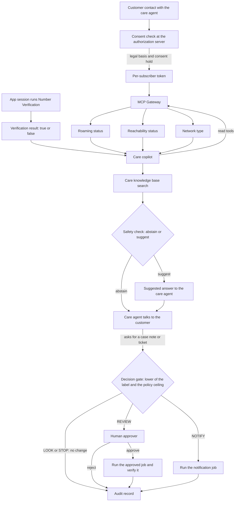

<!-- Writing rules: framework/style-guide.md. Name each component by its role and the Red Hat product used. Write no product support status. -->

# CAMARA customer-care diagnostics

## At a glance

| Field | Value |
|---|---|
| One-liner | Suggests answers to a care agent from CAMARA device diagnostics, with the customer's consent checked before any tool call. Recommends only; the care agent decides. Depends on the operator's consent service and the MCP gateway. |
| Problem | Care agents can't see network state on "no service" calls; the KPIs are average handling time and first-contact resolution |
| Audience | Care agents, care operations, the data protection officer, and the risk owner |
| OTel slots | `llm`: drafts the suggestion, small at the regional site and large at the core; `safety`: abstains when evidence is missing; `embedding` and `reranker`: search the care knowledge base; `decision`: picks the LLM size, and the gate label for case notes and tickets |
| Autonomy ceiling | Recommend with approval |
| Placement tier | Regional and core |
| Agent-school courses | 303 and 304 in the [agent-school roadmap](https://github.com/open-experiments/agent-school/blob/main/docs/RoadMap.md); no course covers CAMARA |

## Problem and value

"No service" calls take long because the care agent can't see whether the device is roaming, reachable, or on which network type.
This recipe reads that state through CAMARA APIs, with the customer's consent, and suggests an answer that cites the care knowledge base, while the care agent stays the one who talks to the customer.
The KPIs are average handling time and first-contact resolution; any ROI is a target, measured against the shadow-stage baseline with the [PB-10](../../../platform/compliance-operating-model/README.md#staged-rollout-and-roi) measures.

## How it works



1. The customer contacts care, and the care agent opens a case. If the customer's app has run Number Verification in its own session on the device, the copilot receives only the true or false result. The copilot never receives a phone number from the model and never sends one to a tool.
2. The operator's consent service checks the legal basis and consent before any tool call. The purpose travels as a `dpv:` scope, and the Authorization Server checks the Consent Master where consent is needed; a CIBA flow can ask the customer out of band.
3. The Authorization Server issues a per-subscriber three-legged token. The MCP Gateway exchanges it for a token scoped to the CAMARA backend, and the token never enters model context.
4. The copilot calls the three device-status tools through the MCP Gateway. Each request carries no `device` identifier, because the token identifies the subject. The gateway denies any call unless a role allows it, the deny-unless-allowed rule in [PB-05](../../../platform/integration/README.md#per-tool-authorization).
5. The Embedding and Reranker slots search the care knowledge base. The Decision slot picks the small or large LLM, and that LLM drafts an answer that cites the passages.
6. The Safety slot checks that the evidence supports the answer. If it doesn't, the Safety slot abstains and the care agent follows the usual care process. Output guardrails screen the suggestion for personal data.
7. The care agent reads the suggestion, decides, and talks to the customer.
8. To add a case note or open a TMF621 network trouble ticket, the copilot sends an action request with `submit_action_request`, and the Decision slot answers a fixed label question for the [decision gate](../../../architecture/decision-gate.md). From the assist stage up, a case note becomes a notification job (NOTIFY). From the recommend stage up, a ticket waits for the approver (REVIEW). STOP changes nothing.

The outcome is the lower of the model label and the policy ceiling for the capability and risk class, so it never exceeds either. A STOP label forces STOP at every stage. A confirmed false ACT drops the use case and its action class back one stage, as [PB-06](../../../platform/safety-autonomy-gating/README.md#staged-autonomy) sets out. A blocked prompt injection in case or knowledge base text opens a SOC case and does not drop a stage.

### Tools and risk classes

| Tool | CAMARA operation | What it returns | Risk class |
|---|---|---|---|
| Roaming status | Device Roaming Status `getRoamingStatus`, `POST /retrieve` | `roaming`, plus `countryCode` and `countryName` while roaming | `read` |
| Reachability status | Device Reachability Status `getReachabilityStatus`, `POST /retrieve` | `reachable`, plus `connectivity` as `DATA`, `SMS`, or both | `read` |
| Network type | Connected Network Type `getConnectedNetworkType`, `POST /retrieve` | `connectedNetworkType`: `2G`, `3G`, `4G`, or `5G` | `read` |
| Care knowledge base search | None | Passages with their usage rights | `read` |
| `submit_action_request` | None | The gate outcome for a case note or a TMF621 ticket | `notify` for a case note; `write_low` for a ticket, because it sends work to network operations |

Number Verification is a session result from the customer's app, not a copilot tool. Risk classes follow the [decision gate schema](https://github.com/ravisharma5/otel-telco-blueprints/blob/main/schemas/decision-gate.schema.json), which lets you map your own.

### Consent and privacy

Consent stays in CAMARA's own flow, outside the copilot. Each purpose is registered as a `dpv:` scope, and the Authorization Server checks the legal basis and, where consent is needed, the Consent Master before it issues a token. The MCP Gateway exchanges that token for one scoped to the CAMARA backend, which grants access on the token alone. Three-legged tokens are required, because the CAMARA specifications make them mandatory where personal data is processed.

CAMARA's Identity and Consent Management working group has [an open issue](https://github.com/camaraproject/IdentityAndConsentManagement/issues/347) to define security, privacy, and consent guidance for MCP tool servers. Until CAMARA publishes that guidance, its MCP work does not define how a tool call carries consent.

Traces hold metadata only; span content capture runs only as an opt-in that the data protection officer approves, as [PB-09](../../../platform/quality-operations/README.md) sets out. The roaming country is location-related data, so map it to the ePrivacy rows in the [PB-10 privacy map](../../../platform/compliance-operating-model/README.md#privacy-map-for-gdpr-and-eprivacy). Your legal team owns the conclusions.

### Worked example: no mobile data while roaming

A customer abroad reports no mobile data, and the care agent opens `case-8841` for subscriber `+44 7700 900123`. The customer's app ran Number Verification on the device, and the copilot `care-copilot` receives `true`.

With the token from the consent check, roaming status returns `roaming: true` and `countryCode: 262`, reachability returns `connectivity: ["SMS"]` only, and network type returns `4G`. The copilot cites the care knowledge base and suggests checking that data roaming is on in the device settings and in the plan. The care agent walks the customer through it, and data returns.

The care agent asks for a case note. The copilot sends `req-8841-1` as a `notify` request. Case notes are at the assist stage, so the gate's NOTIFY outcome becomes a notification job that writes the note, per the [policy table](../../../architecture/decision-gate.md#policy-table). No ticket is needed.

## What you need

- [ ] Models: the five slots, chosen from the family in [PB-01](../../../platform/intake-model-selection/README.md), each pinned by revision with its licence chain recorded
- [ ] Platform blueprints: the pages for [PB-02](../../../platform/evaluation-acceptance/README.md), [PB-04](../../../platform/serving-routing-placement/README.md), [PB-05](../../../platform/integration/README.md), [PB-06](../../../platform/safety-autonomy-gating/README.md), [PB-07](../../../platform/action-layer/README.md), [PB-08](../../../platform/security-identity-sandbox/README.md), [PB-09](../../../platform/quality-operations/README.md), and [PB-10](../../../platform/compliance-operating-model/README.md)
- [ ] Components: one product for each role in the components table
- [ ] Integrations: the Device Roaming Status, Device Reachability Status, and Connected Network Type APIs behind the MCP Gateway, the TMF621 API for network tickets, and your care case system
- [ ] Number Verification: run in the customer's app, which passes only the result to the case
- [ ] Tokens: three-legged tokens only, and per-tool authorization that denies a call unless a role allows it
- [ ] Data: a care knowledge base with usage rights recorded in the [PB-05 corpus register](../../../platform/integration/README.md#knowledge-sources-and-usage-rights)
- [ ] Decision engine: vLLM 0.26 or later on CUDA, or 0.30 or later on ROCm, as the [Decision model card](https://huggingface.co/farbodtavakkoli/OTel-2.0-Decision-26B-A4B-4bit) states
- [ ] Placement: the regional site runs Embedding, Reranker, Safety, Decision, and the small LLM. The core runs the large LLM for harder cases.
- [ ] Commitments: no credits, refunds, or service-level statements in a suggestion without a deterministic policy lookup
- [ ] Stage register: every action class starts at the shadow stage

| Component role | Red Hat product used |
|---|---|
| Consent service: the operator's CAMARA Authorization Server and Consent Master | Operator-built, on Red Hat OpenShift |
| Tool gateway for per-tool authorization and token exchange | MCP gateway in Red Hat Connectivity Link |
| Workload identity for the copilot | Zero Trust Workload Identity Manager for Red Hat OpenShift |
| Action orchestration for the gate, approval, notification job, and audit | Automation Orchestrator for Red Hat Ansible Automation Platform |
| Inference engine for every slot | Red Hat AI Inference (vLLM) |
| Input and output guardrails | NeMo Guardrails in Red Hat OpenShift AI |

Key flags for each slot, copied from [PB-04](../../../platform/serving-routing-placement/README.md#key-flags-per-slot). Start the Safety slot and the small LLM each with its own pinned revision, and the Safety slot with no tool-calling flags.

```text
# LLM 31B (pin the revision; text-only; tool calling)
--revision <sha> --enable-auto-tool-choice --tool-call-parser gemma4 \
--limit-mm-per-prompt '{"image": 0, "audio": 0}'
# Decision (card recipe)
--revision <sha> --max-logprobs 64 --enable-prefix-caching --max-model-len 16384
# Classification (Gemma3TextForSequenceClassification) and Reranker (num_labels=1)
--runner pooling --convert classify        # endpoints /classify, /v1/score, /rerank
# Embedding
--runner pooling --convert embed           # endpoint /v1/embeddings
```

Any component can be replaced. The Red Hat products named here show one way to build this design.

## Governance

Each action request passes the [decision gate](../../../architecture/decision-gate.md). Suggestions to the care agent send no action request.

| Action | Gate outcome (LOOK/NOTIFY/REVIEW/ACT/STOP) | Approval | AI Act class |
|---|---|---|---|
| Suggest an answer to the care agent | LOOK, with no action request | None; the care agent decides | [Recorded by your legal team in the classification record](../../../platform/compliance-operating-model/README.md) |
| Add a diagnostic note to the customer case, `notify` | NOTIFY, run as a notification job, from the assist stage up | None | [Recorded by your legal team in the classification record](../../../platform/compliance-operating-model/README.md) |
| Open a network trouble ticket (TMF621), `write_low` | REVIEW, from the recommend stage up | The `approver` role | [Recorded by your legal team in the classification record](../../../platform/compliance-operating-model/README.md) |
| Any request the label marks STOP | STOP | None | [Recorded by your legal team in the classification record](../../../platform/compliance-operating-model/README.md) |

| Parameter | What it controls | Who sets it | How to calibrate |
|---|---|---|---|
| Safety abstain-recall floor | The lowest share of insufficient-context items where the Safety slot abstains | Risk owner, with subject-matter expert (SME) review | Build items with the evidence removed and measure correct abstention |
| Safety false-abstention ceiling | The highest share of sufficient-context items where the Safety slot abstains | Business owner | Measure abstention on items with full evidence, and weigh it against the human workload |
| LLM groundedness floor | The lowest share of answers whose claims the cited passages support | Risk owner, with SME review | Score a golden set of operator questions with SME-checked answers and a calibrated judge |
| Embedding and Reranker recall-at-k floor | The lowest share of questions with a correct passage in the top results | Platform team, with SME review | Label relevant passages for operator questions; the reranker must beat retriever-only on the same set |
| Decision routing threshold | The label probability over which the large LLM drafts the suggestion instead of the small LLM | Model owner | [Evaluation and acceptance](../../../platform/evaluation-acceptance/README.md): run the small and large LLM on the same golden set, and keep a case band on the small LLM only while it meets the same gates |
| Ceiling for read requests | The highest outcome for requests that only read | Risk owner, with SME review | [Evaluation and acceptance method](../../../platform/evaluation-acceptance/README.md): review the gate set for read requests and the human review load |
| Ceiling for notify requests | The highest outcome for notifications and ticket notes | Risk owner, with SME review | [Evaluation and acceptance method](../../../platform/evaluation-acceptance/README.md): review notify cases for duplicates and noise |
| Ceiling for low-risk writes | The highest outcome for reversible changes such as an interface restart | Risk owner | [Evaluation and acceptance method](../../../platform/evaluation-acceptance/README.md): raise it only after a canary window with no false ACT label |
| Required approver role per action class | Which role approves REVIEW for each action class | Risk owner | [Evaluation and acceptance method](../../../platform/evaluation-acceptance/README.md): check approval times and overrides per class in the trace |
| Override rate ceiling | The share of human overrides that sends a use case back one stage | Business owner | [Evaluation and acceptance method](../../../platform/evaluation-acceptance/README.md): count overrides per use case and action class in the trace |
| Trace archive retention period | How long archived prompts and tool payloads are kept before deletion | Data protection officer | Set from the retention period the applicable law and your audit needs require |

This page gives no default values. Each owner sets the value with SME review and versions it with the policy that `policy_version` names.

| Activity | Responsible | Accountable | Consulted | Informed |
|---|---|---|---|---|
| Approve a REVIEW request | Approver | Business owner | SME | Operations engineer |
| Tune Safety slot abstention | Platform team | Model owner | SME | Business owner |
| Approve content capture | Platform team | Data protection officer | Security | Risk owner |
| Run the DPIA | Data protection officer | Business owner | Legal team | Risk owner |
| Classify the use case under the EU AI Act | Risk owner | Legal team | Business owner and data protection officer | Security |

## Sources

Each key claim links its source, as set out in [the Sources table](../../../framework/definitions.md#sources-table).

| # | Claim | Basis | Source |
|---|---|---|---|
| 1 | `getRoamingStatus` on `POST /retrieve` returns `roaming`, and `countryCode` and `countryName` while roaming | project documentation | [Device Roaming Status API definition](https://github.com/camaraproject/DeviceRoamingStatus/blob/r1.2/code/API_definitions/device-roaming-status.yaml) |
| 2 | With a three-legged token the request carries no `device` object, because the token identifies the subject; three-legged tokens are mandatory where personal data is processed and users can opt in or out | project documentation | [Device Roaming Status API definition](https://github.com/camaraproject/DeviceRoamingStatus/blob/r1.2/code/API_definitions/device-roaming-status.yaml) |
| 3 | `getReachabilityStatus` on `POST /retrieve` returns `reachable` and `connectivity` as `DATA`, `SMS`, or both | project documentation | [Device Reachability Status API definition](https://github.com/camaraproject/DeviceReachabilityStatus/blob/r1.2/code/API_definitions/device-reachability-status.yaml) |
| 4 | `getConnectedNetworkType` on `POST /retrieve` returns `connectedNetworkType` as `2G`, `3G`, `4G`, or `5G` | project documentation | [Connected Network Type API definition](https://github.com/camaraproject/ConnectedNetworkType/blob/r1.2/code/API_definitions/connected-network-type.yaml) |
| 5 | Number Verification needs a three-legged token from network-based or SIM-based authentication, rejects SMS one-time passwords and passwords, and returns `devicePhoneNumberVerified` as true or false to the calling app | project documentation | [Number Verification API definition](https://github.com/camaraproject/NumberVerification/blob/r4.2/code/API_definitions/number-verification.yaml) |
| 6 | The purpose travels as a `dpv:` scope, the Authorization Server checks the legal basis and the Consent Master, and the API grants access on the access token alone | project documentation | [CAMARA API access and user consent](https://github.com/camaraproject/IdentityAndConsentManagement/blob/main/documentation/CAMARA-API-access-and-user-consent.md) |
| 7 | A CIBA flow authenticates the user and captures consent out of band | project documentation | [CAMARA API access and user consent](https://github.com/camaraproject/IdentityAndConsentManagement/blob/main/documentation/CAMARA-API-access-and-user-consent.md) |
| 8 | CAMARA's Identity and Consent Management working group has an open issue to define security, privacy, and consent guidance for MCP | research | [CAMARA issue 347](https://github.com/camaraproject/IdentityAndConsentManagement/issues/347) |
| 9 | Token exchange issues a new token for a named audience | project documentation | [RFC 8693 OAuth 2.0 Token Exchange](https://www.rfc-editor.org/rfc/rfc8693) |
| 10 | By default a valid user can call every tool behind the gateway | Red Hat guidance | [Locking down MCP at the gateway](https://developers.redhat.com/articles/2026/10/23/locking-down-mcp-at-the-gateway) |
| 11 | The Safety model is trained to refuse when retrieved context is insufficient; measure correct abstention in the full pipeline before deployment | model card | [OTel-LLM-12B-Safety model card](https://huggingface.co/farbodtavakkoli/OTel-LLM-12B-Safety) |
| 12 | Capturing prompts, completions, and retrieval content needs an explicit opt-in | project documentation | [GenAI spans](https://github.com/open-telemetry/semantic-conventions-genai/blob/main/docs/gen-ai/gen-ai-spans.md) |
| 13 | Use the Decision model's label probabilities for confidence thresholds and routing | model card | [OTel-2.0-Decision-26B-A4B-4bit model card](https://huggingface.co/farbodtavakkoli/OTel-2.0-Decision-26B-A4B-4bit) |

## Deploy and verify

Apply these settings in order. No action class rises past its stage until the gates pass.

1. Register each purpose as a `dpv:` scope, and wire the consent check into the Authorization Server.
2. Configure the MCP Gateway with deny-unless-allowed rules and token exchange for the three device-status tools.
3. Enable Number Verification in the customer app session, and pass only its result to the case.
4. Index the care knowledge base with its usage rights.
5. Deploy the slots with the flags from What you need.
6. Have each owner set the ceilings, the approver role, and the Safety parameters.
7. Run the [PB-02](../../../platform/evaluation-acceptance/README.md) acceptance in the shadow stage on replayed care cases with fictitious subscribers.

| Check | PB-02 gate or parameter | Owner |
|---|---|---|
| The Safety slot abstains when the evidence is missing | Safety abstain-recall floor | Risk owner |
| The Safety slot answers when the evidence is enough | Safety false-abstention ceiling | Business owner |
| Each suggestion's claims are supported by the cited passages | LLM groundedness floor | Risk owner |
| Case notes stay within the notify ceiling | Ceiling for notify requests | Risk owner |
| Care agents override few suggestions | Override rate ceiling | Business owner |
| No token or phone number appears in model context or traces | [Zero-tolerance rules](../../../platform/evaluation-acceptance/README.md#zero-tolerance-rules) | Security |

- Agent-school: no course covers CAMARA or customer care; 303 has the MCP gateway authorize tool calls by workload identity, and 304 attacks that authorization with prompt-injected tool escalation, in the [agent-school roadmap](https://github.com/open-experiments/agent-school/blob/main/docs/RoadMap.md)
- Architecture: the [decision gate](../../../architecture/decision-gate.md) page for the policy table
- CAMARA: the [Identity and Consent Management](https://github.com/camaraproject/IdentityAndConsentManagement) repository for the consent flows

## Limitations

- It never talks to the customer; the care agent does.
- It never commits credits, refunds, or service-level statements.
- It does not draw legal conclusions on consent or privacy; your legal team does.
- CAMARA's MCP consent guidance is the [open issue](https://github.com/camaraproject/IdentityAndConsentManagement/issues/347) in the Identity and Consent Management working group.
- It covers no customer-facing variant that answers customers directly.
- It reads device state only for the subscriber the token names.
