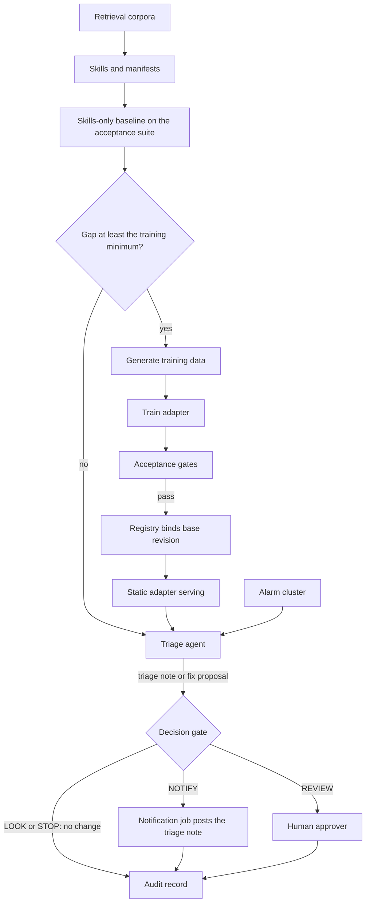

<!-- Writing rules: framework/style-guide.md. Name each component by its role and the Red Hat product used. Write no product support status. -->

# Adaptation ladder on alarm and root-cause triage

## At a glance

| Field | Value |
|---|---|
| One-liner | Runs triage on RAN and transport alarms and recommends fixes for approval. Starts with retrieval and skills only, and earns a LoRA adapter only when evaluation shows a measured gap. Depends on the acceptance gates and a model registry that binds each adapter to its base revision. |
| Problem | Alarm storms bury the root cause, and engineers label the same patterns by hand; the KPI is mean time to identify |
| Audience | Model owners, operations engineers, approvers, and risk owners who run alarm triage |
| OTel slots | `classification`: labels the likely cause; `llm`: the triage agent and the LoRA target; `safety`: checks the evidence behind a finding; `decision`: the gate label; `embedding` and `reranker`: retrieval |
| Autonomy ceiling | Recommend with approval |
| Placement tier | Regional for triage; core for data generation, training, and evaluation |
| Agent-school courses | 101, 401, 402, and 403 in the [agent-school roadmap](https://github.com/open-experiments/agent-school/blob/main/docs/RoadMap.md) |

## Problem and value

A site power event can raise dozens of RAN and transport alarms, and engineers sort them by hand to find the one cause.
This recipe runs triage on the cluster, writes a triage note, and proposes a fix for approval. It trains an adapter only when paired evaluation runs show a gap that retrieval and skills leave open.
The KPIs are mean time to identify and the share of incidents triaged without rework; any ROI is a target, measured against the shadow-stage baseline with the [PB-10](../../../platform/compliance-operating-model/README.md#staged-rollout-and-roi) measures.

## How it works



1. The platform team registers runbooks, alarm dictionaries, and past root-cause reports as retrieval corpora, each with a usage-rights entry ([PB-05](../../../platform/integration/README.md)).
2. The model owner writes the triage skill and a capability manifest for each tool it calls through the MCP Gateway. The gateway denies each call unless a role allows it, the deny-unless-allowed rule in [PB-05](../../../platform/integration/README.md#per-tool-authorization).
3. The skills-only baseline runs on the operator offline acceptance suite in [PB-02](../../../platform/evaluation-acceptance/README.md), in paired runs on identical items, and the registry records the result.
4. The when-to-train rule decides whether the gap earns an adapter. If it doesn't, the agent serves with skills only.
5. SDG Hub generates training data from the tool catalog, replayed tapes, and documents, using a teacher served on site. The data holds LOOK, NOTIFY, REVIEW, and STOP cases beside the ACT cases, using the labels from the [decision gate](../../../architecture/decision-gate.md).
6. Training Hub trains a LoRA adapter against one pinned base revision, and the adapter re-enters operator offline acceptance.
7. On a pass, the model registry binds the adapter to its base revision, and the engine loads it at start, pinned by digest.
8. The agent sends each triage note and fix proposal as an action request. The Decision slot answers a fixed label question, and STOP ends the request with no change.

The outcome is the lower of the model label and the policy ceiling for the capability and risk class, so it never exceeds either. A STOP label forces STOP at every stage. A confirmed false ACT drops the use case and its action class back one stage, as [PB-06](../../../platform/safety-autonomy-gating/README.md#staged-autonomy) sets out. A blocked prompt injection in alarm or ticket text opens a SOC case and does not drop a stage.

Triage notes are NOTIFY from the assist stage up, and the [action layer](../../../platform/action-layer/README.md) runs the notification job. A fix never gets an outcome higher than REVIEW, because this recipe stops at the recommend stage.

### Ladder in practice

| Rung | What you build | Gate to climb |
|---|---|---|
| Retrieval | Corpora behind the knowledge service, each with a usage-rights entry | Start here |
| Skills and capability manifests | The triage skill and one manifest per tool, with the six fields: backend pattern, I/O schema, risk class, allowed identities, rate class, and data class | Retrieval holds the facts, but the agent picks the wrong procedure or tool |
| LoRA | An adapter trained on SDG Hub data and bound to one base revision | The when-to-train rule holds |
| OSFT | A full fine-tune on a large proprietary corpus, served from its own pool | A LoRA adapter cannot close the gap; see [PB-03](../../../platform/adaptation/README.md) |

The rungs and their order come from the [adaptation ladder](../../../architecture/adaptation-ladder.md). The skills-only baseline is the bar the adapter must beat.

### When to train a LoRA

Train only when every row holds. The parameters belong to [PB-03](../../../platform/adaptation/README.md) and [PB-02](../../../platform/evaluation-acceptance/README.md).

| Condition | Evidence | Source |
|---|---|---|
| Retrieval and skills are in place | The skills-only baseline is recorded on the registry | Ladder rung table |
| The gap is large enough | In paired runs on identical items, the baseline shows a gap at least the Minimum measured gap to train, clear of run-to-run noise | PB-03 parameter |
| The gap is the right kind | It sits in vocabulary, tool calls, or output format. Missing facts go back to retrieval; a wrong procedure or tool goes back to skills | Ladder rung table |
| The data is fit to train on | It passes the [training data checks](../../../platform/adaptation/README.md#training-data-checks), including the Minimum share of non-ACT training cases | PB-03 checks |
| The adapter earns its place | It clears the same gates, and the Non-inferiority margin on every other item | PB-02 gates |

### Classification head and Decision slot

The Classification card's head predicts eight drive-test throughput classes from the synthetic TeleLogs dataset, not alarm causes. Retrain the Classification head on your own alarm taxonomy, as a full fine-tune of a small head, and gate it on the Classification per-class recall floor with a temporal holdout and on the Classification other-or-abstain recall floor. The Decision card publishes quantized weights only, so the model owner confirms an adaptation path with the card before training the Decision slot.

### Worked example: gNodeB alarm cluster after a site power event

A site power event raises NG-link and cell-down alarms on `gnb-114`, opening incident `inc-5520`. `ran-triage-agent` sends a triage note that points to the power event, the gate returns NOTIFY, and a notification job posts the note to the ticket, as the [decision gate](../../../architecture/decision-gate.md#policy-table) policy table shows.

In paired runs, the skills-only baseline labels power-related causes as transport faults and misses the note format. The facts are in retrieval and the procedure is right, so the gap is vocabulary and format, and it clears the Minimum measured gap to train. SDG Hub data from the tool catalog and replayed tapes holds LOOK, NOTIFY, REVIEW, and STOP cases. `alarm-triage-adapter` re-enters operator offline acceptance and meets the Non-inferiority margin.

The agent then proposes restarting the NG interface in `req-5520-1`. Fixes are at the recommend stage, so even if the label reads ACT, `dec-5520-1` records REVIEW. The `approver` role signs off before the action layer runs the restart.

## What you need

- [ ] Models: the six slots, chosen from the family in [PB-01](../../../platform/intake-model-selection/README.md), each pinned by revision with its licence chain recorded
- [ ] Platform blueprints: the pages for [PB-02](../../../platform/evaluation-acceptance/README.md), [PB-03](../../../platform/adaptation/README.md), [PB-04](../../../platform/serving-routing-placement/README.md), [PB-05](../../../platform/integration/README.md), [PB-06](../../../platform/safety-autonomy-gating/README.md), [PB-07](../../../platform/action-layer/README.md), and [PB-10](../../../platform/compliance-operating-model/README.md)
- [ ] Components: one product for each role in the components table
- [ ] Data: corpora with usage rights, your alarm taxonomy, and replayed tapes with SME labels
- [ ] Teacher: an open teacher served on site, with its licence chain recorded
- [ ] Adapters: loaded at start with `--lora-modules`, pinned by digest, with runtime loading blocked by policy
- [ ] Adapter storage: internal object storage, because the inference service rejects OCI URIs for adapters ([KServe issue 6094](https://github.com/kserve/kserve/issues/6094))
- [ ] Adapter rank: `--max-lora-rank` set to the highest trained rank
- [ ] Decision engine: vLLM 0.26 or later on CUDA, or 0.30 or later on ROCm, as the [Decision model card](https://huggingface.co/farbodtavakkoli/OTel-2.0-Decision-26B-A4B-4bit) states

| Component role | Red Hat product used |
|---|---|
| Synthetic data from tools, tapes, and documents | SDG Hub in Red Hat OpenShift AI |
| Training for LoRA adapters and the Classification head | Training Hub in Red Hat OpenShift AI |
| Experiment tracking for runs and datasets | MLflow in Red Hat OpenShift AI |
| Model registry that binds each adapter to its base revision | Model Registry in Red Hat OpenShift AI |
| Adapter policy that blocks runtime loading | Red Hat Advanced Cluster Security for Kubernetes |
| Tool gateway for per-tool authorization | MCP gateway in Red Hat Connectivity Link |
| Inference engine for every slot and static adapters | Red Hat AI Inference (vLLM) |

Key flags for each slot, copied from [PB-04](../../../platform/serving-routing-placement/README.md#key-flags-per-slot). Start the Safety slot with its own pinned revision and no tool-calling flags.

```text
# LLM 31B (pin the revision; text-only; tool calling)
--revision <sha> --enable-auto-tool-choice --tool-call-parser gemma4 \
--limit-mm-per-prompt '{"image": 0, "audio": 0}'
# Decision (card recipe)
--revision <sha> --max-logprobs 64 --enable-prefix-caching --max-model-len 16384
# Classification (Gemma3TextForSequenceClassification) and Reranker (num_labels=1)
--runner pooling --convert classify        # endpoints /classify, /v1/score, /rerank
# Embedding
--runner pooling --convert embed           # endpoint /v1/embeddings
# Static LoRA only (never runtime hot-load)
--enable-lora --lora-modules <name>=<path> --max-loras <n> --max-lora-rank <r>
```

Load adapters only at start, pinned by digest. Never enable runtime adapter loading: block `VLLM_ALLOW_RUNTIME_LORA_UPDATING` by policy, as the [LoRA backdoor article](https://developers.redhat.com/articles/2026/09/02/lora-backdoor-threat-how-openshift-ai-mitigates-risk) recommends.

Any component can be replaced. The Red Hat products named here show one way to build this design.

## Governance

Each action request passes the [decision gate](../../../architecture/decision-gate.md), and the outcome never exceeds the policy ceiling for its class.

| Action | Gate outcome (LOOK/NOTIFY/REVIEW/ACT/STOP) | Approval | AI Act class |
|---|---|---|---|
| Write a triage note to the incident, `notify` | NOTIFY, from the assist stage up | None | [Recorded by your legal team in the classification record](../../../platform/compliance-operating-model/README.md) |
| Propose a fix such as an interface restart, `write_low` | REVIEW, from the recommend stage up | The `approver` role | [Recorded by your legal team in the classification record](../../../platform/compliance-operating-model/README.md) |
| Any action the label marks STOP | STOP | None | [Recorded by your legal team in the classification record](../../../platform/compliance-operating-model/README.md) |

| Parameter | What it controls | Who sets it | How to calibrate |
|---|---|---|---|
| Minimum measured gap to train | The smallest task-suite shortfall, after retrieval and skills, that earns an adapter | Risk owner, with subject-matter expert (SME) review | Compare the gap with the run-to-run noise of the suite and the cost of retraining on each base revision |
| Minimum share of non-ACT training cases | The lowest share of LOOK, NOTIFY, REVIEW, and STOP cases in adapter training data | Model owner, with SME review | Sample real incidents and count those where people only looked, notified, escalated, or stopped |
| Non-inferiority margin | The largest drop against the incumbent that still counts as no worse | Risk owner | Run candidate and incumbent on identical items and set the margin from the run-to-run noise |
| Classification per-class recall floor | The lowest recall for each root-cause class in your alarm taxonomy | Risk owner, with SME review | Use SME labels on a temporal holdout, so test incidents come after training incidents |
| Classification other-or-abstain recall floor | The lowest recall for incidents outside the taxonomy | Risk owner | Hold out incident types the model never saw and check they land in other or abstain |
| LLM groundedness floor | The lowest share of answers whose claims the cited passages support | Risk owner, with SME review | Score a golden set of operator questions with SME-checked answers and a calibrated judge |
| Decision false-ACT budget | The highest false-ACT rate accepted on state-changing proposals | Risk owner | [Evaluation and acceptance](../../../platform/evaluation-acceptance/README.md#false-act-method): use the false-ACT method, with a gate set large enough for the rule of three |
| Ceiling for notify requests | The highest outcome for notifications and ticket notes | Risk owner, with SME review | [Evaluation and acceptance method](../../../platform/evaluation-acceptance/README.md): review notify cases for duplicates and noise |
| Ceiling for low-risk writes | The highest outcome for reversible changes such as an interface restart | Risk owner | [Evaluation and acceptance method](../../../platform/evaluation-acceptance/README.md): raise it only after a canary window with no false ACT label |

This page gives no default values. Each owner sets the value with SME review and versions it with the training run or the policy that `policy_version` names.

| Activity | Responsible | Accountable | Consulted | Informed |
|---|---|---|---|---|
| Train an adapter | Model owner | Platform team | SME | Risk owner |
| Run the training data checks | Model owner | Data protection officer | SME | Risk owner |
| Approve adapter promotion | Approver | Risk owner | Model owner | Business owner |
| Re-gate adapters after a base upgrade | Model owner | Risk owner | SME | Platform team |
| Build and label golden sets, trajectory scenarios, and the gate set | SME | Business owner | Model owner | Risk owner |

## Sources

Each key claim links its source, as set out in [the Sources table](../../../framework/definitions.md#sources-table).

| # | Claim | Basis | Source |
|---|---|---|---|
| 1 | The Classification model is built on EssentialAI rnj-1 with a linear head over eight root-cause classes from the synthetic TeleLogs drive-test dataset | model card | [OTel-LLM-8.3B-Classification model card](https://huggingface.co/farbodtavakkoli/OTel-LLM-8.3B-Classification) |
| 2 | Training Hub offers SFT, OSFT, LoRA with SFT through `lora_sft`, and LoRA with GRPO | project documentation | [Training Hub README](https://github.com/Red-Hat-AI-Innovation-Team/training_hub) |
| 3 | SDG Hub chains model, parsing, transform, filtering, and agent blocks into flows that generate training data | project documentation | [SDG Hub repository](https://github.com/Red-Hat-AI-Innovation-Team/sdg_hub) |
| 4 | Training Hub runs LoRA and QLoRA fine-tuning with an Unsloth backend | Red Hat guidance | [Unsloth and Training Hub](https://developers.redhat.com/articles/2026/04/01/unsloth-and-training-hub-lightning-fast-lora-and-qlora-fine-tuning) |
| 5 | The engine loads static adapters with `--lora-modules` and limits adapter rank with `--max-lora-rank` | project documentation | [vLLM LoRA docs](https://docs.vllm.ai/en/latest/features/lora/) |
| 6 | Block runtime adapter loading and pin adapters by digest | Red Hat guidance | [LoRA backdoor article](https://developers.redhat.com/articles/2026/09/02/lora-backdoor-threat-how-openshift-ai-mitigates-risk) |
| 7 | The inference service rejects OCI URIs for LoRA adapters | research | [KServe issue 6094](https://github.com/kserve/kserve/issues/6094) |
| 8 | Course 401 governs skills and capability manifests, 402 builds the knowledge service, and 403 tunes OTel with SDG Hub data and OSFT | project documentation | [agent-school roadmap](https://github.com/open-experiments/agent-school/blob/main/docs/RoadMap.md) |
| 9 | The Decision model is published as a quantized build, with training details still to come | model card | [OTel-2.0-Decision-26B-A4B-4bit model card](https://huggingface.co/farbodtavakkoli/OTel-2.0-Decision-26B-A4B-4bit) |

## Deploy and verify

Apply these settings in order. No fix ever gets an outcome above REVIEW.

1. Pin each slot through intake ([PB-01](../../../platform/intake-model-selection/README.md)), and record each revision and its licence chain in the model registry.
2. Register the corpora, then author the triage skill and a capability manifest for each tool.
3. Run the skills-only baseline through PB-02 operator offline acceptance in paired runs, and record it on the registry version.
4. Apply the when-to-train rule. Stop here if it doesn't hold.
5. Generate data with SDG Hub, and check it against the PB-03 training data checks.
6. Train the LoRA with Training Hub (`lora_sft`), and retrain the Classification head on your taxonomy.
7. Re-enter the PB-02 gates, and bind the adapter to its base revision in the registry.
8. Serve the adapter statically, pinned by digest, from object storage.
9. On every new base revision, retrain and re-gate each adapter before it serves.

| Check | PB-02 gate or parameter | Owner |
|---|---|---|
| The skills-only gap is at least the training minimum | Minimum measured gap to train | Risk owner |
| Training data holds enough cases that change nothing | Minimum share of non-ACT training cases | Model owner |
| Each class in your taxonomy meets its recall floor on a temporal holdout | Classification per-class recall floor | Risk owner |
| Incidents outside the taxonomy land in other or abstain | Classification other-or-abstain recall floor | Risk owner |
| The adapter is no worse than the skills-only baseline on every other item | Non-inferiority margin | Risk owner |
| ACT labels on fix proposals whose ground truth is not ACT stay within budget | Decision false-ACT budget | Risk owner |

- Agent-school: 101 builds the NOC assistant loop, 401 governs skills and capability manifests, 402 builds the knowledge service, and 403 tunes OTel with SDG Hub data and OSFT; it does not cover LoRA. All four are in the [agent-school roadmap](https://github.com/open-experiments/agent-school/blob/main/docs/RoadMap.md)
- Architecture: the [adaptation ladder](../../../architecture/adaptation-ladder.md) for the rungs and the adaptation loop

## Limitations

- It never applies a fix without approval; every fix goes to REVIEW.
- It covers LoRA in detail; OSFT on a large corpus is in [PB-03](../../../platform/adaptation/README.md).
- Adapters don't carry across base revisions, so each new base costs a retrain and a re-gate.
- The Decision slot's adaptation path depends on the model owner's check against its card.
- The Classification slot's shipped classes come from drive-test data, so it needs your taxonomy first.
- The AI Act class is your legal team's call, recorded in the [classification record](../../../platform/compliance-operating-model/README.md).
