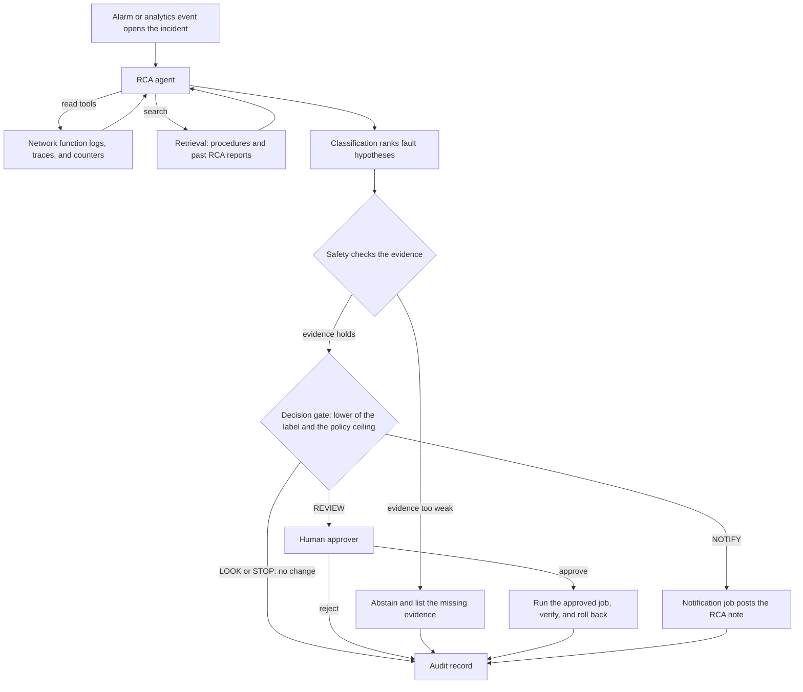

<!-- Writing rules: framework/style-guide.md. Name each component by its role and the Red Hat product used. Write no product support status. -->

# Core network root-cause analysis

## At a glance

| Field | Value |
|---|---|
| One-liner | Finds the likely cause of a 5G core outage from network function logs, traces, and counters, and proposes a fix for approval. Never restarts or fails over a network function on its own. Depends on a Classification head retrained on your core fault taxonomy and on task evaluation with replayed incidents. |
| Problem | 5G core faults spread across network functions, and engineers correlate logs, signalling, and alarms by hand; the KPI is mean time to identify |
| Audience | Operations engineers, approvers, and risk owners who run the 5G core |
| OTel slots | `classification`: ranks fault hypotheses; `llm`: the RCA agent; `safety`: checks the evidence; `decision`: the gate label; `embedding` and `reranker`: retrieval |
| Autonomy ceiling | Recommend with approval |
| Placement tier | Regional for retrieval, cause ranking, and the gate; core for the RCA agent |
| Agent-school courses | 101, 201, and 402 in the [agent-school roadmap](https://github.com/open-experiments/agent-school/blob/main/docs/RoadMap.md) |

## Problem and value

When an AMF, SMF, or UPF restarts, an NRF or UDM stops answering, or an N2 or N3 interface degrades, sessions fail across a region, and the cause hides in the logs and signalling of several network functions.
This recipe ranks likely causes, writes a root-cause analysis (RCA) note to the incident, and proposes a fix for approval.
The KPI is mean time to identify; any gain is a target, measured against the shadow-stage baseline with the [PB-10](../../../platform/compliance-operating-model/README.md#staged-rollout-and-roi) measures.

## How it works



1. A TMF642 alarm, or a network data analytics event such as abnormal behaviour or network function load (TS 23.288), opens the incident.
2. The agent calls read tools through the MCP Gateway for network function logs, stored trace records (TS 32.422 and TS 32.423), performance counters (TS 28.552), and NRF status (TS 29.510). The gateway denies each call unless a role allows it, the deny-unless-allowed rule in [PB-05](../../../platform/integration/README.md#per-tool-authorization).
3. Embedding and Reranker fetch the matching 5G procedures (TS 23.502), runbooks, and past RCA reports from retrieval.
4. Classification, with its head retrained on your core fault taxonomy, ranks the fault hypotheses.
5. Safety checks that the evidence supports the top hypothesis. When it doesn't, the agent abstains and lists what is missing.
6. The agent sends the RCA note and any fix proposal as action requests, and the Decision slot answers a fixed label question at the [decision gate](../../../architecture/decision-gate.md).

The outcome is the lower of the model label and the policy ceiling for the capability and risk class, so it never exceeds either. A STOP label forces STOP at every stage. Every action class starts at the shadow stage, and a confirmed false ACT drops the use case and its action class back one stage, as [PB-06](../../../platform/safety-autonomy-gating/README.md#staged-autonomy) sets out.

RCA notes are NOTIFY from the assist stage up, and the [action layer](../../../platform/action-layer/README.md) runs the notification job. A restart or failover proposal never gets an outcome higher than REVIEW, because this recipe stops at the recommend stage.

### Slots and checkpoints

| Slot | Checkpoint | Role | Placement |
|---|---|---|---|
| `classification` | OTel-LLM-8.3B-Classification with its head retrained on your core fault taxonomy, pinned by revision | Ranks fault hypotheses | Regional |
| `llm` | OTel-2.0-LLM-31B-IT, pinned by revision | The RCA agent: calls tools and writes the note | Core |
| `safety` | OTel-LLM-12B-Safety or OTel-LLM-8.3B-Safety, pinned by revision | Checks the evidence behind a hypothesis | Regional |
| `decision` | OTel-2.0-Decision-26B-A4B-4bit, pinned by revision | Gives the gate label | Regional |
| `embedding` | OTel-Embedding-600M, 4B, or 8B, pinned by revision | Turns procedures and reports into vectors | Regional |
| `reranker` | OTel-Reranker-0.6B or OTel-Reranker-4B, pinned by revision | Puts the best passages first | Regional |

### Worked example: restarts on one SMF fail PDU sessions

PDU session establishment failures rise in one region, and a TMF642 alarm opens incident `inc-8812`. `core-rca-agent` reads the logs of `smf-2`, which show repeated restarts, and the NRF status, which shows lost heartbeats from `smf-2` before each restart. Retrieval returns the PDU session establishment procedure and a past report on SMF registration loss.

Classification ranks an SMF fault first, ahead of a UPF fault, and Safety finds the heartbeat evidence sufficient. The agent sends the RCA note, the gate returns NOTIFY, and a notification job posts the note to the incident, as the [decision gate](../../../architecture/decision-gate.md#policy-table) policy table shows.

Another restart would not stop the heartbeat loss, so the agent proposes a failover from `smf-2` to its standby SMF set in `req-8812-1`. Fixes are at the recommend stage, so even if the label reads ACT, the outcome is REVIEW. The `approver` role signs off before the action layer runs the failover and its verification job.

## What you need

- [ ] Models: the six slots in the slots table, chosen from the family in [PB-01](../../../platform/intake-model-selection/README.md), each pinned by revision with its licence chain recorded
- [ ] Platform blueprints: the pages for [PB-02](../../../platform/evaluation-acceptance/README.md), [PB-03](../../../platform/adaptation/README.md), [PB-04](../../../platform/serving-routing-placement/README.md), [PB-05](../../../platform/integration/README.md), [PB-06](../../../platform/safety-autonomy-gating/README.md), [PB-07](../../../platform/action-layer/README.md), [PB-08](../../../platform/security-identity-sandbox/README.md), [PB-09](../../../platform/quality-operations/README.md), and [PB-10](../../../platform/compliance-operating-model/README.md)
- [ ] Components: one product for each role in the components table
- [ ] Task evaluation first: the [31B model card](https://huggingface.co/farbodtavakkoli/OTel-2.0-LLM-31B-IT#telecommunications-data-not-included-in-training) states that 5G core control-plane and inter-network-function signalling data is not in its training, so evaluate the agent on your replayed incidents before it serves
- [ ] Classification head: retrained on your core fault taxonomy with Training Hub, because the card's head predicts eight synthetic drive-test classes, not core faults ([PB-03](../../../platform/adaptation/README.md))
- [ ] Read tools: read-only access to TMF642 alarms, network data analytics events, log search, stored trace records, performance counters, and NRF status, each behind the MCP Gateway, which denies a call unless a role allows it
- [ ] Corpora: 3GPP procedures, runbooks, and past RCA reports, each with a usage-rights entry ([PB-05](../../../platform/integration/README.md#knowledge-sources-and-usage-rights))
- [ ] Reranker check: compare `/rerank` scores with `sentence-transformers` scores on held-out pairs, because the OTel rerankers are Qwen3 fine-tunes with a one-label head
- [ ] Decision engine: vLLM 0.26 or 0.30 on CUDA or ROCm, as the [Decision model card](https://huggingface.co/farbodtavakkoli/OTel-2.0-Decision-26B-A4B-4bit) states
- [ ] Agent identity: a workload identity bound to the read roles and `submit_action_request` only, as PB-08 sets out
- [ ] Data: replayed core incidents with SME labels, and a gate set weighted toward non-ACT cases
- [ ] Traces: tool calls, gate decisions, and approvals, as PB-09 sets out

| Component role | Red Hat product used |
|---|---|
| Inference engine for every slot | Red Hat AI Inference (vLLM) |
| Serving platform | Red Hat OpenShift AI with KServe |
| Training for the Classification head | Training Hub in Red Hat OpenShift AI |
| Version record for each checkpoint and its pass | Model Registry in Red Hat OpenShift AI |
| Tool gateway for per-tool authorization | MCP gateway in Red Hat Connectivity Link |
| Action orchestration for the gate, approval, job, verification, and rollback | Automation Orchestrator for Red Hat Ansible Automation Platform |
| Input and tool-response guardrails | NeMo Guardrails in Red Hat OpenShift AI |
| Knowledge service and vector store | Your choice; this design names no product |

Key flags for each slot, copied from [PB-04](../../../platform/serving-routing-placement/README.md#key-flags-per-slot). Start the Safety slot with its own pinned revision and no tool-calling flags.

```text
# LLM 31B (pin the revision; text-only; tool calling)
--revision <sha> --enable-auto-tool-choice --tool-call-parser gemma4 \
--limit-mm-per-prompt '{"image": 0, "audio": 0}'
# Decision (card recipe)
--revision <sha> --max-logprobs 64 --enable-prefix-caching --max-model-len 16384
# Classification (Gemma3TextForSequenceClassification) and Reranker (num_labels=1)
--runner pooling --convert classify        # endpoints /classify, /v1/score, /rerank
# Embedding
--runner pooling --convert embed           # endpoint /v1/embeddings
```

Any component can be replaced. The Red Hat products named here show one way to build this design.

### What you bring

<!-- generated:what-you-bring start -->

| Model change | Your expertise | How far to climb |
|---|---|---|
| Retrain the Classification head on your taxonomy; no other model changes | Your fault or alert taxonomy; a golden set your experts label; gate labels from your approvers; a contract for each tool; your domain corpus | Configure first, and train only on a measured gap, as [PB-03 Adaptation](../../../platform/adaptation/README.md) sets out |

| Item | Network component | Mechanism | Owner | Matrix row |
|---|---|---|---|---|
| Core fault taxonomy and SME-labelled incidents | 5G core CNFs | Classification labels | SME | [5G core CNFs](../../../platform/bring-your-own-data/README.md#domain-5g-core-cnfs) |
| 3GPP procedures, runbooks, and past RCA reports | 5G core CNFs | RAG corpus | Platform team | [5G core CNFs](../../../platform/bring-your-own-data/README.md#domain-5g-core-cnfs) |
| Alarm, analytics, log, trace, and counter read tools | 5G core CNFs; OSS and BSS | MCP tool contract | Platform team | [5G core CNFs](../../../platform/bring-your-own-data/README.md#domain-5g-core-cnfs); [OSS and BSS](../../../platform/bring-your-own-data/README.md#domain-oss-and-bss) |
| Core root-cause skill and capability manifests | 5G core CNFs | Skill or capability manifest | SME | [5G core CNFs](../../../platform/bring-your-own-data/README.md#domain-5g-core-cnfs) |
| Restart and failover ceilings with approver roles | 5G core CNFs | Gate and action-layer policy | Risk owner | [5G core CNFs](../../../platform/bring-your-own-data/README.md#domain-5g-core-cnfs) |

<!-- generated:what-you-bring end -->

### Sandbox

<!-- generated:sandbox start -->

| Sandbox fit | Trigger on this page | Where to read |
|---|---|---|
| Base sandbox only: the agent reads through the gateways, so its identity, the gateway screen, and the six sandbox controls are enough | Reads network function logs and counters through read tools; runs no code | [PB-08: when a use case needs a sandbox](../../../platform/security-identity-sandbox/README.md#when-a-use-case-needs-a-sandbox) |

<!-- generated:sandbox end -->

### What you must add

| Gap | What you add | Source |
|---|---|---|
| Fault taxonomy | Your core fault taxonomy and SME-labelled past incidents for the Classification head, because the shipped head covers eight synthetic drive-test classes | [OTel-LLM-8.3B-Classification model card](https://huggingface.co/farbodtavakkoli/OTel-LLM-8.3B-Classification) |
| Golden set | Replayed core incidents with root causes your SMEs confirmed, scored before the shadow stage, because the card reports no evaluation of closed-loop operational tasks | [OTel-2.0-LLM-31B-IT model card](https://huggingface.co/farbodtavakkoli/OTel-2.0-LLM-31B-IT#autonomous-operational-task-completion-not-benchmarked) |
| Gate labels | A gate set of past cases your approvers labelled, weighted toward non-ACT cases, because the Decision slot turns label probabilities into decisions through thresholds you set on your own cases | [OTel-2.0-Decision-26B-A4B-4bit model card](https://huggingface.co/farbodtavakkoli/OTel-2.0-Decision-26B-A4B-4bit) |
| Tool contracts | A pinned contract for each read tool: alarms as in TMF642, and counters as in TS 28.552 | [TMF642 Alarm Management repository](https://github.com/tmforum-apis/TMF642_AlarmManagement), [3GPP TS 28.552](https://www.3gpp.org/DynaReport/28552.htm) |
| Domain corpus | 3GPP procedures, runbooks, and past RCA reports in retrieval, each with a usage-rights entry, because the card's training leaves out 5G core control-plane signalling | [OTel-2.0-LLM-31B-IT model card](https://huggingface.co/farbodtavakkoli/OTel-2.0-LLM-31B-IT#telecommunications-data-not-included-in-training) |
| Language scope | Tests in every language your engineers write incidents in, because the card's quality claims cover English text only | [OTel-2.0-LLM-31B-IT model card](https://huggingface.co/farbodtavakkoli/OTel-2.0-LLM-31B-IT#supported-language-and-modality) |

## Governance

Each action request passes the [decision gate](../../../architecture/decision-gate.md), and the outcome never exceeds the policy ceiling for its class.

| Action | Gate outcome (LOOK/NOTIFY/REVIEW/ACT/STOP) | Approval | AI Act class |
|---|---|---|---|
| Read logs, traces, counters, and NRF status, `read` | LOOK | None | [Recorded by your legal team in the classification record](../../../platform/compliance-operating-model/README.md) |
| Write an RCA note to the incident, `notify` | NOTIFY, from the assist stage up | None | [Recorded by your legal team in the classification record](../../../platform/compliance-operating-model/README.md) |
| Propose restarting one network function instance, `write_low` | REVIEW, from the recommend stage up | The `approver` role | [Recorded by your legal team in the classification record](../../../platform/compliance-operating-model/README.md) |
| Propose a failover to another network function set or site, `write_high` | REVIEW, from the recommend stage up | The `approver` role | [Recorded by your legal team in the classification record](../../../platform/compliance-operating-model/README.md) |
| Any action the label marks STOP | STOP | None | [Recorded by your legal team in the classification record](../../../platform/compliance-operating-model/README.md) |

| Parameter | What it controls | Who sets it | How to calibrate |
|---|---|---|---|
| Classification per-class recall floor | The lowest recall for each root-cause class in your core fault taxonomy | Risk owner, with SME review | Use SME labels on a temporal holdout, so test incidents come after training incidents |
| Classification other-or-abstain recall floor | The lowest recall for incidents outside the taxonomy | Risk owner | Hold out incident types the model never saw and check they land in other or abstain |
| LLM groundedness floor | The lowest share of answers whose claims the cited passages support | Risk owner, with SME review | Score a golden set of operator questions with SME-checked answers and a calibrated judge |
| Safety abstain-recall floor | The lowest share of insufficient-context items where the Safety slot abstains | Risk owner, with SME review | Build items with the evidence removed and measure correct abstention |
| Embedding and Reranker recall-at-k floor | The lowest share of questions with a correct passage in the top results | Platform team, with SME review | Label relevant passages for operator questions; the reranker must beat retriever-only on the same set |
| Decision false-ACT budget | The highest false-ACT rate accepted on state-changing proposals | Risk owner | [Evaluation and acceptance](../../../platform/evaluation-acceptance/README.md#false-act-method): use the false-ACT method, with a gate set large enough for the rule of three |
| Ceiling for notify requests | The highest outcome for notifications and ticket notes | Risk owner, with SME review | [Evaluation and acceptance method](../../../platform/evaluation-acceptance/README.md): review notify cases for duplicates and noise |
| Ceiling for low-risk writes | The highest outcome for reversible changes such as an interface restart | Risk owner | [Evaluation and acceptance method](../../../platform/evaluation-acceptance/README.md): raise it only after a canary window with no false ACT label |
| Ceiling for high-risk writes | The highest outcome for changes that are hard to reverse or affect many customers | Risk owner | [Evaluation and acceptance method](../../../platform/evaluation-acceptance/README.md): keep it at REVIEW until the risk owner signs off on canary evidence |

This page gives no default values. Each owner sets the value with SME review and versions it with the policy that `policy_version` names.

| Activity | Responsible | Accountable | Consulted | Informed |
|---|---|---|---|---|
| Approve a REVIEW request | Approver | Business owner | SME | Operations engineer |
| Change a policy ceiling | Operations engineer | Risk owner | Change board and SME | Business owner |
| Promote a use case to the next stage | Approver | Risk owner | SME | Platform team |
| Drop a use case back a stage | Approver | Risk owner | Platform team | Security |
| Build and label golden sets, trajectory scenarios, and the gate set | SME | Business owner | Model owner | Risk owner |
| Grant a tool role to an agent | Platform team | Risk owner | Business owner | Security |

## Sources

Each key claim links its source, as set out in [the Sources table](../../../framework/definitions.md#sources-table).

| # | Claim | Basis | Source |
|---|---|---|---|
| 1 | The 31B training leaves out 5G core control-plane and inter-NF signalling data | model card | [OTel-2.0-LLM-31B-IT model card](https://huggingface.co/farbodtavakkoli/OTel-2.0-LLM-31B-IT#telecommunications-data-not-included-in-training) |
| 2 | The 31B has not been evaluated for autonomous, closed-loop completion of operational telecom tasks | model card | [OTel-2.0-LLM-31B-IT model card](https://huggingface.co/farbodtavakkoli/OTel-2.0-LLM-31B-IT#autonomous-operational-task-completion-not-benchmarked) |
| 3 | The 31B targets English-language use, and all its quality claims are text-only | model card | [OTel-2.0-LLM-31B-IT model card](https://huggingface.co/farbodtavakkoli/OTel-2.0-LLM-31B-IT#supported-language-and-modality) |
| 4 | The Classification model's head, at revision fdf15b1e, predicts eight root-cause classes from the synthetic TeleLogs drive-test dataset | model card | [OTel-LLM-8.3B-Classification model card](https://huggingface.co/farbodtavakkoli/OTel-LLM-8.3B-Classification) |
| 5 | The Decision model reads decisions from label probabilities and uses them for confidence thresholds and routing | model card | [OTel-2.0-Decision-26B-A4B-4bit model card](https://huggingface.co/farbodtavakkoli/OTel-2.0-Decision-26B-A4B-4bit) |
| 6 | TS 23.288 specifies the 5G System architecture for network data analytics services | project documentation | [3GPP TS 23.288](https://www.3gpp.org/DynaReport/23288.htm) |
| 7 | TS 23.502 specifies the procedures of the 5G System, and TS 29.510 specifies the network function repository services | project documentation | [3GPP TS 23.502](https://www.3gpp.org/DynaReport/23502.htm), [3GPP TS 29.510](https://www.3gpp.org/DynaReport/29510.htm) |
| 8 | TS 32.422 covers trace control and configuration, and TS 32.423 defines trace data and its management | project documentation | [3GPP TS 32.422](https://www.3gpp.org/DynaReport/32422.htm), [3GPP TS 32.423](https://www.3gpp.org/DynaReport/32423.htm) |
| 9 | TS 28.552 defines the 5G performance measurements | project documentation | [3GPP TS 28.552](https://www.3gpp.org/DynaReport/28552.htm) |
| 10 | TMF642 is the TM Forum Open API for alarm management | project documentation | [TMF642 Alarm Management repository](https://github.com/tmforum-apis/TMF642_AlarmManagement) |

## Deploy and verify

Apply these settings in order. Every action class starts at the shadow stage, and no fix ever gets an outcome higher than REVIEW.

1. Pin each slot through intake ([PB-01](../../../platform/intake-model-selection/README.md)), and record each revision and its licence chain in the model registry.
2. Register the corpora, then deploy Embedding and Reranker with the flags from What you need and run the reranker score check.
3. Retrain the Classification head on your core fault taxonomy with Training Hub, gate it on both Classification floors, then deploy it.
4. Deploy Safety and Decision at the regional site, then the 31B at the core with the tool-calling flags.
5. Have each owner load the parameters from Governance.
6. Run PB-02 operator offline acceptance on replayed core incidents in the shadow stage, with trajectory checks that the agent reads before it proposes a write, and the false-ACT method for the Decision slot.
7. Promote to the assist stage, then the recommend stage, only through the PB-06 stage register.

| Check | PB-02 gate or parameter | Owner |
|---|---|---|
| Each class in your core fault taxonomy meets its recall floor on a temporal holdout | Classification per-class recall floor | Risk owner |
| Incidents outside the taxonomy land in other or abstain | Classification other-or-abstain recall floor | Risk owner |
| RCA note claims are supported by the cited passages and tool results | LLM groundedness floor | Risk owner |
| Safety abstains when the evidence is removed | Safety abstain-recall floor | Risk owner |
| The matching procedure appears in the top results | Embedding and Reranker recall-at-k floor | Platform team |
| Reranker serving scores match `sentence-transformers` scores on held-out pairs | [Intake and smoke](../../../platform/evaluation-acceptance/README.md) | Platform team |
| The agent reads evidence before any proposal, and writes nothing outside the allowed set | [Trajectory checks](../../../platform/evaluation-acceptance/README.md#trajectory-checks) | SME |
| ACT labels on fix proposals whose ground truth is not ACT stay within budget | Decision false-ACT budget | Risk owner |

- Agent-school: 101 builds the NOC assistant loop, 201 builds the RCA investigator with its two-phase loop and grounding judge, and 402 builds the knowledge service, all in the [agent-school roadmap](https://github.com/open-experiments/agent-school/blob/main/docs/RoadMap.md)
- Architecture: the [decision gate](../../../architecture/decision-gate.md) for labels and policy ceilings

## Limitations

- It never restarts or fails over a network function without approval; every fix goes to REVIEW.
- It covers 5G core network functions only. Router faults belong to the [closed-loop incident handling](../../agentic-operations/closed-loop-incident-handling/README.md) recipe, and RAN and transport alarms to the [alarm triage](../alarm-triage-adaptation/README.md) recipe.
- Core signalling is not in the 31B training, as the [31B model card](https://huggingface.co/farbodtavakkoli/OTel-2.0-LLM-31B-IT#telecommunications-data-not-included-in-training) states, so its quality on your incidents is unknown until task evaluation runs.
- The Classification slot's shipped classes come from drive-test data, so it needs your core fault taxonomy first.
- OTel quality claims cover English only, as the [31B model card](https://huggingface.co/farbodtavakkoli/OTel-2.0-LLM-31B-IT#supported-language-and-modality) states, so logs and tickets in other languages need their own evaluation.
- The AI Act class is your legal team's call, recorded in the [classification record](../../../platform/compliance-operating-model/README.md).
