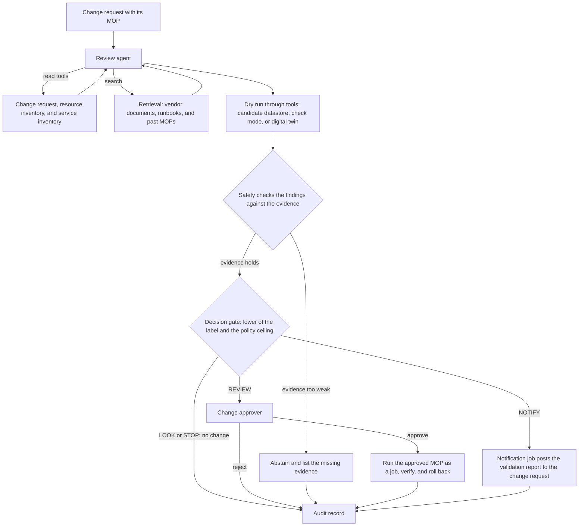

<!-- Writing rules: framework/style-guide.md. Name each component by its role and the Red Hat product used. Write no product support status. -->

# MOP validation

## At a glance

| Field | Value |
|---|---|
| One-liner | Checks each method of procedure (MOP) against inventory, vendor documents, and runbooks, dry-runs it through tools, and recommends approval or rejection to the change approver. Never executes a MOP. Depends on your own MOP-based evaluation against emulated network devices. |
| Problem | MOPs are reviewed by hand, and a missing pre-check or rollback step can cause an outage; the KPIs are change failure rate and review time |
| Audience | Change engineers, approvers, and risk owners who review network changes |
| OTel slots | `llm`: the review agent and the validation report; `safety`: checks the evidence; `decision`: the gate label; `embedding` and `reranker`: retrieval |
| Autonomy ceiling | Recommend with approval |
| Placement tier | Regional for retrieval, the evidence check, and the gate; core for the review agent |
| Agent-school courses | 301 and 401 in the [agent-school roadmap](https://github.com/open-experiments/agent-school/blob/main/docs/RoadMap.md) |

## Problem and value

A method of procedure (MOP) lists each step of a network change: pre-checks, commands, expected outputs, verification, and rollback. Engineers review MOPs by hand under time pressure, and a missing pre-check or rollback step can turn a routine change into an outage.
This recipe checks each MOP against inventory, vendor documents, and runbooks, dry-runs it through tools, and recommends approval or rejection to the change approver.
The KPIs are change failure rate and review time; any gain is a target, measured against the shadow-stage baseline with the [PB-10](../../../platform/compliance-operating-model/README.md#staged-rollout-and-roi) measures.

## How it works



1. A change request arrives through TMF655 Change Management with its MOP attached, and the change system starts the agent.
2. Through the MCP Gateway, the agent reads the change request, the target devices from TMF639 Resource Inventory, and the affected services from TMF638 Service Inventory. The gateway denies each call unless a role allows it, the deny-unless-allowed rule in [PB-05](../../../platform/integration/README.md#per-tool-authorization).
3. Embedding and Reranker fetch vendor documents, runbooks, and past MOPs with their post-change reports from retrieval. The agent checks each step for its target, pre-check, expected output, verification, and rollback.
4. A dry run happens only through tools. A NETCONF tool loads the configuration into the candidate datastore, runs validate, and discards it ([RFC 6241](https://www.rfc-editor.org/rfc/rfc6241#section-8.3)). An Ansible check mode tool runs the playbook without changing remote systems ([Ansible check mode](https://docs.ansible.com/ansible/latest/playbook_guide/playbooks_checkmode.html)) and rejects any task that sets `check_mode: false`. A digital-twin tool replays the MOP on emulated devices.
5. Safety checks that the inventory, documents, and dry-run output support each finding. When they don't, the agent abstains and lists what is missing.
6. The agent sends the validation report and its recommendation as action requests, and the Decision slot answers a fixed label question at the [decision gate](../../../architecture/decision-gate.md).

The outcome is the lower of the model label and the policy ceiling for the capability and risk class, so it never exceeds either. A STOP label forces STOP at every stage. Every action class starts at the shadow stage, and a confirmed false ACT drops the use case and its action class back one stage, as [PB-06](../../../platform/safety-autonomy-gating/README.md#staged-autonomy) sets out.

The validation report is NOTIFY from the assist stage up, and a notification job posts it to the change request. The recommendation's proposed step is the change itself, so it is `write_high` and never gets an outcome higher than REVIEW. The agent never executes the MOP: execution stays an approved job in the [action layer](../../../platform/action-layer/README.md), which runs only after the change approver signs off. Where devices support it, that job uses a NETCONF confirmed commit, which reverts unless a confirming commit follows.

### Slots and checkpoints

| Slot | Checkpoint | Role | Placement |
|---|---|---|---|
| `llm`, large | OTel-2.0-LLM-31B-IT, pinned by revision | The review agent: calls tools, checks each step, writes the report, and sends action requests | Core |
| `safety` | OTel-LLM-12B-Safety or OTel-LLM-8.3B-Safety, pinned by revision | Checks the evidence behind each finding | Regional |
| `decision` | OTel-2.0-Decision-26B-A4B-4bit, pinned by revision | Gives the gate label | Regional |
| `embedding` | OTel-Embedding-600M, 4B, or 8B, pinned by revision | Turns vendor documents, runbooks, and past MOPs into vectors | Regional |
| `reranker` | OTel-Reranker-0.6B or OTel-Reranker-4B, pinned by revision | Puts the best passages first | Regional |

### Worked example: a software upgrade with no way back

Change request `chg-7731` asks to upgrade the software on edge router `edge-rtr-09`, and its MOP is `mop-7731-v2`. The change system starts `mop-review-agent`.

The inventory shows the router's current software image and the services that run through it. The vendor upgrade guide in retrieval lists a pre-check on free storage and a rollback to the previous image. The Ansible check mode tool runs the upgrade playbook with no errors. The MOP has the storage pre-check, but no step restores the previous image if the post-upgrade checks fail. Safety finds the evidence sufficient.

The agent sends the validation report, the gate returns NOTIFY, and a notification job posts the missing rollback step to `chg-7731`, as the [decision gate](../../../architecture/decision-gate.md#policy-table) policy table shows. The agent then sends its recommendation to reject `mop-7731-v2` until it adds a rollback step. The change is `write_high`, so even if the label reads ACT, the outcome is REVIEW. The change approver rejects the MOP, and nothing runs. The author adds the rollback step, and the agent reviews the new version.

## What you need

- [ ] Models: the slots in the slots table, chosen from the family in [PB-01](../../../platform/intake-model-selection/README.md), each pinned by revision with its licence chain recorded
- [ ] Platform blueprints: the pages for [PB-02](../../../platform/evaluation-acceptance/README.md), [PB-04](../../../platform/serving-routing-placement/README.md), [PB-05](../../../platform/integration/README.md), [PB-06](../../../platform/safety-autonomy-gating/README.md), [PB-07](../../../platform/action-layer/README.md), [PB-08](../../../platform/security-identity-sandbox/README.md), [PB-09](../../../platform/quality-operations/README.md), and [PB-10](../../../platform/compliance-operating-model/README.md)
- [ ] Components: one product for each role in the components table
- [ ] MOP evaluation first: the [31B model card](https://huggingface.co/farbodtavakkoli/OTel-2.0-LLM-31B-IT#operational-procedure-mop-validation-not-performed) says no benchmark has checked the model's step-by-step procedures on network devices, and that using it on MOPs "requires dedicated MOP-based evaluation" against emulated network operating system (NOS) instances in a digital twin "before deployment." Run that evaluation on your own MOPs and emulated devices before the shadow stage
- [ ] Read tools: read-only access to change requests, resource inventory, and service inventory, each behind the MCP Gateway, which denies a call unless a role allows it
- [ ] Dry-run tools: the NETCONF candidate datastore and validate, Ansible check mode, and a digital twin or emulated lab, none of which can commit a change
- [ ] Corpora: vendor documents, runbooks, and past MOPs with their post-change reports, each with a usage-rights entry ([PB-05](../../../platform/integration/README.md#knowledge-sources-and-usage-rights))
- [ ] Reranker check: compare `/rerank` scores with `sentence-transformers` scores on held-out pairs, because the OTel rerankers are Qwen3 fine-tunes with a one-label head
- [ ] Decision engine: vLLM 0.26 or 0.30 on CUDA or ROCm, as the [Decision model card](https://huggingface.co/farbodtavakkoli/OTel-2.0-Decision-26B-A4B-4bit) states
- [ ] Agent identity: a workload identity bound to the read and dry-run roles and `submit_action_request` only, as PB-08 sets out
- [ ] Data: past MOPs with SME-labelled defects, such as a missing pre-check, verification, or rollback step, and a gate set weighted toward non-ACT cases
- [ ] Traces: tool calls, dry-run results, gate decisions, and approvals, as PB-09 sets out

| Component role | Red Hat product used |
|---|---|
| Inference engine for every slot | Red Hat AI Inference (vLLM) |
| Serving platform | Red Hat OpenShift AI with KServe |
| Version record for each checkpoint and its pass | Model Registry in Red Hat OpenShift AI |
| Tool gateway for per-tool authorization | MCP gateway in Red Hat Connectivity Link |
| Action orchestration for the gate, approval, job, verification, and rollback | Automation Orchestrator for Red Hat Ansible Automation Platform |
| Execution with the only write credentials | Job templates in Red Hat Ansible Automation Platform |
| Input and tool-response guardrails | NeMo Guardrails in Red Hat OpenShift AI |
| Digital twin, knowledge service, and vector store | Your choice; this design names no product |

Key flags for each slot, copied from [PB-04](../../../platform/serving-routing-placement/README.md#key-flags-per-slot). Start the Safety slot with its own pinned revision and no tool-calling flags.

```text
# LLM 31B (pin the revision; text-only; tool calling)
--revision <sha> --enable-auto-tool-choice --tool-call-parser gemma4 \
--limit-mm-per-prompt '{"image": 0, "audio": 0}'
# Decision (card recipe)
--revision <sha> --max-logprobs 64 --enable-prefix-caching --max-model-len 16384
# Classification (Gemma3TextForSequenceClassification) and Reranker (num_labels=1)
--runner pooling --convert classify        # endpoints /classify, /v1/score, /rerank
# Embedding
--runner pooling --convert embed           # endpoint /v1/embeddings
```

Any component can be replaced. The Red Hat products named here show one way to build this design.

### What you bring

<!-- generated:what-you-bring start -->

| Model change | Your expertise | How far to climb |
|---|---|---|
| No model change: retrieval, a skill per role, and a capability manifest per tool | A golden set your experts label; Gate labels from your approvers; A contract for each tool; Your domain corpus | Configure first, and train only on a measured gap, as [PB-03 Adaptation](../../../platform/adaptation/README.md) sets out |

| Item | Network component | Mechanism | Owner | Matrix row |
|---|---|---|---|---|
| Vendor documents, runbooks, and past MOPs | Transport and IP; RAN; 5G core CNFs | RAG corpus | Operations engineer | [Transport and IP](../../../platform/bring-your-own-data/README.md#domain-transport-and-ip); [RAN](../../../platform/bring-your-own-data/README.md#domain-ran); [5G core CNFs](../../../platform/bring-your-own-data/README.md#domain-5g-core-cnfs) |
| Change request and inventory read tools | OSS and BSS | MCP tool contract | Platform team | [OSS and BSS](../../../platform/bring-your-own-data/README.md#domain-oss-and-bss) |
| Dry-run tools that cannot commit a change | Transport and IP | MCP tool contract | Platform team | [Transport and IP](../../../platform/bring-your-own-data/README.md#domain-transport-and-ip) |
| MOP review skill and capability manifests | Transport and IP | Skill or capability manifest | SME | [Transport and IP](../../../platform/bring-your-own-data/README.md#domain-transport-and-ip) |
| Approval ceilings for high-risk changes | Transport and IP; RAN; 5G core CNFs | Gate and action-layer policy | Risk owner | [Transport and IP](../../../platform/bring-your-own-data/README.md#domain-transport-and-ip); [RAN](../../../platform/bring-your-own-data/README.md#domain-ran); [5G core CNFs](../../../platform/bring-your-own-data/README.md#domain-5g-core-cnfs) |

<!-- generated:what-you-bring end -->

### What you must add

| Gap | What you add | Source |
|---|---|---|
| Golden set | Past MOPs with SME-labelled defects, scored in a digital twin or emulated lab, because the card asks for dedicated MOP-based evaluation before deployment | [OTel-2.0-LLM-31B-IT model card](https://huggingface.co/farbodtavakkoli/OTel-2.0-LLM-31B-IT#operational-procedure-mop-validation-not-performed) |
| Gate labels | A gate set of past cases labelled by your approvers, weighted toward non-ACT cases, because the Decision slot reads its decision from label probabilities and you set its thresholds on your own cases | [OTel-2.0-Decision-26B-A4B-4bit model card](https://huggingface.co/farbodtavakkoli/OTel-2.0-Decision-26B-A4B-4bit) |
| Tool contracts | A pinned contract for each read and dry-run tool, with change requests as in TMF655 and NETCONF validate for dry runs | [TMF655 Change Management repository](https://github.com/tmforum-apis/TMF655_ChangeManagement), [RFC 6241 validate capability](https://www.rfc-editor.org/rfc/rfc6241#section-8.6) |
| Domain corpus | Vendor command references, NOS documents, runbooks, and past MOPs in retrieval, each with a usage-rights entry, because the card's training leaves out vendor command references and NOS documentation | [OTel-2.0-LLM-31B-IT model card](https://huggingface.co/farbodtavakkoli/OTel-2.0-LLM-31B-IT#telecommunications-data-not-included-in-training) |
| Language scope | Tests in every language your MOPs are written in, because the card's quality claims cover English text only | [OTel-2.0-LLM-31B-IT model card](https://huggingface.co/farbodtavakkoli/OTel-2.0-LLM-31B-IT#supported-language-and-modality) |

## Governance

Each action request passes the [decision gate](../../../architecture/decision-gate.md), and the outcome never exceeds the policy ceiling for its class.

| Action | Gate outcome (LOOK/NOTIFY/REVIEW/ACT/STOP) | Approval | AI Act class |
|---|---|---|---|
| Read change requests, inventory, and documents, and run dry runs that change no running configuration, `read` | LOOK | None | [Recorded by your legal team in the classification record](../../../platform/compliance-operating-model/README.md) |
| Post the validation report to the change request, `notify` | NOTIFY, from the assist stage up | None | [Recorded by your legal team in the classification record](../../../platform/compliance-operating-model/README.md) |
| Recommend approving or rejecting the change, with the MOP as the proposed step, `write_high` | REVIEW, from the recommend stage up, within the Ceiling for high-risk writes | The `approver` role for the change class | [Recorded by your legal team in the classification record](../../../platform/compliance-operating-model/README.md) |
| Any action the label marks STOP | STOP | None | [Recorded by your legal team in the classification record](../../../platform/compliance-operating-model/README.md) |

| Parameter | What it controls | Who sets it | How to calibrate |
|---|---|---|---|
| MOP defect recall floor | The lowest share of known MOP defects, such as a missing pre-check or rollback step, that the validation report finds | Risk owner | Seed known defects into past MOPs with SMEs and measure how many the report finds |
| LLM groundedness floor | The lowest share of answers whose claims the cited passages support | Risk owner, with SME review | Score a golden set of operator questions with SME-checked answers and a calibrated judge |
| Non-inferiority margin | The largest drop against the incumbent that still counts as no worse | Risk owner | Run candidate and incumbent on identical items and set the margin from the run-to-run noise |
| Safety abstain-recall floor | The lowest share of insufficient-context items where the Safety slot abstains | Risk owner, with SME review | Build items with the evidence removed and measure correct abstention |
| Embedding and Reranker recall-at-k floor | The lowest share of questions with a correct passage in the top results | Platform team, with SME review | Label relevant passages for operator questions; the reranker must beat retriever-only on the same set |
| Decision false-ACT budget | The highest false-ACT rate accepted on state-changing proposals | Risk owner | [Evaluation and acceptance](../../../platform/evaluation-acceptance/README.md#false-act-method): use the false-ACT method, with a gate set large enough for the rule of three |
| Ceiling for notify requests | The highest outcome for notifications and ticket notes | Risk owner, with SME review | [Evaluation and acceptance method](../../../platform/evaluation-acceptance/README.md): review notify cases for duplicates and noise |
| Ceiling for high-risk writes | The highest outcome for changes that are hard to reverse or affect many customers | Risk owner | [Evaluation and acceptance method](../../../platform/evaluation-acceptance/README.md): keep it at REVIEW until the risk owner signs off on canary evidence |
| Required approver role per action class | Which role approves REVIEW for each action class | Risk owner | [Evaluation and acceptance method](../../../platform/evaluation-acceptance/README.md): check approval times and overrides per class in the trace |

This page gives no default values. Each owner sets the value with SME review and versions it with the policy that `policy_version` names.

| Activity | Responsible | Accountable | Consulted | Informed |
|---|---|---|---|---|
| Approve a REVIEW request | Approver | Business owner | SME | Operations engineer |
| Change a policy ceiling | Operations engineer | Risk owner | Change board and SME | Business owner |
| Promote a use case to the next stage | Approver | Risk owner | SME | Platform team |
| Drop a use case back a stage | Approver | Risk owner | Platform team | Security |
| Build and label golden sets, trajectory scenarios, and the gate set | SME | Business owner | Model owner | Risk owner |
| Grant a tool role to an agent | Platform team | Risk owner | Business owner | Security |

## Sources

Each key claim links its source, as set out in [the Sources table](../../../framework/definitions.md#sources-table).

| # | Claim | Basis | Source |
|---|---|---|---|
| 1 | No benchmark has checked the 31B's step-by-step procedures on real or emulated network devices, and using it on MOPs requires dedicated MOP-based evaluation, for example against emulated NOS instances in a digital twin, before deployment | model card | [OTel-2.0-LLM-31B-IT model card](https://huggingface.co/farbodtavakkoli/OTel-2.0-LLM-31B-IT#operational-procedure-mop-validation-not-performed) |
| 2 | The 31B training leaves out vendor command references and NOS documentation, and change-approval records such as MOP approval and closure records | model card | [OTel-2.0-LLM-31B-IT model card](https://huggingface.co/farbodtavakkoli/OTel-2.0-LLM-31B-IT#telecommunications-data-not-included-in-training) |
| 3 | The 31B targets English-language use, and all its quality claims are text-only | model card | [OTel-2.0-LLM-31B-IT model card](https://huggingface.co/farbodtavakkoli/OTel-2.0-LLM-31B-IT#supported-language-and-modality) |
| 4 | The Decision model reads decisions from label probabilities and uses them for confidence thresholds and routing, on vLLM 0.26 or 0.30 | model card | [OTel-2.0-Decision-26B-A4B-4bit model card](https://huggingface.co/farbodtavakkoli/OTel-2.0-Decision-26B-A4B-4bit) |
| 5 | TMF655 is the TM Forum Open API for change management; a change request carries attachments, notes, risk, and a risk mitigation plan | project documentation | [TMF655 Change Management repository](https://github.com/tmforum-apis/TMF655_ChangeManagement) |
| 6 | TMF639 is the TM Forum Open API for resource inventory, and TMF638 is the one for service inventory | project documentation | [TMF639 Resource Inventory repository](https://github.com/tmforum-apis/TMF639_ResourceInventory), [TMF638 Service Inventory repository](https://github.com/tmforum-apis/TMF638_ServiceInventory) |
| 7 | In NETCONF, the candidate datastore holds configuration that can change without affecting the device's current configuration | project documentation | [RFC 6241 candidate configuration capability](https://www.rfc-editor.org/rfc/rfc6241#section-8.3) |
| 8 | A NETCONF device with the validate capability checks a full configuration for errors before applying it, at least for syntax errors | project documentation | [RFC 6241 validate capability](https://www.rfc-editor.org/rfc/rfc6241#section-8.6) |
| 9 | A confirmed commit is reverted unless a confirming commit follows within the timeout | project documentation | [RFC 6241 confirmed commit capability](https://www.rfc-editor.org/rfc/rfc6241#section-8.4) |
| 10 | In check mode, Ansible makes no changes on remote systems, modules without check mode support report nothing, and a task that sets `check_mode: false` makes changes even in check mode | project documentation | [Ansible check mode](https://docs.ansible.com/ansible/latest/playbook_guide/playbooks_checkmode.html) |
| 11 | GSMA's inspect-kathara runs AI agent evaluations inside isolated, reproducible network topologies built from containers | research | [GSMA inspect-kathara repository](https://github.com/gsma-labs/inspect-kathara) |

## Deploy and verify

Apply these settings in order. Every action class starts at the shadow stage, and no recommendation ever gets an outcome higher than REVIEW.

1. Pin each slot through intake ([PB-01](../../../platform/intake-model-selection/README.md)), and record each revision and its licence chain in the model registry.
2. Run the MOP-based evaluation on your own MOPs against emulated devices, for example in a container-based network emulator like GSMA's inspect-kathara.
3. Connect change requests and inventory as read tools and the dry-run tools with no commit rights, and mark every recommendation as `write_high`.
4. Register the corpora, then deploy Embedding and Reranker with the flags from What you need and run the reranker score check.
5. Deploy Safety and Decision at the regional site, then the 31B at the core with the tool-calling flags.
6. Have each owner load the parameters from Governance, with every class at the shadow stage in the stage register.
7. Run PB-02 operator offline acceptance on past MOPs in the shadow stage, with trajectory checks that the agent reads inventory and runs a dry run before it recommends, and the false-ACT method for the Decision slot.
8. Promote to the assist stage, then the recommend stage, only through the PB-06 stage register.

| Check | PB-02 gate or parameter | Owner |
|---|---|---|
| The validation report finds the defects seeded into past MOPs | MOP defect recall floor | Risk owner |
| Report findings are supported by the cited passages and tool results | LLM groundedness floor | Risk owner |
| Agent-assisted review is no worse than the incumbent manual review on the same MOPs | Non-inferiority margin | Risk owner |
| Safety abstains when the inventory or dry-run evidence is removed | Safety abstain-recall floor | Risk owner |
| The matching vendor document passage appears in the top results | Embedding and Reranker recall-at-k floor | Platform team |
| The agent reads inventory and runs a dry run before any recommendation, and commits nothing | [Trajectory checks](../../../platform/evaluation-acceptance/README.md#trajectory-checks) | SME |
| ACT labels on recommendations whose ground truth is not ACT stay within budget | Decision false-ACT budget | Risk owner |

- Agent-school: 301 builds a multi-agent closed loop with an approval gate and a risk scorer, and 401 builds skill and capability catalogs with a risk class and allowed identities for each tool, in the [agent-school roadmap](https://github.com/open-experiments/agent-school/blob/main/docs/RoadMap.md)
- Architecture: the [decision gate](../../../architecture/decision-gate.md) for labels and policy ceilings

## Limitations

- It never executes a MOP; every change runs as an approved job after the change approver signs off.
- MOP validation is not part of the model's evaluation, as the [31B model card](https://huggingface.co/farbodtavakkoli/OTel-2.0-LLM-31B-IT#operational-procedure-mop-validation-not-performed) states, so evaluate it on your own MOPs and emulated devices first.
- A clean dry run is evidence, not proof: check mode reports nothing for modules without check mode support, and validate may check syntax only.
- Vendor command references and NOS documentation are not in the 31B training, as the [31B model card](https://huggingface.co/farbodtavakkoli/OTel-2.0-LLM-31B-IT#telecommunications-data-not-included-in-training) states, so add vendor documents to retrieval.
- OTel quality claims cover English only, as the [31B model card](https://huggingface.co/farbodtavakkoli/OTel-2.0-LLM-31B-IT#supported-language-and-modality) states.
- The AI Act class is your legal team's call, recorded in the [classification record](../../../platform/compliance-operating-model/README.md).
