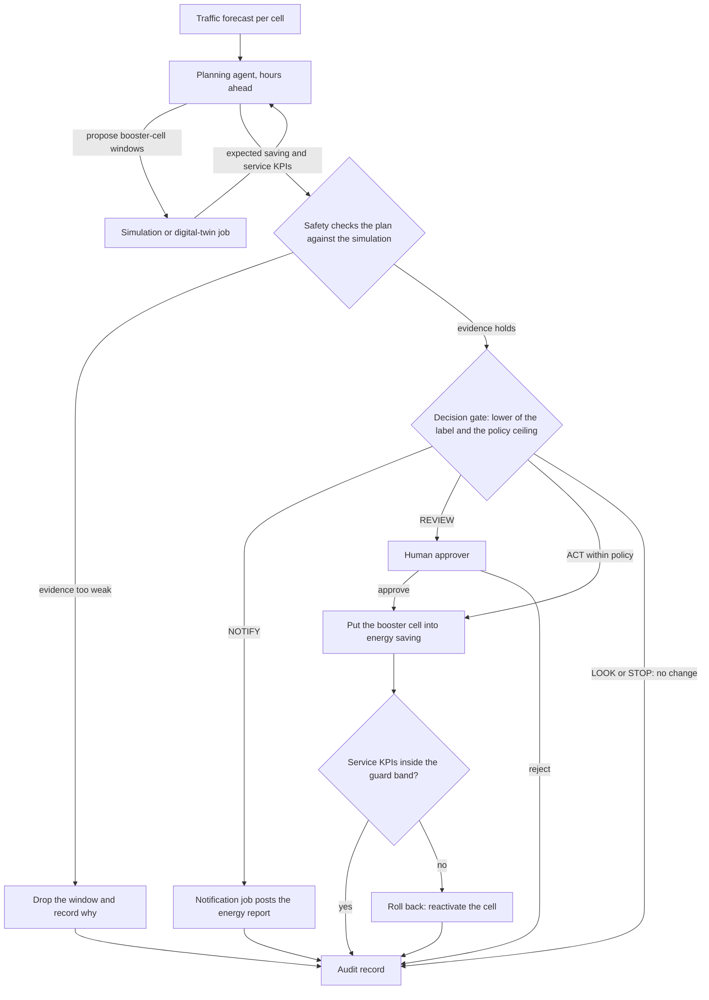

<!-- Writing rules: framework/style-guide.md. Name each component by its role and the Red Hat product used. Write no product support status. -->

# RAN energy saving

## At a glance

| Field | Value |
|---|---|
| One-liner | Plans energy-saving windows for capacity booster cells hours ahead and simulates each one before asking to act. Acts within policy only on booster cells, once that stage is earned; coverage cells always need approval. Depends on your traffic forecast, a simulation or digital twin, and the Decision gate. |
| Problem | Cells stay fully active through low-traffic hours; the KPI is energy used per traffic volume, with service KPIs held |
| Audience | Operations engineers, approvers, and risk owners who run RAN energy saving |
| OTel slots | `llm`: the planning agent and the energy report; `safety`: checks each plan against its simulation; `decision`: the gate label |
| Autonomy ceiling | Act within policy, for booster-cell windows only |
| Placement tier | Regional for the gate, the plan check, and the report; core for the planning agent |
| Agent-school courses | 302 in the [agent-school roadmap](https://github.com/open-experiments/agent-school/blob/main/docs/RoadMap.md) |

## Problem and value

Network energy use doesn't fall in step with traffic, so cells stay fully powered through quiet nights when few users need them.
This recipe plans energy-saving windows for capacity booster cells hours ahead, tests each one in a simulation or digital twin, and sends it through the Decision gate, so every switch-off leaves evidence, a gate decision, and an audit record.
The KPI is energy used per traffic volume with service KPIs held; any saving is a target, measured against the shadow-stage baseline with the [PB-10](../../../platform/compliance-operating-model/README.md#staged-rollout-and-roi) measures.

## How it works



1. A scheduled run starts the planning agent hours before a low-traffic period. Through the MCP Gateway it reads per-cell traffic forecasts built from performance counters (TS 28.552) and the cell inventory. The gateway denies each call unless a role allows it, the deny-unless-allowed rule in [PB-05](../../../platform/integration/README.md#per-tool-authorization).
2. The agent proposes windows only for capacity booster cells that candidate cells overlay, the scenario TS 28.310 describes. O-RAN calls the same feature cell and carrier shutdown.
3. The agent submits each window to a simulation or digital-twin job, which it may only submit and poll, as course 302 teaches. The job reports the expected energy saving and the service KPIs on the candidate cells.
4. A window moves on only when its simulated saving reaches the Minimum simulated energy saving and every service KPI stays inside the Service KPI guard band. Code runs this check, not the prompt.
5. Safety checks that the simulation result supports the window. When it doesn't, the agent drops the window and records why.
6. The agent sends each window that passes, and the energy report, as action requests, and the Decision slot answers a fixed label question at the [decision gate](../../../architecture/decision-gate.md).
7. During the window, a verification job watches service KPIs on the candidate cells. If a service KPI leaves the Service KPI guard band, the [action layer](../../../platform/action-layer/README.md) rolls back the window by reactivating the cell.

The outcome is the lower of the model label and the policy ceiling for the capability and risk class, so it never exceeds either. A STOP label forces STOP at every stage. Every action class starts at the shadow stage, and a confirmed false ACT drops the use case and its action class back one stage, as [PB-06](../../../platform/safety-autonomy-gating/README.md#staged-autonomy) sets out.

The energy report is NOTIFY from the assist stage up, and the action layer runs the notification job. A booster-cell window is REVIEW from the recommend stage up. It runs as ACT only once its class earns the act stage, within the Ceiling for low-risk writes and after the Canary window; that stage targets Level 3 for this scenario only. Switching off a coverage cell is always REVIEW.

The LLM plans hours ahead and is never in the near-real-time RIC loop. In the O-RAN white paper's terms, this is long-term optimisation, and near-real-time adjustments stay with the RAN controllers.

### Slots and checkpoints

| Slot | Checkpoint | Role | Placement |
|---|---|---|---|
| `llm`, large | OTel-2.0-LLM-31B-IT, pinned by revision | The planning agent: reads forecasts, proposes windows, and sends action requests | Core |
| `llm`, small | A 1B to 14B OTel LLM, pinned by revision | Drafts the energy report from simulation and verification results | Regional |
| `safety` | OTel-LLM-12B-Safety or OTel-LLM-8.3B-Safety, pinned by revision | Checks that the simulation result supports each window | Regional |
| `decision` | OTel-2.0-Decision-26B-A4B-4bit, pinned by revision | Gives the gate label | Regional |

### Worked example: a rural cluster overnight

The forecast for a rural cluster shows traffic on booster cell `nrcell-rural-b3` falling to a trickle from 01:00 to 05:00, with candidate cell `nrcell-rural-a1` overlaying it. `energy-planner-agent` proposes a window for those hours and submits it to the simulation job.

The simulation shows the candidate cell absorbing the traffic with every service KPI inside the Service KPI guard band, and a saving that clears the Minimum simulated energy saving. Safety finds the result supports the window, and the agent sends request `es-req-0412`, a `write_low` request.

This class earned the act stage after its Canary window, and the ACT probability clears the Minimum ACT probability for the act stage, so the gate returns ACT within the Ceiling for low-risk writes, as the [decision gate](../../../architecture/decision-gate.md#policy-table) policy table shows. A job template puts `nrcell-rural-b3` into energy saving, and the verification job watches the candidate cell. At 03:40 a service KPI on the candidate cell leaves the guard band, so the rollback job reactivates `nrcell-rural-b3` and the workflow records the rollback. The approver then checks whether the label was a false ACT; a confirmed false ACT drops the class back one stage.

## What you need

- [ ] Models: the slots in the slots table, chosen from the family in [PB-01](../../../platform/intake-model-selection/README.md), each pinned by revision with its licence chain recorded
- [ ] Platform blueprints: the pages for [PB-02](../../../platform/evaluation-acceptance/README.md), [PB-04](../../../platform/serving-routing-placement/README.md), [PB-05](../../../platform/integration/README.md), [PB-06](../../../platform/safety-autonomy-gating/README.md), [PB-07](../../../platform/action-layer/README.md), [PB-08](../../../platform/security-identity-sandbox/README.md), [PB-09](../../../platform/quality-operations/README.md), and [PB-10](../../../platform/compliance-operating-model/README.md)
- [ ] Components: one product for each role in the components table
- [ ] Task evaluation first: the [31B model card](https://huggingface.co/farbodtavakkoli/OTel-2.0-LLM-31B-IT#telecommunications-data-not-included-in-training) states that its training leaves out KPIs, 5G performance metrics, and RF data, so evaluate the planner on your replayed nights before it serves
- [ ] Forecast: a per-cell traffic forecast from your own forecasting tool, called as a read tool; the LLM never computes it
- [ ] Simulation or digital twin: a job that predicts energy saving and service KPIs on candidate cells for a proposed window
- [ ] Cell inventory: which cells are capacity boosters, which candidate cells overlay each, and which cells provide coverage, so a coverage-cell request is always `write_high`
- [ ] Energy-saving playbooks: a job template that activates and deactivates energy saving through your RAN management system, with a verification job and a rollback job, tested on a stateful mock
- [ ] Decision engine: vLLM 0.26 or 0.30 on CUDA or ROCm, as the [Decision model card](https://huggingface.co/farbodtavakkoli/OTel-2.0-Decision-26B-A4B-4bit) states
- [ ] Agent identity: a workload identity bound to the read roles, simulation submit and poll, and `submit_action_request` only, as PB-08 sets out
- [ ] Data: replayed low-traffic nights with SME labels, and a gate set weighted toward non-ACT cases
- [ ] Traces: forecasts, simulation results, gate decisions, approvals, and rollbacks, as PB-09 sets out

| Component role | Red Hat product used |
|---|---|
| Inference engine for every slot | Red Hat AI Inference (vLLM) |
| Serving platform | Red Hat OpenShift AI with KServe |
| Queue for the simulation jobs | Red Hat build of Kueue |
| Version record for each checkpoint and its pass | Model Registry in Red Hat OpenShift AI |
| Tool gateway for per-tool authorization | MCP gateway in Red Hat Connectivity Link |
| Action orchestration for the gate, approval, job, verification, and rollback | Automation Orchestrator for Red Hat Ansible Automation Platform |
| Execution with the only write credentials | Job templates in Red Hat Ansible Automation Platform |
| Input and tool-response guardrails | NeMo Guardrails in Red Hat OpenShift AI |
| Forecasting tool and simulation or digital twin | Your choice; this design names no product |

Key flags for each slot, copied from [PB-04](../../../platform/serving-routing-placement/README.md#key-flags-per-slot). Start the Safety slot with its own pinned revision and no tool-calling flags.

```text
# LLM 31B (pin the revision; text-only; tool calling)
--revision <sha> --enable-auto-tool-choice --tool-call-parser gemma4 \
--limit-mm-per-prompt '{"image": 0, "audio": 0}'
# Decision (card recipe)
--revision <sha> --max-logprobs 64 --enable-prefix-caching --max-model-len 16384
```

Any component can be replaced. The Red Hat products named here show one way to build this design.

### What you bring

<!-- generated:what-you-bring start -->

| Model change | Your expertise | How far to climb |
|---|---|---|
| No model change: a skill per role and a capability manifest per tool | A golden set your experts label; gate labels from your approvers; a contract for each tool | Configure first, and train only on a measured gap, as [PB-03 Adaptation](../../../platform/adaptation/README.md) sets out |

| Item | Network component | Mechanism | Owner | Matrix row |
|---|---|---|---|---|
| Traffic forecast and simulation read tools | RAN | MCP tool contract | Platform team | [RAN](../../../platform/bring-your-own-data/README.md#domain-ran) |
| Cell inventory read tool: boosters and coverage cells | RAN | MCP tool contract | Platform team | [RAN](../../../platform/bring-your-own-data/README.md#domain-ran) |
| Energy-saving planner skill and manifests | RAN | Skill or capability manifest | SME | [RAN](../../../platform/bring-your-own-data/README.md#domain-ran) |
| Window ceilings, playbooks, and rollback jobs | RAN | Gate and action-layer policy | Risk owner | [RAN](../../../platform/bring-your-own-data/README.md#domain-ran) |

<!-- generated:what-you-bring end -->

### What you must add

| Gap | What you add | Source |
|---|---|---|
| Golden set | Replayed low-traffic nights with outcomes your SMEs confirmed, scored on the resulting service KPIs, because the card asks for outcome-based scoring before any non-supervised use | [OTel-2.0-LLM-31B-IT model card](https://huggingface.co/farbodtavakkoli/OTel-2.0-LLM-31B-IT#autonomous-operational-task-completion-not-benchmarked) |
| Gate labels | A gate set of past cases your approvers labelled, weighted toward non-ACT cases, because the Decision slot turns label probabilities into decisions through thresholds you set on your own cases | [OTel-2.0-Decision-26B-A4B-4bit model card](https://huggingface.co/farbodtavakkoli/OTel-2.0-Decision-26B-A4B-4bit) |
| Tool contracts | A pinned contract for the forecast, simulation, and cell inventory tools, with simulation jobs the agent may only submit and poll | [Agent-school 302 Energy Optimizer](https://github.com/open-experiments/agent-school/blob/30458bda61cdc1ea939ce7d1fe6b8d425ed2bbad/302-energy-optimizer/README.md) |
| Language scope | Tests in every language your engineers read energy reports in, because the card's quality claims cover English text only | [OTel-2.0-LLM-31B-IT model card](https://huggingface.co/farbodtavakkoli/OTel-2.0-LLM-31B-IT#supported-language-and-modality) |

## Governance

Each action request passes the [decision gate](../../../architecture/decision-gate.md), and the outcome never exceeds the policy ceiling for its class.

| Action | Gate outcome (LOOK/NOTIFY/REVIEW/ACT/STOP) | Approval | AI Act class |
|---|---|---|---|
| Read forecasts, counters, and the cell inventory, `read` | LOOK | None | [Recorded by your legal team in the classification record](../../../platform/compliance-operating-model/README.md) |
| Post the energy report, `notify` | NOTIFY, from the assist stage up | None | [Recorded by your legal team in the classification record](../../../platform/compliance-operating-model/README.md) |
| Energy-saving window on a capacity booster cell, `write_low` | REVIEW from the recommend stage up, then ACT at the act stage within the Ceiling for low-risk writes, after the Canary window | The `approver` role while the outcome is REVIEW | [Recorded by your legal team in the classification record](../../../platform/compliance-operating-model/README.md) |
| Switch off a coverage cell, `write_high` | REVIEW only, from the recommend stage up | The `approver` role | [Recorded by your legal team in the classification record](../../../platform/compliance-operating-model/README.md) |
| Any action the label marks STOP | STOP | None | [Recorded by your legal team in the classification record](../../../platform/compliance-operating-model/README.md) |

| Parameter | What it controls | Who sets it | How to calibrate |
|---|---|---|---|
| Service KPI guard band | The service KPI range on candidate cells that a window must hold, in simulation and live; leaving it triggers rollback | Risk owner | Replay past low-traffic nights with SMEs and set the band from the service levels you must keep |
| Minimum simulated energy saving | The lowest simulated saving for which a window is worth proposing | Business owner | Compare simulated savings with metered energy on past windows |
| Shadow agreement floor | How often shadow outcomes must match what people did before a use case moves to assist | Risk owner, with SME review | [Evaluation and acceptance method](../../../platform/evaluation-acceptance/README.md): compare shadow outcomes with logged human actions over a window the risk owner sets |
| Canary window | How long, and over how many requests, a raised ceiling runs on a small share of traffic | Risk owner | [Evaluation and acceptance method](../../../platform/evaluation-acceptance/README.md): size the window to hold enough state-changing requests to bound the false-ACT rate |
| Minimum ACT probability for the act stage | The lowest calibrated ACT probability at which the act stage may run a playbook alone | Risk owner, with SME review | Evaluation and acceptance calibration: fit on an operator gate set labelled by SMEs, and check calibration error |
| Override rate ceiling | The share of human overrides that sends a use case back one stage | Business owner | [Evaluation and acceptance method](../../../platform/evaluation-acceptance/README.md): count overrides per use case and action class in the trace |
| Decision false-ACT budget | The highest false-ACT rate accepted on state-changing proposals | Risk owner | [Evaluation and acceptance](../../../platform/evaluation-acceptance/README.md#false-act-method): use the false-ACT method, with a gate set large enough for the rule of three |
| Ceiling for low-risk writes | The highest outcome for reversible changes such as an interface restart | Risk owner | [Evaluation and acceptance method](../../../platform/evaluation-acceptance/README.md): raise it only after a canary window with no false ACT label |
| Ceiling for high-risk writes | The highest outcome for changes that are hard to reverse or affect many customers | Risk owner | [Evaluation and acceptance method](../../../platform/evaluation-acceptance/README.md): keep it at REVIEW until the risk owner signs off on canary evidence |
| Required approver role per action class | Which role approves REVIEW for each action class | Risk owner | [Evaluation and acceptance method](../../../platform/evaluation-acceptance/README.md): check approval times and overrides per class in the trace |

This page gives no default values. Each owner sets the value with SME review and versions it with the policy that `policy_version` names.

| Activity | Responsible | Accountable | Consulted | Informed |
|---|---|---|---|---|
| Approve a REVIEW request | Approver | Business owner | SME | Operations engineer |
| Change a policy ceiling | Operations engineer | Risk owner | Change board and SME | Business owner |
| Promote a use case to the next stage | Approver | Risk owner | SME | Platform team |
| Drop a use case back a stage | Approver | Risk owner | Platform team | Security |
| Approve a canary | Approver | Risk owner | Model owner | Security |

## Sources

Each key claim links its source, as set out in [the Sources table](../../../framework/definitions.md#sources-table).

| # | Claim | Basis | Source |
|---|---|---|---|
| 1 | The 31B training leaves out network-performance data, such as KPIs and 5G performance metrics, and RF and spectral data | model card | [OTel-2.0-LLM-31B-IT model card](https://huggingface.co/farbodtavakkoli/OTel-2.0-LLM-31B-IT#telecommunications-data-not-included-in-training) |
| 2 | The 31B has not been evaluated for autonomous, closed-loop completion of operational telecom tasks, and needs task-specific evaluation with outcome-based scoring before any non-supervised use | model card | [OTel-2.0-LLM-31B-IT model card](https://huggingface.co/farbodtavakkoli/OTel-2.0-LLM-31B-IT#autonomous-operational-task-completion-not-benchmarked) |
| 3 | The 31B targets English-language use, and all its quality claims are text-only | model card | [OTel-2.0-LLM-31B-IT model card](https://huggingface.co/farbodtavakkoli/OTel-2.0-LLM-31B-IT#supported-language-and-modality) |
| 4 | The Decision model reads decisions from label probabilities and uses them for confidence thresholds and routing, on vLLM 0.26 or 0.30 | model card | [OTel-2.0-Decision-26B-A4B-4bit model card](https://huggingface.co/farbodtavakkoli/OTel-2.0-Decision-26B-A4B-4bit) |
| 5 | TS 28.310 switches off capacity booster cells when traffic is low, with candidate cells picking up the load; a cell in energy saving should cause no coverage hole, and the operator decides the permitted impact on coverage, capacity, and quality of service | project documentation | [ETSI TS 128 310 (3GPP TS 28.310)](https://www.etsi.org/deliver/etsi_ts/128300_128399/128310/19.03.00_60/ts_128310v190300p.pdf) |
| 6 | TS 28.552 defines the 5G performance measurements, and TS 28.554 defines the 5G end-to-end KPIs | project documentation | [3GPP TS 28.552](https://www.3gpp.org/DynaReport/28552.htm), [3GPP TS 28.554](https://www.3gpp.org/DynaReport/28554.htm) |
| 7 | O-RAN energy saving builds on cell and carrier shutdown; long-term optimisation policies sit apart from near-real-time adjustments | project documentation | [Potential Energy Savings Features in O-RAN, an O-RAN white paper](https://www.o-ran.org/o-ran-resources/potential-energy-savings-features-in-o-ran) |
| 8 | Network energy use does not follow traffic load, so low-traffic periods such as nights hold high saving potential, and shutting down a base station raises load on its neighbours | project documentation | [NGMN Green Future Networks: A Roadmap to Energy Efficient Mobile Networks](https://www.ngmn.org/wp-content/uploads/GFN_Energy_Efficiency_Roadmap_V1.0.pdf) |
| 9 | Course 302 proposes cell-sleep windows, runs a simulation job that the agent may only submit and poll, gates the plan with a threshold in code, and never touches the RAN | project documentation | [Agent-school 302 Energy Optimizer](https://github.com/open-experiments/agent-school/blob/30458bda61cdc1ea939ce7d1fe6b8d425ed2bbad/302-energy-optimizer/README.md) |

## Deploy and verify

Apply these settings in order. Every action class starts at the shadow stage, and coverage cells never get an outcome higher than REVIEW.

1. Pin each slot through intake ([PB-01](../../../platform/intake-model-selection/README.md)), and record each revision and its licence chain in the model registry.
2. Connect the forecast, the cell inventory, and the simulation job as tools, and mark every coverage cell as `write_high`.
3. Deploy Safety, Decision, and the small LLM at the regional site, then the 31B at the core with the tool-calling flags.
4. Have each owner load the parameters from Governance, with every class at the shadow stage in the stage register.
5. Run PB-02 operator offline acceptance on replayed low-traffic nights with stateful mocks, with trajectory checks that the agent simulates before it requests, and the false-ACT method for the Decision slot.
6. Promote through the assist and recommend stages via the PB-06 stage register. Raise the booster-cell class to the act stage only after its Canary window, and keep the rollback job tested.

| Check | PB-02 gate or parameter | Owner |
|---|---|---|
| Shadow outcomes match what people did on past nights | Shadow agreement floor | Risk owner |
| Every requested window has a simulation result attached, and no write leaves the allowed set | [Trajectory checks](../../../platform/evaluation-acceptance/README.md#trajectory-checks) | SME |
| Simulated service KPIs stay inside the band on every window sent | Service KPI guard band | Risk owner |
| Windows below the saving floor are never proposed | Minimum simulated energy saving | Business owner |
| ACT labels on windows whose ground truth is not ACT stay within budget | Decision false-ACT budget | Risk owner |
| The act stage runs alone only when the calibrated ACT probability clears its floor | Minimum ACT probability for the act stage | Risk owner |
| Human overrides stay below the ceiling during the canary | Override rate ceiling | Business owner |

- Agent-school: 302 builds the energy optimizer, with simulate-before-act and a threshold gate in code, in the [agent-school roadmap](https://github.com/open-experiments/agent-school/blob/main/docs/RoadMap.md)
- Architecture: the [decision gate](../../../architecture/decision-gate.md) for labels and policy ceilings

## Limitations

- It never switches off a coverage cell without approval; every `write_high` request goes to REVIEW.
- It plans hours ahead only; fast radio control stays with the RAN and its controllers.
- The 31B training leaves out KPI and RF data, as the [31B model card](https://huggingface.co/farbodtavakkoli/OTel-2.0-LLM-31B-IT#telecommunications-data-not-included-in-training) states, so the forecast and simulation do the numbers and the LLM plans and explains.
- Its plans are only as good as your simulation or digital twin; check simulated savings against metered energy.
- OTel quality claims cover English only, as the [31B model card](https://huggingface.co/farbodtavakkoli/OTel-2.0-LLM-31B-IT#supported-language-and-modality) states.
- The AI Act class is your legal team's call, recorded in the [classification record](../../../platform/compliance-operating-model/README.md).
