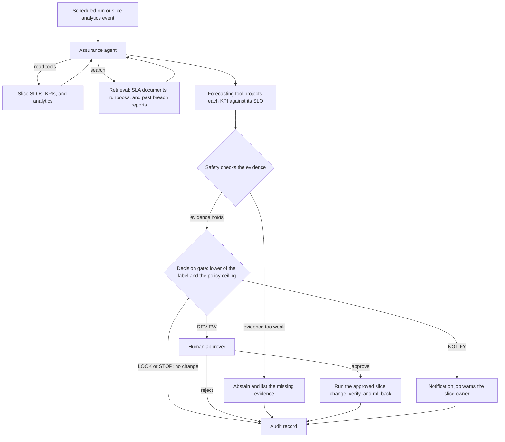

<!-- Writing rules: framework/style-guide.md. Name each component by its role and the Red Hat product used. Write no product support status. -->

# Slice SLA assurance

## At a glance

| Field | Value |
|---|---|
| One-liner | Forecasts network slice SLO breaches from slice KPIs and analytics, warns the slice owner before the breach, and proposes a slice resource change for approval. Never changes a slice on its own. Depends on structured SLOs, your forecasting tool, and evaluation of SLA extraction on your own documents. |
| Problem | Slice SLOs breach without warning, and engineers match KPIs to each customer's SLA by hand; the KPIs are SLO breach minutes and time to detect |
| Audience | Operations engineers, approvers, and risk owners who run enterprise network slices |
| OTel slots | `llm`: the assurance agent and the breach warning; `safety`: checks the evidence; `decision`: the gate label; `embedding` and `reranker`: retrieval |
| Autonomy ceiling | Recommend with approval |
| Placement tier | Regional for retrieval, the evidence check, the gate, and the warning; core for the assurance agent |
| Agent-school courses | 301 in the [agent-school roadmap](https://github.com/open-experiments/agent-school/blob/main/docs/RoadMap.md) |

## Problem and value

An enterprise slice carries service level objectives (SLOs) from the service level agreement (SLA) with its customer. Its KPIs can drift toward a breach with no warning, and engineers may first hear of it from the customer.
This recipe matches each slice's KPIs and analytics to its SLOs, forecasts likely breaches, warns the slice owner, and proposes a slice resource change for approval.
The KPIs are SLO breach minutes and time to detect; any gain is a target, measured against the shadow-stage baseline with the [PB-10](../../../platform/compliance-operating-model/README.md#staged-rollout-and-roi) measures.

## How it works



1. A scheduled run, or a slice analytics event from the network data analytics function (NWDAF, TS 23.288) or management data analytics (MDA, TS 28.104), starts the agent.
2. Through the MCP Gateway, the agent reads the slice's service level objectives from TMF657 Service Quality Management and its ServiceProfile and SliceProfile (TS 28.541). Those profiles carry the SLA attributes, derived from the GSMA NG.116 Generic Network Slice Template. The gateway denies each call unless a role allows it, the deny-unless-allowed rule in [PB-05](../../../platform/integration/README.md#per-tool-authorization).
3. The agent reads per-slice performance measurements (TS 28.552), slice KPIs (TS 28.554), and NWDAF and MDA analytics. Embedding and Reranker fetch the customer's SLA text, runbooks, and past breach reports from retrieval.
4. Your forecasting tool projects each KPI over the SLO breach forecast horizon and compares it with its SLO. The LLM never computes the forecast.
5. Safety checks that the KPIs, analytics, and SLO values support a forecast breach. When they don't, the agent abstains and lists what is missing.
6. The agent sends the breach warning and any remediation proposal as action requests, and the Decision slot answers a fixed label question at the [decision gate](../../../architecture/decision-gate.md).

The outcome is the lower of the model label and the policy ceiling for the capability and risk class, so it never exceeds either. A STOP label forces STOP at every stage. Every action class starts at the shadow stage, and a confirmed false ACT drops the use case and its action class back one stage, as [PB-06](../../../platform/safety-autonomy-gating/README.md#staged-autonomy) sets out.

A breach warning to the slice owner is NOTIFY from the assist stage up, and the [action layer](../../../platform/action-layer/README.md) runs the notification job. A remediation proposal changes slice resources through a service order or your slice provisioning service, so it is `write_high` and never gets an outcome higher than REVIEW.

### Slots and checkpoints

| Slot | Checkpoint | Role | Placement |
|---|---|---|---|
| `llm`, large | OTel-2.0-LLM-31B-IT, pinned by revision | The assurance agent: calls tools, correlates evidence, and sends action requests | Core |
| `llm`, small | A 1B to 14B OTel LLM, pinned by revision | Drafts the breach warning from the evidence and the forecast | Regional |
| `safety` | OTel-LLM-12B-Safety or OTel-LLM-8.3B-Safety, pinned by revision | Checks the evidence behind a forecast breach | Regional |
| `decision` | OTel-2.0-Decision-26B-A4B-4bit, pinned by revision | Gives the gate label | Regional |
| `embedding` | OTel-Embedding-600M, 4B, or 8B, pinned by revision | Turns SLA documents and reports into vectors | Regional |
| `reranker` | OTel-Reranker-0.6B or OTel-Reranker-4B, pinned by revision | Puts the best passages first | Regional |

### Worked example: a factory slice nears its latency objective

Enterprise factory slice `slice-fx-07` carries a TMF657 objective on uplink latency. Its S-NSSAI, `02-0000a7`, is fictitious. A new production shift adds automated vehicles, and an NWDAF slice load event starts the agent.

The per-slice measurements show uplink latency rising toward its objective, and NWDAF analytics show load building on the user plane function that serves the slice. The forecasting tool projects a breach inside the SLO breach forecast horizon, and Safety finds the evidence sufficient. The agent sends the breach warning, the gate returns NOTIFY, and a notification job warns the slice owner, as the [decision gate](../../../architecture/decision-gate.md#policy-table) policy table shows.

The agent then proposes, in `sla-req-3304`, a service order that adds a second user plane function to the slice. The change is `write_high`, so even if the label reads ACT, the outcome is REVIEW. The `approver` role signs off before the action layer runs the order. Its verification job rolls the change back if uplink latency does not recover.

## What you need

- [ ] Models: the slots in the slots table, chosen from the family in [PB-01](../../../platform/intake-model-selection/README.md), each pinned by revision with its licence chain recorded
- [ ] Platform blueprints: the pages for [PB-02](../../../platform/evaluation-acceptance/README.md), [PB-04](../../../platform/serving-routing-placement/README.md), [PB-05](../../../platform/integration/README.md), [PB-06](../../../platform/safety-autonomy-gating/README.md), [PB-07](../../../platform/action-layer/README.md), [PB-08](../../../platform/security-identity-sandbox/README.md), [PB-09](../../../platform/quality-operations/README.md), and [PB-10](../../../platform/compliance-operating-model/README.md)
- [ ] Components: one product for each role in the components table
- [ ] SLA extraction evaluated first: the [31B model card](https://huggingface.co/farbodtavakkoli/OTel-2.0-LLM-31B-IT#autonomous-operational-task-completion-not-benchmarked) lists extracting quantitative SLA and QoS parameters from a natural-language service request as not benchmarked, so evaluate extraction on your own SLA documents before use. Read SLO values from TMF657 records and slice profiles wherever they exist, each mapped to the KPI that measures it
- [ ] Read tools: read-only access to slice SLOs and profiles, per-slice measurements and KPIs, NWDAF and MDA analytics, and your own forecasting tool, each behind the MCP Gateway, which denies a call unless a role allows it
- [ ] Slice change playbooks: a job template that submits a service order or calls your slice provisioning service, with a verification job and a rollback job, tested on a stateful mock
- [ ] Corpora: the customer's SLA documents, runbooks, and past breach reports, each with a usage-rights entry ([PB-05](../../../platform/integration/README.md#knowledge-sources-and-usage-rights))
- [ ] Reranker check: compare `/rerank` scores with `sentence-transformers` scores on held-out pairs, because the OTel rerankers are Qwen3 fine-tunes with a one-label head
- [ ] Decision engine: vLLM 0.26 or 0.30 on CUDA or ROCm, as the [Decision model card](https://huggingface.co/farbodtavakkoli/OTel-2.0-Decision-26B-A4B-4bit) states
- [ ] Agent identity: a workload identity bound to the read roles and `submit_action_request` only, as PB-08 sets out
- [ ] Data: replayed slice incidents and near misses with SME labels, and a gate set weighted toward non-ACT cases
- [ ] Traces: tool calls, forecasts, gate decisions, and approvals, as PB-09 sets out

| Component role | Red Hat product used |
|---|---|
| Inference engine for every slot | Red Hat AI Inference (vLLM) |
| Serving platform | Red Hat OpenShift AI with KServe |
| Version record for each checkpoint and its pass | Model Registry in Red Hat OpenShift AI |
| Tool gateway for per-tool authorization | MCP gateway in Red Hat Connectivity Link |
| Action orchestration for the gate, approval, job, verification, and rollback | Automation Orchestrator for Red Hat Ansible Automation Platform |
| Execution with the only write credentials | Job templates in Red Hat Ansible Automation Platform |
| Input and tool-response guardrails | NeMo Guardrails in Red Hat OpenShift AI |
| Forecasting tool, knowledge service, and vector store | Your choice; this design names no product |

Key flags for each slot, copied from [PB-04](../../../platform/serving-routing-placement/README.md#key-flags-per-slot). Start the Safety slot with its own pinned revision and no tool-calling flags.

```text
# LLM 31B (pin the revision; text-only; tool calling)
--revision <sha> --enable-auto-tool-choice --tool-call-parser gemma4 \
--limit-mm-per-prompt '{"image": 0, "audio": 0}'
# Decision (card recipe)
--revision <sha> --max-logprobs 64 --enable-prefix-caching --max-model-len 16384
# Classification (Gemma3TextForSequenceClassification) and Reranker (num_labels=1)
--runner pooling --convert classify        # endpoints /classify, /v1/score, /rerank
# Embedding
--runner pooling --convert embed           # endpoint /v1/embeddings
```

Any component can be replaced. The Red Hat products named here show one way to build this design.

### What you bring

<!-- generated:what-you-bring start -->

| Model change | Your expertise | How far to climb |
|---|---|---|
| No model change: retrieval, a skill per role, and a capability manifest per tool | A golden set your experts label; gate labels from your approvers; a contract for each tool; your domain corpus | Configure first, and train only on a measured gap, as [PB-03 Adaptation](../../../platform/adaptation/README.md) sets out |

| Item | Network component | Mechanism | Owner | Matrix row |
|---|---|---|---|---|
| SLA documents, runbooks, and past breach reports | OSS and BSS | RAG corpus | Business owner | [OSS and BSS](../../../platform/bring-your-own-data/README.md#domain-oss-and-bss) |
| Slice SLO, KPI, analytics, and forecast read tools | OSS and BSS; 5G core CNFs | MCP tool contract | Platform team | [OSS and BSS](../../../platform/bring-your-own-data/README.md#domain-oss-and-bss); [5G core CNFs](../../../platform/bring-your-own-data/README.md#domain-5g-core-cnfs) |
| Slice assurance skill and capability manifests | OSS and BSS | Skill or capability manifest | SME | [OSS and BSS](../../../platform/bring-your-own-data/README.md#domain-oss-and-bss) |
| Slice change ceilings, playbooks, and rollback | OSS and BSS; 5G core CNFs | Gate and action-layer policy | Risk owner | [OSS and BSS](../../../platform/bring-your-own-data/README.md#domain-oss-and-bss); [5G core CNFs](../../../platform/bring-your-own-data/README.md#domain-5g-core-cnfs) |

<!-- generated:what-you-bring end -->

### Sandbox

<!-- generated:sandbox start -->

| Sandbox fit | Trigger on this page | Where to read |
|---|---|---|
| Base sandbox only: the agent reads through the gateways, so its identity, the gateway screen, and the six sandbox controls are enough | Reads slice KPIs and analytics through read tools; runs no code | [PB-08: when a use case needs a sandbox](../../../platform/security-identity-sandbox/README.md#when-a-use-case-needs-a-sandbox) |

<!-- generated:sandbox end -->

### What you must add

| Gap | What you add | Source |
|---|---|---|
| Golden set | Replayed slice incidents and near misses with outcomes your SMEs confirmed, including SLA extraction checks, because the card lists SLA and QoS extraction as not benchmarked | [OTel-2.0-LLM-31B-IT model card](https://huggingface.co/farbodtavakkoli/OTel-2.0-LLM-31B-IT#autonomous-operational-task-completion-not-benchmarked) |
| Gate labels | A gate set of past cases your approvers labelled, weighted toward non-ACT cases, because the Decision slot turns label probabilities into decisions through thresholds you set on your own cases | [OTel-2.0-Decision-26B-A4B-4bit model card](https://huggingface.co/farbodtavakkoli/OTel-2.0-Decision-26B-A4B-4bit) |
| Tool contracts | A pinned contract for each read tool, with SLOs read from TMF657 records and slice profiles | [TMF657 Service Quality Management repository](https://github.com/tmforum-apis/TMF657_ServiceQualityManagement), [3GPP network slice management](https://www.3gpp.org/technologies/slice-management) |
| Domain corpus | The customer's SLA documents, runbooks, and past breach reports in retrieval, each with a usage-rights entry, because the card's training leaves out network-performance data | [OTel-2.0-LLM-31B-IT model card](https://huggingface.co/farbodtavakkoli/OTel-2.0-LLM-31B-IT#telecommunications-data-not-included-in-training) |
| Language scope | Tests in every language your SLA documents and slice owners use, because the card's quality claims cover English text only | [OTel-2.0-LLM-31B-IT model card](https://huggingface.co/farbodtavakkoli/OTel-2.0-LLM-31B-IT#supported-language-and-modality) |

## Governance

Each action request passes the [decision gate](../../../architecture/decision-gate.md), and the outcome never exceeds the policy ceiling for its class.

| Action | Gate outcome (LOOK/NOTIFY/REVIEW/ACT/STOP) | Approval | AI Act class |
|---|---|---|---|
| Read slice SLOs, profiles, KPIs, and analytics, `read` | LOOK | None | [Recorded by your legal team in the classification record](../../../platform/compliance-operating-model/README.md) |
| Send a breach warning to the slice owner, `notify` | NOTIFY, from the assist stage up | None | [Recorded by your legal team in the classification record](../../../platform/compliance-operating-model/README.md) |
| Propose a slice resource change through a service order or the slice provisioning service, `write_high` | REVIEW, from the recommend stage up, within the Ceiling for high-risk writes | The `approver` role | [Recorded by your legal team in the classification record](../../../platform/compliance-operating-model/README.md) |
| Any action the label marks STOP | STOP | None | [Recorded by your legal team in the classification record](../../../platform/compliance-operating-model/README.md) |

| Parameter | What it controls | Who sets it | How to calibrate |
|---|---|---|---|
| SLO breach forecast horizon | How far ahead the forecast looks for a breach before the agent warns the slice owner | Business owner | Replay past breaches with SMEs and pick the horizon that gives the slice owner time to act without raising false warnings |
| LLM groundedness floor | The lowest share of answers whose claims the cited passages support | Risk owner, with SME review | Score a golden set of operator questions with SME-checked answers and a calibrated judge |
| Safety abstain-recall floor | The lowest share of insufficient-context items where the Safety slot abstains | Risk owner, with SME review | Build items with the evidence removed and measure correct abstention |
| Embedding and Reranker recall-at-k floor | The lowest share of questions with a correct passage in the top results | Platform team, with SME review | Label relevant passages for operator questions; the reranker must beat retriever-only on the same set |
| Decision false-ACT budget | The highest false-ACT rate accepted on state-changing proposals | Risk owner | [Evaluation and acceptance](../../../platform/evaluation-acceptance/README.md#false-act-method): use the false-ACT method, with a gate set large enough for the rule of three |
| Ceiling for notify requests | The highest outcome for notifications and ticket notes | Risk owner, with SME review | [Evaluation and acceptance method](../../../platform/evaluation-acceptance/README.md): review notify cases for duplicates and noise |
| Ceiling for high-risk writes | The highest outcome for changes that are hard to reverse or affect many customers | Risk owner | [Evaluation and acceptance method](../../../platform/evaluation-acceptance/README.md): keep it at REVIEW until the risk owner signs off on canary evidence |

This page gives no default values. Each owner sets the value with SME review and versions it with the policy that `policy_version` names.

| Activity | Responsible | Accountable | Consulted | Informed |
|---|---|---|---|---|
| Approve a REVIEW request | Approver | Business owner | SME | Operations engineer |
| Change a policy ceiling | Operations engineer | Risk owner | Change board and SME | Business owner |
| Promote a use case to the next stage | Approver | Risk owner | SME | Platform team |
| Drop a use case back a stage | Approver | Risk owner | Platform team | Security |
| Build and label golden sets, trajectory scenarios, and the gate set | SME | Business owner | Model owner | Risk owner |
| Grant a tool role to an agent | Platform team | Risk owner | Business owner | Security |

## Sources

Each key claim links its source, as set out in [the Sources table](../../../framework/definitions.md#sources-table).

| # | Claim | Basis | Source |
|---|---|---|---|
| 1 | The 31B has not been evaluated for autonomous, closed-loop completion of operational telecom tasks, including extracting quantitative SLA and QoS parameters from a natural-language service request, and needs task-specific evaluation before any non-supervised use | model card | [OTel-2.0-LLM-31B-IT model card](https://huggingface.co/farbodtavakkoli/OTel-2.0-LLM-31B-IT#autonomous-operational-task-completion-not-benchmarked) |
| 2 | The 31B training leaves out network-performance data such as KPIs and 5G performance metrics | model card | [OTel-2.0-LLM-31B-IT model card](https://huggingface.co/farbodtavakkoli/OTel-2.0-LLM-31B-IT#telecommunications-data-not-included-in-training) |
| 3 | The 31B targets English-language use, and all its quality claims are text-only | model card | [OTel-2.0-LLM-31B-IT model card](https://huggingface.co/farbodtavakkoli/OTel-2.0-LLM-31B-IT#supported-language-and-modality) |
| 4 | The Decision model reads decisions from label probabilities and uses them for confidence thresholds and routing, on vLLM 0.26 or 0.30 | model card | [OTel-2.0-Decision-26B-A4B-4bit model card](https://huggingface.co/farbodtavakkoli/OTel-2.0-Decision-26B-A4B-4bit) |
| 5 | TMF657 is the TM Forum Open API for service quality management; its resources include service level specifications and service level objectives | project documentation | [TMF657 Service Quality Management repository](https://github.com/tmforum-apis/TMF657_ServiceQualityManagement) |
| 6 | NG.116 defines the Generic Network Slice Template, a set of attributes that characterise a type of network slice; a provider maps customer requirements into those attributes to make a NEST | project documentation | [GSMA NG.116 Generic Network Slice Template](https://www.gsma.com/newsroom/gsma_resources/ng-116-generic-network-slice-template-v8-0/) |
| 7 | Slice requirements sit in the ServiceProfile and SliceProfile, derived from NG.116 attributes; slice performance uses per-slice measurements and KPIs, and MDA supports slice analytics | project documentation | [3GPP network slice management](https://www.3gpp.org/technologies/slice-management) |
| 8 | TS 28.541 specifies the 5G network resource model | project documentation | [3GPP TS 28.541](https://www.3gpp.org/DynaReport/28541.htm) |
| 9 | TS 28.552 defines the 5G performance measurements, and TS 28.554 defines the 5G end-to-end KPIs | project documentation | [3GPP TS 28.552](https://www.3gpp.org/DynaReport/28552.htm), [3GPP TS 28.554](https://www.3gpp.org/DynaReport/28554.htm) |
| 10 | TS 23.288 specifies the 5G System architecture for network data analytics services, and TS 28.104 specifies management data analytics | project documentation | [3GPP TS 23.288](https://www.3gpp.org/DynaReport/23288.htm), [3GPP TS 28.104](https://www.3gpp.org/DynaReport/28104.htm) |

## Deploy and verify

Apply these settings in order. Every action class starts at the shadow stage, and no slice change ever gets an outcome higher than REVIEW.

1. Pin each slot through intake ([PB-01](../../../platform/intake-model-selection/README.md)), and record each revision and its licence chain in the model registry.
2. Connect slice SLOs, profiles, measurements, analytics, and the forecasting tool as read tools, and mark every slice change as `write_high`.
3. Register the corpora, then deploy Embedding and Reranker with the flags from What you need and run the reranker score check.
4. Deploy Safety, Decision, and the small LLM at the regional site, then the 31B at the core with the tool-calling flags.
5. Have each owner load the parameters from Governance, with every class at the shadow stage in the stage register.
6. Run PB-02 operator offline acceptance on replayed slice incidents in the shadow stage, with trajectory checks that the agent reads SLOs and KPIs before it warns or proposes, and the false-ACT method for the Decision slot.
7. Promote to the assist stage, then the recommend stage, only through the PB-06 stage register.

| Check | PB-02 gate or parameter | Owner |
|---|---|---|
| Warnings arrive inside the horizon on replayed breaches | SLO breach forecast horizon | Business owner |
| Breach warning claims are supported by the cited passages and tool results | LLM groundedness floor | Risk owner |
| Safety abstains when the KPI or SLO evidence is removed | Safety abstain-recall floor | Risk owner |
| The matching SLA passage appears in the top results | Embedding and Reranker recall-at-k floor | Platform team |
| Reranker serving scores match `sentence-transformers` scores on held-out pairs | [Intake and smoke](../../../platform/evaluation-acceptance/README.md) | Platform team |
| The agent reads SLOs and KPIs before any warning or proposal, and writes nothing outside the allowed set | [Trajectory checks](../../../platform/evaluation-acceptance/README.md#trajectory-checks) | SME |
| ACT labels on slice change proposals whose ground truth is not ACT stay within budget | Decision false-ACT budget | Risk owner |

- Agent-school: 301 builds a multi-agent closed loop with an approval gate and a risk scorer, in the [agent-school roadmap](https://github.com/open-experiments/agent-school/blob/main/docs/RoadMap.md)
- Architecture: the [decision gate](../../../architecture/decision-gate.md) for labels and policy ceilings

## Limitations

- It never changes a slice without approval; every slice change goes to REVIEW.
- SLA and QoS extraction from prose is not benchmarked, as the [31B model card](https://huggingface.co/farbodtavakkoli/OTel-2.0-LLM-31B-IT#autonomous-operational-task-completion-not-benchmarked) states, so SLOs that exist only in contract text need your own extraction evaluation first.
- The 31B training leaves out KPI data, as the [31B model card](https://huggingface.co/farbodtavakkoli/OTel-2.0-LLM-31B-IT#telecommunications-data-not-included-in-training) states, so the forecasting tool does the numbers and the LLM correlates and explains.
- Its warnings are only as good as your forecast; check forecast breaches against actual breaches.
- OTel quality claims cover English only, as the [31B model card](https://huggingface.co/farbodtavakkoli/OTel-2.0-LLM-31B-IT#supported-language-and-modality) states.
- The AI Act class is your legal team's call, recorded in the [classification record](../../../platform/compliance-operating-model/README.md).
