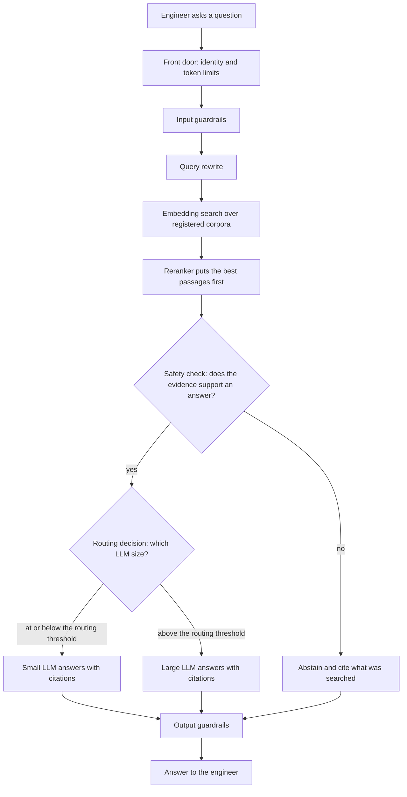

<!-- Writing rules: framework/style-guide.md. Name each component by its role and the Red Hat product used. Write no product support status. -->

# Grounded knowledge assistant

## At a glance

| Field | Value |
|---|---|
| One-liner | Answers standards and runbook questions with citations, or abstains and lists what it searched. Informs only and never changes the network. Depends on retrieval plus the Safety and Decision slots. |
| Problem | Engineers search 3GPP, IETF, TM Forum, and vendor documents by hand; the KPI is time to a cited answer |
| Audience | Operations engineers and support staff who ask standards and runbook questions |
| OTel slots | `embedding`: retrieval; `reranker`: passage order; `safety`: abstain on weak evidence; `decision`: picks the LLM size; `llm`: answers with citations |
| Autonomy ceiling | Inform |
| Placement tier | Regional and core |
| Agent-school courses | 103, 201, 203, and 402 in the [agent-school roadmap](https://github.com/open-experiments/agent-school/blob/main/docs/RoadMap.md) |

## Problem and value

Engineers search 3GPP, IETF, TM Forum, vendor documents, and runbooks by hand, and an answer without citations can send a change down the wrong path.
This assistant answers from your own indexed documents and cites each passage it used, or abstains and says what it searched.
The KPIs are time to a cited answer and the share of answers a reviewer accepts; any ROI is a target, measured against the shadow-stage baseline with the [PB-10](../../../platform/compliance-operating-model/README.md#staged-rollout-and-roi) measures, such as engineer hours and the cases the system would abstain on.

## How it works



1. An engineer asks a question. The front door checks identity and the team's token limit, and input guardrails screen the text.
2. The agent runtime rewrites the query. The Embedding slot retrieves candidate passages from registered corpora only, and the Reranker slot puts the best evidence first.
3. The Safety slot checks whether the passages support an answer. This check is the gate in this flow: when the passages fall short, the assistant abstains and returns the corpora and query it searched, with no answer.
4. The platform asks the Decision slot a fixed label question, such as whether the request needs the large model. It compares the label probability with the Decision routing threshold and picks the small or large LLM.
5. The chosen LLM answers from the passages only and cites each one.
6. Output guardrails screen the answer before the engineer sees it.
7. Each step writes to the trace, as [PB-09](../../../platform/quality-operations/README.md) sets out: retrieval ids, rerank scores, the abstain outcome, the model size, and the Decision probabilities.

No step changes the network, so every outcome is LOOK, the only outcome the shadow stage allows in [PB-06](../../../platform/safety-autonomy-gating/README.md#staged-autonomy).

### Slots and checkpoints

| Slot | Checkpoint | Role | Placement |
|---|---|---|---|
| `embedding` | OTel-Embedding-600M, 4B, or 8B, or a model up to 335M on CPU, pinned by revision | Turns passages and queries into vectors | Regional |
| `reranker` | OTel-Reranker-0.6B or OTel-Reranker-4B, pinned by revision | Puts the best passages first | Regional |
| `safety` | OTel-LLM-12B-Safety or OTel-LLM-8.3B-Safety, pinned by revision | Abstains when the passages don't support an answer | Regional |
| `decision` | OTel-2.0-Decision-26B-A4B-4bit, pinned by revision | Picks the small or large LLM | Regional |
| `llm`, small | A 1B to 14B OTel LLM, pinned by revision | Answers routine lookups with citations | Regional |
| `llm`, large | OTel-2.0-LLM-31B-IT, pinned by revision | Answers questions that need the large model, with citations | Core |

You set the Decision routing threshold; this page gives no default. Questions whose label probability exceeds it go to the large LLM at the core.

### Worked example: a timer question on RRC re-establishment

An operations engineer asks which timers govern RRC re-establishment in the 5G NR release the network runs. Retrieval returns a passage from 3GPP TS 38.331 and the operator runbook for radio link failures, and the Reranker puts the TS 38.331 passage first.

The Safety slot finds that the passages support an answer, and the Decision slot routes this short lookup to the small LLM. The answer names timers T311 and T301, says what starts each one, and cites TS 38.331 and the runbook section.

A second engineer asks about the same timers in a vendor's new software release. That release's manual has no entry in the corpus register, so nobody indexed it, and the Safety slot abstains because no passage covers the release. The reply lists the corpora and the query it searched, and says the manual for that release isn't in the register.

## What you need

- [ ] Models: the five slots in the slots table, chosen from the family in [PB-01](../../../platform/intake-model-selection/README.md), each pinned by revision with its licence chain recorded
- [ ] Platform blueprints: evaluation ([PB-02](../../../platform/evaluation-acceptance/README.md)), serving and routing ([PB-04](../../../platform/serving-routing-placement/README.md)), integration ([PB-05](../../../platform/integration/README.md)), safety gating ([PB-06](../../../platform/safety-autonomy-gating/README.md)), quality operations ([PB-09](../../../platform/quality-operations/README.md)), and compliance ([PB-10](../../../platform/compliance-operating-model/README.md))
- [ ] Components: one product for each role in the components table
- [ ] Corpora: each source, such as 3GPP and IETF specifications, TM Forum documents, vendor manuals, and runbooks, has a filled usage-rights entry in the corpus register before indexing, as [PB-05](../../../platform/integration/README.md#knowledge-sources-and-usage-rights) requires
- [ ] Reranker check: compare the Reranker slot's `/rerank` scores with `sentence-transformers` scores on held-out pairs before it serves retrieval, because the OTel rerankers are Qwen3 fine-tunes with a one-label head, not Qwen3-Reranker
- [ ] Embedding revision: a change of embedding model forces a full re-index of every vector store built with it, so record the embedding revision with the index
- [ ] Decision engine: vLLM 0.26 or later on CUDA, or 0.30 or later on ROCm, as the [Decision model card](https://huggingface.co/farbodtavakkoli/OTel-2.0-Decision-26B-A4B-4bit) states; call `/v1/chat/completions` with log probabilities
- [ ] Placement: retrieval, Safety, Decision, and the small LLM at the regional site; the large LLM at the core, as the [placement tiers](../../../architecture/placement.md) page sets out
- [ ] Data: a golden set of operator questions with SME-checked answers and labelled passages, plus items with the evidence removed, as [PB-02](../../../platform/evaluation-acceptance/README.md) describes

| Component role | Red Hat product used |
|---|---|
| Knowledge service and vector store | Your choice; this design names no product |
| Inference engine for every slot | Red Hat AI Inference (vLLM) |
| Serving platform | Red Hat OpenShift AI with KServe |
| Front door for identity and token limits | Models-as-a-Service in Red Hat OpenShift AI |
| Input and output guardrails | NeMo Guardrails in Red Hat OpenShift AI |
| Traces for each step | OpenTelemetry, as [PB-09](../../../platform/quality-operations/README.md) sets out |

Key flags for each slot, copied from [PB-04](../../../platform/serving-routing-placement/README.md#key-flags-per-slot). The LLM block keeps its tool-calling flags as PB-04 sets them, though this flow makes no tool calls. Start the small LLM with its own pinned revision.

```text
# LLM 31B (pin the revision; text-only; tool calling)
--revision <sha> --enable-auto-tool-choice --tool-call-parser gemma4 \
--limit-mm-per-prompt '{"image": 0, "audio": 0}'
# Decision (card recipe)
--revision <sha> --max-logprobs 64 --enable-prefix-caching --max-model-len 16384
# Classification (Gemma3TextForSequenceClassification) and Reranker (num_labels=1)
--runner pooling --convert classify        # endpoints /classify, /v1/score, /rerank
# Embedding
--runner pooling --convert embed           # endpoint /v1/embeddings
```

Any component can be replaced. The Red Hat products named here show one way to build this design.

## Governance

Every outcome is LOOK. The ceiling is inform, and nothing reaches the [decision gate](../../../architecture/decision-gate.md), because the flow changes no network state.

| Action | Gate outcome (LOOK/NOTIFY/REVIEW/ACT/STOP) | Approval | AI Act class |
|---|---|---|---|
| Answer with citations | LOOK | None: the engineer reads the answer and its sources | [Recorded by your legal team in the classification record](../../../platform/compliance-operating-model/README.md) |
| Abstain and cite what was searched | LOOK | None: the engineer sees what was searched | [Recorded by your legal team in the classification record](../../../platform/compliance-operating-model/README.md) |

| Parameter | What it controls | Who sets it | How to calibrate |
|---|---|---|---|
| LLM groundedness floor | The lowest share of answers whose claims the cited passages support | Risk owner, with subject-matter expert (SME) review | [Evaluation and acceptance](../../../platform/evaluation-acceptance/README.md): score a golden set of operator questions with SME-checked answers and a calibrated judge |
| LLM citation-correctness floor | The lowest share of citations that point to the passage that holds the claim | Risk owner, with SME review | Check citations against the retrieved passages on the same golden set |
| Embedding and Reranker recall-at-k floor | The lowest share of questions with a correct passage in the top results | Platform team, with SME review | Label relevant passages for operator questions; the reranker must beat retriever-only on the same set |
| Safety abstain-recall floor | The lowest share of insufficient-context items where the Safety slot abstains | Risk owner, with SME review | Build items with the evidence removed and measure correct abstention |
| Safety false-abstention ceiling | The highest share of sufficient-context items where the Safety slot abstains | Business owner | Measure abstention on items with full evidence, and weigh it against the human workload |
| Non-inferiority margin | The largest drop against the incumbent that still counts as no worse | Risk owner | Run candidate and incumbent on identical items and set the margin from the run-to-run noise |
| Decision routing threshold | The label probability over which the large LLM answers instead of the small LLM | Model owner | [Evaluation and acceptance](../../../platform/evaluation-acceptance/README.md): run the small and large LLM on the same golden set, and keep a question band on the small LLM only while it stays within the non-inferiority margin |
| Groundedness drift band | How far the share of grounded answers may fall from the accepted baseline before review | Model owner, with SME review | [Quality operations](../../../platform/quality-operations/README.md): score a sample of live answers with the acceptance judge, and compare against the shadow-stage baseline |
| Abstention rate drift band | How far the Safety slot's abstention share may move from the accepted baseline per review period before review | Risk owner | Compare against the shadow-stage baseline on the same question mix |

This page gives no default values. Each owner sets the value with SME review and versions it with the policy that `policy_version` names.

| Activity | Responsible | Accountable | Consulted | Informed |
|---|---|---|---|---|
| Add a corpus to the register | Business owner | Risk owner | Legal team and data protection officer | Platform team |
| Build and label golden sets, trajectory scenarios, and the gate set | SME | Business owner | Model owner | Risk owner |
| Set Decision routing thresholds | Model owner | Business owner | Platform team | Risk owner |
| Tune Safety slot abstention | Platform team | Model owner | SME | Business owner |

## Sources

Each key claim links its source, as set out in [the Sources table](../../../framework/definitions.md#sources-table).

| # | Claim | Basis | Source |
|---|---|---|---|
| 1 | In a RAG pipeline the 31B is the generation stage only; use purpose-built embedding and reranker models for the other stages | model card | [OTel-2.0-LLM-31B-IT model card](https://huggingface.co/farbodtavakkoli/OTel-2.0-LLM-31B-IT) |
| 2 | For high-impact use, deploy the 31B with retrieval, source attribution, checks, and human review suited to the system risk | model card | [OTel-2.0-LLM-31B-IT model card](https://huggingface.co/farbodtavakkoli/OTel-2.0-LLM-31B-IT) |
| 3 | The 31B training corpus draws on 3GPP, ETSI, ITU, GSMA, CAMARA, O-RAN, and TM Forum material, with no dedicated corpus of IETF RFCs | model card | [OTel-2.0-LLM-31B-IT model card](https://huggingface.co/farbodtavakkoli/OTel-2.0-LLM-31B-IT) |
| 4 | Use the Decision model's label probabilities for confidence thresholds and routing; serve it on vLLM 0.26 or 0.30 | model card | [OTel-2.0-Decision-26B-A4B-4bit model card](https://huggingface.co/farbodtavakkoli/OTel-2.0-Decision-26B-A4B-4bit) |
| 5 | Don't assume the Decision label probabilities are calibrated for your workload; its evaluation covers English text only | model card | [OTel-2.0-Decision-26B-A4B-4bit model card](https://huggingface.co/farbodtavakkoli/OTel-2.0-Decision-26B-A4B-4bit) |
| 6 | The Safety model is trained to refuse when retrieved context is insufficient; measure correct abstention and answer quality in the full pipeline before deployment | model card | [OTel-LLM-12B-Safety model card](https://huggingface.co/farbodtavakkoli/OTel-LLM-12B-Safety) |
| 7 | The OTel reranker is a full fine-tune of Qwen3-4B on sentence pairs with a label | model card | [OTel-Reranker-4B model card](https://huggingface.co/farbodtavakkoli/OTel-Reranker-4B) |
| 8 | The OTel embedding model is a full fine-tune of Qwen3-Embedding-8B for telecom retrieval | model card | [OTel-Embedding-8B model card](https://huggingface.co/farbodtavakkoli/OTel-Embedding-8B) |
| 9 | Pooling models serve embeddings, classification, and scores through `--runner pooling` and `--convert` | project documentation | [vLLM pooling models](https://docs.vllm.ai/en/latest/models/pooling_models/) |
| 10 | The GSMA Open-Telco evaluation suite is open source and built on Inspect AI | industry use case | [GSMA Open-Telco evals repository](https://github.com/gsma-labs/evals) |
| 11 | The front door routes on the request body and enforces per-subscription token limits | Red Hat guidance | [OpenShift AI release notes](https://docs.redhat.com/en/documentation/red_hat_openshift_ai_self-managed/3.5/html/release_notes/new-features-and-enhancements_relnotes) |
| 12 | Red Hat recommends NeMo Guardrails as the guardrails framework in OpenShift AI | Red Hat guidance | [OpenShift AI release notes](https://docs.redhat.com/en/documentation/red_hat_openshift_ai_self-managed/3.5/html/release_notes/support-removals_relnotes) |

## Deploy and verify

Apply these settings in order, and run the whole flow in the shadow stage first.

1. Register each corpus with its owner and usage rights in the corpus register ([PB-05](../../../platform/integration/README.md)).
2. Deploy the Embedding and Reranker slots with the pooling flags from What you need, each pinned by revision.
3. Build the index from registered corpora only, and record the embedding revision with it.
4. Deploy the Safety slot, pinned by revision.
5. Deploy the Decision slot and the small and large LLMs with their flags from What you need, on an engine that meets the Decision engine condition.
6. Have each owner set the routing threshold and the abstention parameters in the Governance table.
7. Run the PB-02 operator offline acceptance on your golden set, then run the shadow stage beside your engineers.

| Check | PB-02 gate or parameter | Owner |
|---|---|---|
| Answers are grounded in the cited passages | LLM groundedness floor | Risk owner |
| Each citation points to the passage that holds the claim | LLM citation-correctness floor | Risk owner |
| The Safety slot abstains on items with the evidence removed | Safety abstain-recall floor | Risk owner |
| The Safety slot answers items with full evidence | Safety false-abstention ceiling | Business owner |
| A correct passage is in the top results, and the reranker beats retriever-only | Embedding and Reranker recall-at-k floor | Platform team |
| Reranker serving scores match `sentence-transformers` scores on held-out pairs | [Intake and smoke](../../../platform/evaluation-acceptance/README.md) | Platform team |
| Small-LLM answers are no worse than large-LLM answers for questions routed to the small LLM | Non-inferiority margin, at the Decision routing threshold | Model owner |
| The large LLM identifies itself correctly after each deploy | [Intake and smoke](../../../platform/evaluation-acceptance/README.md) | Platform team |

- Agent-school: 103 rebuilds the Telco-SME assistant, 201 teaches small-vs-large routing and a grounding judge, 203 covers routing, and 402 builds a knowledge service, in the [agent-school roadmap](https://github.com/open-experiments/agent-school/blob/main/docs/RoadMap.md)
- Architecture: the [grounded-answer flow](../../../architecture/index.md#flow-grounded-answer) this recipe builds on
- GSMA: the [Open-Telco evals repository](https://github.com/gsma-labs/evals) for public sanity checks before operator acceptance

## Limitations

- The assistant never changes network state. It informs only, and every outcome is LOOK.
- It answers only from corpora in the register. A source with an empty usage-rights entry stays out of the index, so questions about it end in an abstention.
- It gives no answer without citations; a question with no supporting passage gets an abstention.
- The 31B training corpus has no dedicated IETF RFC corpus, so IETF answers depend on the RFCs you index.
- The operator sets the routing threshold and the abstention parameters before the shadow stage, and the Decision label probabilities count as uncalibrated until you calibrate them on your own questions.
- The Decision card evaluates English text only, so a corpus in another language needs its own evaluation.
