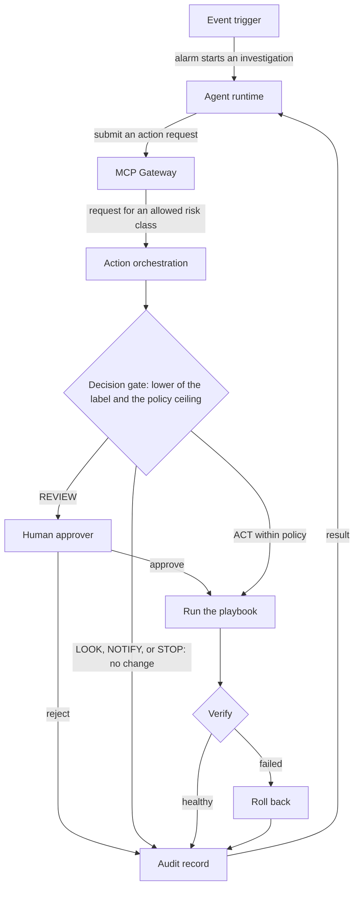

<!-- Writing rules: framework/style-guide.md. Name each component by its role and the Red Hat product used. Write no product support status. -->

# Action layer

## At a glance

| Field | Value |
|---|---|
| One-liner | Turns an agent's action request into a gated, approved, executed, verified, and audited change, with rollback on failure. Depends on an automation platform that holds the only write credentials. |
| Question answered | Autonomy gating: what may the agent do without a human? |
| Audience | Automation engineers, platform engineers, and NOC leads |
| OTel slots | Decision and LLM |
| Placement tier | Regional and core |
| Top 3 decisions | Read the gate label inside the orchestrator; give the agent read-only job access; pair every playbook with a verification job and a rollback job |
| Agent-school courses | 202 and 301 in the [agent-school roadmap](https://github.com/open-experiments/agent-school/blob/main/docs/RoadMap.md) |

## The operator question

How does an agent's action request become an executed, blocked, or human-approved change that you can verify, roll back, and trace?
Until you answer it, agents hold write credentials to the network, and nobody can show who approved a change or undo one that failed.

## Decisions you must make

| Decision | Options | Recommendation | Because |
|---|---|---|---|
| Read the gate label inside the orchestrator | Trust the agent's label; an Automation Orchestrator workflow; a job template that calls the gate with `uri` | An Automation Orchestrator workflow by default. A job template with `uri` when you run job templates only | The workflow holds the gate, the approval, and the job in one place, and inherits your RBAC, approval gates, and audit trails ([Automation Orchestrator announcement](https://www.redhat.com/en/blog/unify-it-workflows-scale-new-automation-orchestrator-ansible-automation-platform)) |
| Give the agent read-only job access | No job access; read-only mode; read-write mode | The MCP Server for AAP in read-only mode. Grant only the job status and output tools | Read-write mode lets agents run jobs and make changes, which turns the gate into a suggestion ([MCP Server for AAP announcement](https://www.redhat.com/en/blog/it-automation-agentic-ai-introducing-mcp-server-red-hat-ansible-automation-platform)) |
| Choose who approves REVIEW | A named person; a role | A role, carried as `required_approver` in the gate decision, such as `noc-shift-lead` | Shifts change, and the [decision gate schema](https://github.com/ravisharma5/otel-telco-blueprints/blob/main/schemas/decision-gate.schema.json) records the approver role |
| Pair every playbook with a verification job and a rollback job | Trust the job exit code; verify and roll back per playbook | A verification job that reads the changed object, and a rollback job that restores it | A job can succeed while the network stays broken. Only a check on the object shows the fix worked |
| Limit what Event-Driven Ansible may start | Fixes on an event; investigations and workflows only | Investigations and Orchestrator workflows only. Every fix passes the gate | An event can start a workflow, so send it there and let the gate decide. Workflows start from webhooks, schedules, or event sources ([Automation Orchestrator announcement](https://www.redhat.com/en/blog/unify-it-workflows-scale-new-automation-orchestrator-ansible-automation-platform)) |

## Reference design



The write path, from alarm to audit record:

1. An Event-Driven Ansible rulebook receives the TMF642 alarm event and starts an investigation, or a NOC user asks the agent.
2. The agent investigates with read tools, then calls `submit_action_request`. The MCP Gateway checks that this identity may submit requests for this risk class.
3. The request reaches an Automation Orchestrator workflow through its webhook trigger, which checks it against the decision gate schema.
4. A REST API step calls the Decision slot on `/v1/chat/completions` with log probabilities and a fixed label question, and reads the label probabilities.
5. A switch step takes the lower of the model label and the policy ceiling for the risk class. A STOP label forces STOP, and a label mass below the floor fails closed to STOP.
6. REVIEW goes to an approval step for the `required_approver` role. ACT goes on only for an approved playbook within policy.
7. A job template runs the playbook, and a verification job reads the same object. If verification fails, the workflow reports the failure, then runs a rollback job.
8. The workflow writes the audit record and updates the TMF621 ticket, then returns the result to the agent.

### Two ways to get the label

| Path | How the action layer gets the label | Use when |
|---|---|---|
| Default: an Automation Orchestrator workflow | A REST API step calls the Decision slot, and a switch step branches on the outcome before the approval and job steps | You run Automation Orchestrator and want the gate, the approval, and the job in one workflow |
| Alternative: a job template calls the gate with `uri` | The first task of the job template calls the Decision slot with the `uri` module and stops unless the outcome allows the job | You run job templates only, or a playbook needs its own gate |

Both paths run the gate again on the request and never trust the agent's advisory label. The [decision gate](../../architecture/decision-gate.md#how-aap-gets-the-label) page describes the same two paths.

### Fallback task

```yaml
- name: Ask the Decision gate
  ansible.builtin.uri:
    url: "{{ gate_url }}/v1/chat/completions"
    method: POST
    body_format: json
    body: "{{ gate_request }}"
    headers: { Authorization: "Bearer {{ gate_token }}" }
  register: gate
- name: Stop unless the outcome allows this job
  ansible.builtin.assert:
    that: gate_outcome in allowed_outcomes
    fail_msg: "Gate outcome {{ gate_outcome }} blocks this job"
```

A small filter or role sets `gate_outcome` from the reply: it turns the log probabilities into label probabilities, checks the label mass, and applies the policy ceiling.

### Prerequisites

The REST API step blocks URLs that target private network addresses or cloud metadata endpoints by default. The Decision slot runs inside the cluster, so allow the gate endpoint for REST API steps, as the [REST API step docs](https://docs.redhat.com/en/documentation/automation_orchestrator/2026.8/develop-add_a_rest_api_step_to_a_workflow) describe. The Decision model card's recipe starts a server with no authentication, so require a token at the gate endpoint before any workflow calls it. Automation Orchestrator ships as an add-on to Red Hat Ansible Automation Platform.

### Policy ceilings

| Parameter | What it controls | Who sets it | How to calibrate |
|---|---|---|---|
| Ceiling for read requests | The highest outcome for requests that only read | Operator, with SME sign-off | [Evaluation and acceptance method](../evaluation-acceptance/README.md): review the gate set for read requests and the human review load |
| Ceiling for notify requests | The highest outcome for notifications and ticket notes | Operator, with SME sign-off | [Evaluation and acceptance method](../evaluation-acceptance/README.md): review notify cases for duplicates and noise |
| Ceiling for low-risk writes | The highest outcome for reversible changes such as an interface restart | Operator risk owner | [Evaluation and acceptance method](../evaluation-acceptance/README.md): raise it only after a canary window with no false ACT label |
| Ceiling for high-risk writes | The highest outcome for changes that are hard to reverse or affect many customers | Operator risk owner | [Evaluation and acceptance method](../evaluation-acceptance/README.md): keep it at REVIEW until the risk owner signs off on canary evidence |
| Required approver role per action class | Which role approves REVIEW for each action class | NOC lead | [Evaluation and acceptance method](../evaluation-acceptance/README.md): check approval times and overrides per class in the trace |
| Label-mass floor | The lowest label mass at which the gate trusts the readout | Platform engineer, with SME sign-off | [Evaluation and acceptance method](../evaluation-acceptance/README.md): measure label mass on the operator gate set and set the floor below normal readouts |

This page gives no default values. You set each parameter with SME sign-off and version the set as the policy that `policy_version` names.

### Worked example: alarm and root-cause triage

Rising CRC errors and BFD flaps on router r2 open incident `inc-2041`. The agent sends `req-0001`, a `write_low` request to restart eth1 on r2 with `router.restart_interface`. The stage register puts this class at the recommend stage, so the ceiling is REVIEW, and `dec-0001` records the outcome REVIEW under `noc-gate-policy-3`. Both messages are on the [decision gate](../../architecture/decision-gate.md#message-examples) page, and both follow the [decision gate schema](https://github.com/ravisharma5/otel-telco-blueprints/blob/main/schemas/decision-gate.schema.json).

The approval step waits for `noc-shift-lead`. After approval, the `pb-interface-restart` job template restarts eth1 on r2. The verification job checks that CRC errors stop rising, the BFD session to r3 stays stable, and the TMF642 alarm clears. If any check fails, the workflow posts the failure to the ticket, then the rollback job re-applies the previous interface configuration. The audit record holds the `gate_decision` message, the approver, the job result, and the verification result.

- Config artifact: an Automation Orchestrator workflow definition with the webhook trigger, REST API step, switch, approval, and job steps
- Config artifact: an Event-Driven Ansible rulebook that starts investigations from TMF642 alarm events
- Config artifact: job templates for each playbook's run, verification, and rollback jobs
- Config artifact: policy ceilings file for each capability and risk class, named by `policy_version`

## Components

| Component role | Red Hat product used |
|---|---|
| Action orchestration: gate, approval, job, verification, rollback, and audit in one workflow | Automation Orchestrator for Red Hat Ansible Automation Platform |
| Event trigger: start investigations and workflows from alarm events | Event-Driven Ansible in Red Hat Ansible Automation Platform |
| Execution: run, verification, and rollback jobs with the only write credentials | Job templates in Red Hat Ansible Automation Platform |
| Agent read access to jobs: job status and output, never launch | MCP Server for Red Hat Ansible Automation Platform, in read-only mode |
| Tool gateway: let the agent submit requests for its risk class only | MCP gateway in Red Hat Connectivity Link |
| Gate model: label each action request with label probabilities | OTel Decision slot on Red Hat AI Inference (vLLM), with log probabilities turned on |

Any component can be replaced. The Red Hat products named here show one way to build this design.

## OTel slot guidance

| Slot | Candidate checkpoints | Notes |
|---|---|---|
| `decision` | OTel-2.0-Decision-26B-A4B-4bit, pinned by revision | Answers a fixed label question with log probabilities. A low label mass means an invalid readout, so the gate fails closed to STOP. Calibrate before any ACT ceiling |
| `llm` | OTel-2.0-LLM-31B-IT or a smaller OTel LLM as the agent, pinned by revision | Writes the action request and reports the verification result. Never launches jobs, and its own gate label is advisory |

## Sources and acceptance

Each key claim links its source, as set out in [the Sources table](../../framework/definitions.md#sources-table).

| # | Claim | Basis | Source |
|---|---|---|---|
| 1 | Automation Orchestrator is an add-on to Ansible Automation Platform, and its workflows inherit RBAC roles, approval gates, and audit trails | Red Hat guidance | [Automation Orchestrator announcement](https://www.redhat.com/en/blog/unify-it-workflows-scale-new-automation-orchestrator-ansible-automation-platform) |
| 2 | Automation Orchestrator workflows start from webhooks, schedules, or event sources, and record every AI decision in the audit log | Red Hat guidance | [Automation Orchestrator announcement](https://www.redhat.com/en/blog/unify-it-workflows-scale-new-automation-orchestrator-ansible-automation-platform) |
| 3 | A REST API step calls a REST service from a workflow, and blocks URLs that target private network addresses or cloud metadata endpoints by default | Red Hat guidance | [Automation Orchestrator REST API step](https://docs.redhat.com/en/documentation/automation_orchestrator/2026.8/develop-add_a_rest_api_step_to_a_workflow) |
| 4 | The MCP Server for AAP runs in read-only mode for querying, or read-write mode that lets agents run jobs and make changes | Red Hat guidance | [MCP Server for AAP announcement](https://www.redhat.com/en/blog/it-automation-agentic-ai-introducing-mcp-server-red-hat-ansible-automation-platform) |
| 5 | The MCP Server for AAP allows only actions that both the server mode and the user's RBAC permit, and its job management toolset can launch jobs | Red Hat guidance | [MCP Server for AAP announcement](https://www.redhat.com/en/blog/it-automation-agentic-ai-introducing-mcp-server-red-hat-ansible-automation-platform) |
| 6 | The Decision model returns label probabilities through `/v1/chat/completions` with log probabilities, and a low label mass indicates an invalid readout | model card | [OTel-2.0-Decision-26B-A4B-4bit model card](https://huggingface.co/farbodtavakkoli/OTel-2.0-Decision-26B-A4B-4bit) |
| 7 | The Decision model card's recipe starts a server with no authentication, and the card advises human review for consequential decisions | model card | [OTel-2.0-Decision-26B-A4B-4bit model card](https://huggingface.co/farbodtavakkoli/OTel-2.0-Decision-26B-A4B-4bit) |
| 8 | The Ansible `uri` module sends HTTP requests with a JSON body and returns the response to the play | project documentation | [Ansible `uri` module](https://docs.ansible.com/ansible/latest/collections/ansible/builtin/uri_module.html) |
| 9 | The Ansible `assert` module fails a task with a message when a condition is false | project documentation | [Ansible `assert` module](https://docs.ansible.com/ansible/latest/collections/ansible/builtin/assert_module.html) |

- Gate: no job runs without a `gate_decision` record that names its request.
- Gate: every playbook has a verification job and a rollback job, and both run against a stateful mock before the canary.
- Gate: a job launch with the agent's token fails.
- Gate: a test request with a STOP label ends as STOP, and a test request with label mass below the floor ends as STOP.
- Gate: a REVIEW outcome runs nothing until the required approver role approves.
- Gate: the REST API step reaches the in-cluster gate endpoint with a token before you publish the workflow.
- Gate: every audit record holds the gate decision, the approver, the job result, and the verification result.

## Operating model

| Activity | Responsible | Accountable | Consulted | Informed |
|---|---|---|---|---|
| Approve a REVIEW request | NOC shift lead | NOC lead | Operator SME | Automation engineer |
| Write a playbook with its verification and rollback jobs | Automation engineer | Platform owner | Operator SME | NOC lead |
| Change a policy ceiling or an approver role | Automation engineer | Operator risk owner | Operator SME | NOC lead |
| Change an Event-Driven Ansible rulebook | Automation engineer | Platform owner | NOC lead | Security team |
| Grant MCP Server for AAP toolsets to an agent | Platform engineer | Security team | Automation engineer | Operator risk owner |

## Risks and limitations

| Risk | Likelihood | Mitigation |
|---|---|---|
| An agent with job-launch rights turns the gate into a suggestion | Medium | Run the MCP Server for AAP in read-only mode, grant job status and output tools only, and test that the agent's token can't launch a job |
| Job output that holds secrets reaches the model provider through a tool result | Medium | Keep secret-bearing job output out of the agent's toolsets, and mask secrets in playbook output |
| A rollback job that never runs leaves a failed change in place | Medium | Run every rollback job against a stateful mock before the canary, and alert when verification fails without a rollback record |
| The REST API step blocks the gate endpoint, so every request stalls | High on first install | Allow the in-cluster gate endpoint for REST API steps, and check the call before publishing the workflow |
| An event rule runs a fix without the gate | Low | Let rulebooks start investigations and Orchestrator workflows only, and review every rulebook change |

## Used by and next steps

- [PB-04 Serving, routing, and placement](../serving-routing-placement/README.md): serves the Decision slot the gate calls
- [PB-05 Integration](../integration/README.md): the MCP Gateway and the `submit_action_request` tool that start this write path
- [PB-06 Safety and autonomy gating](../safety-autonomy-gating/README.md): the stages and policy ceilings this page applies
- [Decision gate](../../architecture/decision-gate.md): the label policy, both paths, and the message examples
- [PB-02 Evaluation and acceptance](../evaluation-acceptance/README.md): supplies the calibration and canary evidence behind each ceiling
- PB-08: security and identity covers workload identity and secrets for job credentials
- PB-09: quality operations tracks gate outcomes, approvals, rollbacks, and overrides
- Agent-school: courses 202 and 301 in the [agent-school roadmap](https://github.com/open-experiments/agent-school/blob/main/docs/RoadMap.md); 301 adds an approval gate to a closed loop
