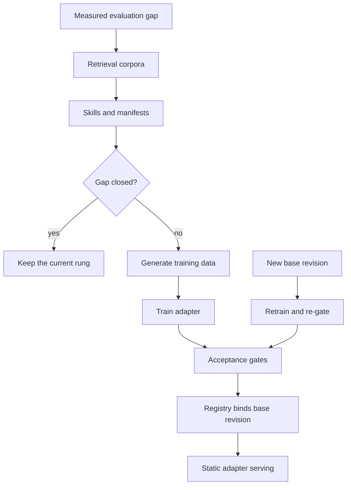

<!-- Writing rules: framework/style-guide.md. Name each component by its role and the Red Hat product used. Write no product support status. -->

# Adaptation

## At a glance

| Field | Value |
|---|---|
| One-liner | Fits OTel models to your network by climbing from retrieval to skills and capability manifests, then to LoRA and OSFT, only when evaluation shows a measured gap. Depends on a knowledge service, a training stack, and a model registry that binds each adapter to its base revision. |
| Question answered | Adaptation: how do you fit the model to your network? |
| Audience | Model owners, platform teams, and risk owners |
| OTel slots | LLM, Decision, Classification, Embedding, and Reranker |
| Placement tier | Core |
| Top 3 decisions | Start at retrieval and climb only on a measured evaluation gap; choose LoRA or OSFT when training is earned; serve adapters statically, pinned by digest |
| Agent-school courses | 401, 402, and 403 in the [agent-school roadmap](https://github.com/open-experiments/agent-school/blob/main/docs/RoadMap.md) |

## The operator question

How do you fit an OTel model to your network without retraining everything each time the base model changes?
Until you answer it, teams train adapters they don't need and skip the re-gate after a base change, so adapters fail without warning.

## Decisions you must make

| Decision | Options | Recommendation | Because |
|---|---|---|---|
| Start at retrieval and climb only on a measured evaluation gap | Fine-tune first; start at retrieval and climb on preference; start at retrieval and climb on a measured gap | Always start at retrieval, and climb one rung only when the task suite shows a measured gap | Each rung costs more to build and more to redo when the base changes ([adaptation ladder](../../architecture/adaptation-ladder.md)) |
| Choose LoRA or OSFT when training is earned | LoRA with supervised fine-tuning (SFT); QLoRA; OSFT; LoRA with group relative policy optimization (GRPO) | LoRA with SFT by default; OSFT only for a large proprietary corpus and a dedicated pool | A LoRA adapter shares the base with other tenants. OSFT gives you a full model of your own to retrain and host ([Training Hub](https://github.com/Red-Hat-AI-Innovation-Team/training_hub)) |
| Pick the teacher model for synthetic data | A commercial model API; an open teacher served on site | An open teacher served on site, with its licence chain recorded as in [PB-01 Intake and model selection](../intake-model-selection/README.md) and sent to legal review | Your tool catalog and documents stay on site. The Gemma Terms of Use count models trained on synthetic outputs of Gemma as Model Derivatives, so a teacher's licence can reach the adapters trained on its output |
| Decide how adapters are served | Load at runtime through an API; load at start, pinned by digest | Load at start only, pinned by digest, from internal object storage | Runtime loading lets anyone with API access swap model behaviour ([LoRA backdoor article](https://developers.redhat.com/articles/2026/09/02/lora-backdoor-threat-how-openshift-ai-mitigates-risk)) |
| Decide what a base change triggers | Keep adapters; retrain and re-gate every adapter | Retrain and re-gate every adapter on each new base revision | An adapter is a delta against one exact set of base weights, so its behaviour on a new base is undefined |

## Reference design



One climb, from a gap to a served adapter:

1. The task suite in [PB-02 Evaluation and acceptance](../evaluation-acceptance/README.md) shows a measured gap on one use case.
2. The platform team adds or fixes retrieval corpora, each with a usage-rights entry before indexing.
3. The model owner writes or fixes the skill for the role and the capability manifests for its tools, then reruns the suite.
4. If the gap stays, the model owner generates training data with SDG Hub from the tool catalog, replayed tapes, and documents, using a teacher on site.
5. Training Hub trains a LoRA adapter against one pinned base revision. Experiment tracking records the run and its dataset.
6. The adapter re-enters the PB-02 ladder at operator offline acceptance.
7. On a pass, the model registry binds the adapter to its base revision and evaluation report.
8. The serving config loads the adapter at start, pinned by digest. A new base revision sends every adapter back to step 5.

### Ladder in practice

| Rung | What you build | Gate to climb | Redo on base change |
|---|---|---|---|
| Retrieval | Operator corpora behind the knowledge service, each with a usage-rights entry | Start here | Re-index only if the embedding model changes |
| Skills and capability manifests | One SKILL.md per role and one manifest per MCP capability | Retrieval holds the facts, but the agent picks the wrong procedure or tool | Rerun the task suite; skills and manifests carry over |
| LoRA | An adapter trained on SDG Hub data and bound to one base revision | The suite still shows a measured gap in vocabulary, tool calls, or output format | Retrain and re-gate the adapter |
| OSFT | A full fine-tune on a large proprietary corpus, served from its own pool | A LoRA adapter cannot close the gap, and you have the corpus and the budget | Retrain and re-gate the full model |

The rungs and their order come from the [adaptation ladder](../../architecture/adaptation-ladder.md).

### Retrieval corpora

Record a usage-rights entry for each corpus in the corpus register before you index it, as [PB-05 Integration](../integration/README.md) describes. Version each index with its embedding model. A new embedding model forces a full re-index of every store built with the old one.

### Skills and capability manifests

A skill is a procedure bound to a role: write one SKILL.md per role. Govern skills as content, with review, version, provenance, and a judge, as the 401 course in the [agent-school roadmap](https://github.com/open-experiments/agent-school/blob/main/docs/RoadMap.md) describes.

A capability is what an agent reaches through MCP. Give each capability one manifest with six fields: backend pattern, I/O schema, risk class, allowed identities, rate class, and data class. The risk class sets the ceiling that the [decision gate](../../architecture/decision-gate.md) applies, and the same manifest drives the tool gateway's access and rate policies.

The course defines the backend patterns, so the triage manifest below uses a descriptive value.

```yaml
capability: classify_root_cause
backend_pattern: model-as-tool       # Classification slot behind the MCP gateway
io_schema: {input: alarm_bundle, output: root_cause_label_with_probabilities}
risk_class: read
allowed_identities: [noc-triage-agent]
rate_class: interactive
data_class: network-operational      # no subscriber personal data
```

### When to train LoRA

| Method | Use when | Serving consequence |
|---|---|---|
| LoRA with SFT, the default | Operator vocabulary, tool catalog, output formats, or procedure style | Many adapters share one base pool |
| QLoRA | Training GPUs are short of memory | Serve on the same base precision the adapter targets, or evaluate the mismatch |
| OSFT | A large proprietary corpus must be absorbed while limiting forgetting | A full model of your own in a dedicated pool, with no base sharing |
| LoRA with GRPO | Tool-call correctness against verifiable rewards from replayed tapes or MCP mocks | Same as LoRA |
| Full fine-tune of small heads | Classification labels, reranker, or embedding on operator data | Redeploy the model; an embedding change forces a re-index |

Training data that always ends in a change teaches the model to act. Generate LOOK, NOTIFY, REVIEW, and STOP cases as well as ACT cases, using the labels from the [decision gate](../../architecture/decision-gate.md).

### Training data checks

Every dataset passes these checks before SDG Hub or Training Hub uses it.

| Check | What it enforces |
|---|---|
| Provenance | Each dataset records its sources, the SDG flow and teacher model that produced it, and its version in experiment tracking |
| Usage rights | Each document set, ticket export, and tape set has a usage-rights entry in the corpus register in [PB-05 Integration](../integration/README.md#knowledge-sources-and-usage-rights) |
| Personal data screening | Subscriber identifiers are scrubbed from tapes, tickets, and documents before synthetic data generation |
| Traffic and location data | Traffic data and location data get erased or made anonymous, unless the lawful basis or consent recorded for the dataset covers them |
| Lawful basis | Each dataset records the lawful basis for any personal data it still holds, and the data protection officer reviews it |
| Label balance | The dataset meets the minimum share of non-ACT training cases, with LOOK, NOTIFY, REVIEW, and STOP cases beside the ACT cases |

### Base upgrades

| Change | What re-runs |
|---|---|
| New base revision of the same model | Retrain and re-gate every adapter through PB-02 before it serves on the new base |
| New base family or hidden size | Retrain from scratch, because old adapters fail to load |
| New embedding model | Re-index every store built with the old model, then re-run retrieval and abstention checks |
| New skill or manifest version | Rerun the task suite; no retraining |

An adapter trained on an earlier base may load on a new one, because the shapes match, but its behaviour is undefined. Retrain and re-gate every adapter on every base revision, and let the model registry bind each adapter to one base revision.

### Adapter serving and security

| Prerequisite | Why | Source |
|---|---|---|
| Load adapters only at start with static `--lora-modules`, pinned by digest | A pinned list is reviewable in Git and cannot change at runtime | [vLLM LoRA docs](https://docs.vllm.ai/en/latest/features/lora/) |
| Block runtime adapter loading with a cluster policy | Runtime loading lets a caller inject a malicious adapter | [LoRA backdoor article](https://developers.redhat.com/articles/2026/09/02/lora-backdoor-threat-how-openshift-ai-mitigates-risk) |
| Store adapters in internal object storage, not as OCI URIs | The inference service rejects OCI URIs for adapters | [KServe issue 6094](https://github.com/kserve/kserve/issues/6094) |
| Set `--max-lora-rank` to the highest trained rank | An adapter with a higher rank fails to load | [vLLM LoRA docs](https://docs.vllm.ai/en/latest/features/lora/) |

```text
--enable-lora --max-lora-rank <highest trained rank> \
--lora-modules triage-adapter=<internal object storage path pinned by digest>
```

Never set `VLLM_ALLOW_RUNTIME_LORA_UPDATING`; block it by policy. [PB-04 Serving, routing, and placement](../serving-routing-placement/README.md) lists the full serving flags.

### Adaptation parameters

| Parameter | What it controls | Who sets it | How to calibrate |
|---|---|---|---|
| Minimum measured gap to train | The smallest task-suite shortfall, after retrieval and skills, that earns an adapter | Risk owner, with SME review | Compare the gap with the run-to-run noise of the suite and the cost of retraining on each base revision |
| Minimum share of non-ACT training cases | The lowest share of LOOK, NOTIFY, REVIEW, and STOP cases in adapter training data | Model owner, with SME review | Sample real incidents and count those where people only looked, notified, escalated, or stopped |

This page gives no default values. You set each parameter with SME review and version the set with the training run. The non-inferiority margin that a retrained adapter must meet belongs to [PB-02 Evaluation and acceptance](../evaluation-acceptance/README.md).

### Worked example: alarm and root-cause triage

Rising CRC errors and BFD flaps on router r2 open incident `inc-2041`. Triage starts at the retrieval rung, with runbooks and past root-cause reports, then adds the triage skill and the manifests for its tools. It earns a LoRA only if the PB-02 suite still shows a measured gap, such as the wrong tool sequence or the wrong output format on eth1 interface faults.

The adapter trains on SDG Hub data built from the triage tools and replayed tapes. That data includes LOOK, NOTIFY, REVIEW, and STOP cases, so the adapter doesn't learn that every incident ends in a restart. The model registry binds it to the base revision, and the engine loads it at start.

A fix proposal such as `req-0001` still goes through the gate, and `dec-0001` stays at REVIEW for the `approver`, as the [decision gate](../../architecture/decision-gate.md) requires. When the next OTel base revision ships, you retrain and re-gate the adapter before it serves.

- Config artifact: skill catalog entry for the triage role that records its version and reviewer
- Config artifact: capability manifest for each triage tool
- Config artifact: model registry record binding each adapter to its base revision and evaluation report
- Config artifact: serving config listing adapters by digest

## Components

| Component role | Red Hat product used |
|---|---|
| Knowledge service: holds operator corpora for retrieval | Vector store with the OTel Embedding and Reranker slots on Red Hat AI Inference (vLLM) |
| Skill catalog and manifest registry: version skills and capability manifests | Git repository with OpenShift GitOps |
| Synthetic data: turns tools, tapes, and documents into training data | SDG Hub in Red Hat OpenShift AI |
| Training: trains LoRA adapters and runs OSFT | Training Hub in Red Hat OpenShift AI |
| Experiment tracking: links runs, datasets, and results | MLflow in Red Hat OpenShift AI |
| Model registry: binds each adapter to its base revision and evaluation report | Model Registry in Red Hat OpenShift AI |
| Adapter policy: blocks runtime adapter loading | Red Hat Advanced Cluster Security for Kubernetes |
| Inference engine: serves the base with static adapters | Red Hat AI Inference (vLLM) |

Any component can be replaced. The Red Hat products named here show one way to build this design.

## OTel slot guidance

| Slot | Candidate checkpoints | Notes |
|---|---|---|
| `llm` | OTel-2.0-LLM-31B-IT or a smaller OTel LLM, pinned by revision | The main LoRA target. Retrain adapters on every base revision |
| `decision` | OTel-2.0-Decision-26B-A4B-4bit, pinned by revision | Only quantized weights are published, so the model owner must confirm an adaptation path against the model card before training |
| `classification` | OTel-LLM-8.3B-Classification, pinned by revision | Full fine-tune of the label head on your alarm taxonomy |
| `embedding` | OTel-Embedding models from 22M to 8B, pinned by revision | A new or retrained embedding model forces a full re-index |
| `reranker` | OTel-Reranker-0.6B or OTel-Reranker-4B, pinned by revision | Fine-tune on operator question and passage pairs, then re-check scores at intake |

## Sources and acceptance

Each key claim links its source, as set out in [the Sources table](../../framework/definitions.md#sources-table).

| # | Claim | Basis | Source |
|---|---|---|---|
| 1 | Skills are governed as content with review, version, provenance, and a judge; each capability manifest has six fields | project documentation | [agent-school roadmap](https://github.com/open-experiments/agent-school/blob/main/docs/RoadMap.md) |
| 2 | Training Hub offers SFT, OSFT, LoRA, QLoRA, and LoRA with GRPO | project documentation | [Training Hub README](https://github.com/Red-Hat-AI-Innovation-Team/training_hub) |
| 3 | SDG Hub builds synthetic training data from flows over tools and documents | project documentation | [SDG Hub repository](https://github.com/Red-Hat-AI-Innovation-Team/sdg_hub) |
| 4 | Training Hub runs LoRA and QLoRA fine-tuning with an Unsloth backend | Red Hat guidance | [Unsloth and Training Hub](https://developers.redhat.com/articles/2026/04/01/unsloth-and-training-hub-lightning-fast-lora-and-qlora-fine-tuning) |
| 5 | LoRA fine-tuning runs on OpenShift AI with Ray | Red Hat guidance | [LoRA fine-tuning on OpenShift AI with Ray](https://developers.redhat.com/articles/2026/08/24/lora-fine-tuning-red-hat-openshift-ai-ray) |
| 6 | The engine loads static adapters with `--lora-modules` and limits adapter rank with `--max-lora-rank` | project documentation | [vLLM LoRA docs](https://docs.vllm.ai/en/latest/features/lora/) |
| 7 | Block runtime adapter loading and pin adapters by digest | Red Hat guidance | [LoRA backdoor article](https://developers.redhat.com/articles/2026/09/02/lora-backdoor-threat-how-openshift-ai-mitigates-risk) |
| 8 | The inference service rejects OCI URIs for adapters | research | [KServe issue 6094](https://github.com/kserve/kserve/issues/6094) |
| 9 | Only the quantized build of the Decision model is published | model card | [OTel-2.0-Decision-26B-A4B-4bit model card](https://huggingface.co/farbodtavakkoli/OTel-2.0-Decision-26B-A4B-4bit) |

- Gate: no adapter serves without a model registry record that binds its base revision and evaluation report.
- Gate: every adapter is retrained and re-gated through PB-02 after a base change.
- Gate: no serving config enables runtime adapter loading.
- Gate: no corpus enters the index without a usage-rights entry.
- Gate: adapter training data meets the minimum share of non-ACT training cases.
- Gate: no dataset enters training without passing the training data checks.

## Operating model

| Activity | Responsible | Accountable | Consulted | Informed |
|---|---|---|---|---|
| Train an adapter | Model owner | Platform team | SME | Risk owner |
| Run the training data checks | Model owner | Data protection officer | SME | Risk owner |
| Approve adapter promotion | Approver | Risk owner | Model owner | Business owner |
| Author and review a skill | SME | Model owner | Platform team | Business owner |
| Change a manifest risk class | Platform team | Risk owner | Security | Change board |
| Re-gate adapters after a base upgrade | Model owner | Risk owner | SME | Platform team |

## Risks and limitations

| Risk | Likelihood | Mitigation |
|---|---|---|
| An adapter changes behaviour silently after a base change | High without a re-gate | Bind each adapter to its base revision, and retrain and re-gate on every base revision |
| A malicious adapter is loaded at runtime | Medium | Load static adapters pinned by digest, and block runtime loading by policy |
| Training data that always acts teaches the model to act | Medium | Meet the minimum share of non-ACT training cases and check the gate label mix in evaluation |
| A corpus is indexed without usage rights | Medium | Gate the index on the usage-rights entry in the corpus register |
| Teams train before retrieval and skills are exhausted | Medium | Train only when the gap meets the minimum measured gap to train |

## Used by and next steps

- [Adaptation ladder](../../architecture/adaptation-ladder.md): the rungs this page puts into practice
- [PB-02 Evaluation and acceptance](../evaluation-acceptance/README.md): every adapter re-enters its ladder
- [PB-04 Serving, routing, and placement](../serving-routing-placement/README.md): serves the base and static adapters
- [PB-05 Integration](../integration/README.md): holds the corpus register and the MCP tools the manifests describe
- [Decision gate](../../architecture/decision-gate.md): the risk class from each manifest sets its ceiling
- [PB-09 Quality operations and observability](../quality-operations/README.md): quality operations spots the drift that starts a new climb
- [PB-01 Intake and model selection](../intake-model-selection/README.md): picks the base each adapter binds to
- Agent-school: courses 401, 402, and 403 in the [agent-school roadmap](https://github.com/open-experiments/agent-school/blob/main/docs/RoadMap.md); 401 covers skills and manifests, 402 the knowledge service, and 403 the OTel domain models
