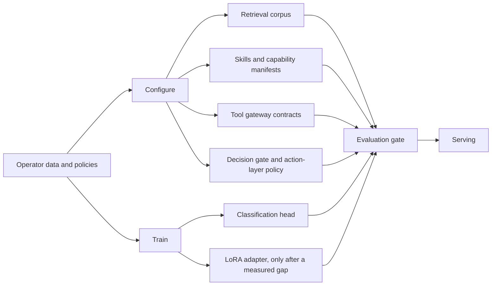

<!-- Writing rules: framework/style-guide.md. Name each component by its role and the Red Hat product used. Write no product support status. -->

# Bring your own data and policies

## At a glance

| Field | Value |
|---|---|
| One-liner | Tells you, for each network domain and each part of the agent runtime harness, what data or policy to bring, in what format, where it goes, who owns it, and which gate checks it. Depends on the adaptation ladder, the tool gateway, and the evaluation gates. |
| Question answered | Data and policies: what must you bring, and where does each one go? |
| Audience | Platform teams, model owners, risk owners, and business owners |
| OTel slots | LLM, Embedding, Reranker, Safety, Decision, and Classification |
| Placement tier | Regional and core |
| Top 3 decisions | Configure before you train; give every item one owner and one PB-02 gate; retrain only what a measured gap or a source change calls for |
| Agent-school courses | 301, 401, 402, and 403 in the [agent-school roadmap](https://github.com/open-experiments/agent-school/blob/main/docs/RoadMap.md) |

## The operator question

What must you bring from your RAN, core, transport, OSS, BSS, and care systems, and where does each item go in the harness?
Until you answer it, use cases run on public data and generic procedures, and teams train models when a corpus, a skill, or a policy would have closed the gap.

## Decisions you must make

| Decision | Options | Recommendation | Because |
|---|---|---|---|
| Configure before you train | Train first; configure retrieval, skills, tools, and policies first | Configure first. Retrain the Classification head when your taxonomy differs from the model's classes, and train a LoRA adapter only when a measured gap remains after retrieval and skills | Each rung costs more to build and to redo when the base changes ([PB-03 Adaptation](../adaptation/README.md)) |
| Give every item one owner and one PB-02 gate | Shared ownership; one owner and one gate per item | One generic role owns each item, and one gate in [PB-02 Evaluation and acceptance](../evaluation-acceptance/README.md) checks it before it serves | An item with no owner goes stale, and an item with no gate can lower quality without anyone noticing |
| Retrain only what a measured gap or a source change calls for | Retrain on a schedule; redo each item when its trigger fires | Redo each item when its trigger in the domain tables fires | A corpus refresh or a policy change needs no training. A new base revision needs every adapter retrained and re-gated |
| Keep personal data out unless its lawful basis covers it | Index and label everything; screen first | Screen every corpus, label set, and training set before use, and record its usage rights | Care and trace data hold subscriber data. The [training data checks](../adaptation/README.md#training-data-checks) and [PB-10 Compliance, sovereignty, and operating model](../compliance-operating-model/README.md) set the rules |

## Reference design

Harness here means the agent runtime harness in the [architecture overview](../../architecture/index.md), not agent-school's harness. It covers skills and capability manifests, the MCP tool gateway, retrieval, the decision gate, and the action layer.

One item, from your systems to serving:

1. Find your domain in the matrix and the mechanism the use case needs.
2. Register the item with its owner: a corpus register entry, a pinned tool contract, or a policy entry.
3. Configure first: index the corpus, write the skill and manifests, release the MCP server, or load the policy.
4. Run the PB-02 gate that the domain table names.
5. Retrain the Classification head when your taxonomy differs from the model's classes.
6. Train a LoRA adapter only when the suite still shows a measured gap after retrieval and skills.
7. Promote through PB-02 and the stage register in [PB-06 Safety and autonomy gating](../safety-autonomy-gating/README.md).
8. Redo the item when its trigger in the domain table fires.

### Mechanisms

| Mechanism | Configure or train | What it changes | Where it goes in the harness | Platform page |
|---|---|---|---|---|
| RAG corpus | configure | What the agent can look up and cite | Knowledge service index, after a corpus register entry | [PB-03 retrieval corpora](../adaptation/README.md#retrieval-corpora) and [PB-05 corpus register](../integration/README.md#knowledge-sources-and-usage-rights) |
| Skill or capability manifest | configure | Which procedure the agent follows and which tools it may call | Skill catalog and manifest registry: one skill per role, one manifest per MCP capability | [PB-03 skills and capability manifests](../adaptation/README.md#skills-and-capability-manifests) |
| MCP tool contract | configure | What the agent can read or request in your systems | An MCP server behind the MCP Gateway, deny unless allowed | [PB-05 Integration](../integration/README.md) |
| Gate and action-layer policy | configure | What the agent may do alone and who approves the rest | Decision gate ceilings, approver roles, and action-layer playbooks | [PB-06](../safety-autonomy-gating/README.md) and [PB-07 Action layer](../action-layer/README.md) |
| Classification labels | train | Which root-cause classes the model predicts | Classification head retrain on your taxonomy, then the model registry | [PB-03 when to train](../adaptation/README.md#when-to-train-lora) |
| LoRA training data | train | Vocabulary, tool-call sequence, or output format, only when a measured gap remains after retrieval and skills | Training, then the model registry, bound to one base revision | [PB-03 Adaptation](../adaptation/README.md#when-to-train-lora) |

### Matrix

| Domain | RAG corpus | Skill or capability manifest | MCP tool contract | Gate and action-layer policy | Classification labels | LoRA training data |
|---|---|---|---|---|---|---|
| [RAN](#domain-ran) | RAN vendor manuals, parameter references, and runbooks | RAN triage and health-check skills | RAN alarm, counter, and configuration-read contracts | Ceilings for cell parameter and site actions | RAN alarm cause taxonomy | RAN vocabulary and report examples |
| [vRAN and O-RAN](#domain-vran-and-o-ran) | O-RAN specifications and RIC app guides | xApp and rApp review skills | RIC and service management read contracts | Ceilings for xApp, rApp, and RIC policy changes | vRAN workload fault taxonomy | xApp and rApp code examples |
| [5G core CNFs](#domain-5g-core-cnfs) | 3GPP core specifications and CNF vendor guides | Core root-cause and trace analysis skills | Analytics, counter, and trace job contracts | Ceilings for CNF scaling, restarts, and configuration | Core failure cause taxonomy | Trace summary examples |
| [VNFs](#domain-vnfs) | VNF vendor manuals and lifecycle runbooks | VNF lifecycle check skills | VNF manager and element manager read contracts | Ceilings for VNF heal, scale, and restart | VNF fault taxonomy | VNF vendor vocabulary examples |
| [Transport and IP](#domain-transport-and-ip) | Router guides, network designs, and past change records | Transport triage and change review skills | NETCONF, YANG, telemetry, and show-command contracts | Ceilings for interface, routing, and configuration changes | Transport fault taxonomy | Device command and configuration diff examples |
| [OSS and BSS](#domain-oss-and-bss) | OSS and BSS architecture documents and process manuals | Cross-domain correlation and ticket handling skills | TM Forum alarm, inventory, performance, and ticket contracts | Ceilings for ticket writes, notifications, and orders | Ticket category taxonomy | Ticket summary and API payload examples |
| [Customer and care](#domain-customer-and-care) | Care articles, product guides, and screened past cases | Care diagnostics skills | CAMARA and care-system tool contracts | Ceilings for customer-facing actions and messages | Contact reason taxonomy | Screened care dialogue examples |

Gate names in the domain tables are parameters and ladder stages in [PB-02 Evaluation and acceptance](../evaluation-acceptance/README.md), except the Conformance Test Kit gate, which belongs to PB-05. Every LoRA row applies only when a measured gap remains after retrieval and skills.

### Domain: RAN

| Mechanism | What you bring | Format | Where it goes in the harness | Owner | PB-02 gate that checks it | When to redo or retrain |
|---|---|---|---|---|---|---|
| RAG corpus | Vendor RAN manuals, parameter references, runbooks, and past root-cause reports | Documents with source, version, and a usage-rights entry | Knowledge service index | Operations engineer | Embedding and Reranker recall-at-k floor; LLM groundedness floor | A vendor release or runbook change; a new embedding model forces a re-index |
| Skill or capability manifest | Triage and health-check skills; manifests for RAN read tools | A skill file per role, and a manifest per capability that records its risk class and data class | Skill catalog and manifest registry | SME | Trajectory suite at Operator offline acceptance | The procedure changes or a tool contract version changes |
| MCP tool contract | Read tools for RAN alarms, performance counters, and configuration | Pinned contract per tool; counters named as in 3GPP TS 28.552, alarms as in TMF642 | MCP server behind the MCP Gateway, read only | Platform team | Trajectory suite on stateful mocks | The pinned API or counter set version changes |
| Gate and action-layer policy | Ceilings and approver roles for cell parameter and site actions; playbooks with verification and rollback jobs | Policy entry per action class | Decision gate policy and action-layer playbooks | Risk owner | Decision false-ACT budget on the gate set | The risk owner changes a ceiling or an approver role |
| Classification labels | Your RAN alarm cause taxonomy and SME-labelled past incidents, with an other class | Labelled incidents, one class each, with a temporal holdout | Classification head retrain, then the model registry | SME | Classification per-class recall floor; Classification other-or-abstain recall floor | The taxonomy changes or a new base revision ships |
| LoRA training data | RAN vocabulary and report examples, only if a measured gap remains after retrieval and skills | Synthetic data from your tools, replayed tapes, and documents, with non-ACT cases | Training, then the model registry bound to one base revision | Model owner | Non-inferiority margin at Operator offline acceptance | A new base revision ships, or a measured gap remains |

### Domain: vRAN and O-RAN

| Mechanism | What you bring | Format | Where it goes in the harness | Owner | PB-02 gate that checks it | When to redo or retrain |
|---|---|---|---|---|---|---|
| RAG corpus | O-RAN specifications, RIC and app guides, and vRAN vendor manuals | Documents downloaded from the O-RAN portal, registered with their usage terms | Knowledge service index | Platform team | Embedding and Reranker recall-at-k floor; LLM groundedness floor | A new O-RAN release or vendor release; a new embedding model forces a re-index |
| Skill or capability manifest | xApp and rApp review skills; manifests for RIC and service management tools | A skill file per role and a manifest per capability | Skill catalog and manifest registry | SME | Trajectory suite at Operator offline acceptance | The review procedure or a tool contract version changes |
| MCP tool contract | Read tools for the RIC, the service management platform, and vRAN workload state | Pinned contract per tool, from the interface specification your vendor implements | MCP server behind the MCP Gateway, read only | Platform team | Trajectory suite on stateful mocks | The vendor interface version changes |
| Gate and action-layer policy | Ceilings and approver roles for xApp and rApp deployment and RIC policy changes | Policy entry per action class | Decision gate policy and action-layer playbooks | Risk owner | Decision false-ACT budget on the gate set | The risk owner changes a ceiling or an approver role |
| Classification labels | Your vRAN workload and RIC fault taxonomy, with an other class | Labelled incidents, one class each, with a temporal holdout | Classification head retrain, then the model registry | SME | Classification per-class recall floor; Classification other-or-abstain recall floor | The taxonomy changes or a new base revision ships |
| LoRA training data | xApp and rApp code examples, only if a measured gap remains after retrieval and skills | Reviewed code and review notes, with usage rights recorded | Training, then the model registry bound to one base revision | Model owner | Non-inferiority margin at Operator offline acceptance | A new base revision ships, or a measured gap remains |

### Domain: 5G core CNFs

| Mechanism | What you bring | Format | Where it goes in the harness | Owner | PB-02 gate that checks it | When to redo or retrain |
|---|---|---|---|---|---|---|
| RAG corpus | 3GPP core specifications, CNF vendor guides, and core runbooks | Documents with source, release, and a usage-rights entry | Knowledge service index | Platform team | Embedding and Reranker recall-at-k floor; LLM groundedness floor | A new standards release you adopt, a vendor release, or a runbook change |
| Skill or capability manifest | Core root-cause and trace analysis skills; manifests for analytics and trace tools | A skill file per role and a manifest per capability, with data class | Skill catalog and manifest registry | SME | Trajectory suite at Operator offline acceptance | The procedure changes or a tool contract version changes |
| MCP tool contract | Read tools for NWDAF analytics, core counters, and trace jobs | Pinned contract per tool; analytics as in 3GPP TS 23.288, counters as in 3GPP TS 28.552, traces as in 3GPP TS 32.422 and TS 32.423 | MCP server behind the MCP Gateway, read only | Platform team | Trajectory suite on stateful mocks | The pinned specification release or vendor interface changes |
| Gate and action-layer policy | Ceilings and approver roles for CNF scaling, restarts, and configuration changes | Policy entry per action class | Decision gate policy and action-layer playbooks | Risk owner | Decision false-ACT budget on the gate set | The risk owner changes a ceiling or an approver role |
| Classification labels | Your core failure cause taxonomy and SME-labelled past incidents, with an other class | Labelled incidents, one class each, with a temporal holdout | Classification head retrain, then the model registry | SME | Classification per-class recall floor; Classification other-or-abstain recall floor | The taxonomy changes or a new base revision ships |
| LoRA training data | Trace summary examples, only if a measured gap remains after retrieval and skills | Synthetic data from replayed traces with subscriber identifiers removed, and non-ACT cases | Training, then the model registry bound to one base revision | Model owner, with data protection officer review | Non-inferiority margin at Operator offline acceptance | A new base revision ships, or a measured gap remains |

### Domain: VNFs

| Mechanism | What you bring | Format | Where it goes in the harness | Owner | PB-02 gate that checks it | When to redo or retrain |
|---|---|---|---|---|---|---|
| RAG corpus | VNF vendor manuals and lifecycle runbooks | Documents with source, version, and a usage-rights entry | Knowledge service index | Operations engineer | Embedding and Reranker recall-at-k floor; LLM groundedness floor | A vendor release or runbook change |
| Skill or capability manifest | VNF lifecycle check skills; manifests for VNF manager tools | A skill file per role and a manifest per capability | Skill catalog and manifest registry | SME | Trajectory suite at Operator offline acceptance | The procedure changes or a tool contract version changes |
| MCP tool contract | Read tools for the VNF manager and element managers | Pinned contract per tool, in the format you agree with the VNF vendor | MCP server behind the MCP Gateway, read only | Platform team | Trajectory suite on stateful mocks | The vendor interface version changes |
| Gate and action-layer policy | Ceilings and approver roles for VNF heal, scale, and restart actions | Policy entry per action class | Decision gate policy and action-layer playbooks | Risk owner | Decision false-ACT budget on the gate set | The risk owner changes a ceiling or an approver role |
| Classification labels | Your VNF fault taxonomy, with an other class | Labelled incidents, one class each, with a temporal holdout | Classification head retrain, then the model registry | SME | Classification per-class recall floor; Classification other-or-abstain recall floor | The taxonomy changes or a new base revision ships |
| LoRA training data | VNF vendor vocabulary examples, only if a measured gap remains after retrieval and skills | Synthetic data from your tools and documents, with non-ACT cases | Training, then the model registry bound to one base revision | Model owner | Non-inferiority margin at Operator offline acceptance | A new base revision ships, or a measured gap remains |

### Domain: Transport and IP

| Mechanism | What you bring | Format | Where it goes in the harness | Owner | PB-02 gate that checks it | When to redo or retrain |
|---|---|---|---|---|---|---|
| RAG corpus | Router vendor guides, network design documents, and past change records | Documents with source, version, and a usage-rights entry | Knowledge service index | Operations engineer | Embedding and Reranker recall-at-k floor; LLM groundedness floor | A vendor release, a design change, or a new change record |
| Skill or capability manifest | Transport triage and change review skills; manifests for device read and dry-run tools | A skill file per role and a manifest per capability, with risk class read | Skill catalog and manifest registry | SME | Trajectory suite at Operator offline acceptance | The procedure changes or a tool contract version changes |
| MCP tool contract | Device reads, telemetry, and show commands | NETCONF with YANG models, gNMI telemetry subscriptions, or read-only command line | MCP server behind the MCP Gateway, read only | Platform team | Trajectory suite on stateful mocks | A YANG model, device software, or command set changes |
| Gate and action-layer policy | Ceilings and approver roles for interface, routing, and configuration changes; playbooks with verification and rollback jobs | Policy entry per action class | Decision gate policy and action-layer playbooks | Risk owner | Decision false-ACT budget on the gate set | The risk owner changes a ceiling or an approver role |
| Classification labels | Your transport fault taxonomy and SME-labelled past incidents, with an other class | Labelled incidents, one class each, with a temporal holdout | Classification head retrain, then the model registry | SME | Classification per-class recall floor; Classification other-or-abstain recall floor | The taxonomy changes or a new base revision ships |
| LoRA training data | Device command and configuration diff examples, only if a measured gap remains after retrieval and skills | Synthetic data from your tools and replayed tapes, with non-ACT cases | Training, then the model registry bound to one base revision | Model owner | Non-inferiority margin at Operator offline acceptance | A new base revision ships, or a measured gap remains |

### Domain: OSS and BSS

| Mechanism | What you bring | Format | Where it goes in the harness | Owner | PB-02 gate that checks it | When to redo or retrain |
|---|---|---|---|---|---|---|
| RAG corpus | OSS and BSS architecture documents, process manuals, and TM Forum API guides | Documents with source, version, and a usage-rights entry | Knowledge service index | Business owner | Embedding and Reranker recall-at-k floor; LLM groundedness floor | A process change or a new API version you adopt |
| Skill or capability manifest | Cross-domain correlation and ticket handling skills; manifests for TM Forum tools | A skill file per role and a manifest per capability | Skill catalog and manifest registry | SME | Trajectory suite at Operator offline acceptance | The procedure changes or a tool contract version changes |
| MCP tool contract | TM Forum alarm, inventory, performance, and trouble ticket tools | Tool definitions generated from the pinned TMF642, TMF639, TMF628, and TMF621 specifications | MCP server behind the MCP Gateway; writes only as action requests | Platform team | PB-05 Conformance Test Kit gate, then the trajectory suite | The pinned API version changes |
| Gate and action-layer policy | Ceilings and approver roles for ticket writes, notifications, and order changes | Policy entry per action class | Decision gate policy and action-layer playbooks | Risk owner | Decision false-ACT budget on the gate set | The risk owner changes a ceiling or an approver role |
| Classification labels | Your ticket category taxonomy and labelled past tickets, with an other class | Labelled tickets, one class each, with a temporal holdout | Classification head retrain, then the model registry | SME | Classification per-class recall floor; Classification other-or-abstain recall floor | The taxonomy changes or a new base revision ships |
| LoRA training data | Ticket summary and API payload examples, only if a measured gap remains after retrieval and skills | Synthetic data from stateful mocks of your APIs, with non-ACT cases | Training, then the model registry bound to one base revision | Model owner | Non-inferiority margin at Operator offline acceptance | A new base revision ships, or a measured gap remains |

### Domain: Customer and care

| Mechanism | What you bring | Format | Where it goes in the harness | Owner | PB-02 gate that checks it | When to redo or retrain |
|---|---|---|---|---|---|---|
| RAG corpus | Care knowledge articles, product guides, and past cases screened for personal data | Documents with a usage-rights entry and the lawful basis for any personal data left | Knowledge service index | Business owner, with data protection officer review | Embedding and Reranker recall-at-k floor; Safety abstain-recall floor | A product change, an article change, or a change in usage rights |
| Skill or capability manifest | Care diagnostics skills; manifests that carry the purpose and data class of each call | A skill file per role and a manifest per capability, with data class | Skill catalog and manifest registry | SME | Trajectory suite at Operator offline acceptance | The care procedure or a tool contract version changes |
| MCP tool contract | CAMARA and care-system tools, such as customer records | CAMARA contracts that declare a purpose, with consent left in CAMARA's own flow; customer records as in TMF629 | MCP server behind the MCP Gateway, read only | Platform team | Trajectory suite on stateful mocks | The CAMARA or care API version changes |
| Gate and action-layer policy | Ceilings and approver roles for customer-facing actions and messages | Policy entry per action class | Decision gate policy and action-layer playbooks | Risk owner | Decision false-ACT budget on the gate set | The risk owner changes a ceiling or an approver role |
| Classification labels | Your contact reason taxonomy and labelled past contacts, screened for personal data | Labelled contacts, one class each, with a temporal holdout | Classification head retrain, then the model registry | SME, with data protection officer review | Classification per-class recall floor; Classification other-or-abstain recall floor | The taxonomy changes or a new base revision ships |
| LoRA training data | Care dialogue examples, only if a measured gap remains after retrieval and skills | Synthetic dialogues with subscriber identifiers removed, and non-ACT cases | Training, then the model registry bound to one base revision | Model owner, with data protection officer review | Non-inferiority margin at Operator offline acceptance | A new base revision ships, or a measured gap remains |

### Worked example: alarm and root-cause triage

A fibre cut on a transport ring raises link-down alarms on two routers and cell-unavailable alarms on the RAN sites behind them, and opens incident `inc-6610`. The operator brings these items for `byo-triage-agent`, and configures everything it can before it trains anything.

| Mechanism | Domains | What the operator brings | Configure or train |
|---|---|---|---|
| RAG corpus | RAN, transport | RAN and router vendor guides and past root-cause reports, each with a corpus register entry | Configure |
| Skill or capability manifest | RAN, transport | A triage skill that reads transport alarms before RAN alarms on shared topology, and read manifests for its tools | Configure |
| MCP tool contract | OSS and BSS, transport | TMF642 alarms, TMF639 inventory, TMF628 counters, and read-only show commands | Configure |
| Gate and action-layer policy | RAN, transport | A ceiling that keeps any router or RAN change at REVIEW for the `approver` role | Configure |
| Classification labels | RAN, transport | SME labels for past incidents in the operator's taxonomy, with an other class | Train |
| LoRA training data | None | Nothing: the suite shows no measured gap after retrieval and skills | Not trained |

The agent holds tool roles for the read tools and `submit_action_request` only, so every change goes through the [decision gate](../../architecture/decision-gate.md). The retrained Classification head must meet the Classification per-class recall floor before it serves. If the suite later shows a measured gap, such as the wrong tool sequence on shared topology, [PB-03 Adaptation](../adaptation/README.md#when-to-train-lora) decides whether a LoRA adapter is earned.

- Config artifact: corpus register entries for each RAN and transport corpus
- Config artifact: the triage skill and its capability manifests
- Config artifact: tool-role mapping for `byo-triage-agent`
- Config artifact: label set version and the model registry record for the retrained head

### Parameters

| Parameter | What it controls | Who sets it | How to calibrate |
|---|---|---|---|
| Corpus refresh interval | How often each corpus is re-read from its source and re-indexed | Platform team | Match the release cadence of each source, and check retrieval recall after each refresh |
| Label agreement floor | The lowest agreement between SMEs labelling the same incidents before a label set may train the head | Risk owner, with SME review | Have SMEs label an overlapping sample, measure agreement, and fix the taxonomy where they disagree |
| Policy review interval | How often each ceiling, approver role, and playbook is reviewed | Risk owner | Review on each audit cycle and after every incident that the gate handled |
| Label set refresh interval | How often new incidents enter the label set and the holdout | SME | Track new incident types and refresh when per-class recall drifts |

This page gives no default values. The thresholds that each gate applies belong to [PB-02 Evaluation and acceptance](../evaluation-acceptance/README.md), and the minimum measured gap to train belongs to [PB-03 Adaptation](../adaptation/README.md#adaptation-parameters).

## Components

| Component role | Red Hat product used |
|---|---|
| Knowledge service: holds operator corpora for retrieval | Vector store with the OTel Embedding and Reranker slots on Red Hat AI Inference (vLLM) |
| Skill catalog and manifest registry: version skills and capability manifests | Git repository with OpenShift GitOps |
| MCP tool gateway: routes, authorizes, and audits every tool call | MCP gateway in Red Hat Connectivity Link |
| Decision gate: label each action request and apply the policy ceiling | OTel Decision slot on Red Hat AI Inference (vLLM), with Red Hat Ansible Automation Platform |
| Action layer: run playbooks with verification and rollback jobs | Automation Orchestrator for Red Hat Ansible Automation Platform |
| Training: retrain the Classification head and train LoRA adapters | Training Hub in Red Hat OpenShift AI |
| Evaluation: run the PB-02 gates | EvalHub in Red Hat OpenShift AI |
| Model registry: bind each retrained model or adapter to its base revision and evaluation report | Model Registry in Red Hat OpenShift AI |

Any component can be replaced. The Red Hat products named here show one way to build this design.

## OTel slot guidance

| Slot | Candidate checkpoints | Notes |
|---|---|---|
| `llm` | OTel-2.0-LLM-31B-IT or a smaller OTel LLM, pinned by revision | Reads your corpora and follows your skills; train a LoRA adapter only on a measured gap |
| `embedding` | OTel-Embedding models, pinned by revision | Indexes your corpora; a new embedding model forces a full re-index |
| `reranker` | OTel-Reranker-0.6B or OTel-Reranker-4B, pinned by revision | Ranks passages from your corpora; check its scores at intake |
| `safety` | OTel-LLM-8.3B-Safety or OTel-LLM-12B-Safety, pinned by revision | Abstains when your corpus lacks the evidence |
| `decision` | OTel-2.0-Decision-26B-A4B-4bit, pinned by revision | Labels each action request; your policy ceiling caps the outcome |
| `classification` | OTel-LLM-8.3B-Classification, pinned by revision | Its head predicts eight classes from a synthetic dataset, so retrain it on your taxonomy |

## Sources and acceptance

Each key claim links its source, as set out in [the Sources table](../../framework/definitions.md#sources-table).

| # | Claim | Basis | Source |
|---|---|---|---|
| 1 | 3GPP defines the 5G performance measurements for RAN and core | project documentation | [3GPP TS 28.552](https://www.3gpp.org/DynaReport/28552.htm) |
| 2 | 3GPP defines the alarm information service for fault management | project documentation | [3GPP TS 32.111-2](https://www.3gpp.org/DynaReport/32111-2.htm) |
| 3 | 3GPP defines trace control and configuration for subscriber and equipment trace | project documentation | [3GPP TS 32.422](https://www.3gpp.org/DynaReport/32422.htm) |
| 4 | 3GPP defines the trace data format | project documentation | [3GPP TS 32.423](https://www.3gpp.org/DynaReport/32423.htm) |
| 5 | NWDAF provides network data analytics services in the 5G core | project documentation | [3GPP TS 23.288](https://www.3gpp.org/DynaReport/23288.htm) |
| 6 | O-RAN specifications are available to the public through the O-RAN download portal | project documentation | [O-RAN specifications](https://www.o-ran.org/specifications) |
| 7 | The ETSI NFV group works on an open ecosystem for VNF lifecycle management | project documentation | [ETSI network functions virtualisation](https://www.etsi.org/technologies/nfv) |
| 8 | NETCONF installs, changes, and deletes the configuration of network devices | project documentation | [RFC 6241 NETCONF](https://www.rfc-editor.org/rfc/rfc6241) |
| 9 | YANG models configuration data, state data, and notifications | project documentation | [RFC 7950 YANG 1.1](https://www.rfc-editor.org/rfc/rfc7950) |
| 10 | gNMI defines subscriptions to telemetry updates | project documentation | [gNMI specification](https://github.com/openconfig/reference/blob/master/rpc/gnmi/gnmi-specification.md) |
| 11 | TMF642 defines alarm management operations | project documentation | [TMF642 Alarm Management API](https://github.com/tmforum-apis/TMF642_AlarmManagement) |
| 12 | TMF639 defines resource inventory operations | project documentation | [TMF639 Resource Inventory API](https://github.com/tmforum-apis/TMF639_ResourceInventory) |
| 13 | TMF628 defines performance management operations | project documentation | [TMF628 Performance Management API](https://github.com/tmforum-apis/TMF628_Performance) |
| 14 | TMF621 defines trouble ticket operations | project documentation | [TMF621 Trouble Ticket API](https://github.com/tmforum-apis/TMF621_TroubleTicket) |
| 15 | TMF629 defines customer management operations | project documentation | [TMF629 Customer Management API](https://github.com/tmforum-apis/TMF629_CustomerManagement) |
| 16 | Each CAMARA call declares its purpose, and consent stays in CAMARA's own flow | project documentation | [CAMARA API access and user consent](https://github.com/camaraproject/IdentityAndConsentManagement/blob/main/documentation/CAMARA-API-access-and-user-consent.md) |
| 17 | CAMARA API Design Guide Appendix B sets `operationId` and description rules for MCP tool selection | project documentation | [CAMARA API Design Guide](https://github.com/camaraproject/Commonalities/blob/main/documentation/CAMARA-API-Design-Guide.md) |
| 18 | An MCP tool declares its parameters as a JSON Schema in `inputSchema` | project documentation | [MCP specification: tools](https://modelcontextprotocol.io/specification/2025-06-18/server/tools) |
| 19 | The Classification model is a full fine-tune with a head over eight root-cause classes from the synthetic TeleLogs dataset | model card | [OTel-LLM-8.3B-Classification model card](https://huggingface.co/farbodtavakkoli/OTel-LLM-8.3B-Classification) |
| 20 | Training Hub offers LoRA with SFT and OSFT | project documentation | [Training Hub README](https://github.com/Red-Hat-AI-Innovation-Team/training_hub) |

- Gate: no corpus enters the index without a corpus register entry and a named owner.
- Gate: no tool contract serves until its PB-02 gate passes, and every TM Forum contract passes the PB-05 Conformance Test Kit gate.
- Gate: no policy change applies without the risk owner's approval and a run of the gate set.
- Gate: no retrained Classification head serves until it meets the Classification per-class recall floor.
- Gate: no LoRA adapter trains unless the gap meets the minimum measured gap to train in PB-03.
- Gate: no care or trace data enters a corpus, label set, or training set before personal data screening.

## Operating model

| Activity | Responsible | Accountable | Consulted | Informed |
|---|---|---|---|---|
| Bring a corpus | Business owner | Risk owner | Legal team and data protection officer | Platform team |
| Bring a tool contract | Platform team | Business owner | Security | Operations engineer |
| Change a policy ceiling or an approver role | Operations engineer | Risk owner | Change board and SME | Business owner |
| Bring new Classification labels | SME | Risk owner | Model owner | Business owner |
| Bring LoRA training data | Model owner | Data protection officer | SME | Risk owner |

## Risks and limitations

| Risk | Likelihood | Mitigation |
|---|---|---|
| Teams train a model when a corpus, skill, or policy would close the gap | Medium | Configure first, and train a LoRA adapter only when the gap meets the minimum measured gap to train |
| Personal data reaches a corpus, label set, or training set | Medium | Screen every item, record usage rights and lawful basis, and have the data protection officer review care and trace data |
| A corpus or contract goes stale after a source change | Medium | Give each item an owner and a redo trigger, and set the corpus refresh interval |
| SMEs disagree on labels, so the head learns noise | Medium | Meet the label agreement floor before training, and fix the taxonomy where SMEs disagree |
| VNF interfaces vary by vendor, so contracts differ per VNF | High | Agree each contract format with the VNF vendor, and pin it like any other contract |

## Used by and next steps

- [Architecture overview](../../architecture/index.md): the agent runtime harness this page fills
- [PB-02 Evaluation and acceptance](../evaluation-acceptance/README.md): every gate the domain tables name
- [PB-03 Adaptation](../adaptation/README.md): the ladder, the training data checks, and when to train
- [PB-05 Integration](../integration/README.md): the MCP Gateway, tool contracts, and the corpus register
- [PB-06 Safety and autonomy gating](../safety-autonomy-gating/README.md): the stage register and ceilings
- [PB-07 Action layer](../action-layer/README.md): playbooks with verification and rollback jobs
- [PB-10 Compliance, sovereignty, and operating model](../compliance-operating-model/README.md): consent, residency, and lawful basis
- Use cases: [the recipes that use PB-11](../../catalog/index.md#pb-11-bring-your-own-data-and-policies)
- Agent-school: 301 adds an approval gate, 401 covers skills and manifests, 402 the knowledge service, and 403 the OTel domain models, in the [agent-school roadmap](https://github.com/open-experiments/agent-school/blob/main/docs/RoadMap.md)
