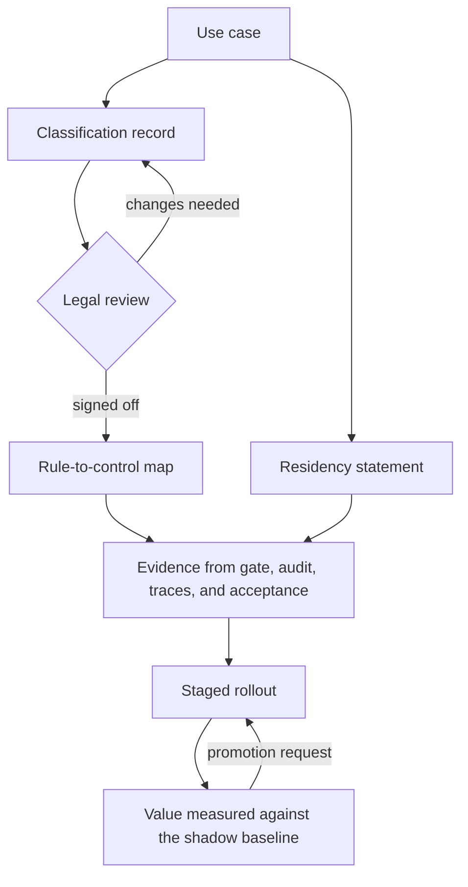

<!-- Writing rules: framework/style-guide.md. Name each component by its role and the Red Hat product used. Write no product support status. -->

# Compliance, sovereignty, and operating model

## At a glance

| Field | Value |
|---|---|
| One-liner | Records an EU AI Act classification for each use case, maps the EU AI Act, NIS2, GDPR, CAMARA consent, and GSMA Responsible AI to the controls that produce evidence, keeps data in country, and names owners, rollout stages, and value measures. Depends on your legal team and on the evidence the other blueprints produce. |
| Question answered | Compliance and sovereignty: can you show the use case meets the rules and keeps data where it must stay? |
| Audience | Business owners, risk owners, data protection officers, and legal teams |
| OTel slots | LLM, Decision, Safety, and Classification, the slots whose outputs become evidence |
| Placement tier | Regional and core |
| Top 3 decisions | Record a classification for each use case before the shadow stage; map each rule to the control that already produces its evidence; measure value against the shadow-stage baseline |
| Agent-school courses | 301 and 401 in the [agent-school roadmap](https://github.com/open-experiments/agent-school/blob/main/docs/RoadMap.md) |

## The operator question

Can you show that a use case meets the rules and keeps data where it must stay, and who owns it as it grows?
Until you answer it, the use case runs without a classification record, nobody knows who approves the next stage, and any value claimed for it has no baseline.

## Decisions you must make

| Decision | Options | Recommendation | Because |
|---|---|---|---|
| Record a classification for each use case before the shadow stage | Classify the whole platform once; classify each use case when it reaches production; classify each use case before the shadow stage | Classify each use case before the shadow stage, and send the record to legal review | The EU AI Act classifies an AI system by its intended purpose, so two use cases on the same models can land in different categories ([Regulation (EU) 2024/1689](https://eur-lex.europa.eu/eli/reg/2024/1689/oj/eng)) |
| Map each rule to the control that already produces its evidence | Write new compliance controls; map each provision to an existing blueprint control | Map each provision to the blueprint control that produces its evidence | The gate, the audit record, the traces, and the acceptance reports already exist for engineering reasons, and one control can answer several rules |
| Set data residency for each use case | One residency rule for the platform; a residency statement for each use case | A residency statement for each use case | Prompts, passages, traces, training data, and adapters move through different systems, and each can leave the country by a different path |
| Name who is accountable | The platform team; the model owner; the business owner | The business owner, with the risk owner accountable for stage promotion | NIS2 makes management bodies approve and oversee cybersecurity risk measures ([NIS2 Directive](https://eur-lex.europa.eu/eli/dir/2022/2555/oj/eng)) |
| Decide how value is measured | Vendor benchmarks; savings estimates; named measures against the shadow-stage baseline | Named measures against the shadow-stage baseline, per stage | The shadow stage records what people did without the system, so every later stage compares against the same use case |

## Reference design



### Example classification record: alarm and root-cause triage

Example: complete this record for your own deployment. The entries cite Regulation (EU) 2024/1689 as amended by Regulation (EU) 2026/1744. They record the team's assessment and its reasons, for legal review.

| Field | Example entry |
|---|---|
| System description | `noc-triage-agent` reads alarms, interface counters, and inventory through read-only tools, proposes a root cause and a remediation, and sends any network change as an action request. It uses the LLM, Decision, Classification, and Safety slots. Example incident: `inc-2041`, CRC errors and BFD flaps on eth1 of router r2 |
| Intended purpose | Propose a root cause and a remediation for network alarms to operations engineers. Every network change passes the [decision gate](../../architecture/decision-gate.md). At the assist and recommend stages an approver decides each change; at the act stage, approved low-risk playbooks run without an approver |
| Deployer and provider roles | The operator deploys the system. The provider is whoever develops the system and puts it into service under its own name. Record who holds each role, including any adaptation the operator does in house, for your legal team to confirm |
| Risk-category reasoning | Annex III point 2 lists "AI systems intended to be used as safety components in the management and operation of critical digital infrastructure" as high-risk. Article 3(14), as amended, adds that "a component fulfils a safety function where its intended purpose is to prevent or mitigate risks to health and safety of persons or property" for the purposes of the definition. Article 6(1a) says systems "solely used for non-safety related aspects of user assistance, performance optimisation, service efficiency, automation or convenience or quality control" do not qualify as safety components. Article 6(1b) brings back any system "the failure or malfunctioning of which would endanger health and safety" as a safety component. The Commission's AI Act Service Desk lists trouble ticket management and network load prediction as examples out of scope. The team's assessment, with its facts, for each stage planned for the use case: up to the recommend stage, triage proposes and an approver decides each change; at the act stage, the gate runs approved low-risk playbooks without an approver and sends every other class to REVIEW; at every stage, the network's own protection runs independently of the agent |
| Article 6(3) assessment | Needed only if your legal team places the system in Annex III. Record which condition the team relies on, such as a narrow procedural or preparatory task, and keep the documented assessment that Article 6(4) asks the provider for |
| Human oversight | The decision gate labels every action request. The stage register in [PB-06](../safety-autonomy-gating/README.md#staged-autonomy) caps the outcomes at each stage, and the approval step in [PB-07](../action-layer/README.md) waits for the approver |
| Logging | Gate decisions, the action audit record, and end-to-end traces from [PB-09](../quality-operations/README.md), kept for the audit log retention period set under Staged rollout and ROI |
| Data governance | Corpora enter the corpus register with usage rights in [PB-05](../integration/README.md#knowledge-sources-and-usage-rights). The triage tools read alarms, interface counters, and inventory. Training data passes the training data checks in [PB-03](../adaptation/README.md#training-data-checks). Record which personal data each source holds, if any, and the lawful basis for it |
| Competent authority | Article 75(1), as amended, keeps systems referred to in Annex III point 2 outside the AI Office's exclusive competence. Record the national market surveillance authority |
| Fundamental rights impact assessment | Article 27(1) excludes high-risk systems in the area listed in Annex III point 2. Record whether your legal team relies on that exclusion, and the date you checked it |
| Obligations apply from | Article 113, as amended, applies the Annex III high-risk obligations from December 2, 2027. Recheck this record when the Commission's guidelines are final |
| Date, owner, and legal sign-off | Date of the record; the risk owner who drafted it; legal team reference |

Your legal team owns the classification.

```text
Classification record: <use case>
System description:
Intended purpose:
Deployer and provider roles:
Risk-category reasoning:
Article 6(3) assessment:
Human oversight:
Logging:
Data governance:
Competent authority:
Fundamental rights impact assessment:
Obligations apply from:
Date, owner, and legal sign-off:
```

### EU AI Act map

Articles 9 to 15 and Article 26 apply only to high-risk systems. Map them anyway, because the same controls produce the evidence whichever category your legal team records.

| Provision | What it says | Blueprint control | Source |
|---|---|---|---|
| Annex III point 2 | Lists AI systems intended as safety components in the management and operation of critical digital infrastructure, road traffic, and the supply of water, gas, heating, or electricity | The classification record on this page | [Regulation (EU) 2024/1689](https://eur-lex.europa.eu/eli/reg/2024/1689/oj/eng) |
| Article 3(14), as amended | Defines a safety component, and says a component fulfils a safety function where its intended purpose is to prevent or mitigate risks to health and safety | Intended purpose field in the record | [Regulation (EU) 2026/1744](https://eur-lex.europa.eu/eli/reg/2026/1744/oj/eng) |
| Article 6(1a) and 6(1b), inserted | Systems solely used for non-safety aspects such as performance optimisation, service efficiency, automation, or quality control do not qualify as safety components, unless their failure would endanger health and safety | Risk-category reasoning field | [Regulation (EU) 2026/1744](https://eur-lex.europa.eu/eli/reg/2026/1744/oj/eng) |
| Article 6(3) and 6(4) | An Annex III system that poses no significant risk of harm, for example one that performs a narrow procedural or preparatory task, falls outside high risk; the provider documents that assessment | Article 6(3) assessment field | [Regulation (EU) 2024/1689](https://eur-lex.europa.eu/eli/reg/2024/1689/oj/eng) |
| Article 9 | Risk management system | Promotion thresholds in [PB-06](../safety-autonomy-gating/README.md) and the acceptance ladder in [PB-02](../evaluation-acceptance/README.md) | [Regulation (EU) 2024/1689](https://eur-lex.europa.eu/eli/reg/2024/1689/oj/eng) |
| Article 10 | Data and data governance for training, validation, and testing data | Training data checks in [PB-03](../adaptation/README.md#training-data-checks) and the corpus register in [PB-05](../integration/README.md) | [Regulation (EU) 2024/1689](https://eur-lex.europa.eu/eli/reg/2024/1689/oj/eng) |
| Article 12 | Automatic recording of events over the lifetime of the system | The audit record in [PB-07](../action-layer/README.md) and traces in [PB-09](../quality-operations/README.md) | [Regulation (EU) 2024/1689](https://eur-lex.europa.eu/eli/reg/2024/1689/oj/eng) |
| Article 13 | Transparency and instructions for use for deployers | The classification record and the intended purpose it states | [Regulation (EU) 2024/1689](https://eur-lex.europa.eu/eli/reg/2024/1689/oj/eng) |
| Article 14 | Human oversight by natural persons while the system is in use | The [decision gate](../../architecture/decision-gate.md), the stage register in [PB-06](../safety-autonomy-gating/README.md), and the approval step in [PB-07](../action-layer/README.md) | [Regulation (EU) 2024/1689](https://eur-lex.europa.eu/eli/reg/2024/1689/oj/eng) |
| Article 15 | Accuracy, robustness, and cybersecurity | Acceptance gates in [PB-02](../evaluation-acceptance/README.md) and the controls in [PB-08](../security-identity-sandbox/README.md) | [Regulation (EU) 2024/1689](https://eur-lex.europa.eu/eli/reg/2024/1689/oj/eng) |
| Article 26 | Deployers use the system per its instructions, assign oversight to people with competence, training, and authority, monitor it and report serious incidents, and keep its logs for at least six months unless other law provides otherwise | The approver in the RACI, incident response in [PB-09](../quality-operations/README.md), and the audit log retention period | [Regulation (EU) 2024/1689](https://eur-lex.europa.eu/eli/reg/2024/1689/oj/eng) |
| Article 27(1) | The fundamental rights impact assessment excludes high-risk systems in the area listed in Annex III point 2 | Fundamental rights impact assessment field | [Regulation (EU) 2024/1689](https://eur-lex.europa.eu/eli/reg/2024/1689/oj/eng) |
| Article 4, as replaced | Providers and deployers take measures to support the AI literacy of their staff, with no specific level guaranteed | The AI literacy training row in the RACI | [Regulation (EU) 2026/1744](https://eur-lex.europa.eu/eli/reg/2026/1744/oj/eng) |
| Article 75(1), as amended | The AI Office's exclusive competence leaves out systems referred to in Annex III point 2 | Competent authority field | [Regulation (EU) 2026/1744](https://eur-lex.europa.eu/eli/reg/2026/1744/oj/eng) |
| Article 113, as amended | Obligations for Annex III high-risk systems apply from December 2, 2027 | Obligations apply from, in the record | [Regulation (EU) 2026/1744](https://eur-lex.europa.eu/eli/reg/2026/1744/oj/eng) |

### NIS2 map

| Provision | What it says | Blueprint control | Source |
|---|---|---|---|
| Article 2(2)(a) | Applies regardless of size to providers of public electronic communications networks or publicly available electronic communications services | Every use case at a public network operator carries this map | [NIS2 Directive](https://eur-lex.europa.eu/eli/dir/2022/2555/oj/eng) |
| Article 3(1) | Such providers are essential entities from medium size upward | Same scope note | [NIS2 Directive](https://eur-lex.europa.eu/eli/dir/2022/2555/oj/eng) |
| Article 20 | Management bodies approve and oversee the cybersecurity risk measures, and their members follow training | The business owner as accountable owner in the RACI | [NIS2 Directive](https://eur-lex.europa.eu/eli/dir/2022/2555/oj/eng) |
| Article 21(2)(b) | Incident handling | Incident response in [PB-09](../quality-operations/README.md) | [NIS2 Directive](https://eur-lex.europa.eu/eli/dir/2022/2555/oj/eng) |
| Article 21(2)(c) | Business continuity, backup, and crisis management | Fallbacks in [PB-04](../serving-routing-placement/README.md) and rollback in [PB-07](../action-layer/README.md) | [NIS2 Directive](https://eur-lex.europa.eu/eli/dir/2022/2555/oj/eng) |
| Article 21(2)(d) | Supply chain security, including direct suppliers | Licence chain, pinned revisions, and signed images in [PB-01](../intake-model-selection/README.md) | [NIS2 Directive](https://eur-lex.europa.eu/eli/dir/2022/2555/oj/eng) |
| Article 21(2)(e) | Security in acquisition, development, and maintenance, including vulnerability handling | Pinning in [PB-01](../intake-model-selection/README.md) and re-gating after a base change in [PB-03](../adaptation/README.md) | [NIS2 Directive](https://eur-lex.europa.eu/eli/dir/2022/2555/oj/eng) |
| Article 21(2)(f) | Assessing whether risk measures work | Acceptance and regression runs in [PB-02](../evaluation-acceptance/README.md) | [NIS2 Directive](https://eur-lex.europa.eu/eli/dir/2022/2555/oj/eng) |
| Article 21(2)(i) | Human resources security, access control, and asset management | Per-tool authorization in [PB-05](../integration/README.md) and identity in [PB-08](../security-identity-sandbox/README.md) | [NIS2 Directive](https://eur-lex.europa.eu/eli/dir/2022/2555/oj/eng) |
| Article 21(2)(j) | Multi-factor or continuous authentication and secured communications | Workload identity in [PB-08](../security-identity-sandbox/README.md) | [NIS2 Directive](https://eur-lex.europa.eu/eli/dir/2022/2555/oj/eng) |
| Article 23(4) | Early warning within 24 hours, notification within 72 hours, and a final report within one month of the notification | Incident response in [PB-09](../quality-operations/README.md) and the NIS2 row in the RACI | [NIS2 Directive](https://eur-lex.europa.eu/eli/dir/2022/2555/oj/eng) |

### Privacy map for GDPR and ePrivacy

| Provision | What it says | Blueprint control | Source |
|---|---|---|---|
| GDPR Article 5(1)(b), (c), and (e) | Purpose limitation, data minimisation, and storage limitation | Metadata-only traces with opt-in content capture and a retention period in [PB-09](../quality-operations/README.md); training data checks in [PB-03](../adaptation/README.md#training-data-checks) | [GDPR](https://eur-lex.europa.eu/eli/reg/2016/679/oj/eng) |
| GDPR Article 6 | Processing needs a lawful basis | Data governance field in the record, for each use case | [GDPR](https://eur-lex.europa.eu/eli/reg/2016/679/oj/eng) |
| GDPR Article 25 | Data protection by design and by default | Data class in each capability manifest in [PB-03](../adaptation/README.md) and the sandbox in [PB-08](../security-identity-sandbox/README.md) | [GDPR](https://eur-lex.europa.eu/eli/reg/2016/679/oj/eng) |
| GDPR Article 28 | Controllers use only processors with sufficient guarantees | The residency statement: no external model provider handles regulated data | [GDPR](https://eur-lex.europa.eu/eli/reg/2016/679/oj/eng) |
| GDPR Article 30 | Records of processing activities | The classification record and the corpus register in [PB-05](../integration/README.md) | [GDPR](https://eur-lex.europa.eu/eli/reg/2016/679/oj/eng) |
| GDPR Article 32 | Security of processing. The article names pseudonymisation and encryption of personal data as measures | The controls in [PB-08](../security-identity-sandbox/README.md) | [GDPR](https://eur-lex.europa.eu/eli/reg/2016/679/oj/eng) |
| GDPR Article 35 | A data protection impact assessment (DPIA) before processing likely to cause high risk; EU AI Act Article 26(9) points deployers to it | The DPIA row in the RACI | [GDPR](https://eur-lex.europa.eu/eli/reg/2016/679/oj/eng) |
| GDPR Article 44 | Transfers of personal data to third countries only under the conditions the GDPR sets for them | The residency statement | [GDPR](https://eur-lex.europa.eu/eli/reg/2016/679/oj/eng) |
| ePrivacy Article 6 | Traffic data is erased or made anonymous when no longer needed to transmit a communication, apart from the listed exceptions | Training data checks in [PB-03](../adaptation/README.md#training-data-checks) | [ePrivacy Directive](https://eur-lex.europa.eu/eli/dir/2002/58/oj/eng) |
| ePrivacy Article 9 | Location data other than traffic data is processed only when anonymous or with consent | Training data checks in [PB-03](../adaptation/README.md#training-data-checks), and consent through CAMARA | [ePrivacy Directive](https://eur-lex.europa.eu/eli/dir/2002/58/oj/eng) |

### CAMARA consent

| Mechanism | What it does | Blueprint control | Source |
|---|---|---|---|
| Purpose as a scope | The authorization request carries the purpose in `scope` as a `dpv:` value from the W3C Data Privacy Vocabulary | Each CAMARA call in [PB-05](../integration/README.md) declares its purpose | [CAMARA API access and user consent](https://github.com/camaraproject/IdentityAndConsentManagement/blob/main/documentation/CAMARA-API-access-and-user-consent.md) |
| Legal basis check | The operator's Authorization Server checks the legal basis of the purpose and, where consent is needed, checks the Consent Master | The operator's Authorization Server in Components | [CAMARA API access and user consent](https://github.com/camaraproject/IdentityAndConsentManagement/blob/main/documentation/CAMARA-API-access-and-user-consent.md) |
| Three-legged tokens | Authorization Code, CIBA, and JWT Bearer flows act for a user; client credentials serve only APIs that process no personal data | Identity in [PB-08](../security-identity-sandbox/README.md) | [CAMARA API access and user consent](https://github.com/camaraproject/IdentityAndConsentManagement/blob/main/documentation/CAMARA-API-access-and-user-consent.md) |
| Token-only grant | The resource server grants access based solely on the access token | Consent stays in CAMARA's own flow, outside the agent, as [PB-05](../integration/README.md) states | [CAMARA API access and user consent](https://github.com/camaraproject/IdentityAndConsentManagement/blob/main/documentation/CAMARA-API-access-and-user-consent.md) |

How consent couples to MCP tool calls is still open in CAMARA ([CAMARA and MCP](https://camaraproject.org/2026/01/12/camara-charts-a-path-for-network-aware-ai-applications-with-mcp/)).

### GSMA Responsible AI map

The GSMA Responsible AI Maturity Roadmap measures maturity at four levels, Foundational, Evolving, Performing, and Advanced, across five dimensions: vision, operating model, technical controls, third-party ecosystem, and change management and communications.

| Principle | Blueprint control | Source |
|---|---|---|
| Fairness | Evaluation on your own data in [PB-02](../evaluation-acceptance/README.md) | [GSMA press release](https://www.gsma.com/newsroom/press-release/gsma-launches-maturity-roadmap-as-telecoms-industry-leads-the-way-in-the-deployment-of-responsible-ai/) |
| Human agency and oversight | The [decision gate](../../architecture/decision-gate.md) and the stage register in [PB-06](../safety-autonomy-gating/README.md) | [GSMA press release](https://www.gsma.com/newsroom/press-release/gsma-launches-maturity-roadmap-as-telecoms-industry-leads-the-way-in-the-deployment-of-responsible-ai/) |
| Privacy and security | [PB-08](../security-identity-sandbox/README.md) and the privacy map | [GSMA press release](https://www.gsma.com/newsroom/press-release/gsma-launches-maturity-roadmap-as-telecoms-industry-leads-the-way-in-the-deployment-of-responsible-ai/) |
| Safety and robustness | Acceptance gates in [PB-02](../evaluation-acceptance/README.md) and gate rules in [PB-06](../safety-autonomy-gating/README.md) | [GSMA press release](https://www.gsma.com/newsroom/press-release/gsma-launches-maturity-roadmap-as-telecoms-industry-leads-the-way-in-the-deployment-of-responsible-ai/) |
| Transparency | The classification record and traces in [PB-09](../quality-operations/README.md) | [GSMA press release](https://www.gsma.com/newsroom/press-release/gsma-launches-maturity-roadmap-as-telecoms-industry-leads-the-way-in-the-deployment-of-responsible-ai/) |
| Accountability | The RACI on this page | [GSMA press release](https://www.gsma.com/newsroom/press-release/gsma-launches-maturity-roadmap-as-telecoms-industry-leads-the-way-in-the-deployment-of-responsible-ai/) |
| Environmental impact | Sizing by hardware class in [PB-04](../serving-routing-placement/README.md) | [GSMA press release](https://www.gsma.com/newsroom/press-release/gsma-launches-maturity-roadmap-as-telecoms-industry-leads-the-way-in-the-deployment-of-responsible-ai/) |

### Data residency

Inference runs in country, on the regional tier described on the [placement](../../architecture/placement.md) page. Write one residency statement for each use case.

| Data | Where it lives | Control |
|---|---|---|
| Prompts and answers | The regional site in the country | Serving in [PB-04](../serving-routing-placement/README.md); no external model provider receives regulated data |
| Retrieved passages and the index | The local retrieval index at the regional site | Corpus register in [PB-05](../integration/README.md) |
| Traces and audit logs | The trace store and the audit record at the site, in the same region | [PB-09](../quality-operations/README.md) and [PB-07](../action-layer/README.md) |
| Training data and the teacher model | The core site in the country; the teacher model runs on site | [PB-03](../adaptation/README.md) |
| Adapters and model images | The internal registry and object storage, mirrored to offline sites | [PB-01](../intake-model-selection/README.md) and the air-gapped mirror flow in [PB-08](../security-identity-sandbox/README.md#air-gapped-mirror-flow) |

### Staged rollout and ROI

These are the stages in the [stage register](../safety-autonomy-gating/README.md#staged-autonomy). Each measure compares with the shadow-stage baseline for the same use case.

| Stage | What is allowed | ROI measures against the shadow-stage baseline |
|---|---|---|
| Shadow | LOOK only; the system runs beside people, who do everything | Record the baseline: mean time to identify, engineer hours per incident, and the cases the system would abstain on |
| Assist | LOOK and NOTIFY, with NOTIFY delivered as the [decision gate](../../architecture/decision-gate.md) page sets out | Mean time to identify; share of incidents auto-triaged; abstention handling cost |
| Recommend | Adds REVIEW; the approver decides each proposed change | Engineer hours saved; mean time to identify; abstention handling cost; review cost of proposals the approver rejects |
| Act | ACT for approved playbooks in low-risk classes; REVIEW for every other class | Engineer hours saved; false-ACT cost; abstention handling cost; mean time to identify |

At the act stage some changes run without an approver, so the facts in the classification record change. Promotion to the act stage reopens the classification record and needs a new legal sign-off before the first playbook runs alone.

```text
value per period =
    (engineer hours saved x loaded hourly cost)
  + (incidents in period x reduction in mean time to identify x cost per incident minute)
  - (false ACTs executed x cost per false ACT)
  - (proposals rejected x review cost per rejection)
  - (abstentions handed to people x handling cost per abstention)
  - run cost of the slots
```

| Parameter | What it controls | Who sets it | How to calibrate |
|---|---|---|---|
| Loaded hourly cost | The value of an engineer hour in the value formula | Business owner | Take the loaded hourly rate your finance team uses |
| Cost per incident minute | The value of a shorter time to identify | Business owner | Derive it from service credits, penalties, and revenue at risk on the affected services |
| Cost per false ACT | The cost charged for each executed change that should not have gone ahead | Risk owner | Price the rollback work, customer impact, and incident handling of past wrong changes |
| Review cost per rejection | The cost of an approver reviewing and rejecting a proposed change that never runs | Business owner | Time how long an approver spends on each rejected proposal during the recommend stage |
| Handling cost per abstention | The cost of a person picking up an abstained case | Business owner | Time the hand-off and the manual triage during the shadow stage |
| Run cost of the slots | The serving, storage, and operations cost of the use case per period | Platform team | Allocate the share of hardware and operations the use case consumes |
| Audit log retention period | How long gate decisions, audit records, and traces are kept, and the floor for the trace retention periods on the [quality operations](../quality-operations/README.md) page | Data protection officer | Set it from the log retention period the applicable law sets and from your audit needs |

This page gives no default values. You set each parameter with SME review and version the set with the use case's value case.

### Worked example: alarm and root-cause triage

Rising CRC errors and BFD flaps on router r2 open incident `inc-2041`. The example classification record on this page describes `noc-triage-agent` with this incident. Before the shadow stage, the risk owner drafts the record, and the legal team signs it off as the accountable owner after consulting the business owner and the data protection officer.

At the recommend stage, the `approver` reviews `dec-0001` at REVIEW on the [decision gate](../../architecture/decision-gate.md) before eth1 on r2 restarts. The RACI applies to triage unchanged. The operations engineer reports engineer hours saved, mean time to identify, and abstention handling cost for `inc-2041` and similar incidents against the shadow-stage baseline. Prompts, passages, and traces for the incident stay at the regional site.

- Config artifact: classification record for each use case, with the legal sign-off reference
- Config artifact: rule-to-control map for each use case, linked to the evidence each control produces
- Config artifact: residency statement for each use case
- Config artifact: the ROI measure set and cost parameters, versioned with the value case

## Components

| Component role | Red Hat product used |
|---|---|
| Governance record store: holds classification records, rule-to-control maps, residency statements, and value cases | Operator-built, versioned in Git, and delivered with OpenShift GitOps |
| Evidence from the gate and action layer: gate decisions, approvals, and audit records | Automation Orchestrator for Red Hat Ansible Automation Platform |
| Evidence from traces: episodes and spans, kept on site | MLflow in Red Hat OpenShift AI and the Red Hat build of Tempo |
| Evidence from acceptance: evaluation reports on each version | EvalHub in Red Hat OpenShift AI |
| Identity and consent for CAMARA calls: the operator's Authorization Server and Consent Master | Operator-built, with the Red Hat build of Keycloak for identity |
| In-country inference at the regional site | Red Hat OpenShift AI on single-node OpenShift |
| Dashboards: show the ROI measures per stage | Cluster Observability Operator with Perses |

Any component can be replaced. The Red Hat products named here show one way to build this design.

## OTel slot guidance

| Slot | Candidate checkpoints | Notes |
|---|---|---|
| `llm` | OTel-2.0-LLM-31B-IT, pinned by revision | Its triage notes and proposals enter traces and the audit record as evidence |
| `decision` | OTel-2.0-Decision-26B-A4B-4bit, pinned by revision | Its label probabilities are the gate decisions that show human oversight |
| `safety` | OTel-LLM-8.3B-Safety or OTel-LLM-12B-Safety, pinned by revision | Its abstentions feed the abstention handling cost |
| `classification` | OTel-LLM-8.3B-Classification, pinned by revision | Its root-cause labels feed the share of incidents auto-triaged |

## Sources and acceptance

Each key claim links its source, as set out in [the Sources table](../../framework/definitions.md#sources-table).

| # | Claim | Basis | Source |
|---|---|---|---|
| 1 | Annex III point 2 lists safety components in critical digital infrastructure; Articles 6(3), 9 to 15, 26, and 27 set the classification derogation and the duties mapped here | project documentation | [Regulation (EU) 2024/1689 on EUR-Lex](https://eur-lex.europa.eu/eli/reg/2024/1689/oj/eng) |
| 2 | The amending regulation changes Article 3(14), inserts Article 6(1a) and 6(1b), replaces Article 4, amends Article 75(1), and sets December 2, 2027 for Annex III obligations in Article 113 | project documentation | [Regulation (EU) 2026/1744 on EUR-Lex](https://eur-lex.europa.eu/eli/reg/2026/1744/oj/eng) |
| 3 | The Commission's service desk lists trouble ticket management and network load prediction as examples out of scope for critical digital infrastructure, and points to draft guidelines | project documentation | [AI Act Service Desk: critical infrastructure](https://ai-act-service-desk.ec.europa.eu/en/critical-infrastructure) |
| 4 | Deployers keep logs for at least six months unless other law provides otherwise, and Article 26(9) points them to the DPIA | project documentation | [Regulation (EU) 2024/1689 on EUR-Lex](https://eur-lex.europa.eu/eli/reg/2024/1689/oj/eng) |
| 5 | The fundamental rights impact assessment in Article 27(1) excludes the area listed in Annex III point 2 | project documentation | [Regulation (EU) 2024/1689 on EUR-Lex](https://eur-lex.europa.eu/eli/reg/2024/1689/oj/eng) |
| 6 | NIS2 covers public electronic communications providers regardless of size, lists the risk measures in Article 21(2), and sets the incident reporting deadlines | project documentation | [NIS2 Directive on EUR-Lex](https://eur-lex.europa.eu/eli/dir/2022/2555/oj/eng) |
| 7 | GDPR sets the principles, lawful basis, design, processor, record, security, DPIA, and transfer rules mapped here | project documentation | [GDPR on EUR-Lex](https://eur-lex.europa.eu/eli/reg/2016/679/oj/eng) |
| 8 | The ePrivacy Directive limits the processing of traffic data and location data | project documentation | [ePrivacy Directive on EUR-Lex](https://eur-lex.europa.eu/eli/dir/2002/58/oj/eng) |
| 9 | CAMARA carries the purpose as a `dpv:` scope, checks consent at the Authorization Server, and grants on the access token alone | project documentation | [CAMARA API access and user consent](https://github.com/camaraproject/IdentityAndConsentManagement/blob/main/documentation/CAMARA-API-access-and-user-consent.md) |
| 10 | CAMARA is working out how network APIs reach AI agents through MCP | industry use case | [CAMARA and MCP](https://camaraproject.org/2026/01/12/camara-charts-a-path-for-network-aware-ai-applications-with-mcp/) |
| 11 | The GSMA roadmap measures maturity at four named levels across five dimensions | industry use case | [GSMA Responsible AI Maturity Roadmap](https://www.gsma.com/solutions-and-impact/connectivity-for-good/external-affairs/wp-content/uploads/2024/09/GSMA-ai4i_The-GSMA-Responsible-AI-Maturity-Roadmap_v8.pdf) |
| 12 | The GSMA roadmap builds on seven principles, from fairness to environmental impact | industry use case | [GSMA press release](https://www.gsma.com/newsroom/press-release/gsma-launches-maturity-roadmap-as-telecoms-industry-leads-the-way-in-the-deployment-of-responsible-ai/) |

- Gate: no use case enters the shadow stage without a classification record and legal sign-off.
- Gate: no stage promotion happens without the accountable owner named in the RACI.
- Gate: report ROI only against a shadow-stage baseline for the same use case.
- Gate: every use case has a residency statement before any data reaches it.
- Gate: promotion to the act stage reopens the classification record and needs a new legal sign-off.

## Operating model

| Activity | Responsible | Accountable | Consulted | Informed |
|---|---|---|---|---|
| Classify the use case under the EU AI Act | Risk owner | Legal team | Business owner and data protection officer | Security |
| Approve a stage promotion | Approver | Risk owner | SME | Change board |
| Run the DPIA | Data protection officer | Business owner | Legal team | Risk owner |
| Report a NIS2 incident | Security | Business owner | Operations engineer | Risk owner |
| Measure ROI per stage | Operations engineer | Business owner | Model owner | Change board |
| Change a policy ceiling | Operations engineer | Risk owner | Change board and SME | Business owner |
| Keep the AI literacy training record | Platform team | Business owner | Security | Risk owner |

## Risks and limitations

| Risk | Likelihood | Mitigation |
|---|---|---|
| The example record gets read as legal advice | Medium | The record is marked as an example, cites the text, and needs legal sign-off before the shadow stage |
| The Commission's guidelines for Annex III are still in draft | High | Date each record, and recheck it when the guidelines are final and before December 2, 2027 |
| Data leaves the country through an external model provider | Medium | The residency statement bars external providers for regulated data, and the front door routes only to in-country models |
| Value is claimed without a baseline | High | Report ROI only against the shadow-stage baseline, using the named measures |
| A use case changes purpose without a new record | Medium | A change of intended purpose reopens the classification record and the rule-to-control map |
| The record's facts stop holding when a use case reaches the act stage | Medium | Promotion to the act stage reopens the classification record and needs a new legal sign-off |

## Used by and next steps

- [Readiness questions](../../framework/index.md): this page answers the compliance and sovereignty question and the operating model question
- [PB-01 Intake and model selection](../intake-model-selection/README.md): licence chain records and signed images are supply chain evidence
- [PB-02 Evaluation and acceptance](../evaluation-acceptance/README.md): acceptance reports show accuracy and assess whether the risk measures work
- [PB-03 Adaptation](../adaptation/README.md): the [training data checks](../adaptation/README.md#training-data-checks) and re-gating are data governance and maintenance evidence
- [PB-04 Serving, routing, and placement](../serving-routing-placement/README.md): in-country serving and fallbacks
- [PB-05 Integration](../integration/README.md): the corpus register, per-tool authorization, and CAMARA purposes
- [PB-06 Safety and autonomy gating](../safety-autonomy-gating/README.md): the stage register the rollout follows
- [PB-07 Action layer](../action-layer/README.md): the approval step and the audit record
- [PB-08 Security, identity, and sandbox](../security-identity-sandbox/README.md): identity, access control, and the air gap
- [PB-09 Quality operations and observability](../quality-operations/README.md): traces and the incident process
- [Decision gate](../../architecture/decision-gate.md): the labels that show human oversight
- Agent-school: 301 adds an approval gate and 401 builds governance from a capability catalog, in the [agent-school roadmap](https://github.com/open-experiments/agent-school/blob/main/docs/RoadMap.md)
