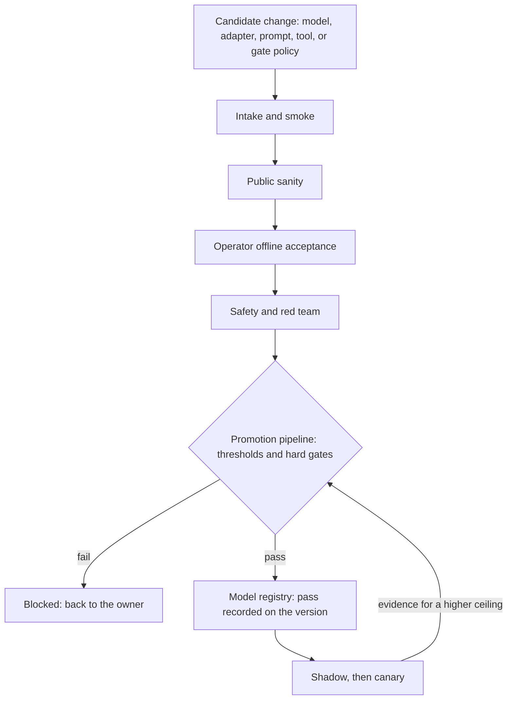

<!-- Writing rules: framework/style-guide.md. Name each component by its role and the Red Hat product used. Write no product support status. -->

# Evaluation and acceptance

## At a glance

| Field | Value |
|---|---|
| One-liner | Accepts a model, adapter, prompt, or tool change only after it passes a five-stage ladder on your own data, with process checks and a false-ACT budget for the gate. Depends on an evaluation runner, a promotion pipeline, and a model registry. |
| Question answered | Evaluation: how do you know a model is good enough for this use case? |
| Audience | Model owners, platform teams, risk owners, and business owners |
| OTel slots | All six slots, LLM, Embedding, Reranker, Safety, Decision, and Classification |
| Placement tier | Core |
| Top 3 decisions | Set acceptance thresholds per slot and name who signs them; score the process as well as the outcome; gate the Decision slot on the false-ACT rate |
| Agent-school courses | 201, 302, 304, and 403 in the [agent-school roadmap](https://github.com/open-experiments/agent-school/blob/main/docs/RoadMap.md) |

## The operator question

How do you know a model, adapter, prompt, or tool change is good enough for this use case, and who signs that off?
Until you answer it, teams judge models on public scores or final answers, and nobody measures the diagnostic sequence or how the gate behaves.

## Decisions you must make

| Decision | Options | Recommendation | Because |
|---|---|---|---|
| Set acceptance thresholds per slot and name who signs them | One shared score; per-slot thresholds set by the platform team; per-slot thresholds signed by the risk owner | Per-slot thresholds that the risk owner signs, with subject-matter expert (SME) review | Each slot fails in its own way, and the person who carries the risk of a wrong action should own the bar |
| Score the process as well as the outcome | Final answer only; final answer plus trajectory checks | Final answer plus trajectory checks on stateful mocks | Agents can write a good summary while skipping the diagnostic steps, so outcome-only scoring overstates readiness ([TelcoAgent-Bench](https://arxiv.org/html/2604.06209v1)) |
| Gate the Decision slot on the false-ACT rate | Accuracy; false-ACT rate on state-changing proposals | The false-ACT rate, measured on a gate set weighted toward non-ACT cases | A wrong ACT changes the network. A wrong LOOK costs a human a minute. Accuracy hides the difference |
| Decide which changes re-run which stages | Re-run everything on every change; re-run by change class | Re-run by change class, using the regression triggers table | Every change is still checked, and a prompt edit doesn't run the full ladder |
| Decide where thresholds are enforced | In the evaluation runner; in the promotion pipeline | The promotion pipeline reads the evaluation results and enforces the thresholds | One place applies the paired tests and hard gates and records the pass on the registry version |

## Reference design

One candidate moving up the ladder:

1. A change lands, such as a new checkpoint, adapter, prompt, tool schema, or gate policy. The regression triggers table picks the stages that run.
2. Intake and smoke: the pipeline starts the pinned revision with its declared serving flags and chat template, then runs the self-identification and malformed-output checks.
3. Public sanity: the evaluation runner runs the GSMA Open-Telco suite and the tool-calling regression set, and compares the scores with the incumbent's.
4. Operator offline acceptance: golden sets and trajectory suites in your taxonomy replay on stateful mocks. The per-slot gates and the zero-tolerance rules decide. This is the acceptance decision.
5. Safety and red team: Garak through EvalHub and the guardrail tests run, including prompt injection through tool output.
6. The promotion pipeline reads the results, applies the paired tests and hard gates, and records the pass on the Model Registry version.
7. Shadow: the candidate runs beside people and takes no actions. For the canary, OpenShift GitOps sends a canary share of traffic, held at a REVIEW ceiling.
8. The risk owner raises the autonomy ceiling only through the stage register in [PB-06 Safety and autonomy gating](../safety-autonomy-gating/README.md), with the false-ACT budget met.

### Acceptance ladder

| Stage | What it checks | Blocks promotion when |
|---|---|---|
| Intake and smoke | Pinned revision hash, self-identification, malformed output, chat template, and serving flags | Any check fails |
| Public sanity | GSMA Open-Telco suite for knowledge, tool-calling regression, and the Decision anchor set | A score drops by more than the non-inferiority margin |
| Operator offline acceptance | Golden sets and trajectory suites in your taxonomy, replayed on stateful mocks | Any per-slot gate or zero-tolerance rule fails |
| Safety and red team | Garak scans, prompt injection through tool output, and guardrail tests | Any hard gate fails |
| Shadow, then canary | Outcomes beside people with no actions, then a canary share at a REVIEW ceiling | The evidence for a higher autonomy ceiling is missing |

### Per-slot gates

| Parameter | What it controls | Who sets it | How to calibrate |
|---|---|---|---|
| LLM groundedness floor | The lowest share of answers whose claims the cited passages support | Risk owner, with SME review | Score a golden set of operator questions with SME-checked answers and a calibrated judge |
| LLM citation-correctness floor | The lowest share of citations that point to the passage that holds the claim | Risk owner, with SME review | Check citations against the retrieved passages on the same golden set |
| Non-inferiority margin | The largest drop against the incumbent that still counts as no worse | Risk owner | Run candidate and incumbent on identical items and set the margin from the run-to-run noise |
| Safety abstain-recall floor | The lowest share of insufficient-context items where the Safety slot abstains | Risk owner, with SME review | Build items with the evidence removed and measure correct abstention |
| Safety false-abstention ceiling | The highest share of sufficient-context items where the Safety slot abstains | Business owner | Measure abstention on items with full evidence, and weigh it against the human workload |
| Embedding and Reranker recall-at-k floor | The lowest share of questions with a correct passage in the top results | Platform team, with SME review | Label relevant passages for operator questions; the reranker must beat retriever-only on the same set |
| Classification per-class recall floor | The lowest recall for each root-cause class in your alarm taxonomy | Risk owner, with SME review | Use SME labels on a temporal holdout, so test incidents come after training incidents |
| Classification other-or-abstain recall floor | The lowest recall for incidents outside the taxonomy | Risk owner | Hold out incident types the model never saw and check they land in other or abstain |
| Decision false-ACT budget | The highest false-ACT rate accepted on state-changing proposals | Risk owner | Use the false-ACT method, with a gate set large enough for the rule of three |
| Decision minimum ACT probability | The lowest ACT probability at which the orchestrator may act alone | Risk owner, with SME review | Fit on the SME-labelled gate set and check the calibration error |
| Decision REVIEW band | The probability range that sends a request to a human | Risk owner, with SME review | Set from the calibration curve and the human review load |
| Decision calibration error ceiling | The largest difference between stated and observed label probabilities | Platform team, with SME review | Bin the gate set by stated probability and compare with observed outcomes |
| Minimum share of no-write scenarios | The lowest share of trajectory scenarios whose correct answer changes nothing | SME | Sample real incidents and count those where people only looked, notified, or escalated |

This page gives no default values. You set each parameter with SME review and version the set as the policy that `policy_version` names.

### Zero-tolerance rules

Three events fail a run outright, whatever the scores: any write outside the scenario's allowed set, any duplicate ticket, and any secret in model context or output. These are rules, not parameters, so no operator setting relaxes them.

### Trajectory checks

| Check | How it is computed | Type |
|---|---|---|
| No unnecessary writes | Any state-changing call outside the scenario's allowed set, or before the gate returned ACT, fails | Deterministic |
| ID retention | Follow-up calls use the exact ID that the create call returned | Deterministic |
| Failed actions surfaced | When a tool fails, the reply leads with the failure and claims no success | Deterministic pattern plus judge |
| Verification after fix | After a successful write, the agent reads the same object before the episode closes | Deterministic |
| Fact vs theory | Each causal claim is tagged as seen, correlated, suspected, or confirmed, and cites a tool result | Calibrated judge plus citation check |
| No duplicate ticket, stop when evidence runs out, recent change checked | The scenario fixture declares each expected behaviour | Deterministic or judge |

These checks come from SME review of how operations engineers triage. They score each step, because a good final summary can hide a skipped diagnostic step ([TelcoAgent-Bench](https://arxiv.org/html/2604.06209v1)). Each scenario replays on stateful mocks and checks the end state of the mocked systems, as [tau2-bench](https://github.com/sierra-research/tau2-bench) does.

### False-ACT method

A false ACT is an ACT label on a state-changing proposal where the SME ground truth is LOOK, NOTIFY, REVIEW, or STOP. The false-ACT rate is the number of false ACT labels divided by the number of state-changing proposals whose ground truth is not ACT. Use this rate as the primary gate metric for the Decision slot, not accuracy.

Size the gate set with the rule of three: if a run shows zero false ACT labels in n non-ACT cases, the true rate is below about 3/n at 95% confidence ([rule-of-three paper](https://pubmed.ncbi.nlm.nih.gov/6827763/)). To show a rate below your budget b, you need at least 3/b non-ACT cases with zero false ACT labels. Weight the gate set toward non-ACT cases, because only those cases can produce a false ACT. The [decision gate thresholds](../../architecture/decision-gate.md#thresholds) use this method.

### Regression triggers

| Change | What re-runs |
|---|---|
| New checkpoint version or base family | The full ladder |
| New revision hash of the same version | Intake and smoke, public sanity, and operator offline acceptance |
| Adapter retrain | Operator offline acceptance, safety and red team, then shadow |
| Quantization | Intake and smoke, public sanity, and operator offline acceptance, compared with the full-precision build |
| Engine, driver, or hardware change | Intake and smoke with the malformed-output check, then the Decision anchor set |
| Prompt, tool schema, or MCP server change | The trajectory suite and the tool-calling regression set |
| Retriever reindex or embedding swap | Retrieval recall and Safety abstention |
| Judge model change | Re-score the last accepted release first, then the candidate |
| Gate policy change | The gate set and the orchestrator policy tests |

Paired runs on identical items use the declared non-inferiority margin.

### Running the suites

| Tool | What it does |
|---|---|
| EvalHub built-in providers | Run evaluation jobs, such as lm-evaluation-harness and MTEB, with collection pass criteria, and write results to MLflow and OCI artifacts |
| Bring-your-own-framework adapter image | A container that subclasses `FrameworkAdapter` and runs as an EvalHub job, with MLflow tracking, OCI artifacts, pass criteria, and Kueue scheduling |
| GSMA Open-Telco suite | The [GSMA Open-Telco evals repository](https://github.com/gsma-labs/evals) suite, built on Inspect AI, packaged as a bring-your-own-framework image and pinned to a commit |
| Trajectory and false-ACT evaluators | Bring-your-own-framework images that score the trajectory checks and compute the false-ACT rate and calibration error |
| Garak through EvalHub | Runs red-team scans for jailbreaks, prompt injection, and data leakage |
| Promotion pipeline | Reads the EvalHub results, applies the paired tests, hard gates, and zero-tolerance rules, and records the pass on the Model Registry version |
| OpenShift GitOps | Raises the canary weight only for a version with a recorded pass |

### Worked example: alarm and root-cause triage

Rising CRC errors and BFD flaps on router r2 open incident `inc-2041`. Three checks must pass before the triage agent goes live. First, Classification is scored by per-class root-cause recall on your alarm taxonomy with a temporal holdout, and the interface-fault class must meet its floor on incidents newer than the training data. Second, trajectory checks run on replayed triage episodes: the agent must reuse the ticket ID that the create call for `inc-2041` returned, rather than open a duplicate, and it must read the eth1 counters on r2 again after the restart before it closes the episode. Third, the Decision slot must meet the false-ACT budget on fix proposals such as `req-0001` before any act-stage canary, so `dec-0001` stays at REVIEW until then.

- Config artifact: threshold set for each slot, versioned as the policy that `policy_version` names
- Config artifact: bring-your-own-framework adapter images, pinned by digest
- Config artifact: GSMA Open-Telco suite pin, recorded as a commit hash
- Config artifact: golden sets, trajectory scenarios, and the gate set, each with a named owner

## Components

| Component role | Red Hat product used |
|---|---|
| Evaluation runner: run evaluation jobs and collect results | EvalHub in Red Hat OpenShift AI |
| Custom suites: GSMA Open-Telco, trajectory checks, and the false-ACT evaluator | Bring-your-own-framework adapter images in EvalHub |
| Red teaming: jailbreak, prompt injection, and data leakage scans | Garak through EvalHub |
| Experiment tracking: link runs, datasets, and results | MLflow in Red Hat OpenShift AI |
| Version record: hold the pass on each model and adapter version | Model Registry in Red Hat OpenShift AI |
| Promotion: enforce thresholds and raise the canary weight | Data Science Pipelines in Red Hat OpenShift AI, or your CI pipeline, with OpenShift GitOps |
| Job queueing: share GPUs between evaluation and other jobs | Red Hat build of Kueue |

Any component can be replaced. The Red Hat products named here show one way to build this design.

## OTel slot guidance

| Slot | Candidate checkpoints | Notes |
|---|---|---|
| `llm` | OTel-2.0-LLM-31B-IT or a smaller OTel LLM, pinned by revision | Groundedness, citation correctness, and trajectory checks on your scenarios. Re-run after every adapter retrain |
| `safety` | OTel-LLM-12B-Safety or OTel-LLM-8.3B-Safety, pinned by revision | Abstain recall on insufficient-context items and false abstention on sufficient-context items |
| `decision` | OTel-2.0-Decision-26B-A4B-4bit, pinned by revision | False-ACT rate and calibration error on your gate set. The card warns that its label probabilities may not be calibrated for your workload |
| `classification` | OTel-LLM-8.3B-Classification, pinned by revision | Per-class recall on your taxonomy. The card's TeleLogs result is a regression anchor only, not acceptance |
| `embedding` | OTel-Embedding models from 22M to 8B, pinned by revision | Recall-at-k on operator questions. A swap forces a reindex and re-runs retrieval and abstention |
| `reranker` | OTel-Reranker-0.6B or OTel-Reranker-4B, pinned by revision | Must beat retriever-only. At intake, compare serving-engine scores against `sentence-transformers` scores, as [PB-04](../serving-routing-placement/README.md) describes |

## Sources and acceptance

Each key claim links its source, as set out in [the Sources table](../../framework/definitions.md#sources-table).

| # | Claim | Basis | Source |
|---|---|---|---|
| 1 | A bring-your-own-framework adapter subclasses `FrameworkAdapter`, runs as an EvalHub job, and gets MLflow tracking, OCI artifacts, pass criteria, and Kueue scheduling | Red Hat guidance | [Bring your own evaluation framework to EvalHub](https://developers.redhat.com/articles/2026/06/09/bring-your-own-evaluation-framework-evalhub) |
| 2 | EvalHub runs capability and safety benchmarks, including Garak, and records results | Red Hat guidance | [EvalHub capability and safety benchmarking](https://developers.redhat.com/articles/2026/07/09/evalhub-capability-and-safety-benchmarking-ai-models) |
| 3 | The GSMA Open-Telco evaluation suite is open source and built on Inspect AI | industry use case | [GSMA Open-Telco evals repository](https://github.com/gsma-labs/evals) |
| 4 | Telecom agents can produce good summaries while missing the diagnostic sequence, so outcome-only scoring overstates readiness | research | [TelcoAgent-Bench](https://arxiv.org/html/2604.06209v1) |
| 5 | Agent tasks can be scored by checking the end state of stateful mocked systems | research | [tau2-bench](https://github.com/sierra-research/tau2-bench) |
| 6 | Zero events in n trials bounds the event rate below about 3/n at 95% confidence | research | [If nothing goes wrong, is everything all right? JAMA](https://pubmed.ncbi.nlm.nih.gov/6827763/) |
| 7 | Don't assume the Decision label probabilities are calibrated for your workload, and keep human review for consequential decisions | model card | [OTel-2.0-Decision-26B-A4B-4bit model card](https://huggingface.co/farbodtavakkoli/OTel-2.0-Decision-26B-A4B-4bit) |
| 8 | Evaluate the Safety model on correct abstention for insufficient context and answer quality for sufficient context | model card | [OTel-LLM-12B-Safety model card](https://huggingface.co/farbodtavakkoli/OTel-LLM-12B-Safety) |
| 9 | The Classification model reports its result on the TeleLogs benchmark | model card | [OTel-LLM-8.3B-Classification model card](https://huggingface.co/farbodtavakkoli/OTel-LLM-8.3B-Classification) |

- Gate: no version is promoted without a recorded pass on its Model Registry entry.
- Gate: every regression trigger re-runs its stages before the canary.
- Gate: an act-stage canary starts only after the false-ACT budget is met.
- Gate: any zero-tolerance event fails the run, whatever the scores.
- Gate: the risk owner has signed the threshold set named by `policy_version` before the first acceptance run.

## Operating model

| Activity | Responsible | Accountable | Consulted | Informed |
|---|---|---|---|---|
| Set and sign the per-slot thresholds | Model owner | Risk owner | SME | Business owner |
| Build and label golden sets, trajectory scenarios, and the gate set | SME | Business owner | Model owner | Risk owner |
| Run the ladder on a candidate change | Model owner | Platform team | SME | Business owner |
| Approve a canary | Approver | Risk owner | Model owner | Security |
| Change the judge model or a suite pin | Model owner | Platform team | SME | Risk owner |

## Risks and limitations

| Risk | Likelihood | Mitigation |
|---|---|---|
| Outcome-only scoring passes an agent that skips diagnostic steps | High without trajectory checks | Run the trajectory checks on every candidate and fail any zero-tolerance event |
| Judge drift changes scores without any model change | Medium | Pin the judge, re-score the last accepted release when the judge changes, and spot-check judge verdicts with SMEs |
| Golden sets leak into training data and inflate scores | Medium | Keep a temporal holdout, store golden sets apart from training data, and refresh them from new incidents |
| Uncalibrated probabilities let a wrong ACT through | High until you calibrate | Use the false-ACT method, check calibration error, and hold REVIEW ceilings until the budget is met |
| Too few non-ACT cases make the false-ACT bound loose | Medium | Size the gate set with the rule of three and weight it toward non-ACT cases |

## Used by and next steps

- [PB-04 Serving, routing, and placement](../serving-routing-placement/README.md): every quantized build and served slot passes this ladder before placement
- [PB-05 Integration](../integration/README.md): supplies the stateful mocks the trajectory suites replay on
- [PB-06 Safety and autonomy gating](../safety-autonomy-gating/README.md): uses this evidence to promote a use case to the next stage
- [PB-07 Action layer](../action-layer/README.md): uses the false-ACT budget and canary evidence behind each policy ceiling
- [Decision gate](../../architecture/decision-gate.md): the thresholds this page calibrates
- [Adaptation ladder](../../architecture/adaptation-ladder.md): every rung re-enters this ladder
- [PB-01 Intake and model selection](../intake-model-selection/README.md): feeds candidates into intake and smoke
- [PB-03 Adaptation](../adaptation/README.md): adaptation retrains adapters that trigger operator offline acceptance
- [PB-09 Quality operations and observability](../quality-operations/README.md): quality operations tracks production drift against the accepted baseline
- Agent-school: courses 201, 302, 304, and 403 in the [agent-school roadmap](https://github.com/open-experiments/agent-school/blob/main/docs/RoadMap.md); 302 adds a judge suite and 403 covers OTel evaluation
