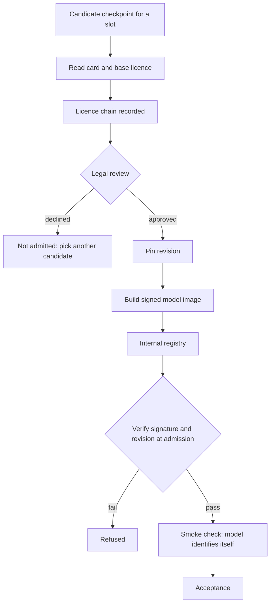

<!-- Writing rules: framework/style-guide.md. Name each component by its role and the Red Hat product used. Write no product support status. -->

# Intake and model selection

## At a glance

| Field | Value |
|---|---|
| One-liner | Decides which OTel checkpoints you may run by following each licence chain to its base model, pins every checkpoint to a commit revision, and serves it as a signed image from your own registry. Depends on a model registry, an image signing service, and your legal team's review. |
| Question answered | Intake: which checkpoints may you run, and where do they come from? |
| Audience | Model owners, legal teams, platform teams, and security |
| OTel slots | All six slots, LLM, Embedding, Reranker, Safety, Decision, and Classification |
| Placement tier | Far edge, regional, and core |
| Top 3 decisions | Follow the licence chain to the base model; pin a commit revision for every checkpoint; serve signed model images from your own registry |
| Agent-school courses | 403 in the [agent-school roadmap](https://github.com/open-experiments/agent-school/blob/main/docs/RoadMap.md) |

## The operator question

Which checkpoints may you run, and can you prove where each one came from?
Until you answer it, a repository tag gets taken as the licence, a floating revision changes the weights under you, or an unsigned image reaches production.

## Decisions you must make

| Decision | Options | Recommendation | Because |
|---|---|---|---|
| Follow the licence chain to the base model | Trust the repository tag; read the OTel card; follow the base model to its own licence | Follow every checkpoint to its base model's licence and record the chain | Every OTel repository is tagged apache-2.0, yet some bases use the Gemma Terms of Use or the LFM Open License v1.0, and the OTel cards ask you to comply with the base terms too ([12B Safety card](https://huggingface.co/farbodtavakkoli/OTel-LLM-12B-Safety)) |
| Pin a commit revision for every checkpoint | Floating latest; a commit revision | Pin a commit revision and record it in the model registry | The repositories carry no release tags, and the cards say the weights may be updated ([31B card](https://huggingface.co/farbodtavakkoli/OTel-2.0-LLM-31B-IT)) |
| Serve signed model images from your own registry | Download from the public hub at start; object storage; a signed ModelCar image in an internal registry | A signed ModelCar image in your internal registry | Models then move through the same supply chain as your other container images ([ModelCar article](https://www.redhat.com/en/blog/using-containers-bring-software-engineering-rigor-ai-workloads)) |
| Decide what admission verifies | Nothing; the image signature; the signature and the recorded revision | Verify both the signature and the revision | A signature proves origin, not freshness, so an older signed revision could still be swapped in |
| Decide how other blueprints name models | A checkpoint name in every design; slots everywhere, with one mapping page | Name slots in every blueprint and map slots to checkpoints only on this page | The family changes, so one table is easier to keep current than ten |

## Reference design



Run these checks for each checkpoint before it enters intake:

1. Read the OTel model card. Note its licence, its base model, and the revision you plan to pin.
2. Follow the base model to its own card and licence. The repository tag alone doesn't settle the licence chain.
3. Check redistribution, including whether serving the model to others through an API counts under the licence.
4. Check use restrictions, such as a prohibited-use policy or a commercial-use limit tied to revenue.
5. Check attribution and notice files that must travel with any copy you distribute.
6. Check derivative and adapter terms: whether your fine-tunes, adapters, quantized builds, or synthetic training data count as derivatives.
7. Check gating, and accept the base model's terms on its repository where it asks.
8. Record the licence chain with the pinned revision in the model registry, and send it to legal review.

This page states what the licences say; your legal team decides what they mean for you.

### Current OTel family

| Slot | OTel checkpoint | Base model | Licence | Source |
|---|---|---|---|---|
| `llm` | OTel-2.0-LLM-31B-IT | Gemma 4 31B IT | Apache-2.0 | [OTel-2.0-LLM-31B-IT card](https://huggingface.co/farbodtavakkoli/OTel-2.0-LLM-31B-IT) |
| `decision` | OTel-2.0-Decision-26B-A4B-4bit | Gemma 4 26B A4B IT | Apache-2.0 | [OTel-2.0-Decision-26B-A4B-4bit card](https://huggingface.co/farbodtavakkoli/OTel-2.0-Decision-26B-A4B-4bit) |
| `safety` | OTel-LLM-12B-Safety | Gemma 3 12B IT | Gemma Terms of Use; the base repository is gated | [OTel-LLM-12B-Safety card](https://huggingface.co/farbodtavakkoli/OTel-LLM-12B-Safety) |
| `safety` | OTel-LLM-8.3B-Safety | EssentialAI rnj-1-instruct | Apache-2.0 | [OTel-LLM-8.3B-Safety card](https://huggingface.co/farbodtavakkoli/OTel-LLM-8.3B-Safety) |
| `classification` | OTel-LLM-8.3B-Classification | EssentialAI rnj-1 | Apache-2.0 | [OTel-LLM-8.3B-Classification card](https://huggingface.co/farbodtavakkoli/OTel-LLM-8.3B-Classification) |
| `reranker` | OTel-Reranker-0.6B, 4B, and 8B | Qwen3 0.6B, 4B, and 8B | Apache-2.0 | [OTel-Reranker-4B card](https://huggingface.co/farbodtavakkoli/OTel-Reranker-4B) |
| `embedding` | OTel-Embedding-600M, 4B, and 8B | Qwen3-Embedding | Apache-2.0 | [OTel-Embedding-8B card](https://huggingface.co/farbodtavakkoli/OTel-Embedding-8B) |
| `embedding` | OTel-Embedding-22M, 34M, and 109M | MiniLM and mpnet sentence-transformers models | Apache-2.0 | [OTel-Embedding-22M card](https://huggingface.co/farbodtavakkoli/OTel-Embedding-22M) |
| `embedding` | OTel-Embedding-33M, 335M, and 568M | BAAI bge models | MIT | [OTel-Embedding-568M card](https://huggingface.co/farbodtavakkoli/OTel-Embedding-568M) |
| `embedding` | OTel-Embedding-300M | `EmbeddingGemma` 300M | Gemma Terms of Use; the base repository is gated | [OTel-Embedding-300M card](https://huggingface.co/farbodtavakkoli/OTel-Embedding-300M) |
| `llm`, smaller models | OTel-LLM-270M-IT, 1B-IT, 4B-IT, 12B-IT, and 27B-IT | Gemma 3 | Gemma Terms of Use | [OTel-LLM-12B-IT card](https://huggingface.co/farbodtavakkoli/OTel-LLM-12B-IT) |
| `llm`, smaller models | OTel-LLM-1.2B-IT, 8B-A1B-IT, and 24B-IT | LiquidAI LFM2.5 and LFM2 | LFM Open License v1.0, although the OTel repositories are tagged apache-2.0 | [OTel-LLM-24B-IT card](https://huggingface.co/farbodtavakkoli/OTel-LLM-24B-IT) |
| `llm`, smaller models | Qwen3, `OLMo`, `Ministral`, gpt-oss, rnj-1, and Gemma 4 E4B checkpoints | The named base for each checkpoint | Apache-2.0 | [OTel-LLM-14B-IT card](https://huggingface.co/farbodtavakkoli/OTel-LLM-14B-IT) |

Checked against the model cards on 2026-11-11; the family changes. The table groups the smaller checkpoints by licence family, so check each card on Hugging Face for the full list. The safety, embedding, and smaller LLM cards ask users to comply with both the OTel release licence and the upstream base-model licence or terms.

The LFM rows show why you follow the base model. Their repositories are tagged apache-2.0, but each base uses the LFM Open License v1.0, and that licence sets a revenue threshold for commercial use.

The Classification checkpoint's config.json declares the `Gemma3TextForSequenceClassification` architecture class, while its card names rnj-1 as the base model. The licence follows the base model, not the architecture class.

### What the licences say

| Licence | What it says | Source |
|---|---|---|
| Apache-2.0 | Redistribution must give recipients a copy of the licence, mark modified files, keep copyright and attribution notices, and carry the contents of any NOTICE file. The patent licence ends for anyone who files patent litigation over the work. It grants no trademark rights | [Gemma 4 licence](https://ai.google.dev/gemma/docs/gemma_4_license) |
| Gemma Terms of Use | "Model Derivatives" include modifications, works based on Gemma, and models trained by distillation or on synthetic outputs of Gemma; outputs are not Model Derivatives. Distribution must carry the use restrictions as an enforceable provision, a copy of the agreement, and, except through a Hosted Service, a Notice file stating "Gemma is provided under and subject to the Gemma Terms of Use found at ai.google.dev/gemma/terms" as Section 3.1 sets out. Offering Gemma through an API makes it a "Hosted Service" under the terms. The Prohibited Use Policy is part of the terms. On termination, all copies of Gemma and Model Derivatives must be deleted. The terms do not name adapters | [Gemma Terms of Use](https://ai.google.dev/gemma/terms), last modified 2026-04-01 |
| LFM Open License v1.0 | The licence defines "Threshold" as "annual revenue of 10 million United States dollars ($10,000,000) or more" in its definitions. Section 5(b) reads "Any Commercial Use of the Work or a Derivative Work by a Legal Entity that exceeds the Threshold is not licensed under this Agreement" in full. Redistribution needs a copy of the licence, marked changes, and retained notices | [LFM2-24B-A2B licence](https://huggingface.co/LiquidAI/LFM2-24B-A2B/blob/main/LICENSE) |
| MIT | Copies must keep the copyright notice and the permission notice | [MIT licence](https://opensource.org/license/mit) |

### Pinning and provenance

| Control | What it proves | Source |
|---|---|---|
| Pin a commit revision and record it in the model registry | Every deployment loads the weights you evaluated, even after the repository moves on | [31B card](https://huggingface.co/farbodtavakkoli/OTel-2.0-LLM-31B-IT) |
| Build each checkpoint into a signed ModelCar image in your internal registry | The image came from your build system, and you can attach provenance and a bill of materials to it | [ModelCar article](https://www.redhat.com/en/blog/using-containers-bring-software-engineering-rigor-ai-workloads) |
| Admission policy for image signatures | No unsigned or wrongly signed model image starts | [Trusted Artifact Signer administration guide](https://docs.redhat.com/en/documentation/red_hat_trusted_artifact_signer/1/html/administration_guide/rhtas-ocp-admin) |
| Model file signatures | A validation step checks signatures over the model files before the pod uses them | [Trusted Artifact Signer administration guide](https://docs.redhat.com/en/documentation/red_hat_trusted_artifact_signer/1/html/administration_guide/rhtas-ocp-admin) |
| Revision check at admission | The image holds the revision the registry records | [31B card](https://huggingface.co/farbodtavakkoli/OTel-2.0-LLM-31B-IT) |
| Self-identification smoke check | The model answers as OTel, not as its base, so the right weights loaded, as in [PB-04 Serving, routing, and placement](../serving-routing-placement/README.md#hardware-prerequisites) | [31B card](https://huggingface.co/farbodtavakkoli/OTel-2.0-LLM-31B-IT) |

A valid signature shows where an image came from, not that its revision is current, so admission also checks the revision against the registry record.

```text
# model registry entry, one per checkpoint
checkpoint: OTel-2.0-LLM-31B-IT
revision: <sha>
image: <internal registry>/otel/llm-31b-it@sha256:<digest>
licence_chain: Apache-2.0 (OTel release) -> Apache-2.0 (Gemma 4 base)
legal_review: <reference>
```

### Runtime requirements

| Checkpoint | Prerequisite | Source |
|---|---|---|
| OTel-2.0-LLM-31B-IT | vLLM 0.19 or later and transformers 5.5 or later; an older stack fails at load | [31B card](https://huggingface.co/farbodtavakkoli/OTel-2.0-LLM-31B-IT) |
| OTel-2.0-Decision-26B-A4B-4bit | vLLM 0.26 on CUDA or 0.30 on ROCm, as the card tests them, reading labels through `/v1/chat/completions` with logprobs; `/v1/systemone` needs a nightly engine build | [Decision card](https://huggingface.co/farbodtavakkoli/OTel-2.0-Decision-26B-A4B-4bit) |
| Safety, embedding, and smaller LLM checkpoints | The cards describe an English-only, mainly text release, so a non-English use case needs its own evaluation | [12B Safety card](https://huggingface.co/farbodtavakkoli/OTel-LLM-12B-Safety) |
| Every slot | Hardware class, precision, and serving flags | [PB-04 Serving, routing, and placement](../serving-routing-placement/README.md) |

### Slot-to-checkpoint selection guide

| Slot | Pick when | Licence family | Hardware class | Check |
|---|---|---|---|---|
| `llm` | The use case needs reasoning, tool calls, or explanations for human review | Apache-2.0 for the 31B; smaller LLMs follow their base | Single large GPU or Multi-GPU core node for the 31B; Small edge GPU for smaller LLMs | Self-identification smoke check and the tool-calling suite in [PB-02 Evaluation and acceptance](../evaluation-acceptance/README.md) |
| `decision` | A step needs label probabilities for the gate or for content routing | Apache-2.0 | Small edge GPU, or Single large GPU for high concurrency | The engine prerequisite under Runtime requirements |
| `safety` | Prompts and answers need screening for abstention | Gemma Terms of Use or Apache-2.0, by base | Small edge GPU | Abstention gate in PB-02 |
| `classification` | A step needs one label from a closed set, such as a root cause | Apache-2.0 | Small edge GPU | The label set matches your incident taxonomy |
| `embedding` | The use case retrieves from your documents | Apache-2.0, MIT, or Gemma Terms of Use, by base | CPU for small models; Small edge GPU otherwise | Changing the embedding model forces a full re-index |
| `reranker` | Retrieval needs candidate passages reordered | Apache-2.0 | Small edge GPU, or a slice of a Single large GPU | Ranking quality on your held-out pairs in PB-02 |

### Worked example: alarm and root-cause triage

Rising CRC errors and BFD flaps on router r2 open incident `inc-2041`. `noc-triage-agent` uses these checkpoints from the family table: OTel-2.0-LLM-31B-IT as the agent model, OTel-2.0-Decision-26B-A4B-4bit for the gate labels, OTel-LLM-8.3B-Classification for the root-cause label, OTel-LLM-8.3B-Safety for abstention, and an OTel Embedding and Reranker pair on Qwen3 bases for local retrieval. Every one is Apache-2.0 down to its base.

A team that picks OTel-LLM-12B-Safety instead records a chain that includes the Gemma Terms of Use, and legal review covers those terms as well. Each checkpoint is pinned by commit revision in the model registry and served as a signed ModelCar image from the internal registry. When the `approver` reviews `dec-0001` at REVIEW on the [decision gate](../../architecture/decision-gate.md), the record shows which revisions produced the labels for eth1.

- Config artifact: licence chain record for each checkpoint, with the legal review reference
- Config artifact: model registry entry with the pinned revision and image digest
- Config artifact: image signature policy that also checks the recorded revision

## Components

| Component role | Red Hat product used |
|---|---|
| Model registry: records each checkpoint, its pinned revision, and its licence chain | Model registry in Red Hat OpenShift AI |
| Model images: package each checkpoint as an OCI image | ModelCar images in an internal registry such as Red Hat Quay |
| Signing: signs model images and model files | Red Hat Trusted Artifact Signer |
| Admission policy: refuses images without a valid signature | Policy Controller with Red Hat Trusted Artifact Signer |
| Model file validation: checks model signatures before a pod uses the files | Model Validation Operator with Red Hat Trusted Artifact Signer |
| Inference engine: serves each pinned checkpoint | Red Hat AI Inference (vLLM) |
| Licence register: holds one licence chain record per checkpoint | Operator-built, kept beside the model registry |

Any component can be replaced. The Red Hat products named here show one way to build this design.

## OTel slot guidance

| Slot | Candidate checkpoints | Notes |
|---|---|---|
| `llm` | OTel-2.0-LLM-31B-IT or a smaller OTel LLM, pinned by revision | Smaller LLMs span three licence families, so check each base |
| `decision` | OTel-2.0-Decision-26B-A4B-4bit, pinned by revision | Apache-2.0 through to the Gemma 4 base |
| `safety` | OTel-LLM-8.3B-Safety or OTel-LLM-12B-Safety, pinned by revision | The 12B chain includes the Gemma Terms of Use; the 8.3B chain stays Apache-2.0 |
| `classification` | OTel-LLM-8.3B-Classification, pinned by revision | Apache-2.0 through to the rnj-1 base |
| `embedding` | An OTel Embedding model, pinned by revision | The licence follows the base, which may be Apache-2.0, MIT, or Gemma Terms of Use |
| `reranker` | OTel-Reranker-0.6B, 4B, or 8B, pinned by revision | Apache-2.0 through to the Qwen3 base |

## Sources and acceptance

Each key claim links its source, as set out in [the Sources table](../../framework/definitions.md#sources-table).

| # | Claim | Basis | Source |
|---|---|---|---|
| 1 | The 31B is built on Gemma 4 31B IT under Apache-2.0; pin a revision because weights may change; it needs vLLM 0.19 and transformers 5.5 or later; it should identify itself as OTel | model card | [OTel-2.0-LLM-31B-IT model card](https://huggingface.co/farbodtavakkoli/OTel-2.0-LLM-31B-IT) |
| 2 | The Decision model is built on Gemma 4 26B A4B IT under Apache-2.0, is tested on vLLM 0.26 on CUDA and 0.30 on ROCm, and serves `/v1/systemone` only on nightly builds | model card | [OTel-2.0-Decision-26B-A4B-4bit model card](https://huggingface.co/farbodtavakkoli/OTel-2.0-Decision-26B-A4B-4bit) |
| 3 | The 12B Safety model is built on Gemma 3 12B IT, is English-only, and asks users to comply with the base-model terms | model card | [OTel-LLM-12B-Safety model card](https://huggingface.co/farbodtavakkoli/OTel-LLM-12B-Safety) |
| 4 | The 8.3B Safety model is built on EssentialAI rnj-1-instruct | model card | [OTel-LLM-8.3B-Safety model card](https://huggingface.co/farbodtavakkoli/OTel-LLM-8.3B-Safety) |
| 5 | The 8.3B Classification model is built on EssentialAI rnj-1 | model card | [OTel-LLM-8.3B-Classification model card](https://huggingface.co/farbodtavakkoli/OTel-LLM-8.3B-Classification) |
| 6 | The 24B LLM is built on LiquidAI LFM2-24B-A2B and asks users to comply with the base-model terms | model card | [OTel-LLM-24B-IT model card](https://huggingface.co/farbodtavakkoli/OTel-LLM-24B-IT) |
| 7 | The base repositories of Gemma 3 models ask users to accept the Gemma terms before download | model card | [Gemma 3 12B IT model card](https://huggingface.co/google/gemma-3-12b-it) |
| 8 | The Gemma Terms of Use define Model Derivatives and Hosted Service, and set the distribution, Notice file, use restriction, and termination terms | project documentation | [Gemma Terms of Use](https://ai.google.dev/gemma/terms) |
| 9 | Gemma 4 models use the Apache-2.0 licence | project documentation | [Gemma 4 licence](https://ai.google.dev/gemma/docs/gemma_4_license) |
| 10 | The LFM Open License v1.0 sets a revenue threshold for commercial use | project documentation | [LFM2-24B-A2B licence](https://huggingface.co/LiquidAI/LFM2-24B-A2B/blob/main/LICENSE) |
| 11 | The BAAI bge models use the MIT licence | model card | [BAAI bge-m3 model card](https://huggingface.co/BAAI/bge-m3) |
| 12 | The MIT licence requires the copyright and permission notices in copies | project documentation | [MIT licence](https://opensource.org/license/mit) |
| 13 | Trusted Artifact Signer signs and verifies model files, and its Policy Controller and Model Validation Operator check signatures at admission | Red Hat guidance | [Trusted Artifact Signer administration guide](https://docs.redhat.com/en/documentation/red_hat_trusted_artifact_signer/1/html/administration_guide/rhtas-ocp-admin) |
| 14 | ModelCar images package models as OCI images that you can sign, attest, and serve from an internal registry | Red Hat guidance | [ModelCar article](https://www.redhat.com/en/blog/using-containers-bring-software-engineering-rigor-ai-workloads) |

- Gate: no checkpoint enters intake without a recorded licence chain and legal sign-off.
- Gate: every checkpoint in use has a pinned revision in the model registry.
- Gate: no model image is admitted without a valid signature and a revision that matches the registry record.
- Gate: every deployment passes the self-identification smoke check before traffic arrives.

## Operating model

| Activity | Responsible | Accountable | Consulted | Informed |
|---|---|---|---|---|
| Read the cards and record the licence chain | Model owner | Risk owner | Legal team | Platform team |
| Review the licence chain | Legal team | Risk owner | Model owner | Business owner |
| Pin the revision and build the signed image | Platform team | Model owner | Security | Risk owner |
| Run the signing keys and admission policy | Platform team | Security | Model owner | Risk owner |
| Re-check the family when a card or revision changes | Model owner | Risk owner | Legal team | Platform team |

## Risks and limitations

| Risk | Likelihood | Mitigation |
|---|---|---|
| The repository tag gets taken as the licence | High | Follow every base model through the check steps; the LFM rows show why |
| An older signed revision gets served | Medium | Check the revision against the registry record at admission, as well as the signature |
| A gated base's terms were never accepted | Medium | Gating is a check step, and the licence chain record shows who accepted the terms |
| The family changes after intake | High | Re-run the check steps for every new revision; the dated note shows when this table was last checked |
| The wrong weights load behind a healthy endpoint | Medium | Run the self-identification smoke check before traffic arrives |

## Used by and next steps

- [PB-02 Evaluation and acceptance](../evaluation-acceptance/README.md): every admitted checkpoint enters the intake and smoke stage
- [PB-03 Adaptation](../adaptation/README.md): each adapter binds to a base revision pinned here
- [PB-04 Serving, routing, and placement](../serving-routing-placement/README.md): serves each pinned checkpoint and lists flags and hardware
- [PB-08 Security, identity, and sandbox](../security-identity-sandbox/README.md): mirrors signed model images to offline sites
- [PB-09 Quality operations and observability](../quality-operations/README.md): a digest mismatch alert rolls the slot back to the revision recorded here
- [Decision gate](../../architecture/decision-gate.md): the Decision slot's labels come from a pinned checkpoint
- PB-10: compliance uses the licence chain records as evidence
- Agent-school: course 403 in the [agent-school roadmap](https://github.com/open-experiments/agent-school/blob/main/docs/RoadMap.md) covers the OTel domain models
