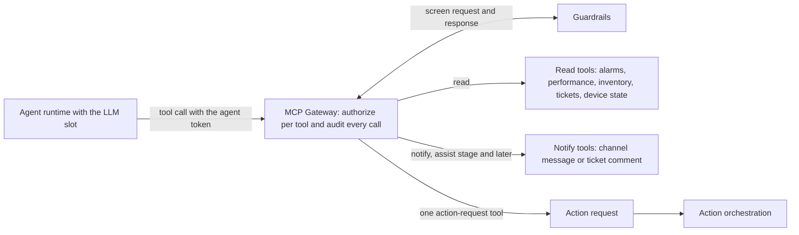

<!-- Writing rules: framework/style-guide.md. Name each component by its role and the Red Hat product used. Write no product support status. -->

# Integration

## At a glance

| Field | Value |
|---|---|
| One-liner | Connects agents to network and business systems through standards-based tools. Each call is authorized per tool and audited. Depends on an MCP gateway and an authorization server. |
| Question answered | Integration: how do agents reach your network and business systems? |
| Audience | Platform engineers, integration engineers, and security architects |
| OTel slots | LLM, Classification, Embedding, and Reranker |
| Placement tier | Regional and core |
| Top 3 decisions | Pick the standard that fronts each system; deny every tool unless a role allows it; route every write through the action request |
| Agent-school courses | 301, 302, 303, and 401 in the [agent-school roadmap](https://github.com/open-experiments/agent-school/blob/main/docs/RoadMap.md) |

## The operator question

How do agents reach your network and business systems, and who controls each call they make?
Until you answer it, agents hold direct credentials to network systems, and nobody can limit or audit what each tool call does.

## Decisions you must make

| Decision | Options | Recommendation | Because |
|---|---|---|---|
| Pick the standard that fronts each system | TM Forum Open APIs; CAMARA; 3GPP NWDAF and UDR; vendor APIs; device command line | TM Forum Open APIs for OSS and BSS, CAMARA for network APIs, 3GPP NWDAF and UDR for core analytics, and a read-only device command line for state no API exposes | Standard APIs come with published specifications and per-API conformance kits ([TM Forum conformance](https://www.tmforum.org/conformance-certification/open-api-conformance/)) |
| Put every tool behind one gateway | Agents call each server directly; one gateway | One MCP Gateway for every tool | One place checks the token per tool, screens each call, and writes the audit entry ([MCP gateway announcement](https://www.redhat.com/en/blog/model-context-protocol-gateway-red-hat-openshift-now-generally-available)) |
| Deny every tool unless a role allows it | Allow unless denied; deny unless allowed | Deny unless a per-tool role allows the call | By default a valid user can call every tool behind the gateway ([Locking down MCP at the gateway](https://developers.redhat.com/articles/2026/10/23/locking-down-mcp-at-the-gateway)) |
| Route every write through the action request | Direct write tools; the action request | The action request, through `submit_action_request`, for every write to a system of record, including ticket creation and updates. Direct notify tools are the one exception, from the assist stage up | The gate, the duplicate-ticket policy, and the audit trail live in one place ([decision gate](../../architecture/decision-gate.md)) |
| Produce tool definitions | Hand-written; generated from a pinned OpenAPI version | Generate them from a pinned OpenAPI version, following CAMARA API Design Guide Appendix B | Agents pick a tool from its `operationId` and description alone ([CAMARA API Design Guide](https://github.com/camaraproject/Commonalities/blob/main/documentation/CAMARA-API-Design-Guide.md)) |

## Reference design

Each `tools/call` follows these steps:

1. The agent gets a token from the authorization server. The token carries the agent's roles, grouped by MCP server, with one role per tool, such as `tool:list_alarms` on the TMF642 server.
2. The agent sends a JSON-RPC `tools/call` to the MCP Gateway. The router reads the body and sets the `x-mcp-servername` and `x-mcp-toolname` headers itself, so the client can't choose them.
3. The authorization rule allows the call only if `tool:` plus `x-mcp-toolname` is among the token's roles for that server. It denies every other call.
4. The gateway uses token exchange to swap the agent's token for one scoped to the backend server, so no backend receives a token that works anywhere else.
5. Guardrails screen the request before it reaches the backend, and the response before it reaches the agent. If the guardrail service is down, the call fails closed.
6. The router writes an audit entry with the user, server, tool, status, request ID, and session ID, and writes one for early rejections too.
7. The agent gets the response. To change anything, its only path is `submit_action_request`.

### Tools for alarm triage

| Tool | Standard | Access |
|---|---|---|
| List and get alarms | TM Forum TMF642 Alarm Management | read |
| Read performance indicators and measurement jobs | TM Forum TMF628 Performance Management | read |
| Read resource inventory for topology | TM Forum TMF639 Resource Inventory | read |
| Search trouble tickets | TM Forum TMF621 Trouble Ticket | read |
| Run `show` commands on a device | Device command line, through a read-only MCP server | read |
| Read network analytics | 3GPP NWDAF | read |
| Classify the root cause | OTel Classification slot, served as a tool | read |
| Post an operations-channel message or a ticket comment, from the assist stage up | Operations chat, paging system, or ticket comment | notify |
| `submit_action_request` | Action request in the [decision gate schema](https://github.com/ravisharma5/otel-telco-blueprints/blob/main/schemas/decision-gate.schema.json) | action request |

NOTIFY works two ways. From the assist stage up, an agent may hold direct notify tools, such as an operations-channel message or a ticket comment, through the MCP Gateway; the shadow stage gets no notify role. An action request that the gate labels NOTIFY becomes a notification job that the action layer runs. Bind each notify role to the stage register, so the gateway's tool-role mapping enforces the stage for direct notify tools.

### Per-tool authorization

| Control | What it does |
|---|---|
| Per-tool rule | A CEL rule on `x-mcp-toolname` allows a call only when the token holds `tool:<name>` in its client roles for that MCP server |
| Deny unless allowed | A valid user can call every tool by default, so the rule set must deny any call that no role allows |
| Gateway-set headers | The router sets the server and tool headers from the JSON-RPC body before the rule runs; clients can't set them |
| Token exchange | RFC 8693 token exchange gives each backend server a token for its own audience only |
| Filtered tool list | `tools/list` returns only the tools the token allows, so the rest stay hidden from the agent |
| Audit entry | One entry for every valid `tools/call`, including early rejections: user, server, tool, status, request ID, and session ID |
| Rate limits | Per-agent request limits at the gateway, set with a [rate limit policy](https://docs.kuadrant.io/1.5.x/kuadrant-operator/doc/overviews/rate-limiting/) |
| Workload identity | Each agent runs with its own SPIFFE identity, so roles bind to one agent; PB-08 covers the full identity design |

### Tool contracts and conformance

| Practice | Why |
|---|---|
| Pin the API version each MCP server fronts | A spec change can't alter tool behaviour without a release |
| Generate tool definitions from the pinned OpenAPI spec | Tool names, parameters, and descriptions match the contract |
| Follow CAMARA API Design Guide Appendix B for `operationId` and descriptions | Agents select tools from the operation object alone |
| Run the TM Forum Conformance Test Kit for each TMF API a server fronts | The server returns what the specification says |
| Put every tool description change under review before release | A swapped description can steer the agent toward the wrong tool (tool poisoning) |
| Use a stateful mock for every API with writes during evaluation and data generation | A static mock that returns one fixed ID teaches the model to cite that ID |

### Knowledge sources and usage rights

Keep a corpus register, and record the licence of every corpus before you index it. A source with an empty usage-rights entry stays out of the index.

| Source | Owner | Usage rights | Refresh | Used by slot |
|---|---|---|---|---|
| Vendor manuals and release notes | Vendor manager | The contract clause that allows indexing, per vendor | Each vendor release | Embedding, Reranker |
| Standards specifications | Standards team | The publisher's terms page and the date you checked it | Each standards release | Embedding, Reranker |
| Past trouble tickets | NOC lead | Data owner approval and any customer data rules | Daily | Embedding, Reranker, Classification |
| Runbooks and method-of-procedure documents | Operations engineering | Internal, with the owning team named | On change | Embedding, Reranker, LLM |

### Worked example: alarm and root-cause triage

Rising CRC errors and BFD flaps on router r2 open incident `inc-2041`. `noc-triage-agent` holds roles for TMF642 list and get, TMF628 read, TMF639 read, TMF621 search, the device `show interface` command, the Classification tool, and `submit_action_request`. It holds no direct notify role. The gateway denies and audits every other call.

The agent reads the alarms, the CRC counters on eth1, and the inventory links to r3, asks the Classification tool for the likely cause, then searches for an open ticket. Its triage note, creating the ticket for `inc-2041`, and restarting eth1 on r2 all go through the action request. The restart is `req-0001` on the [decision gate](../../architecture/decision-gate.md) page. If triage needs a customer line's network state, the CAMARA call carries its declared purpose, and consent stays in CAMARA's own flow. PB-10 covers customer consent design.

- Config artifact: one `MCPServerRegistration` per MCP server
- Config artifact: one `AuthPolicy` per MCP server, with the per-tool rule
- Config artifact: tool-role mapping for each agent, such as `noc-triage-agent`
- Config artifact: corpus register with its usage-rights column

## Components

| Component role | Red Hat product used |
|---|---|
| MCP tool gateway: routes, authorizes, and audits every tool call | MCP gateway in Red Hat Connectivity Link |
| Authorization server: issues tokens with per-tool roles and exchanges them per backend | Red Hat build of Keycloak |
| Workload identity: gives each agent its own identity | Zero Trust Workload Identity Manager for Red Hat OpenShift |
| Tool-call guardrails: screen requests and responses | MCP gateway guardrails with NeMo Guardrails in Red Hat OpenShift AI |
| MCP servers for TM Forum, CAMARA, 3GPP, and device command line | Operator-built servers on Red Hat OpenShift |
| Retrieval over registered corpora | OTel Embedding and Reranker slots on Red Hat AI Inference (vLLM) |

Any component can be replaced. The Red Hat products named here show one way to build this design.

## OTel slot guidance

| Slot | Candidate checkpoints | Notes |
|---|---|---|
| `llm` | OTel-2.0-LLM-31B-IT, or a smaller OTel LLM as the agent, pinned by revision | Calls tools only through the gateway, with the `gemma4` tool parser, and holds no backend credentials |
| `classification` | OTel-LLM-8.3B-Classification, pinned by revision | Served as a tool behind the gateway, so its calls are authorized and audited like any other |
| `embedding` | OTel-Embedding models, pinned by revision | Index only corpora with a filled usage-rights entry. A model change forces a full re-index |
| `reranker` | OTel-Reranker-0.6B or OTel-Reranker-4B, pinned by revision | Ranks passages from registered corpora only |

## Sources and acceptance

Each key claim links its source, as set out in [the Sources table](../../framework/definitions.md#sources-table).

| # | Claim | Basis | Source |
|---|---|---|---|
| 1 | The MCP gateway writes a structured audit entry for every valid `tools/call`, including early rejections, and screens requests and responses with NeMo guardrails | Red Hat guidance | [MCP gateway announcement](https://www.redhat.com/en/blog/model-context-protocol-gateway-red-hat-openshift-now-generally-available) |
| 2 | A CEL rule allows a call only when `tool:` plus `x-mcp-toolname` is among the token's roles for the server, and the router sets those headers from the request body | project documentation | [Kuadrant MCP gateway authorization](https://docs.kuadrant.io/1.5.x/mcp-gateway/docs/guides/authorization/) |
| 3 | By default a valid user can call every tool behind the gateway, so you add rules that deny unless a role allows | Red Hat guidance | [Locking down MCP at the gateway](https://developers.redhat.com/articles/2026/10/23/locking-down-mcp-at-the-gateway) |
| 4 | The gateway exchanges tokens per backend and filters `tools/list` to the tools a token allows | Red Hat guidance | [Advanced authentication and authorization for the MCP gateway](https://developers.redhat.com/articles/2025/12/12/advanced-authentication-authorization-mcp-gateway) |
| 5 | Token exchange issues a new token for a named audience | project documentation | [RFC 8693 OAuth 2.0 Token Exchange](https://www.rfc-editor.org/rfc/rfc8693) |
| 6 | Keycloak can act as the authorization server for MCP | project documentation | [Keycloak MCP authorization server](https://www.keycloak.org/securing-apps/mcp-authz-server) |
| 7 | The Zero Trust Workload Identity Manager gives each workload a SPIFFE identity on OpenShift | Red Hat guidance | [Zero Trust Workload Identity Manager announcement](https://www.redhat.com/en/blog/zero-trust-workload-identity-manager-11-generally-available-red-hat-openshift) |
| 8 | TMF642 defines alarm list and get operations | project documentation | [TMF642 Alarm Management API](https://www.tmforum.org/open-digital-architecture/open-apis/alarm-management-api-TMF642/v5.0) |
| 9 | TMF621 defines trouble ticket operations | project documentation | [TMF621 Trouble Ticket API](https://github.com/tmforum-apis/TMF621_TroubleTicket) |
| 10 | TMF639 defines resource inventory operations | project documentation | [TMF639 Resource Inventory API](https://github.com/tmforum-apis/TMF639_ResourceInventory) |
| 11 | TMF628 defines performance indicator and measurement job operations | project documentation | [TMF628 Performance Management API](https://github.com/tmforum-apis/TMF628_Performance) |
| 12 | TM Forum publishes a Conformance Test Kit for each Open API | project documentation | [TM Forum Open API conformance](https://www.tmforum.org/conformance-certification/open-api-conformance/) |
| 13 | An MCP server can translate CAMARA APIs into tools, with the declared purpose on each call and consent kept in CAMARA's own flow | project documentation | [CAMARA and MCP](https://camaraproject.org/2026/01/12/camara-charts-a-path-for-network-aware-ai-applications-with-mcp/) |
| 14 | CAMARA API Design Guide Appendix B sets `operationId` and description rules for MCP tool selection | project documentation | [CAMARA API Design Guide](https://github.com/camaraproject/Commonalities/blob/main/documentation/CAMARA-API-Design-Guide.md) |
| 15 | NWDAF exposes network analytics to consumers in the 5G core | project documentation | [3GPP TS 23.288](https://www.3gpp.org/dynareport/23288.htm) |

- Gate: the TM Forum Conformance Test Kit passes for each TMF API an MCP server fronts, at the pinned version.
- Gate: for every tool, a call with a valid token and no role for that tool is rejected, and the rejection appears in the audit log.
- Gate: the diff of every tool name and description is reviewed before an MCP server release.
- Gate: every API with writes has a stateful mock in the evaluation set ([PB-02](../evaluation-acceptance/README.md)).
- Gate: no agent token can reach a write endpoint directly; writes appear only as action requests.
- Gate: every corpus in the index has a filled usage-rights entry in the corpus register.

## Operating model

| Activity | Responsible | Accountable | Consulted | Informed |
|---|---|---|---|---|
| Grant a tool role to an agent | Platform engineer | Operator risk owner | NOC lead | Security team |
| Release an MCP server version | Integration engineer | Platform owner | Security team | NOC lead |
| Review tool description changes | Integration engineer | Security team | NOC lead | Operator risk owner |
| Add a corpus to the register | Data owner | Operator risk owner | Legal team | NOC lead |
| Review the tool-call audit log | Security team | Operator risk owner | NOC lead | Platform engineer |

## Risks and limitations

| Risk | Likelihood | Mitigation |
|---|---|---|
| A changed tool description steers the agent (tool poisoning) | Medium | Generate definitions from a pinned spec, review every description diff, and gate releases on that review |
| An agent can call tools it doesn't need | High, because the gateway allows every tool by default | Deny unless a role allows, grant the fewest roles per agent, and run the no-role rejection gate |
| Tool output carries a prompt injection | Medium | Gateway guardrails screen responses and fail closed, and the agent holds no write credentials. [PB-06](../safety-autonomy-gating/README.md) covers the full safety design |
| A corpus is indexed without usage rights | Medium | Keep the corpus register, gate the index on the rights entry, and remove and re-index when rights lapse |
| A static mock teaches the model a fake ID | Medium | Use stateful mocks for every API with writes, and gate the evaluation set on them |

## Used by and next steps

- [PB-04 Serving, routing, and placement](../serving-routing-placement/README.md): serves the LLM, Classification, Embedding, and Reranker slots this page's tools and retrieval use
- [Architecture overview](../../architecture/index.md): the network capabilities, MCP Gateway, and data and knowledge layers this page details
- [Decision gate](../../architecture/decision-gate.md): where every `submit_action_request` goes
- [PB-06 Safety and autonomy gating](../safety-autonomy-gating/README.md): builds on the gateway guardrails here
- [PB-07 Action layer](../action-layer/README.md): the action layer completes the write path that starts at the action request
- PB-08: security and identity covers workload identity and secrets in depth
- PB-10: compliance covers customer consent and data residency for CAMARA calls and corpora
- Agent-school: 301 adds an approval gate, 302 covers governed MCP gateways, 303 covers identity-based tool authorization, and 401 generates gateway policies from a capability catalog, in the [agent-school roadmap](https://github.com/open-experiments/agent-school/blob/main/docs/RoadMap.md)
