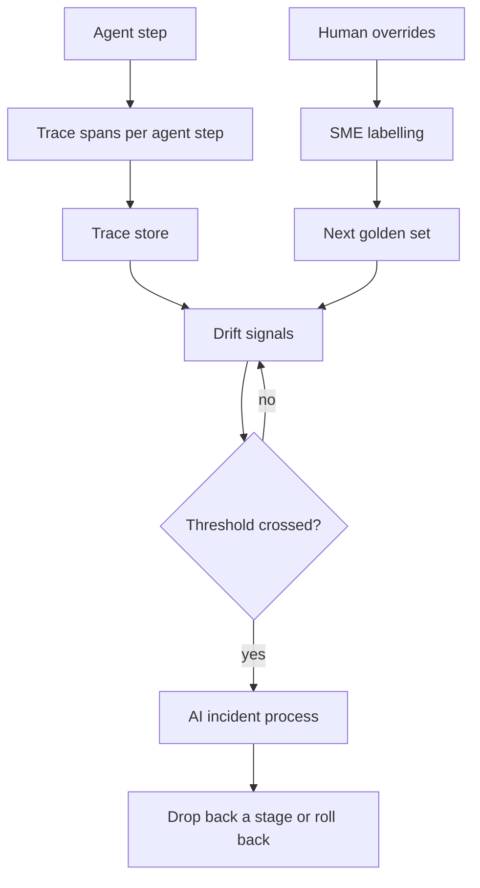

<!-- Writing rules: framework/style-guide.md. Name each component by its role and the Red Hat product used. Write no product support status. -->

# Quality operations and observability

## At a glance

| Field | Value |
|---|---|
| One-liner | Traces every agent step with OpenTelemetry, watches six drift signals that each have an owner and a threshold, sends AI incidents through your NOC and SOC process, and feeds human overrides into the next golden set. Depends on a tracing collector, a trace store, and an agent trace store. |
| Question answered | Quality operations: how do you notice when quality drops? |
| Audience | Platform teams, model owners, risk owners, operations engineers, and security |
| OTel slots | All six slots, LLM, Embedding, Reranker, Safety, Decision, and Classification |
| Placement tier | Far edge, regional, and core |
| Top 3 decisions | Decide what each span captures; give every drift signal an owner and a threshold; send AI incidents through the NOC and SOC process |
| Agent-school courses | 301, 302, and 304 in the [agent-school roadmap](https://github.com/open-experiments/agent-school/blob/main/docs/RoadMap.md) |

## The operator question

How do you notice that an agent's quality is dropping before an operations engineer or a customer does?
Until you answer it, drift in gate labels, abstentions, or human overrides goes unseen until a false ACT changes the network.

## Decisions you must make

| Decision | Options | Recommendation | Because |
|---|---|---|---|
| Decide what each span captures | Full prompts and tool results; metadata only; metadata by default with content capture as an opt-in | Metadata by default; capture prompts, tool arguments, and results only where the data protection officer opts in | The GenAI conventions make content capture opt-in, because prompts and tool results can hold subscriber and network data ([GenAI spans](https://github.com/open-telemetry/semantic-conventions-genai/blob/main/docs/gen-ai/gen-ai-spans.md)) |
| Decide where traces live and for how long | Vendor cloud service; trace store on site; trace store plus agent trace archival | A trace store on site for spans, and the agent trace store with archival to object storage; both keep data for named live and archive retention periods | Traces stay in region, and archived payloads stay searchable by metadata ([release notes](https://docs.redhat.com/en/documentation/red_hat_openshift_ai_self-managed/3.5/html/release_notes/new-features-and-enhancements_relnotes)) |
| Give every drift signal an owner and a threshold | Dashboards with no owner; one shared alert; one owner and one threshold per signal | One owner and one named threshold per signal, with no default | A signal nobody owns is a chart nobody reads |
| Send AI incidents through the NOC and SOC process | A separate AI incident process; the existing NOC and SOC process | The existing NOC and SOC process, with AI-specific triggers and first actions | Operators already run severity, paging, and regulatory reporting there, and an AI-caused outage is an incident like any other |
| Decide how feedback reaches golden sets | Ad hoc; every override straight into the set; SME labelling first | SME labelling and personal-data scrubbing before any trace enters a golden set | Unlabelled traces teach the evaluation the system's own mistakes |

## Reference design



### Trace each agent step

| Tool | What it does |
|---|---|
| Tracing collector | Receives spans over the OpenTelemetry protocol from agents, the MCP gateway, and the action layer, drops attributes outside the allow-list, and forwards the rest |
| Trace store | Holds spans on site and links each agent step to its tool calls by trace ID |
| Agent trace store | Records prompts, reasoning steps, tool calls, and token costs per episode, accepts spans at `/v1/traces`, and archives payloads to object storage after the live retention period |
| Replica-scheduler inference traces | Add the inference request to the same trace, so slow steps show up beside the agent step that waited |

One triage step produces this span tree under the GenAI semantic conventions:

```text
invoke_agent noc-triage-agent
  execute_tool list_alarms
  execute_tool classify_root_cause
  tools/call submit_action_request      # MCP span, compatible with execute_tool
```

By default, each span records IDs and the metadata attributes the signal table lists: the agent, tool, conversation, and call IDs, plus labels, probabilities, `policy_version`, the abstain outcome, and the error type. Prompts, tool arguments, and tool results are captured only as an opt-in that the data protection officer approves per use case. The conventions still change upstream; pin the version you emit and record it on the collector config.

### Drift signals

| Parameter | What it controls | Who sets it | How to calibrate |
|---|---|---|---|
| Abstention rate drift band | How far the Safety slot's abstention share may move from the accepted baseline per review period before review | Risk owner | Compare against the shadow-stage baseline on the same incident mix |
| Groundedness drift band | How far the share of grounded answers may fall from the accepted baseline before review | Model owner, with SME review | Score a sample of live answers with the judge used in acceptance, and compare against the shadow-stage baseline on the same incident mix |
| Gate label mix and false-ACT report threshold | How far the share of each gate label may move, and how many false-ACT reports per review period, before review | Risk owner | Compare the label mix against the shadow-stage baseline on the same incident mix, and treat any false-ACT report as evidence against the false-ACT budget |
| Human override rate drift band | How far the share of approver overrides may rise before review, below the override ceiling that drops a stage | Business owner | Count overrides per use case and action class, and compare against the shadow-stage baseline on the same incident mix |
| Tool error rate threshold | The share of failed tool calls per review period that opens a review | Platform team | Compare against the error rate of the same tools before the agent used them |
| Root-cause label distribution shift threshold | How far the Classification label mix may move from the accepted baseline before review | Model owner, with SME review | Compare the label mix against the shadow-stage baseline on the same incident mix, and check new alarm types with SMEs |
| Trace live retention period | How long spans and payloads stay searchable in the trace stores before payloads move to the archive | Data protection officer | Set from how far back incident reviews and drift checks need full traces |
| Trace archive retention period | How long archived prompts and tool payloads are kept before deletion | Data protection officer | Set from the retention period the applicable law and your audit needs require |

This page gives no default values. You set each parameter with SME review and version the set with the gate policy that `policy_version` names. The override ceiling that drops a use case back one stage belongs to [PB-06 Safety and autonomy gating](../safety-autonomy-gating/README.md). The live and archive retention periods together never end before the audit log retention period in [PB-10 Compliance, sovereignty, and operating model](../compliance-operating-model/README.md#staged-rollout-and-roi), which sets the floor for traces.

### Signal sources

| Signal | Span | Owner |
|---|---|---|
| Abstention rate | `invoke_agent`, with the Safety slot's abstain outcome as an attribute | Risk owner |
| Groundedness | `invoke_agent` and its retrieval spans, plus a sampled judge score | Model owner |
| Gate label mix and false-ACT reports | The gate decision span, with label, probabilities, and `policy_version`, plus false-ACT reports from approvers | Risk owner |
| Human override rate | The approver decision linked to the gate decision span | Business owner |
| Tool error rate | `execute_tool` and `tools/call`, with the error type | Platform team |
| Root-cause label distribution shift | `execute_tool classify_root_cause`, with the label as a metadata attribute | Model owner |

The [decision gate](../../architecture/decision-gate.md) sets the five labels LOOK, NOTIFY, REVIEW, ACT, and STOP. A drop in the share of LOOK and NOTIFY with a rise in ACT is the shift to watch.

### Incident response for the AI system

| Trigger | First action | Owner | Hand-off |
|---|---|---|---|
| A confirmed false ACT report | Drop the use case back one stage in the [stage register](../safety-autonomy-gating/README.md#staged-autonomy) and freeze promotions | Approver, with the risk owner accountable | NOC incident; the change board reviews the action that ran |
| A drift threshold crossed | Freeze promotions for the use case and review the signal with its owner; drop back one stage if the override ceiling is crossed | Signal owner | NOC incident at the severity your process sets |
| Prompt injection detected at the gateway | Block the session and open a SOC case. The use case keeps its stage, so planted text can't force autonomy down, as the [stage register](../safety-autonomy-gating/README.md#staged-autonomy) sets out | Security | SOC case |
| A model or adapter integrity alert, such as a digest mismatch | Roll back the slot revision as [PB-04 Serving, routing, and placement](../serving-routing-placement/README.md) describes | Platform team | SOC case and NOC incident |

If you are an EU provider, report an AI-caused incident that meets the NIS2 significance test like any other: an early warning within 24 hours, a notification within 72 hours, and a final report within one month ([NIS2 Directive](https://eur-lex.europa.eu/eli/dir/2022/2555/oj/eng)). Your existing NOC and SOC process files these reports, not a separate AI process.

### Feedback loop

1. Approvers record a reason with every override and rejection.
2. SMEs label those traces and scrub personal data, as the regression rules in [PB-02 Evaluation and acceptance](../evaluation-acceptance/README.md) require.
3. The labelled cases join the next golden-set release in PB-02, and every later candidate change is scored against them.
4. A gap that skills and retrieval can't close starts a climb in [PB-03 Adaptation](../adaptation/README.md).

### Worked example: alarm and root-cause triage

Rising CRC errors and BFD flaps on router r2 open incident `inc-2041`. The trace shows `invoke_agent noc-triage-agent`, then `execute_tool list_alarms` against TMF642 for r2, then `execute_tool classify_root_cause`, which labels an eth1 interface fault. The agent then calls `tools/call submit_action_request` with `req-0001` for `router.restart_interface`.

The gate decision span records `dec-0001` at REVIEW under `noc-gate-policy-3`. The `approver` accepts, so the trace adds the approver decision, the `pb-interface-restart` job, and the verification read of the eth1 counters on r2. The acceptance counts as a non-override in the override-rate signal, and the interface-fault label adds to the root-cause mix. Tool arguments and results stay out of the spans, because nobody opted in to capture them.

- Config artifact: span attribute allow-list, with the opt-ins the data protection officer approved
- Config artifact: drift parameter set, versioned with the gate policy
- Config artifact: incident runbook mapping each trigger to its first action and hand-off
- Config artifact: trace retention policy for spans and archived payloads

## Components

| Component role | Red Hat product used |
|---|---|
| Tracing collector: receives, filters, and forwards spans | Red Hat build of OpenTelemetry |
| Trace store: holds spans on site | Red Hat build of Tempo |
| Agent trace and evaluation store: records episodes and archives payloads | MLflow in Red Hat OpenShift AI |
| Dashboards: show drift signals and inference latency | Cluster Observability Operator with Perses |
| Incident tooling: opens NOC incidents and SOC cases | Operator ITSM, NOC, and SOC tools |

Any component can be replaced. The Red Hat products named here show one way to build this design.

## OTel slot guidance

| Slot | Candidate checkpoints | Notes |
|---|---|---|
| `llm` | OTel-2.0-LLM-31B-IT or a smaller OTel LLM, pinned by revision | Watch groundedness on a sampled share of live answers |
| `embedding` | OTel-Embedding models, pinned by revision | Watch groundedness; a drop after a reindex points at retrieval |
| `reranker` | OTel-Reranker-0.6B or OTel-Reranker-4B, pinned by revision | Watch groundedness alongside the embedding slot |
| `safety` | OTel-LLM-12B-Safety, pinned by revision | Watch the abstention rate in both directions |
| `decision` | OTel-2.0-Decision-26B-A4B-4bit, pinned by revision | Watch the gate label mix, false-ACT reports, and the human override rate |
| `classification` | OTel-LLM-8.3B-Classification, pinned by revision | Watch root-cause label distribution shift against your alarm taxonomy |

## Sources and acceptance

Each key claim links its source, as set out in [the Sources table](../../framework/definitions.md#sources-table).

| # | Claim | Basis | Source |
|---|---|---|---|
| 1 | The GenAI semantic conventions live in their own repository and still change upstream | project documentation | [semantic-conventions-genai](https://github.com/open-telemetry/semantic-conventions-genai) |
| 2 | An agent invocation span uses the `invoke_agent` operation name | project documentation | [Invoke agent spans](https://github.com/open-telemetry/semantic-conventions-genai/blob/main/docs/gen-ai/client-invoke-agent.md) |
| 3 | A tool span is named `execute_tool` plus the tool name, and tool arguments and results are opt-in | project documentation | [Execute tool spans](https://github.com/open-telemetry/semantic-conventions-genai/blob/main/docs/gen-ai/execute-tool.md) |
| 4 | MCP spans are named by method and target and are compatible with tool spans | project documentation | [MCP conventions](https://github.com/open-telemetry/semantic-conventions-genai/blob/main/docs/gen-ai/mcp.md) |
| 5 | Capturing prompts, completions, and retrieval content needs an explicit opt-in | project documentation | [GenAI spans](https://github.com/open-telemetry/semantic-conventions-genai/blob/main/docs/gen-ai/gen-ai-spans.md) |
| 6 | With tracing on, OpenShift AI deploys the Red Hat build of Tempo and the Red Hat build of OpenTelemetry collector | Red Hat guidance | [OpenShift AI observability guide](https://docs.redhat.com/en/documentation/red_hat_openshift_ai_self-managed/3.5/html/managing_openshift_ai/managing-observability_managing-rhoai) |
| 7 | MLflow trace payloads move to object storage after a retention period, and metadata stays searchable | Red Hat guidance | [OpenShift AI release notes](https://docs.redhat.com/en/documentation/red_hat_openshift_ai_self-managed/3.5/html/release_notes/new-features-and-enhancements_relnotes) |
| 8 | MLflow tracing records prompts, reasoning steps, tool calls, and token costs | Red Hat guidance | [How AI observability works with MLflow](https://developers.redhat.com/articles/2026/08/26/how-ai-observability-works-mlflow) |
| 9 | MLflow accepts OpenTelemetry protocol traces at `/v1/traces` | project documentation | [MLflow OpenTelemetry docs](https://mlflow.org/docs/latest/genai/tracing/opentelemetry/) |
| 10 | Agentic workflows with MCP servers can be traced end to end with the Red Hat build of OpenTelemetry | Red Hat guidance | [Distributed tracing for agentic workflows](https://developers.redhat.com/articles/2026/04/06/distributed-tracing-agentic-workflows-opentelemetry) |
| 11 | NIS2 sets early warning, notification, and final report deadlines for significant incidents | project documentation | [NIS2 Directive](https://eur-lex.europa.eu/eli/dir/2022/2555/oj/eng) |

- Gate: every agent step emits a span that links to its tool calls and gate decision.
- Gate: every drift signal has a named owner and a threshold in the drift parameter set.
- Gate: content capture stays off unless the data protection officer approves it for the use case.
- Gate: every incident trigger maps to a first action and a NOC or SOC hand-off in the runbook.
- Gate: no live trace enters a golden set without SME labelling and personal-data scrubbing.

## Operating model

| Activity | Responsible | Accountable | Consulted | Informed |
|---|---|---|---|---|
| Set drift thresholds | Model owner | Risk owner | SME | Business owner |
| Approve content capture | Platform team | Data protection officer | Security | Risk owner |
| Run the trace pipeline and retention | Platform team | Data protection officer | Security | Model owner |
| Respond to an AI incident | Operations engineer | Risk owner | Security | Change board |
| Label overrides for the golden set | SME | Model owner | Approver | Risk owner |

## Risks and limitations

| Risk | Likelihood | Mitigation |
|---|---|---|
| Personal data lands in traces | High with content capture on | Keep capture off by default, enforce the attribute allow-list at the collector, and set a retention period |
| The GenAI conventions change and break dashboards | Medium | Pin the convention version you emit and re-test dashboards when you move it |
| Too many alerts and nobody reacts | Medium | Give each signal one owner, set its threshold from the baseline, and review alerts once per review period |
| A signal has no owner | Medium without the gate | Block promotion until every signal in the drift parameter set has an owner |
| The baseline goes stale after a model change | Medium | Reset the baseline from the shadow stage after every promotion |

## Used by and next steps

- [PB-02 Evaluation and acceptance](../evaluation-acceptance/README.md): labelled overrides become the next golden set
- [PB-03 Adaptation](../adaptation/README.md): drift that skills and retrieval can't fix starts a new climb
- [PB-06 Safety and autonomy gating](../safety-autonomy-gating/README.md): a confirmed false ACT or an override rate that crosses the ceiling drops a use case back one stage
- [PB-07 Action layer](../action-layer/README.md): action jobs and rollbacks appear in the same trace
- [PB-04 Serving, routing, and placement](../serving-routing-placement/README.md): slot rollback on an integrity alert
- [Decision gate](../../architecture/decision-gate.md): the labels behind the gate label mix
- [PB-10 Compliance, sovereignty, and operating model](../compliance-operating-model/README.md): compliance maps traces and incident records to regulatory duties
- Use cases: this page supports [UC-KNOW-01 Grounded knowledge assistant](../../catalog/standards-knowledge/grounded-knowledge-assistant/README.md), [UC-AGOPS-01 Governed closed-loop incident handling](../../catalog/agentic-operations/closed-loop-incident-handling/README.md), and [UC-CARE-01 CAMARA customer-care diagnostics](../../catalog/business-assurance/camara-care-diagnostics/README.md)
- Agent-school: courses 301, 302, and 304 in the [agent-school roadmap](https://github.com/open-experiments/agent-school/blob/main/docs/RoadMap.md); 301 adds an approval gate, 302 adds a judge suite, and 304 covers agent security operations
