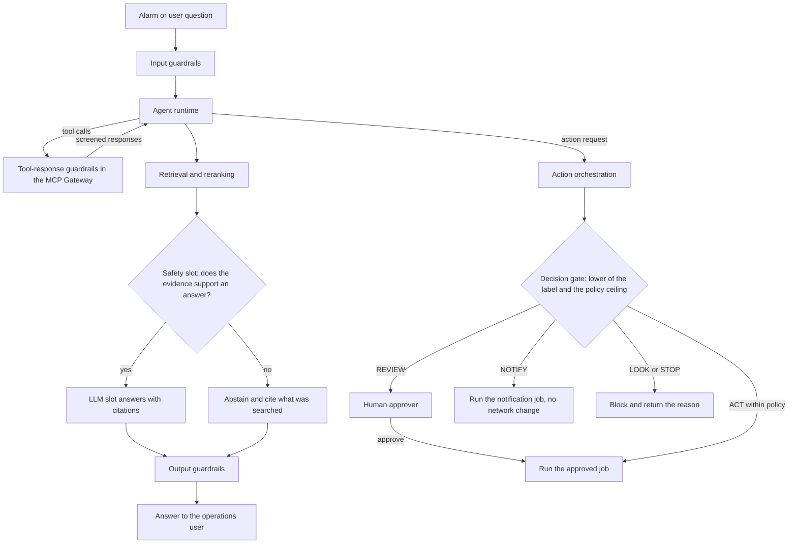

<!-- Writing rules: framework/style-guide.md. Name each component by its role and the Red Hat product used. Write no product support status. -->

# Safety and autonomy gating

## At a glance

| Field | Value |
|---|---|
| One-liner | Screens every input, tool response, and answer, grounds answers in evidence, and gates every change by autonomy stage. Depends on guardrails, the Safety and Decision slots, and an orchestrator that applies the policy ceiling. |
| Question answered | Autonomy gating: what may the agent do without a human? |
| Audience | Platform teams, security architects, and risk owners |
| OTel slots | Safety, Decision, and LLM |
| Placement tier | Far edge, regional, and core |
| Top 3 decisions | Place every control where its risk enters; set a stage per use case and action class; promote a stage only on evidence |
| Agent-school courses | 201, 301, and 304 in the [agent-school roadmap](https://github.com/open-experiments/agent-school/blob/main/docs/RoadMap.md) |

## The operator question

What may the agent do without a human, and what evidence lets you raise that limit?
Until you answer it, teams disagree on what the agent may do alone, and nobody can show the evidence for letting it do more.

## Decisions you must make

| Decision | Options | Recommendation | Because |
|---|---|---|---|
| Place every control where its risk enters | Guardrails at the gateway only; a control on each path | Input guardrails, tool-response guardrails, the Safety slot, the Decision gate, and output guardrails, each on its own path | Each path carries its own risk. The gateway screens tool traffic that input guardrails never see ([MCP gateway announcement](https://www.redhat.com/en/blog/model-context-protocol-gateway-red-hat-openshift-now-generally-available)) |
| Set a stage per use case and action class | One stage for the whole system; one stage per use case and action class | One stage per use case and action class, kept in a stage register | TM Forum applies autonomy levels to selected scenarios, not whole networks ([TM Forum Autonomous Networks whitepaper](https://www.tmforum.org/wp-content/uploads/2019/05/22553-Autonomous-Networks-whitepaper.pdf)) |
| Promote a stage only on evidence | The platform team decides; the risk owner decides on evidence | The risk owner approves each promotion, with the promotion parameters met and subject-matter expert (SME) review | The Decision model card advises keeping human review for consequential decisions ([Decision model card](https://huggingface.co/farbodtavakkoli/OTel-2.0-Decision-26B-A4B-4bit)) |
| Tune the Safety slot before use | Use it as shipped; measure abstention on your own set | Measure correct abstention and answer quality on an operator set before the slot fronts answers | The model card says it may over-abstain or under-abstain, so tune and measure before production use ([Safety model card](https://huggingface.co/farbodtavakkoli/OTel-LLM-12B-Safety)) |
| Treat Decision probabilities as uncalibrated until you calibrate them | Trust them as shipped; calibrate on an operator gate set | Keep REVIEW ceilings until the probabilities are calibrated on an operator gate set | The model card says not to assume the label probabilities are calibrated ([Decision model card](https://huggingface.co/farbodtavakkoli/OTel-2.0-Decision-26B-A4B-4bit)) |

## Reference design

One triage episode passes these controls in order:

1. Input guardrails screen the alarm text and any user question for jailbreaks, personal data, and off-topic requests before the agent sees them.
2. The agent calls read tools through the MCP Gateway. Tool-response guardrails screen each response for injected instructions and leaks, and fail closed.
3. Retrieval and reranking pick passages from runbooks and past tickets.
4. The Safety slot checks whether the passages support an answer. If they don't, the agent abstains and cites what it searched.
5. To change anything, the agent submits an action request. Its own gate label is advisory.
6. Action orchestration runs the Decision gate again and applies the lower of the model label and the policy ceiling for the risk class.
7. REVIEW goes to a human approver, ACT runs an approved playbook, NOTIFY runs a notification job, and LOOK and STOP block the step.
8. Output guardrails screen the final answer before it reaches the operations user.

### Where each control sits

| Control | Position | Role |
|---|---|---|
| Input guardrails | Before the agent | Screen user and alarm text for jailbreaks, personal data, and off-topic requests |
| Tool-response guardrails | In the MCP Gateway | Screen each `tools/call` request and response for injected instructions and leaks, and fail closed |
| Safety slot | After retrieval and reranking, before the answer | Answer only from the passages, and abstain when they don't support an answer |
| Decision gate | Before any state change: advisory in the agent, authoritative in action orchestration | Label each action request LOOK, NOTIFY, REVIEW, ACT, or STOP, with label probabilities |
| Output guardrails | Before the answer reaches the user | Screen the final answer before anyone sees it |

### Staged autonomy

| Stage | Autonomy ceiling | Gate outcomes allowed | Who does what | TM Forum target |
|---|---|---|---|---|
| Shadow | inform | LOOK only, logged to compare with what people did | People do everything; the system runs beside them | None: the scenario stays at its current level |
| Assist | notify | LOOK and NOTIFY | The system runs triage and sends notes and alerts, sharing routine execution; people analyse, decide, and change the network | Level 1: assisted operation and maintenance |
| Recommend | recommend-with-approval | LOOK, NOTIFY, and REVIEW | The system analyses and proposes each change; people approve each step; the action layer executes | Level 2: partial autonomous network |
| Act | act-within-policy, for low-risk classes only | ACT for approved playbooks in low-risk classes; REVIEW for every other class | The system decides and executes within policy; people own the policy and every other class | Level 3: conditional autonomous network |

TM Forum applies levels to scenarios, not whole networks, so each use case and action class gets its own stage. Each level here is a target, never a claim, as the [definitions](../../framework/definitions.md#autonomy-ceiling) page sets out. Level 4 and higher, where the system decides across domains and shares intent, is a later target beyond these blueprints.

### Gate rules

The outcome is the lower of the model label and the policy ceiling for the capability and risk class, so it never exceeds either. A STOP label forces STOP at every stage. The gate call in action orchestration is authoritative and the agent's label is advisory, so a prompt-injected agent can't skip the gate. The [policy table](../../architecture/decision-gate.md#policy-table) on the decision gate page says who acts and what runs for each label.

NOTIFY works two ways. From the assist stage up, an agent may hold direct notify tools, such as an operations-channel message or a ticket comment, through the MCP Gateway; the shadow stage gets no notify role. An action request that the gate labels NOTIFY becomes a notification job that the action layer runs. For direct notify tools, the gateway's tool-role mapping enforces the stage, not the gate.

### Promotion thresholds

| Parameter | What it controls | Who sets it | How to calibrate |
|---|---|---|---|
| Shadow agreement floor | How often shadow outcomes must match what people did before a use case moves to assist | Risk owner, with SME review | [Evaluation and acceptance method](../evaluation-acceptance/README.md): compare shadow outcomes with logged human actions over a window the risk owner sets |
| Safety abstain-recall floor | The lowest share of insufficient-context items on which the Safety slot must abstain | Risk owner, with SME review | [Evaluation and acceptance method](../evaluation-acceptance/README.md): score abstention on an operator set that includes items with no supporting evidence |
| Canary window | How long, and over how many requests, a raised ceiling runs on a small share of traffic | Risk owner | [Evaluation and acceptance method](../evaluation-acceptance/README.md): size the window to hold enough state-changing requests to bound the false-ACT rate |
| Minimum ACT probability for the act stage | The lowest calibrated ACT probability at which the act stage may run a playbook alone | Risk owner, with SME review | Evaluation and acceptance calibration: fit on an operator gate set labelled by SMEs, and check calibration error |
| Override rate ceiling | The share of human overrides that sends a use case back one stage | Business owner | [Evaluation and acceptance method](../evaluation-acceptance/README.md): count overrides per use case and action class in the trace |

This page gives no default values. You set each parameter with SME review and version it with the policy ceilings.

### Worked example: alarm and root-cause triage

Rising CRC errors and BFD flaps on router r2 open incident `inc-2041`. The stage register puts triage notes at the assist stage, with a ceiling of notify. The agent reads the alarms and counters through the gateway, Classification labels the likely cause, and the Safety slot checks that the evidence supports the finding. The agent submits its triage note as an action request. The gate labels it NOTIFY, and the action layer runs a notification job that posts the note to the ticket.

The agent then proposes restarting eth1 on r2. Interface restarts are a `write_low` action class at the recommend stage, so the ceiling is REVIEW. Even when the Decision label says ACT, the outcome is REVIEW. The approver signs off, and the action layer runs the restart, verifies it, and writes the audit record, as `req-0001` on the [decision gate](../../architecture/decision-gate.md) page shows.

- Config artifact: guardrail rail configuration in Colang for the input, tool-response, and output rails
- Config artifact: stage register with the stage for each use case and action class, and the evidence and sign-off behind each promotion
- Config artifact: policy ceilings file for each capability and risk class, named by `policy_version`

## Components

| Component role | Red Hat product used |
|---|---|
| Input and output guardrails: screen user text, alarm text, and answers | NeMo Guardrails in Red Hat OpenShift AI |
| Tool-response guardrails: screen tool requests and responses | MCP gateway in Red Hat Connectivity Link, with NeMo Guardrails |
| Grounding and abstention: answer only from passages, abstain on weak evidence | OTel Safety slot on Red Hat AI Inference (vLLM) |
| Gate model: label each action request with label probabilities | OTel Decision slot on Red Hat AI Inference (vLLM), with log probabilities turned on |
| Authoritative gate: apply the policy ceiling, route REVIEW, run approved jobs | Red Hat Ansible Automation Platform with Automation Orchestrator |

Any component can be replaced. The Red Hat products named here show one way to build this design.

## OTel slot guidance

| Slot | Candidate checkpoints | Notes |
|---|---|---|
| `safety` | OTel-LLM-12B-Safety or OTel-LLM-8.3B-Safety, pinned by revision | May over-abstain or under-abstain, so measure correct abstention and answer quality on your own sets before use |
| `decision` | OTel-2.0-Decision-26B-A4B-4bit, pinned by revision | Labels LOOK, NOTIFY, REVIEW, ACT, or STOP with probabilities. Check that the label mass sums to 1, and calibrate before any ACT ceiling |
| `llm` | OTel-2.0-LLM-31B-IT or a smaller OTel LLM as the agent, pinned by revision | Answers only from passages that passed the Safety slot. Its own gate label is advisory |

## Sources and acceptance

Each key claim links its source, as set out in [the Sources table](../../framework/definitions.md#sources-table).

| # | Claim | Basis | Source |
|---|---|---|---|
| 1 | TM Forum defines autonomy levels from Level 0 to Level 5 and applies them to selected scenarios | project documentation | [TM Forum Autonomous Networks whitepaper](https://www.tmforum.org/wp-content/uploads/2019/05/22553-Autonomous-Networks-whitepaper.pdf) |
| 2 | At Level 1 people and system share execution; at Level 2 the system executes and shares awareness; at Level 3 the system also shares analysis and decision | project documentation | [TM Forum Autonomous Networks whitepaper](https://www.tmforum.org/wp-content/uploads/2019/05/22553-Autonomous-Networks-whitepaper.pdf) |
| 3 | The Safety model may over-abstain or under-abstain, so tune and measure it before production use | model card | [OTel-LLM-12B-Safety model card](https://huggingface.co/farbodtavakkoli/OTel-LLM-12B-Safety) |
| 4 | Don't assume the Decision label probabilities are calibrated, and keep human review for consequential decisions | model card | [OTel-2.0-Decision-26B-A4B-4bit model card](https://huggingface.co/farbodtavakkoli/OTel-2.0-Decision-26B-A4B-4bit) |
| 5 | Red Hat recommends NeMo Guardrails as the guardrails framework in OpenShift AI | Red Hat guidance | [OpenShift AI release notes](https://docs.redhat.com/en/documentation/red_hat_openshift_ai_self-managed/3.5/html/release_notes/support-removals_relnotes) |
| 6 | NeMo Guardrails runs on OpenShift AI and screens input and output with configurable rails | Red Hat guidance | [Deploy NeMo Guardrails on OpenShift AI](https://developers.redhat.com/articles/2026/09/09/deploy-nemo-guardrails-on-red-hat-openshift-ai) |
| 7 | The MCP gateway screens tool requests and responses with NeMo guardrails | Red Hat guidance | [MCP gateway announcement](https://www.redhat.com/en/blog/model-context-protocol-gateway-red-hat-openshift-now-generally-available) |
| 8 | An Automation Orchestrator workflow can call a REST service as a step and branch on the result | Red Hat guidance | [Automation Orchestrator REST API step](https://docs.redhat.com/en/documentation/automation_orchestrator/2026.8/develop-add_a_rest_api_step_to_a_workflow) |

- Gate: the shadow agreement floor is met before a use case moves from shadow to assist.
- Gate: the Safety abstain-recall floor is met on insufficient-context items before the Safety slot fronts answers.
- Gate: no false ACT label appears during the canary window before any ceiling rises.
- Gate: the red-team suite ([PB-02](../evaluation-acceptance/README.md)) includes guardrail tests for jailbreaks, personal data, and prompt injection through alarm, ticket, and tool text, and every test is blocked.
- Gate: a test request with a STOP label ends as STOP, and a `write_low` request labelled ACT under a REVIEW ceiling ends as REVIEW.
- Gate: every stage change has a signed entry in the stage register.

## Operating model

| Activity | Responsible | Accountable | Consulted | Informed |
|---|---|---|---|---|
| Promote a use case to the next stage | Approver | Risk owner | SME | Platform team |
| Drop a use case back a stage | Approver | Risk owner | Platform team | Security |
| Change a policy ceiling | Operations engineer | Risk owner | Change board and SME | Business owner |
| Change guardrail rails | Security | Platform team | Business owner | Risk owner |
| Tune Safety slot abstention | Platform team | Model owner | SME | Business owner |

## Risks and limitations

| Risk | Likelihood | Mitigation |
|---|---|---|
| Over-abstention hides answers people need | Medium | Track the abstention rate per use case, review abstained items with SMEs, and re-tune against the Safety abstain-recall floor |
| Under-abstention lets the agent answer from weak evidence | Medium | Gate on the Safety abstain-recall floor, cite passages in every answer, and keep people deciding at the assist and recommend stages |
| Uncalibrated probabilities let a wrong ACT through | High until you calibrate | Calibrate on an operator gate set, keep REVIEW ceilings until then, and run the canary with no false ACT |
| A use case gains autonomy without evidence | Medium | Promote only through the stage register, with the promotion parameters met and the risk owner's sign-off |
| Alarm, ticket, or tool text carries a prompt injection | Medium | Input and tool-response guardrails fail closed, the agent holds no write credentials, and the orchestrator runs the gate again |

## Used by and next steps

- [PB-04 Serving, routing, and placement](../serving-routing-placement/README.md): serves the Safety and Decision slots this page gates with
- [PB-05 Integration](../integration/README.md): the MCP Gateway and the tool-response guardrails this page places
- [Decision gate](../../architecture/decision-gate.md): the label policy and gate thresholds this page builds on
- [Architecture overview](../../architecture/index.md): the grounded answer and investigate-then-act flows these controls guard
- [PB-07 Action layer](../action-layer/README.md): the action layer runs each gate outcome
- [PB-02 Evaluation and acceptance](../evaluation-acceptance/README.md): supplies the evidence behind each promotion
- [PB-08 Security, identity, and sandbox](../security-identity-sandbox/README.md): covers prompt injection and workload identity in depth
- [PB-09 Quality operations and observability](../quality-operations/README.md): quality operations tracks abstention rate, gate labels, and human overrides
- Agent-school: courses 201, 301, and 304 in the [agent-school roadmap](https://github.com/open-experiments/agent-school/blob/main/docs/RoadMap.md); 301 adds an approval gate and 304 covers agent security operations
