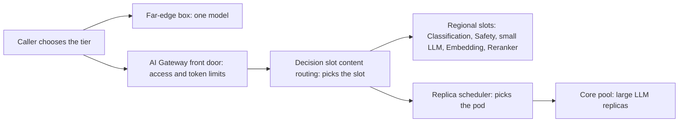

<!-- Writing rules: framework/style-guide.md. Name each component by its role and the Red Hat product used. Write no product support status. -->

# Serving, routing, and placement

## At a glance

| Field | Value |
|---|---|
| One-liner | Sizes, serves, routes, and places every OTel slot from the far edge to the core. Depends on a front door, the Decision slot for content routing, and a replica scheduler. |
| Question answered | Serving and placement: where and how does each slot run? |
| Audience | Platform teams and architects |
| OTel slots | All six slots, LLM, Embedding, Reranker, Safety, Decision, and Classification |
| Placement tier | Far edge, regional, and core |
| Top 3 decisions | Pick a hardware class and precision for each slot; keep the front door, content routing, and replica scheduling separate; pick a serving option for each tier |
| Agent-school courses | 104 and 203 in the [agent-school roadmap](https://github.com/open-experiments/agent-school/blob/main/docs/RoadMap.md) |

## The operator question

Where and how does each OTel slot run: on what hardware, at what precision, on which tier, and behind which routing?
Until you answer it, slots get sized by guesswork, and the gateway, the app, and the scheduler each make routing choices that belong to another layer.

## Decisions you must make

| Decision | Options | Recommendation | Because |
|---|---|---|---|
| Pick a hardware class and precision for each slot | Full precision (bf16); FP8; W4A16 | bf16 for the large LLM at the core; FP8 for the large LLM at a regional site; W4A16 for the Decision slot | The 31B needs about 62.6 GB in bf16 ([model card](https://huggingface.co/farbodtavakkoli/OTel-2.0-LLM-31B-IT)), and the Decision model ships only as W4A16 ([model card](https://huggingface.co/farbodtavakkoli/OTel-2.0-Decision-26B-A4B-4bit)) |
| Keep the front door, content routing, and replica scheduling separate | One component does all three; three layers | Three layers: the front door decides access and tokens, the app calling the Decision slot picks the slot, and the replica scheduler picks the pod | The front door has no content-aware routing, and the replica scheduler works inside one model's pool ([OpenShift AI release notes](https://docs.redhat.com/en/documentation/red_hat_openshift_ai_self-managed/3.5/html/release_notes/new-features-and-enhancements_relnotes)) |
| Pick a serving option for each tier | Replica scheduler; one KServe service per slot; one model per box | Replica scheduler for generative slots at the core; one KServe service per slot at a regional site; one model per box at the far edge | Each tier has different limits; see [Edge options and limits](#edge-options-and-limits) |
| Set priority between interactive and batch traffic | One queue; priority bands | Priority bands, with interactive triage ahead of batch evaluation and data generation | Batch jobs on the same pool must never starve NOC traffic ([OpenShift AI release notes](https://docs.redhat.com/en/documentation/red_hat_openshift_ai_self-managed/3.5/html/release_notes/new-features-and-enhancements_relnotes)) |
| Add a semantic router in front of the replica scheduler | Decision slot only; semantic router as well | Decision slot only; try a semantic router in a pilot, as agent-school 203 does | A semantic router's classifiers need telecom tuning, and the Decision slot already returns label probabilities you can threshold |

## Reference design



1. The caller picks the tier: a far-edge box, the regional site, or the core. None of the routing layers below makes this choice.
2. The front door checks the caller's API key against a subscription, applies that team's token limit, and routes on the `model` field in the request body.
3. The app asks the Decision slot about the request and reads its label probabilities. It compares them with your thresholds and picks the slot: a small LLM, the large LLM, the abstain path, or STOP.
4. For a generative slot at the core, the replica scheduler picks the pod by prefix-cache hits, KV cache use, and queue depth, and serves interactive traffic before batch.
5. The chosen slot answers. The app records the slot, the model revision, and the Decision probabilities with the request.

### Three routing layers

| Layer | Decides | Signals | Product used |
|---|---|---|---|
| Front door | Who may call which model name, and how many tokens | API key mapped to a subscription, OIDC groups, the `model` field in the body, per-model token limits | Models-as-a-Service in Red Hat OpenShift AI (needs PostgreSQL) |
| Content routing | Which slot handles the request: small LLM, large LLM, abstain path, or STOP | Decision label probabilities against your thresholds; an explicit caller override | Your app or agent runtime calling the OTel Decision slot |
| Replica scheduling | Which pod of the chosen model's pool serves it | Prefix-cache hits, KV cache use, queue depth; priority bands set in an `InferenceObjective`; a weighted canary for a new revision | Distributed Inference with llm-d in Red Hat OpenShift AI, for generative slots at the core |

None of these layers picks the tier. llm-d schedules within one cluster, so the caller, or multi-cluster DNS policy, picks far edge, regional, or core, as the [placement tiers](../../architecture/placement.md) page sets out.

### Sizing by hardware class

The figures cover weights only. The KV cache comes on top, so leave headroom for your context length and concurrency.

<!-- generated:sizing start -->

| Slot | Precision | Weights | Hardware class |
|---|---|---|---|
| LLM 31B | bf16 | about 62.6 GB | Single large GPU with about 141 GB or more, or a Multi-GPU core node with two GPUs of about 80 GB in tensor parallel |
| LLM 31B, operator-made build | FP8 W8A8 | about 33 GB | Single large GPU (about 80 GB or more); Small edge GPU at the 48 GB end, with less room for KV cache |
| Small LLM 4B | bf16 or FP8 | about 8 GB in bf16, about 4 GB in FP8 | Small edge GPU, or a slice of a Single large GPU |
| Decision 26B-A4B | W4A16 | about 17 GB | Small edge GPU (about 24 to 48 GB), tight at 24 GB; Single large GPU for high concurrency |
| Safety 12B | bf16 | about 24 GB | Small edge GPU at the 48 GB end, or Single large GPU |
| Safety 8.3B | bf16 or FP8 | about 17 GB in bf16, about 8.5 GB in FP8 | Small edge GPU (about 24 to 48 GB) |
| Classification 8.3B | bf16 or FP8 | about 17 GB in bf16, about 8.5 GB in FP8 | Small edge GPU (about 24 to 48 GB) |
| Embedding and Reranker, 0.6B to 8B | bf16 | about 1.2 to 16 GB | Small edge GPU, or a slice of a Single large GPU |
| Small Embedding models up to 335M | bf16 or fp32 | under 1.5 GB | CPU |

<!-- generated:sizing end -->

Safety, Classification, and small LLM figures assume about 2 bytes per parameter in bf16 and about 1 byte in FP8. No OTel FP8 builds are published, so operators make them; the 31B FP8 figure comes from the FP8 build of its base model. On Ampere, use W4A16 builds instead, as the hardware prerequisites say. Fit estimates count the small LLM as the 4B model, OTel-LLM-4B-IT.

### Edge options and limits

| Option | Tier | Limits | Source |
|---|---|---|---|
| RHEL with Podman running Red Hat AI Inference | Far edge | One container per model; no Kubernetes API, front door, or replica scheduler on the box | [Red Hat AI Inference release notes](https://docs.redhat.com/en/documentation/red_hat_ai_inference/3.5/html/release_notes/rhaii-350-ga-release-notes_release-notes) |
| Red Hat Device Edge (MicroShift) with KServe | Far edge | Runs only one AI model per deployment; `x86_64` only; ModelCar images only; raw deployment | [MicroShift AI models](https://docs.redhat.com/en/documentation/red_hat_build_of_microshift/4.22/html/using_ai_models/microshift-rh-openshift-ai) |
| Single-node OpenShift with Red Hat OpenShift AI | Regional | The node needs at least 32 CPU cores and 128 GiB of RAM; run one KServe service per slot | [OpenShift AI install](https://docs.redhat.com/en/documentation/red_hat_openshift_ai_self-managed/3.5/html/installing_and_uninstalling_openshift_ai_self-managed/installing-and-deploying-openshift-ai_install) |
| Distributed Inference with llm-d | Core | Multi-node OpenShift 4.20 or later; an `amd64` node for the tokenizer; schedules within one cluster | [llm-d components](https://access.redhat.com/articles/7136620) |

### Hardware prerequisites

These failures are silent: the endpoint answers, but the output or the build is wrong.

| Hardware or build | Prerequisite | Source |
|---|---|---|
| AMD MI350-class GPUs (gfx950) serving the 31B | Set `VLLM_ROCM_USE_AITER=0`, or the model can return malformed text while still answering HTTP 200. `VLLM_ROCM_USE_AITER_MOE=0` is no substitute | [31B model card](https://huggingface.co/farbodtavakkoli/OTel-2.0-LLM-31B-IT) |
| NVIDIA Blackwell (compute capability 10.0 and newer) | No INT8 W8A8 kernels; use FP8 or NVFP4 instead | [vLLM INT8 W8A8](https://docs.vllm.ai/en/latest/features/quantization/llm_compressor/int8_w8a8/) |
| NVIDIA Ampere | No FP8 W8A8; use W8A16 or W4A16 instead | [vLLM quantization](https://docs.vllm.ai/en/stable/features/quantization/) |
| Decision slot (Gemma 4 MoE) on ROCm with the Red Hat AI Inference build of vLLM 0.24 | Add `--moe-backend triton` | [Red Hat AI Inference release notes](https://docs.redhat.com/en/documentation/red_hat_ai_inference/3.5/html/release_notes/rhaii-350-ga-release-notes_release-notes) |
| Gemma 4 with image input on H100 or H200 with the Red Hat AI Inference build of vLLM 0.24 | Add `--attention-backend TRITON_ATTN`; text-only serving avoids the issue | [Red Hat AI Inference release notes](https://docs.redhat.com/en/documentation/red_hat_ai_inference/3.5/html/release_notes/rhaii-350-ga-release-notes_release-notes) |
| Decision slot engine | vLLM 0.26 or later on CUDA, or 0.30 or later on ROCm | [Decision model card](https://huggingface.co/farbodtavakkoli/OTel-2.0-Decision-26B-A4B-4bit) |
| Decision MoE kernels | Results are not bit-deterministic; expect small run-to-run variation on low-margin cases and keep thresholds clear of it | [Decision model card](https://huggingface.co/farbodtavakkoli/OTel-2.0-Decision-26B-A4B-4bit) |
| Any 31B deployment | Ask the model to identify itself after deploy; it should answer as OTel 2.0, because HTTP 200 alone does not show the deployment is correct | [31B model card](https://huggingface.co/farbodtavakkoli/OTel-2.0-LLM-31B-IT) |

### Key flags per slot

<!-- generated:flags-per-slot start -->

```text
# LLM 31B (pin the revision; text-only; tool calling)
--revision <sha> --enable-auto-tool-choice --tool-call-parser gemma4 \
--limit-mm-per-prompt '{"image": 0, "audio": 0}'
# Decision (card recipe)
--revision <sha> --max-logprobs 64 --enable-prefix-caching --max-model-len 16384
# Classification (Gemma3TextForSequenceClassification) and Reranker (num_labels=1)
--runner pooling --convert classify        # endpoints /classify, /v1/score, /rerank
# Embedding
--runner pooling --convert embed           # endpoint /v1/embeddings
# Static LoRA only (never runtime hot-load)
--enable-lora --lora-modules <name>=<path> --max-loras <n> --max-lora-rank <r>
```

<!-- generated:flags-per-slot end -->

Load adapters only at start, pinned by digest. Never enable runtime adapter loading: block `VLLM_ALLOW_RUNTIME_LORA_UPDATING` by policy, as the [LoRA backdoor article](https://developers.redhat.com/articles/2026/09/02/lora-backdoor-threat-how-openshift-ai-mitigates-risk) recommends.

### Setup profiles

Each setup is a hardware profile that a site can size its slots against; memory per GPU is the smallest card the setup allows.

<!-- vale Google.OxfordComma = NO -->
<!-- generated:setups start -->

| Setup | Tier | GPUs per node | Memory per GPU | Notes |
|---|---|---|---|---|
| Regional site, one 48 GB GPU (Ada or newer) | Regional | 1 | 48 GB | 48 GB PCIe data-center GPU, Ada or newer; Ampere cards use W4A16 instead of FP8 |
| Regional site, one 96 GB GPU | Regional | 1 | 96 GB | 96 GB PCIe data-center GPU, Blackwell |
| Regional site, two 48 GB GPUs | Regional | 2 | 48 GB | 48 GB PCIe data-center GPU, Ada or newer; Ampere cards use W4A16 instead of FP8 |
| Core pool, NVIDIA H200 or B200 | Core | 8 | 141 GB | H200 (141 GB) or B200; sized at the H200 |
| Core pool, AMD MI300X | Core | 8 | 192 GB | MI300X (192 GB) |

<!-- generated:setups end -->

### Key settings per setup

These settings come on top of the key flags per slot; values in angle brackets are yours to set, with no default.

<!-- generated:setup-flags start -->

| Setup | Setting | Value | Why |
|---|---|---|---|
| Regional site, one 48 GB GPU (Ada or newer) | Model build | FP8 W8A8, made by the operator (W4A16 on Ampere) | No OTel FP8 build is published, so build one from the pinned checkpoint, register it, and pin it by digest; FP8 halves the bf16 weights, so several slots share one 48 GB GPU. |
| Regional site, one 48 GB GPU (Ada or newer) | `--max-model-len` | `<your longest prompt plus answer>` | Caps the KV cache each request can take, so the slots sharing one 48 GB GPU keep their room. |
| Regional site, one 48 GB GPU (Ada or newer) | `--gpu-memory-utilization` | `<share for this slot>` | Gives each slot's vLLM instance a fixed share of GPU memory; the shares of all slots on one GPU sum to less than 1. |
| Regional site, one 96 GB GPU | Model build | FP8 W8A8 for the 31B, made by the operator | The 31B in FP8 needs about 33 GB, which leaves room on 96 GB for the other regional slots. |
| Regional site, one 96 GB GPU | `--gpu-memory-utilization` | `<share for this slot>` | Gives each slot's vLLM instance a fixed share of GPU memory; the shares of all slots on the GPU sum to less than 1. |
| Regional site, two 48 GB GPUs | Model build | FP8 W8A8, made by the operator (W4A16 on Ampere) | No OTel FP8 build is published, so build one from the pinned checkpoint, register it, and pin it by digest; FP8 halves the bf16 weights, so several slots share one 48 GB GPU. |
| Regional site, two 48 GB GPUs | `--tensor-parallel-size` | `1` | Places each slot service on one of the two GPUs, never split across both, because the cards share only PCIe. |
| Regional site, two 48 GB GPUs | `--gpu-memory-utilization` | `<share for this slot>` | Gives each slot's vLLM instance a fixed share of its GPU; the shares of the slots on each GPU sum to less than 1. |
| Core pool, NVIDIA H200 or B200 | Replica scheduling | Prefix-cache aware | Agent requests share long system prompts and tool lists, so the scheduler sends each request to a pod that already holds its prefix. |
| Core pool, NVIDIA H200 or B200 | Priority band (`InferenceObjective`) | `<priority for this band>` | Only when batch work shares the pool: rank interactive triage ahead of batch evaluation and data generation, so batch jobs never starve it. |
| Core pool, NVIDIA H200 or B200 | Weighted canary | `<share of traffic for the new revision>` | Sends a small share of traffic to a new revision before it takes the whole pool, so a bad revision reaches few requests. |
| Core pool, AMD MI300X | Replica scheduling | Prefix-cache aware | Agent requests share long system prompts and tool lists, so the scheduler sends each request to a pod that already holds its prefix. |
| Core pool, AMD MI300X | Priority band (`InferenceObjective`) | `<priority for this band>` | Only when batch work shares the pool: rank interactive triage ahead of batch evaluation and data generation, so batch jobs never starve it. |
| Core pool, AMD MI300X | Weighted canary | `<share of traffic for the new revision>` | Sends a small share of traffic to a new revision before it takes the whole pool, so a bad revision reaches few requests. |
| Core pool, AMD MI300X | `--moe-backend` | `triton` | Decision slot only: the Red Hat AI Inference build of vLLM needs it to serve the Gemma 4 MoE on ROCm. |

<!-- generated:setup-flags end -->
<!-- vale Google.OxfordComma = YES -->

### Advanced serving options

These are options to test, not defaults: turn one on, then check it on your traffic with the same gates.

<!-- generated:advanced-options start -->

| Option | What it does | What to set | How to check on your traffic | Limits | Source |
|---|---|---|---|---|---|
| Prefix-aware scheduling | Sends each request to the pod that most likely already holds its prompt prefix in KV cache, balanced against pod load. | Prefix-cache aware replica scheduling for the generative pool, with the default approximate prefix scoring | Replay recorded traffic and compare time to first token and prefix-cache hits with and without it; the same gates must still pass. | Core only, inside one model's pool. Scoring is approximate by default; precise scoring needs the model's tokenizer files mirrored to the router, which takes extra work at a disconnected site. | [OpenShift AI release notes](https://docs.redhat.com/en/documentation/red_hat_openshift_ai_self-managed/3.5/html/release_notes/new-features-and-enhancements_relnotes); [llm-d optimized baseline](https://github.com/llm-d/llm-d/tree/main/guides/optimized-baseline); [llm-d precise prefix cache routing](https://github.com/llm-d/llm-d/tree/main/guides/precise-prefix-cache-routing) |
| Priority bands | Queues requests by priority when the pool is saturated, so interactive work goes ahead of batch work on the same pool. | One `InferenceObjective` per traffic class, with interactive triage ranked ahead of batch evaluation and data generation | Run a batch job during replayed interactive traffic and confirm the interactive latency target holds; the same gates must still pass. | Core only. Only matters when batch work shares the pool; it orders requests and adds no capacity. | [OpenShift AI release notes](https://docs.redhat.com/en/documentation/red_hat_openshift_ai_self-managed/3.5/html/release_notes/new-features-and-enhancements_relnotes); [llm-d flow control](https://github.com/llm-d/llm-d/tree/main/guides/flow-control) |
| Weighted canary | Sends a set share of traffic to a new model revision before it takes the whole pool. | A traffic weight for the new revision, raised step by step while the gates pass | Compare the canary's results with the current revision on the same gates before each weight step; roll back by setting its weight to zero. | Core only. The new revision's pods need time to load weights and warm up before they take traffic. | [OpenShift AI release notes](https://docs.redhat.com/en/documentation/red_hat_openshift_ai_self-managed/3.5/html/release_notes/new-features-and-enhancements_relnotes); [llm-d rollouts](https://github.com/llm-d/llm-d/tree/main/guides/rollouts) |
| Speculative decoding | A drafter proposes several tokens and the target model checks them in one pass, which can cut decode latency. | n-gram or suffix drafting, with no extra model; the MTP drafter google/gemma-4-31B-it-assistant for the 31B; the EAGLE-3 speculator RedHatAI/gemma-4-31B-it-speculator.eagle3 for the 31B | Measure the acceptance rate and decode latency on replayed OTel traffic; answers must still pass the same gates. | Both drafters were trained against the base Gemma 4 31B, so measure their acceptance rate on the OTel fine-tune. A model drafter takes extra GPU memory. Keep it off the Decision slot, because vLLM does not guarantee stable log probabilities with it. | [vLLM speculative decoding](https://docs.vllm.ai/en/latest/features/speculative_decoding/); [gemma-4-31B-it-assistant model card](https://huggingface.co/google/gemma-4-31B-it-assistant); [gemma-4-31B-it-speculator.eagle3 model card](https://huggingface.co/RedHatAI/gemma-4-31B-it-speculator.eagle3) |
| Prefill/decode split | Runs prompt processing and token generation in separate pools that move the KV cache between them, so each pool scales on its own. | Size a prefill pool and a decode pool for the large LLM from your prompt and answer lengths | Replay peak traffic and compare time to first token and tokens per second with a single pool; the same gates must still pass. | Core only; needs several GPUs and a fast network between them. Red Hat's llm-d paths for AMD GPUs do not include it. | [llm-d prefill/decode guide](https://github.com/llm-d/llm-d/tree/main/guides/pd-disaggregation); [llm-d components](https://access.redhat.com/articles/7136620) |
| Autoscaling on inference load | Adds or removes model replicas on queue depth, in-flight requests, and KV cache pressure instead of GPU use. | Minimum and maximum replica counts, plus a scaling target on the scheduler's queue or saturation metrics | Replay an incident storm and confirm the latency target holds while replicas scale; the same gates must still pass. | Core only; needs a Prometheus monitoring stack. A new replica takes time to load weights, so keep a minimum that covers the first minutes of a surge. | [llm-d workload autoscaling](https://github.com/llm-d/llm-d/tree/main/guides/workload-autoscaling) |
| FP8 builds of the regional slots | Stores weights and activations in FP8, about half the bf16 size, so more slots fit on one regional GPU. | An FP8 W8A8 build of each regional slot that needs room, made from the pinned checkpoint, registered, and pinned by digest; W4A16 builds on Ampere GPUs | Show non-inferiority against the full-precision model on the same gates before the build serves traffic. | No OTel FP8 builds are published, so the operator makes them. Ampere GPUs have no FP8 W8A8 support. The Decision slot already ships as W4A16. | [vLLM quantization](https://docs.vllm.ai/en/stable/features/quantization/); [gemma-4-31B-it-FP8-dynamic model card](https://huggingface.co/RedHatAI/gemma-4-31B-it-FP8-dynamic) |
| Adapter-aware routing | Routes a request that names a LoRA adapter to the pool of the base model that serves it. | The adapter names for each base model, unique across the fleet | Compare latency per adapter and adapter load churn with plain routing; each adapter must still pass the same gates. | Core only. Static, digest-pinned adapters only; never runtime adapter loading. | [llm-d multi-model routing](https://github.com/llm-d/llm-d/tree/main/guides/multi-model-routing); [LoRA backdoor article](https://developers.redhat.com/articles/2026/09/02/lora-backdoor-threat-how-openshift-ai-mitigates-risk) |
| FP8 KV cache | Stores the KV cache in FP8, about half its default size, so more context or more requests fit. | `--kv-cache-dtype fp8`, with scales calibrated through LLM Compressor; `--kv-cache-dtype-skip-layers sliding_window` if sliding-window layers lose accuracy | Compare concurrent requests per GPU and answer quality with the default KV cache; the same gates must still pass. | Without calibrated scales, accuracy can drop; sliding-window attention layers are the most sensitive. Keep it off the Decision slot unless you re-run its threshold checks. | [vLLM quantized KV cache](https://docs.vllm.ai/en/latest/features/quantization/quantized_kvcache/) |
| Structured outputs | Constrains an answer to a JSON schema set in the request, so action requests and ticket fields follow it. | `response_format` of type `json_schema` on requests that write action requests, tickets, or triage notes | Measure the schema-valid rate on replayed tapes; gate and trajectory checks stay the same gates and must still pass. | Set per request, not on the server. A schema can lower answer quality on a fine-tune, so compare it with free text on the same gates. Never on the Decision slot, because it changes the label probabilities the gate reads. | [vLLM structured outputs](https://docs.vllm.ai/en/latest/features/structured_outputs/) |

<!-- generated:advanced-options end -->

### Where each option helps

Each row names a use case where the option fits its traffic, and why.

<!-- generated:option-fit start -->

| Option | Use case | Where it helps |
|---|---|---|
| Prefix-aware scheduling | [UC-AGOPS-01 Governed closed-loop incident handling](../../catalog/agentic-operations/closed-loop-incident-handling/README.md) | Each investigation step resends the same long system prompt and tool list, so later steps reuse the cached prefix. |
| Prefix-aware scheduling | [UC-KNOW-01 Grounded knowledge assistant](../../catalog/standards-knowledge/grounded-knowledge-assistant/README.md) | Questions to the large LLM share one long instruction prompt, so its prefix stays cached across requests. |
| Prefix-aware scheduling | [UC-CARE-01 CAMARA customer-care diagnostics](../../catalog/business-assurance/camara-care-diagnostics/README.md) | A care conversation resends its earlier turns, so each new turn lands on the pod that holds them. |
| Priority bands | [UC-AGOPS-01 Governed closed-loop incident handling](../../catalog/agentic-operations/closed-loop-incident-handling/README.md) | Incident triage keeps its latency while acceptance runs and data generation share the same large LLM pool. |
| Priority bands | [UC-KNOW-01 Grounded knowledge assistant](../../catalog/standards-knowledge/grounded-knowledge-assistant/README.md) | Questions routed to the large LLM keep their latency while batch evaluation runs on the same pool. |
| Weighted canary | [UC-AGOPS-01 Governed closed-loop incident handling](../../catalog/agentic-operations/closed-loop-incident-handling/README.md) | A new revision of the large LLM that writes action requests reaches few incidents before it takes them all. |
| Weighted canary | [UC-KNOW-01 Grounded knowledge assistant](../../catalog/standards-knowledge/grounded-knowledge-assistant/README.md) | A new revision of the large LLM answers a small share of questions first, so citation quality can be compared. |
| Speculative decoding | [UC-KNOW-01 Grounded knowledge assistant](../../catalog/standards-knowledge/grounded-knowledge-assistant/README.md) | Answers quote retrieved passages, so drafting from the prompt text can match many tokens. |
| Speculative decoding | [UC-CARE-01 CAMARA customer-care diagnostics](../../catalog/business-assurance/camara-care-diagnostics/README.md) | Suggested answers reuse care knowledge-base text that is already in the prompt. |
| Speculative decoding | [UC-AGOPS-01 Governed closed-loop incident handling](../../catalog/agentic-operations/closed-loop-incident-handling/README.md) | Ticket fields repeat device names and alarm text from the investigation. |
| Prefill/decode split | [UC-KNOW-01 Grounded knowledge assistant](../../catalog/standards-knowledge/grounded-knowledge-assistant/README.md) | Long prompts full of retrieved passages make prefill the heavy step, so a separate prefill pool can absorb it. |
| Autoscaling on inference load | [UC-AGOPS-01 Governed closed-loop incident handling](../../catalog/agentic-operations/closed-loop-incident-handling/README.md) | Incident storms arrive in bursts, and the pool can grow for the storm and shrink after it. |
| Autoscaling on inference load | [UC-CARE-01 CAMARA customer-care diagnostics](../../catalog/business-assurance/camara-care-diagnostics/README.md) | Care calls follow the working day, so the pool can follow the call volume. |
| FP8 builds of the regional slots | [UC-OPS-01 Adaptation ladder on alarm and root-cause triage](../../catalog/network-operations/alarm-triage-adaptation/README.md) | Classification, Safety, and the small LLM fit beside retrieval on one regional GPU. |
| FP8 builds of the regional slots | [UC-AGOPS-01 Governed closed-loop incident handling](../../catalog/agentic-operations/closed-loop-incident-handling/README.md) | Safety and Classification fit beside the Decision slot on one regional GPU. |
| FP8 builds of the regional slots | [UC-KNOW-01 Grounded knowledge assistant](../../catalog/standards-knowledge/grounded-knowledge-assistant/README.md) | Safety and the small LLM fit beside Embedding, Reranker, and the Decision slot on one regional GPU. |
| Adapter-aware routing | [UC-OPS-01 Adaptation ladder on alarm and root-cause triage](../../catalog/network-operations/alarm-triage-adaptation/README.md) | At the core, where evaluation runs, each candidate triage adapter is called by name from the shared base pool. |
| FP8 KV cache | [UC-KNOW-01 Grounded knowledge assistant](../../catalog/standards-knowledge/grounded-knowledge-assistant/README.md) | Long prompts of retrieved passages fill the KV cache, and FP8 fits more of them per GPU. |
| FP8 KV cache | [UC-AGOPS-01 Governed closed-loop incident handling](../../catalog/agentic-operations/closed-loop-incident-handling/README.md) | Long investigations carry tool output in context, and FP8 keeps more of them in memory. |
| FP8 KV cache | [UC-CARE-01 CAMARA customer-care diagnostics](../../catalog/business-assurance/camara-care-diagnostics/README.md) | Multi-turn care conversations keep more turns in memory per GPU. |
| Structured outputs | [UC-AGOPS-01 Governed closed-loop incident handling](../../catalog/agentic-operations/closed-loop-incident-handling/README.md) | Action requests and ticket fields must match the automation workflow's schema before the gate sees them. |
| Structured outputs | [UC-OPS-01 Adaptation ladder on alarm and root-cause triage](../../catalog/network-operations/alarm-triage-adaptation/README.md) | Triage notes and fix proposals follow a fixed shape that the approver and the ticket system read. |
| Structured outputs | [UC-CARE-01 CAMARA customer-care diagnostics](../../catalog/business-assurance/camara-care-diagnostics/README.md) | Suggested answers reach the care agent's screen in a fixed shape with their citations. |

<!-- generated:option-fit end -->

### Worked example: alarm and root-cause triage

Rising CRC errors and BFD flaps on router r2 open incident `inc-2041`, and `noc-triage-agent` starts triage at the regional site. That site runs single-node OpenShift with one large GPU and serves Classification for the root-cause label, Decision for the gate and content routing, Safety, a small LLM, and Embedding and Reranker for local retrieval.

When the approver asks for a written explanation, the Decision slot routes the request to the 31B at the core, behind the replica scheduler. The front door gives the NOC triage team its own subscription and token limit, and the triage priority band ranks ahead of batch evaluation on the same pool. The [decision gate](../../architecture/decision-gate.md) page covers the gate itself.

- Config artifact: serving runtime config for each slot with its key flags and pinned revision
- Config artifact: front-door subscription and token limit for each team, such as the NOC triage team
- Config artifact: priority objective that ranks interactive triage ahead of batch evaluation
- Config artifact: pinned revision record in the model registry for every checkpoint and quantized build

## Components

| Component role | Red Hat product used |
|---|---|
| Front door for API keys, subscriptions, token limits, and body-based model routing | Models-as-a-Service in Red Hat OpenShift AI |
| Inference engine for every slot | Red Hat AI Inference (vLLM) |
| Replica scheduling and priority bands for generative slots at the core | Distributed Inference with llm-d in Red Hat OpenShift AI |
| Per-slot serving at regional sites and for pooling slots | KServe in Red Hat OpenShift AI |
| Regional closed-loop platform | Single-node OpenShift with Red Hat OpenShift AI |
| Far-edge runtime | RHEL with Podman, or Red Hat Device Edge |
| Quantized builds (FP8, W4A16, NVFP4) | Red Hat AI Model Optimization Toolkit |
| Model storage and revision records | Model registry in Red Hat OpenShift AI with ModelCar images |

Any component can be replaced. The Red Hat products named here show one way to build this design.

## OTel slot guidance

| Slot | Candidate checkpoints | Notes |
|---|---|---|
| `llm` | OTel-2.0-LLM-31B-IT for explanations, and a 1B to 14B OTel LLM as the small LLM, pinned by revision | Serve the 31B text-only with the `gemma4` tool parser. Use an FP8 build at regional sites after it passes your acceptance suite |
| `decision` | OTel-2.0-Decision-26B-A4B-4bit, pinned by revision | The card targets vLLM 0.26 (CUDA) or 0.30 (ROCm). The current Red Hat AI Inference release ships vLLM 0.24, so run the Decision slot under KServe on an engine at 0.26 or later, such as a Red Hat AI Inference fast release. Call `/v1/chat/completions` with log probabilities; the card's `/v1/systemone` endpoint needs a nightly build |
| `classification` | OTel-LLM-8.3B-Classification, pinned by revision | Serve with the pooling runner and `--convert classify` |
| `safety` | OTel-LLM-12B-Safety or OTel-LLM-8.3B-Safety, pinned by revision | Generative; size at about 2 bytes per parameter in bf16 |
| `embedding` | OTel-Embedding models from 22M to 8B, pinned by revision | Models up to 335M run on CPU. Changing the model forces a full re-index of every vector store built with it |
| `reranker` | OTel-Reranker-0.6B or OTel-Reranker-4B, pinned by revision | These are Qwen3 LLM fine-tunes with a one-label head, not Qwen3-Reranker. Compare their vLLM `/rerank` scores against `sentence-transformers` scores on held-out pairs before use |

## Sources and acceptance

Each key claim links its source, as set out in [the Sources table](../../framework/definitions.md#sources-table).

| # | Claim | Basis | Source |
|---|---|---|---|
| 1 | The 31B needs about 62.6 GB for bf16 weights; pin a revision because weights may change | model card | [OTel-2.0-LLM-31B-IT model card](https://huggingface.co/farbodtavakkoli/OTel-2.0-LLM-31B-IT) |
| 2 | On MI350-class GPUs the 31B needs `VLLM_ROCM_USE_AITER=0`, and HTTP 200 alone does not show a correct deployment | model card | [OTel-2.0-LLM-31B-IT model card](https://huggingface.co/farbodtavakkoli/OTel-2.0-LLM-31B-IT) |
| 3 | The Decision model ships as W4A16 at about 17 GB, targets vLLM 0.26 (CUDA) or 0.30 (ROCm), and its label probabilities serve as routing thresholds | model card | [OTel-2.0-Decision-26B-A4B-4bit model card](https://huggingface.co/farbodtavakkoli/OTel-2.0-Decision-26B-A4B-4bit) |
| 4 | An FP8 build of the base Gemma 4 31B is about 33 GB | model card | [gemma-4-31B-it-FP8-dynamic model card](https://huggingface.co/RedHatAI/gemma-4-31B-it-FP8-dynamic) |
| 5 | The OTel rerankers are Qwen3 LLM fine-tunes with a one-label head | model card | [OTel-Reranker-4B model card](https://huggingface.co/farbodtavakkoli/OTel-Reranker-4B) |
| 6 | Gemma 4 uses the `gemma4` tool parser, and image and audio inputs can be turned off | project documentation | [vLLM Gemma 4 recipe](https://docs.vllm.ai/projects/recipes/en/latest/Google/Gemma4.html) |
| 7 | Pooling models serve embeddings, classification, and scores through `--runner pooling` and `--convert` | project documentation | [vLLM pooling models](https://docs.vllm.ai/en/latest/models/pooling_models/) |
| 8 | INT8 W8A8 has no kernels on compute capability 10.0 and newer, and FP8 W8A8 needs compute capability 8.9 or newer (Ada, Hopper, Blackwell) or a supported AMD GPU | project documentation | [vLLM quantization](https://docs.vllm.ai/en/stable/features/quantization/) |
| 9 | The front door routes on the request body and enforces per-subscription token limits; llm-d adds prefix-aware scheduling, priority bands, and weighted canary rollout | Red Hat guidance | [OpenShift AI release notes](https://docs.redhat.com/en/documentation/red_hat_openshift_ai_self-managed/3.5/html/release_notes/new-features-and-enhancements_relnotes) |
| 10 | The current Red Hat AI Inference release ships vLLM 0.24, offers fast releases between its stable releases, and needs the MoE and attention flags in the hardware prerequisites | Red Hat guidance | [Red Hat AI Inference release notes](https://docs.redhat.com/en/documentation/red_hat_ai_inference/3.5/html/release_notes/rhaii-350-ga-release-notes_release-notes) |
| 11 | llm-d needs OpenShift 4.20 or later and an `amd64` node for the tokenizer; Red Hat's llm-d paths for AMD GPUs do not include the prefill/decode split | Red Hat guidance | [llm-d components](https://access.redhat.com/articles/7136620) |
| 12 | MicroShift runs one AI model per deployment, on `x86_64` only, from ModelCar images | Red Hat guidance | [MicroShift AI models](https://docs.redhat.com/en/documentation/red_hat_build_of_microshift/4.22/html/using_ai_models/microshift-rh-openshift-ai) |
| 13 | OpenShift AI on single-node OpenShift needs at least 32 CPU cores and 128 GiB of RAM | Red Hat guidance | [OpenShift AI install](https://docs.redhat.com/en/documentation/red_hat_openshift_ai_self-managed/3.5/html/installing_and_uninstalling_openshift_ai_self-managed/installing-and-deploying-openshift-ai_install) |
| 14 | Block runtime adapter loading and pin adapters by digest | Red Hat guidance | [LoRA backdoor article](https://developers.redhat.com/articles/2026/09/02/lora-backdoor-threat-how-openshift-ai-mitigates-risk) |
| 15 | The OTel small LLM used for fit estimates has 4B parameters | model card | [OTel-LLM-4B-IT model card](https://huggingface.co/farbodtavakkoli/OTel-LLM-4B-IT) |
| 16 | The smaller OTel Safety model has 8.3B parameters | model card | [OTel-LLM-8.3B-Safety model card](https://huggingface.co/farbodtavakkoli/OTel-LLM-8.3B-Safety) |
| 17 | `--max-model-len` caps the context length, `--gpu-memory-utilization` sets each vLLM instance's share of GPU memory, and `--tensor-parallel-size` sets how many GPUs one instance spans | project documentation | [vLLM engine arguments](https://docs.vllm.ai/en/latest/configuration/engine_args/) |
| 18 | Speculative decoding drafts tokens by n-gram, suffix, MTP, or EAGLE-3 methods, and vLLM does not guarantee stable log probabilities with it | project documentation | [vLLM speculative decoding](https://docs.vllm.ai/en/latest/features/speculative_decoding/) |
| 19 | The Gemma 4 31B MTP drafter is a speculative decoding draft model for the base Gemma 4 31B | model card | [gemma-4-31B-it-assistant model card](https://huggingface.co/google/gemma-4-31B-it-assistant) |
| 20 | The EAGLE-3 speculator was trained against the base Gemma 4 31B | model card | [gemma-4-31B-it-speculator.eagle3 model card](https://huggingface.co/RedHatAI/gemma-4-31B-it-speculator.eagle3) |
| 21 | An FP8 KV cache cuts KV cache memory, scales calibrated with LLM Compressor give the best accuracy, and sliding-window layers can be skipped | project documentation | [vLLM quantized KV cache](https://docs.vllm.ai/en/latest/features/quantization/quantized_kvcache/) |
| 22 | A `json_schema` response format constrains an answer to a schema | project documentation | [vLLM structured outputs](https://docs.vllm.ai/en/latest/features/structured_outputs/) |
| 23 | llm-d balances requests on estimated prefix-cache reuse and pod load | project documentation | [llm-d optimized baseline](https://github.com/llm-d/llm-d/tree/main/guides/optimized-baseline) |
| 24 | Precise prefix-cache routing replaces the approximate estimate and needs the router to tokenize every prompt | project documentation | [llm-d precise prefix cache routing](https://github.com/llm-d/llm-d/tree/main/guides/precise-prefix-cache-routing) |
| 25 | Flow control serves the highest priority band first when the pool is saturated, with bands set in `InferenceObjective` resources | project documentation | [llm-d flow control](https://github.com/llm-d/llm-d/tree/main/guides/flow-control) |
| 26 | A canary rollout shifts traffic weights between revisions, and new pods need warm-up time | project documentation | [llm-d rollouts](https://github.com/llm-d/llm-d/tree/main/guides/rollouts) |
| 27 | The prefill/decode split runs separate prefill and decode pools that move the KV cache over a high-bandwidth fabric | project documentation | [llm-d prefill/decode guide](https://github.com/llm-d/llm-d/tree/main/guides/pd-disaggregation) |
| 28 | Autoscaling on queue depth, in-flight requests, and KV cache pressure needs a Prometheus monitoring stack | project documentation | [llm-d workload autoscaling](https://github.com/llm-d/llm-d/tree/main/guides/workload-autoscaling) |
| 29 | Requests that name a LoRA adapter route to their base model's pool, and adapter names must be unique | project documentation | [llm-d multi-model routing](https://github.com/llm-d/llm-d/tree/main/guides/multi-model-routing) |

- Gate: after every deploy, ask each generative slot to identify itself, and fail the rollout if the answer is wrong or empty.
- Gate: on MI350-class GPUs, confirm the pod sets `VLLM_ROCM_USE_AITER=0` and that a fixed prompt returns well-formed text before traffic arrives.
- Gate: every quantized build passes your operator acceptance suite ([PB-02](../evaluation-acceptance/README.md)) before you place it at a regional site.
- Gate: reranker scores from the serving engine match `sentence-transformers` scores on your held-out pairs before the reranker serves retrieval.
- Gate: the deployed revision of every slot matches the revision record in the model registry.

## Operating model

| Activity | Responsible | Accountable | Consulted | Informed |
|---|---|---|---|---|
| Size and place each slot | Platform team | Model owner | Business owner | Risk owner |
| Set front-door subscriptions and token limits | Platform team | Business owner | Model owner | Risk owner |
| Set Decision routing thresholds | Model owner | Business owner | Platform team | Risk owner |
| Roll out a new model revision | Platform team | Model owner | Business owner | Risk owner |
| Roll back a slot | Platform team | Business owner | Model owner | Risk owner |

## Risks and limitations

| Risk | Likelihood | Mitigation |
|---|---|---|
| A slot returns malformed output while answering HTTP 200 | Medium | Apply the hardware prerequisites, and run the self-identification and fixed-prompt gates after every deploy |
| KV cache runs out under load, and requests queue or fail | Medium | Size with KV headroom, cap context length per slot, and give triage a higher priority band than batch work |
| A quantized build answers worse than full precision | Medium | Gate every quantized build on your acceptance suite before regional placement; keep the bf16 build at the core as the fallback |
| One component takes on access, content routing, and replica scheduling | Medium | Keep the three layers in separate components with separate owners, as in the routing layers table |
| A far-edge box runs one model, so a second slot has nowhere to go | High | Plan one model per far-edge box, and use single-node OpenShift where a site needs several slots |

## Used by and next steps

- [Architecture overview](../../architecture/index.md): the model endpoint, AI Gateway, and placement layers this page details
- [Placement tiers](../../architecture/placement.md): the tier rules this page sizes and serves
- [Decision gate](../../architecture/decision-gate.md): the gate the Decision slot serves
- [PB-05 Integration](../integration/README.md): integration reaches the slots served here through the same front door
- [PB-06 Safety and autonomy gating](../safety-autonomy-gating/README.md): uses the Safety and Decision slots placed here
- [PB-07 Action layer](../action-layer/README.md): the action layer runs behind the gate at the regional site and the core
- [PB-02 Evaluation and acceptance](../evaluation-acceptance/README.md): gates every quantized build before placement
- Use cases: this page supports [UC-KNOW-01 Grounded knowledge assistant](../../catalog/standards-knowledge/grounded-knowledge-assistant/README.md), [UC-AGOPS-01 Governed closed-loop incident handling](../../catalog/agentic-operations/closed-loop-incident-handling/README.md), [UC-OPS-01 Adaptation ladder on alarm and root-cause triage](../../catalog/network-operations/alarm-triage-adaptation/README.md), and [UC-CARE-01 CAMARA customer-care diagnostics](../../catalog/business-assurance/camara-care-diagnostics/README.md)
- Agent-school: 104 serves a NOC assistant behind the front door, and 203 covers routing, in the [agent-school roadmap](https://github.com/open-experiments/agent-school/blob/main/docs/RoadMap.md)
