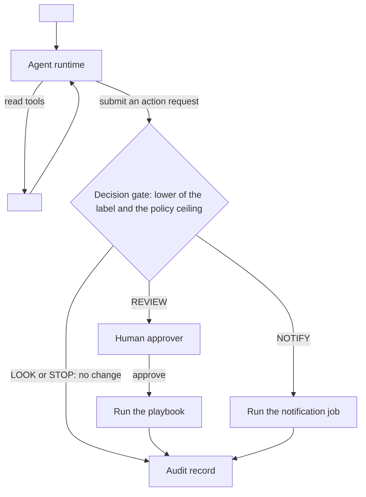

<!-- One template serves flagships and catalog entries.
     Catalog entries (flagship: false) must fill At a glance, Governance, Sources, and Limitations.
     The other sections may contain only a line that starts with _Stub: <reason>_.
     Writing rules: framework/style-guide.md. Name each component by its role and the Red Hat product used. Write no product support status.
     Vale tips: start the text after a bullet label or an H3 colon in lowercase; refer to tables by name, never as "above" or "below". -->

# <Use case title>

## At a glance

<!-- budget: 1 table, 7 rows ; purpose: the whole use case before any prose -->

| Field | Value |
|---|---|
| One-liner | Recommends fixes with human approval. Needs a tool-calling LLM slot. |
| Problem | <One line: the operator pain and the KPI it moves> |
| Audience | <Who reads and runs this, for example NOC engineers> |
| OTel slots | <slot: role, for example `llm: tool-calling`; `safety: abstain`> |
| Autonomy ceiling | <inform, notify, recommend with approval, or act within policy> |
| Placement tier | <far-edge, regional, or core> |
| Agent-school courses | <Course numbers with links> |

## Problem and value

<!-- budget: 5 lines ; purpose: what the operator gets and the measurable outcome; label any ROI figure as a target -->

<!-- One paragraph of at most 3 sentences: the paragraph rule binds before the line budget. -->

<Who has the problem, what it costs today, and the KPI this use case moves.>

## How it works

<!-- budget: 1 diagram, 8 steps ; purpose: diagram plus numbered flow, and where the decision gate sits -->

<!-- One Mermaid flowchart. Name capabilities only: no product names and no layer codes.
     A NOTIFY edge ends at a notification job, never at a no-change branch. Drop the gate nodes on an inform page. -->



1. <Trigger: what starts the flow>
2. <Model step: which OTel slot does what>
3. <Gate step: the decision gate returns LOOK, NOTIFY, REVIEW, ACT, or STOP>

<!-- State which step holds the decision gate and what happens on STOP.
     Any H3 list counts toward the 8-step budget: put multi-condition rules in a table under an H3, not a list. -->

### Slots and checkpoints

<!-- One row per slot in otel_slots. Name released checkpoints, each pinned by revision. -->

| Slot | Checkpoint | Role | Placement |
|---|---|---|---|
| `<slot>` | <Released checkpoint, pinned by revision> | <What the slot does in this flow> | <far-edge, regional, or core> |

### Worked example: <lowercase start, such as a link flap on one router>

<!-- Prose, not a list. Use your own incident, request, decision, and agent ids, never the platform or other recipe ids.
     If the example mentions NOTIFY, link the decision gate in this H3; the gate-link check runs per section. -->

<One short scenario that walks one request through the gate.>

## What you need

<!-- budget: 12 bullets ; purpose: checklist of models, platform blueprints, integrations, tools and data, adaptation, prerequisites -->

<!-- Start the text after each label in lowercase. The components table and the flags fence don't count as bullets. -->

- [ ] Models: <the slots in the slots table, each pinned by revision with its licence chain recorded>
- [ ] Platform blueprints: <the pages for PB-nn, with links>
- [ ] Components: one product for each role in the components table
- [ ] Integrations: <MCP capabilities with risk class; standards such as TMF, CAMARA, 3GPP>
- [ ] Tools and data: <data sources, consent and privacy notes>
- [ ] Data and adaptation: <task data, SDG recipe, adapter strategy, license and sovereignty>
- [ ] Prerequisites: <cluster, accelerators, access>
- [ ] Decision engine: <copy the Decision slot engine prerequisite from PB-04 word for word; keep this bullet only when `otel_slots` includes `decision`>

| Component role | Red Hat product used |
|---|---|
| <Role in this design> | <Red Hat product used> |

<!-- Copy the PB-04 "Key flags per slot" blocks line for line, only for this page's slots, and add no flag PB-04 or PB-03 lacks.
     For a slot PB-04 has no block for, such as Safety, say how to start it (its own pinned revision, no tool-calling flags). -->

Key flags for each slot, copied from [PB-04](../../../platform/serving-routing-placement/README.md#key-flags-per-slot).

```text
# <PB-04 block header for the slot>
<flag lines copied from PB-04>
```

Any component can be replaced. The Red Hat products named here show one way to build this design.

## Governance

<!-- budget: 3 tables ; purpose: gate outcome per action, named parameters, RACI -->

<!-- Keep the gate link sentence on every page, inform pages included. -->

Each action request passes the [decision gate](../../../architecture/decision-gate.md), and the outcome never exceeds the policy ceiling for its class.

<!-- One row per action and risk class. An inform page uses rows such as "LOOK, with no action request".
     The AI Act class cell links the classification record your legal team keeps; never state the class. -->

| Action | Gate outcome (LOOK/NOTIFY/REVIEW/ACT/STOP) | Approval | AI Act class |
|---|---|---|---|
| <Action the agent can take, with its risk class> | <REVIEW> | <Role that approves> | <Link to the classification record> |

<!-- Copy each parameter row from the platform page that defines it: same name, same owner. Never write a value. -->

| Parameter | What it controls | Who sets it | How to calibrate |
|---|---|---|---|

This page gives no default values. Each owner sets the value with SME review and versions it with the policy that `policy_version` names.

<!-- Copy RACI rows from the platform pages for the activities this use case runs. Use generic roles, never job titles. -->

| Activity | Responsible | Accountable | Consulted | Informed |
|---|---|---|---|---|

## Sources

<!-- budget: 1 table ; purpose: the canonical Sources table, one row per key claim -->

<!-- One row per key claim. Basis is model card, research, Red Hat guidance, industry use case, or project documentation. Source links the URL or repo file; never this page. -->

Each key claim links its source, as set out in [the Sources table](../../../framework/definitions.md#sources-table).

| # | Claim | Basis | Source |
|---|---|---|---|
| 1 | <Claim the model card reports, for example tool-calling support> | model card | [OTel-2.0-LLM-31B-IT model card](https://huggingface.co/farbodtavakkoli/OTel-2.0-LLM-31B-IT) |
| 2 | <Claim Red Hat documentation recommends> | Red Hat guidance | [<Red Hat doc or article title>](https://docs.redhat.com/<path>) |

## Deploy and verify

<!-- budget: 5 lines, 5 bullets ; purpose: numbered deploy steps, a verification table tied to gates, then related-work links -->

<!-- Numbered steps in order: pin through intake, deploy with the flags from What you need, load the owners' settings, then run the PB-02 ladder.
     Each verification row names a PB-02 gate or a parameter from Governance and its owner. Report no results. -->

Apply these settings in order. <State the starting ceiling, such as every action class at REVIEW.>

1. <Pin each slot's checkpoint through intake (PB-01) and record its revision>
2. <Deploy the slots with the flags from What you need>
3. <Have each owner load the parameters from Governance>
4. <Run the PB-02 ladder and record the pass or fail on each registry version>

| Check | PB-02 gate or parameter | Owner |
|---|---|---|
| <What the check confirms> | <PB-02 gate or Governance parameter> | <Owner from the parameter table> |

- Agent-school: <courses and what each adds>, in the [agent-school roadmap](https://github.com/open-experiments/agent-school/blob/main/docs/RoadMap.md)
- NVIDIA or Databricks equivalent: <link>
- LFN project: <link>

## Limitations

<!-- budget: 6 bullets ; purpose: what it does not do and what it does not cover -->

<!-- Say what the design does not cover in plain words. Avoid legal conclusions such as calling a variant "out of scope" with is or are; the legal-conclusion check flags them. -->

- <What this use case never does on its own>
- <What this design does not cover>
- <Known gap or open question>
